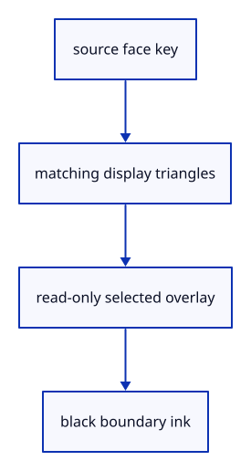

# 6.3.12 · Highlight one original face without recolouring its parent

**Chapter 6 · Picking and selection · Section 6.3 · Faces, edges and original controls** · [Contents](contents.md)

**Typing: 24–47 minutes.** [Estimate](typing-load.md).

Build a derived overlay from only the triangles belonging to the selected original polygon. Keep source topology and primary geometry shared.

## Type

Continue from [Build highlights from original ink targets](44ia-original-ink.md). [Save or recover your work](recovery.md).

### 1. `src/highlight.rs`

Build a local original-face overlay.

<details>
<summary>Locate the existing block</summary>

```rust
        self.mesh = None; let mut strokes = Vec::new(); let mut paths = Vec::new(); let mut markers = Vec::new();
        let yellow = [1., 0.75, 0.05, 1.];
        if let Some(target) = target.filter(|t| t.valid(scene)) { match target.part {
            Part::MeshEdge(a, b) => {
                let row = scene.objects().iter().find(|r| r.id == target.owner).unwrap();
                let index = row.mesh.parts.edges.iter().position(|&edge| edge == (a, b)).unwrap();
```

</details>

Edit the existing block to match this code; keep unchanged lines:

```rust
--8<-- "journey/code/44j-face-highlight-01.rs"
```

### 2. `src/renderer.rs`

Draw read-only highlights before original black ink.

Edit these blocks from bottom to top. Keep the surrounding lines unchanged.

<details>
<summary>Locate this block</summary>

```rust
            for mesh in &self.meshes {
                mesh.draw(&mut pass);
            }
            self.mesh_ink.draw(&mut pass);
            self.grid.draw(&mut pass);
            self.strokes.draw(&mut pass);
```

</details>

Replace it with:

```rust
            for mesh in &self.meshes {
                mesh.draw(&mut pass);
            }
            pass.set_pipeline(&self.highlight_pipeline); pass.set_bind_group(0, &self.view_group, &[]);
            self.highlight.mesh(&mut pass);
            self.highlight.ink(&mut pass);
            self.mesh_ink.draw(&mut pass);
            self.grid.draw(&mut pass);
            self.strokes.draw(&mut pass);
```

<details>
<summary>Locate this block</summary>

```rust
        self.markers.view(&self.queue, transform, self.size, self.density);
        self.grid.view(&self.queue, transform, self.size, self.density);
        self.mesh_ink.view(&self.queue, transform, self.size, self.density);
        let [r, g, b] = background.rgb();
        let mut encoder = self.device.create_command_encoder(&Default::default());
        {
```

</details>

Replace it with:

```rust
        self.markers.view(&self.queue, transform, self.size, self.density);
        self.grid.view(&self.queue, transform, self.size, self.density);
        self.mesh_ink.view(&self.queue, transform, self.size, self.density);
        self.highlight.view(&self.queue, transform, self.size, self.density);
        let [r, g, b] = background.rgb();
        let mut encoder = self.device.create_command_encoder(&Default::default());
        {
```

<details>
<summary>Locate this block</summary>

```rust
        let [count, bytes] = self.grid.usage(); [count, bytes, self.grid.uploads, self.grid.uploaded_bytes]
    }

    pub fn stats(&self) -> [usize; 4] {
        [self.geometry.uploads, self.settings_allocations, self.settings_writes, self.settings_bytes]
    }
```

</details>

Replace it with:

```rust
        let [count, bytes] = self.grid.usage(); [count, bytes, self.grid.uploads, self.grid.uploaded_bytes]
    }

    pub fn set_highlight(&mut self, scene: &Scene, target: Option<crate::pick_sources::Target>) -> Result<(), &'static str> {
        self.highlight.set(&self.device, &self.pipeline.get_bind_group_layout(1), scene, target)
    }

    pub fn highlight_bytes(&self) -> u64 { self.highlight.bytes() }

    pub fn stats(&self) -> [usize; 4] {
        [self.geometry.uploads, self.settings_allocations, self.settings_writes, self.settings_bytes]
    }
```

<details>
<summary>Locate this block</summary>

```rust

    pub fn set_scene(&mut self, scene: &Scene, selected: Option<ObjectId>) {
        self.picker.cancel(); self.faces.clear();
        self.sources = crate::pick_sources::Sources::new(scene).expect("Prepared source topology is bounded");
        self.mesh_ink.set(&self.device, self.sources.mesh_ink.iter().copied()).expect("Prepared source edges");
        self.mesh_ink.set_ids(&self.device, self.sources.mesh_ids.iter().copied()).expect("Source edge IDs match");
```

</details>

Replace it with:

```rust

    pub fn set_scene(&mut self, scene: &Scene, selected: Option<ObjectId>) {
        self.picker.cancel(); self.faces.clear();
        self.highlight.set(&self.device, &self.pipeline.get_bind_group_layout(1), scene, None).expect("Empty selection");
        self.sources = crate::pick_sources::Sources::new(scene).expect("Prepared source topology is bounded");
        self.mesh_ink.set(&self.device, self.sources.mesh_ink.iter().copied()).expect("Prepared source edges");
        self.mesh_ink.set_ids(&self.device, self.sources.mesh_ids.iter().copied()).expect("Source edge IDs match");
```

<details>
<summary>Locate this block</summary>

```rust
        let picker = crate::pick_gpu::Picker::new(&device, &view_layout, &model_layout);
        let faces = crate::face_pick::Faces::new(&device);
        let mesh_ink = crate::stroke_gpu::Lane::new(&device, format);
        let mut renderer = Self { device, queue, pipeline, meshes: Vec::new(),
            geometry: Default::default(), settings_allocations: 0, settings_writes: 0,
            settings_bytes: 0, uniform, view_group, depth, strokes, paths, markers, grid, grid_settings: None, size: [640, 480], density: 1.0, picker, faces, mesh_ink, sources: Default::default(), pick_mode: Default::default() };
        renderer.set_scene(scene, None);
```

</details>

Replace it with:

```rust
        let picker = crate::pick_gpu::Picker::new(&device, &view_layout, &model_layout);
        let faces = crate::face_pick::Faces::new(&device);
        let mesh_ink = crate::stroke_gpu::Lane::new(&device, format);
        let mut renderer = Self { device, queue, pipeline, highlight_pipeline, highlight, meshes: Vec::new(),
            geometry: Default::default(), settings_allocations: 0, settings_writes: 0,
            settings_bytes: 0, uniform, view_group, depth, strokes, paths, markers, grid, grid_settings: None, size: [640, 480], density: 1.0, picker, faces, mesh_ink, sources: Default::default(), pick_mode: Default::default() };
        renderer.set_scene(scene, None);
```

<details>
<summary>Locate this block</summary>

```rust
                targets: &[Some(format.into())],
            }),
            primitive: Default::default(),
            depth_stencil: Some(crate::depth::surface()),
            multisample: Default::default(),
            multiview_mask: None,
            cache: None,
        });
        let uniform = device.create_buffer(&wgpu::BufferDescriptor {
            label: Some("view transform and normal diagnostic"),
            size: 80,
```

</details>

Replace it with:

```rust
                targets: &[Some(format.into())],
            }),
            primitive: Default::default(),
            depth_stencil: Some(depth),
            multisample: Default::default(),
            multiview_mask: None,
            cache: None,
        });
        let pipeline = mesh_pipeline(crate::depth::surface());
        let highlight_pipeline = mesh_pipeline(crate::depth::ink());
        let highlight = crate::highlight::Highlight::new(&device, format);
        let uniform = device.create_buffer(&wgpu::BufferDescriptor {
            label: Some("view transform and normal diagnostic"),
            size: 80,
```

<details>
<summary>Locate this block</summary>

```rust
        let model_layout = crate::gpu_layout::uniform(&device, 144);
        let layout = device.create_pipeline_layout(&wgpu::PipelineLayoutDescriptor {
            label: Some("mesh settings"), bind_group_layouts: &[Some(&view_layout), Some(&model_layout)], immediate_size: 0 });
        let pipeline = device.create_render_pipeline(&wgpu::RenderPipelineDescriptor {
            label: Some("triangle"),
            layout: Some(&layout),
            vertex: wgpu::VertexState {
```

</details>

Replace it with:

```rust
        let model_layout = crate::gpu_layout::uniform(&device, 144);
        let layout = device.create_pipeline_layout(&wgpu::PipelineLayoutDescriptor {
            label: Some("mesh settings"), bind_group_layouts: &[Some(&view_layout), Some(&model_layout)], immediate_size: 0 });
        let mesh_pipeline = |depth| device.create_render_pipeline(&wgpu::RenderPipelineDescriptor {
            label: Some("triangle"),
            layout: Some(&layout),
            vertex: wgpu::VertexState {
```

<details>
<summary>Locate this block</summary>

```rust
    pub device: wgpu::Device,
    pub queue: wgpu::Queue,
    pipeline: wgpu::RenderPipeline,
    meshes: Vec<GpuMesh>,
    geometry: crate::geometry_cache::GeometryCache,
    settings_allocations: usize,
```

</details>

Replace it with:

```rust
    pub device: wgpu::Device,
    pub queue: wgpu::Queue,
    pipeline: wgpu::RenderPipeline,
    highlight_pipeline: wgpu::RenderPipeline,
    highlight: crate::highlight::Highlight,
    meshes: Vec<GpuMesh>,
    geometry: crate::geometry_cache::GeometryCache,
    settings_allocations: usize,
```

<details>
<summary>Complete updated block reference</summary>

```rust
use crate::{gpu_mesh::GpuMesh, scene::{ObjectId, Scene}};

pub struct Renderer {
    pub device: wgpu::Device,
    pub queue: wgpu::Queue,
    pipeline: wgpu::RenderPipeline,
    highlight_pipeline: wgpu::RenderPipeline,
    highlight: crate::highlight::Highlight,
    meshes: Vec<GpuMesh>,
    geometry: crate::geometry_cache::GeometryCache,
    settings_allocations: usize,
    settings_writes: usize,
    settings_bytes: usize,
    uniform: wgpu::Buffer,
    view_group: wgpu::BindGroup,
    depth: wgpu::TextureView,
    strokes: crate::stroke_gpu::Lane,
    paths: crate::stroke_gpu::Lane,
    markers: crate::stroke_gpu::Lane,
    grid: crate::stroke_gpu::Lane,
    grid_settings: Option<crate::grid::Settings>,
    size: [u32; 2],
    density: f32,
    picker: crate::pick_gpu::Picker,
    sources: crate::pick_sources::Sources,
    faces: crate::face_pick::Faces,
    mesh_ink: crate::stroke_gpu::Lane,
    pick_mode: crate::pick_sources::Mode,
}

impl Renderer {
    pub fn new(
        device: wgpu::Device,
        queue: wgpu::Queue,
        format: wgpu::TextureFormat,
        scene: &Scene,
    ) -> Self {
        let shader = device.create_shader_module(wgpu::ShaderModuleDescriptor {
            label: Some("triangle"),
            source: wgpu::ShaderSource::Wgsl(include_str!("triangle.wgsl").into()),
        });
        let view_layout = crate::gpu_layout::uniform(&device, 80);
        let model_layout = crate::gpu_layout::uniform(&device, 144);
        let layout = device.create_pipeline_layout(&wgpu::PipelineLayoutDescriptor {
            label: Some("mesh settings"), bind_group_layouts: &[Some(&view_layout), Some(&model_layout)], immediate_size: 0 });
        let mesh_pipeline = |depth| device.create_render_pipeline(&wgpu::RenderPipelineDescriptor {
            label: Some("triangle"),
            layout: Some(&layout),
            vertex: wgpu::VertexState {
                module: &shader,
                entry_point: Some("vertex"),
                compilation_options: Default::default(),
                buffers: &[wgpu::VertexBufferLayout {
                    array_stride: 24,
                    step_mode: wgpu::VertexStepMode::Vertex,
                    attributes: &wgpu::vertex_attr_array![0 => Float32x3, 1 => Float32x3],
                }, wgpu::VertexBufferLayout {
                    array_stride: 12, step_mode: wgpu::VertexStepMode::Vertex,
                    attributes: &wgpu::vertex_attr_array![2 => Float32x3],
                }],
            },
            fragment: Some(wgpu::FragmentState {
                module: &shader,
                entry_point: Some("fragment"),
                compilation_options: Default::default(),
                targets: &[Some(format.into())],
            }),
            primitive: Default::default(),
            depth_stencil: Some(depth),
            multisample: Default::default(),
            multiview_mask: None,
            cache: None,
        });
        let pipeline = mesh_pipeline(crate::depth::surface());
        let highlight_pipeline = mesh_pipeline(crate::depth::ink());
        let highlight = crate::highlight::Highlight::new(&device, format);
        let uniform = device.create_buffer(&wgpu::BufferDescriptor {
            label: Some("view transform and normal diagnostic"),
            size: 80,
            usage: wgpu::BufferUsages::UNIFORM | wgpu::BufferUsages::COPY_DST,
            mapped_at_creation: false,
        });
        let view_group = device.create_bind_group(&wgpu::BindGroupDescriptor {
            label: Some("view settings"),
            layout: &pipeline.get_bind_group_layout(0),
            entries: &[wgpu::BindGroupEntry {
                binding: 0,
                resource: uniform.as_entire_binding(),
            }],
        });
        let depth = Self::depth(&device, 640, 480);
        let strokes = crate::stroke_gpu::Lane::new(&device, format);
        let paths = crate::stroke_gpu::Lane::joined(&device, format);
        let markers = crate::stroke_gpu::Lane::markers(&device, format);
        let grid = crate::stroke_gpu::Lane::grid(&device, format);
        let picker = crate::pick_gpu::Picker::new(&device, &view_layout, &model_layout);
        let faces = crate::face_pick::Faces::new(&device);
        let mesh_ink = crate::stroke_gpu::Lane::new(&device, format);
        let mut renderer = Self { device, queue, pipeline, highlight_pipeline, highlight, meshes: Vec::new(),
            geometry: Default::default(), settings_allocations: 0, settings_writes: 0,
            settings_bytes: 0, uniform, view_group, depth, strokes, paths, markers, grid, grid_settings: None, size: [640, 480], density: 1.0, picker, faces, mesh_ink, sources: Default::default(), pick_mode: Default::default() };
        renderer.set_scene(scene, None);
        renderer
    }

    fn depth(device: &wgpu::Device, width: u32, height: u32) -> wgpu::TextureView {
        let depth_texture = device.create_texture(&wgpu::TextureDescriptor {
            label: Some("opaque depth"),
            size: wgpu::Extent3d { width, height, depth_or_array_layers: 1 },
            mip_level_count: 1,
            sample_count: 1,
            dimension: wgpu::TextureDimension::D2,
            format: crate::depth::FORMAT,
            usage: wgpu::TextureUsages::RENDER_ATTACHMENT,
            view_formats: &[],
        });
        depth_texture.create_view(&Default::default())
    }

    pub fn resize(&mut self, size: crate::viewport::Viewport) {
        if self.size != [size.width, size.height] { self.picker.cancel(); }
        self.size = [size.width, size.height];
        self.depth = Self::depth(&self.device, size.width, size.height);
    }

    pub fn set_density(&mut self, density: f32) {
        if density.is_finite() && density > 0.0 && density != self.density { self.picker.cancel(); self.density = density; }
    }

    pub fn stroke_usage(&self) -> [u64; 4] {
        let [count, bytes] = self.strokes.usage();
        [count, bytes, self.strokes.uploads, self.strokes.uploaded_bytes]
    }

    pub fn path_usage(&self) -> [u64; 4] {
        let [count, bytes] = self.paths.usage();
        [count, bytes, self.paths.uploads, self.paths.uploaded_bytes]
    }

    pub fn point_usage(&self) -> [u64; 4] {
        let [count, bytes] = self.markers.usage();
        [count, bytes, self.markers.uploads, self.markers.uploaded_bytes]
    }

    pub fn set_scene(&mut self, scene: &Scene, selected: Option<ObjectId>) {
        self.picker.cancel(); self.faces.clear();
        self.highlight.set(&self.device, &self.pipeline.get_bind_group_layout(1), scene, None).expect("Empty selection");
        self.sources = crate::pick_sources::Sources::new(scene).expect("Prepared source topology is bounded");
        self.mesh_ink.set(&self.device, self.sources.mesh_ink.iter().copied()).expect("Prepared source edges");
        self.mesh_ink.set_ids(&self.device, self.sources.mesh_ids.iter().copied()).expect("Source edge IDs match");
        self.markers.set_points(&self.device, scene.points().iter().filter(|row| row.visible()).map(crate::scene::PointObject::marker).chain(scene.control_markers().into_iter().map(|c| c.display)))
            .expect("Prepared point placement fits the display range");
        self.paths.set_chains(&self.device, scene.paths().iter().filter(|row| row.visible()).flat_map(crate::scene::PathObject::segments))
            .expect("Prepared path placement fits the display range");
        self.strokes.set(&self.device, scene.lines().iter().filter(|row| row.visible()).map(crate::scene::LineObject::stroke))
            .expect("Prepared line placement fits the display range");
        self.markers.set_ids(&self.device, self.sources.marker_ids.iter().copied()).expect("Marker owners match");
        self.paths.set_ids(&self.device, self.sources.path_ids.iter().copied()).expect("Path owners match");
        self.strokes.set_ids(&self.device, self.sources.line_ids.iter().copied()).expect("Line owners match");
        let layout = self.pipeline.get_bind_group_layout(1);
        let mut old = std::mem::take(&mut self.meshes);
        for object in scene.objects().iter().filter(|row| row.visible()) {
            let matching = old.iter().position(|row| row.id == object.id
                && std::rc::Rc::ptr_eq(&row.geometry.source, &object.mesh));
            let row = if let Some(index) = matching {
                let mut row = old.swap_remove(index);
                let [calls, bytes] = row.update(&self.queue, object, selected == Some(object.id));
                self.settings_writes += calls;
                self.settings_bytes += bytes;
                row
            } else {
                let geometry = self.geometry.get(&self.device, &object.mesh);
                self.settings_allocations += 1;
                GpuMesh::with_geometry(&self.device, &layout, object,
                    selected == Some(object.id), geometry)
            };
            self.meshes.push(row);
        }
        drop(old);
        self.geometry.prune();
    }

    pub fn request_pick(&mut self, screen: [f32; 2], transform: [f32; 16]) -> Result<(), &'static str> {
        let window = crate::pick_window::Window::new(screen, self.size, self.density).ok_or("Invalid pick cursor")?;
        self.picker.queue(crate::pick_gpu::Request { window, transform, density: self.density, mode: self.pick_mode })?;
        self.pump_pick(transform); Ok(())
    }

    fn pump_pick(&mut self, transform: [f32; 16]) {
        let Ok(view) = crate::pick_view::View::new(transform, self.size, self.density) else { self.picker.cancel(); return; };
        if self.pick_mode == crate::pick_sources::Mode::Face && !self.faces.ready(self.meshes.len()) {
            self.faces.set(&self.device, &self.meshes, &self.sources.mesh_bases);
        }
        if let Some(request) = self.picker.next(view) { self.picker.submit(&self.device, &self.queue, request,
            &self.meshes, &[&self.mesh_ink, &self.strokes, &self.paths, &self.markers], &self.faces); }
    }

    pub fn take_pick(&mut self, transform: [f32; 16]) -> Option<Result<Option<[u32; 2]>, &'static str>> {
        let view = match crate::pick_view::View::new(transform, self.size, self.density) { Ok(view) => view, Err(error) => {
            self.picker.cancel(); return Some(Err(error));
        } };
        match self.picker.take(view) {
            Some(Ok(crate::pick_gpu::Reply::Hit(hit))) => Some(Ok(hit)),
            Some(Ok(crate::pick_gpu::Reply::Stale)) => { self.pump_pick(transform); None },
            Some(Err(error)) => Some(Err(error)), None => None,
        }
    }

    pub fn set_pick_mode(&mut self, mode: crate::pick_sources::Mode) {
        if self.pick_mode != mode { self.picker.cancel(); self.pick_mode = mode; }
    }

    pub fn resolve_pick(&self, scene: &Scene, pixel: [u32; 2]) -> Option<crate::pick_sources::Target> {
        self.sources.resolve(scene, pixel, self.pick_mode)
    }

    pub fn part_usage(&self) -> [u64; 4] { let [count, bytes] = self.mesh_ink.usage(); [count, bytes, self.faces.bytes(), self.sources.bytes() as u64] }

    pub fn cancel_pick(&mut self) { self.picker.cancel(); }

    pub fn pick_usage(&self) -> [u64; 5] {
        let [active, pending, bytes] = self.picker.usage();
        [active, pending, bytes + self.strokes.pick_bytes() + self.paths.pick_bytes() + self.markers.pick_bytes() + self.mesh_ink.pick_bytes() + self.mesh_ink.usage()[1] + self.faces.bytes(),
            self.picker.submitted, self.picker.coalesced]
    }

    pub fn geometry_owners(&self) -> impl Iterator<Item = &std::rc::Rc<crate::gpu_geometry::GpuGeometry>> {
        self.meshes.iter().map(|row| &row.geometry)
    }

    pub fn usage(&self) -> [u64; 4] { crate::memory::gpu(&self.meshes) }

    pub fn uploaded_bytes(&self) -> u64 {
        self.geometry.uploaded_bytes + self.settings_allocations as u64 * 144 + self.settings_bytes as u64
            + self.strokes.uploaded_bytes + self.paths.uploaded_bytes + self.markers.uploaded_bytes + self.grid.uploaded_bytes
    }

    pub fn set_grid(&mut self, settings: Option<crate::grid::Settings>) -> Result<(), &'static str> {
        if settings == self.grid_settings { return Ok(()); }
        let strokes = settings.map(crate::grid::Settings::strokes).transpose()?.unwrap_or_default();
        self.grid.set(&self.device, strokes)?; self.grid_settings = settings; Ok(())
    }

    pub fn grid_usage(&self) -> [u64; 4] {
        let [count, bytes] = self.grid.usage(); [count, bytes, self.grid.uploads, self.grid.uploaded_bytes]
    }

    pub fn set_highlight(&mut self, scene: &Scene, target: Option<crate::pick_sources::Target>) -> Result<(), &'static str> {
        self.highlight.set(&self.device, &self.pipeline.get_bind_group_layout(1), scene, target)
    }

    pub fn highlight_bytes(&self) -> u64 { self.highlight.bytes() }

    pub fn stats(&self) -> [usize; 4] {
        [self.geometry.uploads, self.settings_allocations, self.settings_writes, self.settings_bytes]
    }

    pub fn draw(
        &self,
        view: &wgpu::TextureView,
        background: &crate::background::Background,
        transform: &[f32; 16],
    ) { self.draw_mode(view, background, transform, false); }

    pub fn draw_mode(&self, view: &wgpu::TextureView, background: &crate::background::Background,
        transform: &[f32; 16], normals: bool,
    ) {
        let mut bytes: Vec<u8> = transform.iter().flat_map(|value| value.to_ne_bytes()).collect();
        let display = [if normals { 1.0f32 } else { 0.0 }, 0.0, 0.0, 0.0];
        bytes.extend(display.iter().flat_map(|value| value.to_ne_bytes()));
        self.queue.write_buffer(&self.uniform, 0, &bytes);
        self.strokes.view(&self.queue, transform, self.size, self.density);
        self.paths.view(&self.queue, transform, self.size, self.density);
        self.markers.view(&self.queue, transform, self.size, self.density);
        self.grid.view(&self.queue, transform, self.size, self.density);
        self.mesh_ink.view(&self.queue, transform, self.size, self.density);
        self.highlight.view(&self.queue, transform, self.size, self.density);
        let [r, g, b] = background.rgb();
        let mut encoder = self.device.create_command_encoder(&Default::default());
        {
            // The pass borrows the encoder. This scope ends that borrow before finish takes it.
            let mut pass = encoder.begin_render_pass(&wgpu::RenderPassDescriptor {
                label: Some("canvas"),
                depth_stencil_attachment: Some(wgpu::RenderPassDepthStencilAttachment {
                    view: &self.depth,
                    depth_ops: Some(wgpu::Operations {
                        load: wgpu::LoadOp::Clear(1.0),
                        store: wgpu::StoreOp::Store,
                    }),
                    stencil_ops: None,
                }),
                color_attachments: &[Some(wgpu::RenderPassColorAttachment {
                    view,
                    depth_slice: None,
                    resolve_target: None,
                    ops: wgpu::Operations {
                        load: wgpu::LoadOp::Clear(wgpu::Color {
                            r, g, b, a: 1.0,
                        }),
                        store: wgpu::StoreOp::Store,
                    },
                })],
                ..Default::default()
            });
            pass.set_pipeline(&self.pipeline);
            pass.set_bind_group(0, &self.view_group, &[]);
            for mesh in &self.meshes {
                mesh.draw(&mut pass);
            }
            pass.set_pipeline(&self.highlight_pipeline); pass.set_bind_group(0, &self.view_group, &[]);
            self.highlight.mesh(&mut pass);
            self.highlight.ink(&mut pass);
            self.mesh_ink.draw(&mut pass);
            self.grid.draw(&mut pass);
            self.strokes.draw(&mut pass);
            self.paths.draw(&mut pass);
            self.markers.draw(&mut pass);
        }
        self.queue.submit([encoder.finish()]);
    }
}
```

</details>

<details>
<summary>Optional patch references</summary>

Use these original edit fragments when comparing a saved checkpoint. Apply the complete blocks above.

```text
--8<-- "journey/code/44j-face-highlight-02.rs"
```

```text
--8<-- "journey/code/44j-face-highlight-03.rs"
```

```text
--8<-- "journey/code/44j-face-highlight-04.rs"
```

```text
--8<-- "journey/code/44j-face-highlight-05.rs"
```

```text
--8<-- "journey/code/44j-face-highlight-06.rs"
```

```text
--8<-- "journey/code/44j-face-highlight-07.rs"
```

```text
--8<-- "journey/code/44j-face-highlight-08.rs"
```

```text
--8<-- "journey/code/44j-face-highlight-09.rs"
```

</details>

<details>
<summary>Supplied validation fixture</summary>

Copy this supplied authoring fixture once. Continue with the browser build below; the course does not require running native tests.

### 3. `src/pick_gpu_tests.rs`

Copy actual face, edge and control highlight pixels and release checks.

<details>
<summary>Locate the existing block</summary>

```text
    renderer.set_pick_mode(crate::pick_sources::Mode::Control); renderer.request_pick([0., 0.6], identity()).unwrap(); assert!(finish(&mut renderer).is_none());
}
```

</details>

After that block, append this supplied code:

```text
--8<-- "journey/code/44j-face-highlight-10.rs" skip=164
```

</details>

### 4. `src/highlight.rs`

Remove the preparation-only face refusal now that original-face overlays are implemented.

<details>
<summary>Locate the existing block</summary>

```rust
            Part::Face(_) => return Err("Face overlays are added in the next checkpoint"),
            Part::Object => {}
```

</details>

Edit the existing block to match this code; keep unchanged lines:

```rust
            Part::Object => {}
```

<details>
<summary>Optional patch references</summary>

Use these original edit fragments when comparing a saved checkpoint. Apply the complete blocks above.

</details>

## Run and check

In your project:

```sh
cd workspace/journey
REGEN_PROTO=0 cargo build --lib --locked --target wasm32-unknown-unknown -j1
REGEN_PROTO=0 CARGO_BUILD_JOBS=1 trunk serve --port 8780
```

Open `http://127.0.0.1:8780/`. Keep an existing Trunk server running; saving rebuilds it.

The original-face overlay is prepared. The supplied pixel fixture records its local highlight, black edge centres and control halos; browser pick-mode delivery connects in the following lessons.

### Recorded visual result

**Previous native render — current verification pending.**

The inherited placed boxes, source ink and ground grid remain visible. The image proves drawing; copied tests prove the new metadata.


*This recorded image predates a source or checker change. Rebuild this checkpoint before using it as current evidence; browser controls require separate acceptance.*

This reference image is shared with [6.3.8 · Draw original boundary edges consistently](44g-edge-ink.md). It does not demonstrate a new feature by itself.

<details>
<summary>Code explanation and diagram</summary>


source face key → matching display triangles → read-only selected overlay → black boundary ink.



Why is the highlight drawn before original ink?

The original edge or marker stays visible at the centre while the wider yellow overlay forms a fringe.

Study estimate, including typing and experiments: 0.5–1 hours.

</details>

<details>
<summary>Optional experiment</summary>

Clear selection and compare the exact pixels with the unselected drawing; Close must release overlays.

</details>

<details>
<summary>Check and save your work</summary>

Restore experimental edits, then run from `session_viewer`:

```sh
npm --prefix ../session_tests run course -- check 6.3.12
npm --prefix ../session_tests run course -- save 6.3.12
```

Source comparison leaves your project untouched. [Save and recovery instructions](recovery.md).

</details>

<details>
<summary>Viewer coverage and verification</summary>

This preparation retains whole-object input. Source part modes and highlights become interactive together at44l. Original source topology is distinct from display triangulation.

The existing point-picking exercise remains available. Part selection is connected at44l; browser acceptance is pending.

[Full validation scope](release.md).

To reproduce the scripted acceptance of the reference checkpoint, run from `session_viewer` with the [course bundle server](release.md#reproduce) running on port 8781:

```sh
npm --prefix ../session_tests run course -- capture 6.3.12
```

This uses the verified reference bundle; it does not check or change your typed project.

</details>
