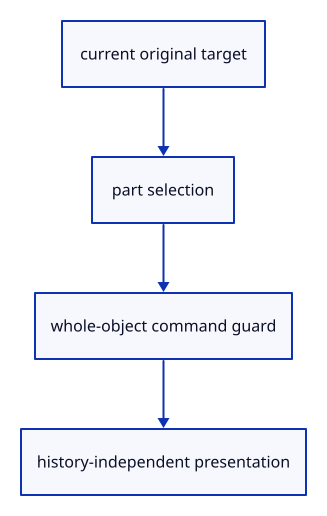

# 6.3.13 · Keep part selection outside document history

**Chapter 6 · Picking and selection · Section 6.3 · Faces, edges and original controls** · [Contents](contents.md)

**Typing: 26–52 minutes.** [Estimate](typing-load.md).

Store the original target separately from whole-object selection. A selected part must not silently become a whole-parent Move or Delete.

## Type

Continue from [Highlight one original face without recolouring its parent](44j-face-highlight.md). [Save or recover your work](recovery.md).

### 1. `src/selection.rs`

Describe the original selected source part.

<details>
<summary>Locate the existing block</summary>

```rust
        }
    }

}
```

</details>

Edit the existing block to match this code; keep unchanged lines:

```rust
--8<-- "journey/code/44k-selection-01.rs"
```

### 2. `src/editor.rs`

Validate part selection and guard commands that require a whole object.

Edit these blocks from bottom to top. Keep the surrounding lines unchanged.

<details>
<summary>Locate this block</summary>

```rust
        }
        // Deletion and history travel can invalidate selection; repair it in one place.
        self.selected = self.selected.filter(|id| self.scene.contains(*id));
        Ok(Change::Scene)
    }
}
```

</details>

Replace it with:

```rust
        }
        // Deletion and history travel can invalidate selection; repair it in one place.
        self.selected = self.selected.filter(|id| self.scene.contains(*id));
        if let (Some(owner), Some(part)) = (self.selected, self.selected_part) {
            if !(crate::pick_sources::Target { owner, part }).valid(&self.scene) { self.selected = None; }
        }
        if self.selected.is_none() { self.selected_part = None; }
        Ok(Change::Scene)
    }
}
```

<details>
<summary>Locate this block</summary>

```rust
                self.history.try_edit(&mut self.scene, |scene| scene.add_box().map(|_| ()))?;
            }
            Action::Translate(offset) => {
                let id = self.selected.ok_or("Select an object before Move")?;
                return self.move_object(id, offset);
            }
            Action::ToggleExtra => self.history.edit(&mut self.scene, Scene::toggle_extra),
            Action::SelectNext => self.selected = self.scene.next(self.selected),
            Action::Delete => {
                return match self.selected {
                    Some(id) => self.delete_object(id),
                    None => Ok(Change::View),
```

</details>

Replace it with:

```rust
                self.history.try_edit(&mut self.scene, |scene| scene.add_box().map(|_| ()))?;
            }
            Action::Translate(offset) => {
                let id = self.whole_selection().ok_or("Select an object before Move")?;
                return self.move_object(id, offset);
            }
            Action::ToggleExtra => self.history.edit(&mut self.scene, Scene::toggle_extra),
            Action::SelectNext => { self.selected_part = None; self.selected = self.scene.next(self.selected); }
            Action::Delete => {
                if self.selected_part.is_some() { return Err("Use Select Object before Delete"); }
                return match self.selected {
                    Some(id) => self.delete_object(id),
                    None => Ok(Change::View),
```

<details>
<summary>Locate this block</summary>

```rust
            return Err("Reload editable sources before Delete");
        }
        self.history.edit(&mut self.scene, |scene| { scene.remove(id); });
        if self.selected == Some(id) { self.selected = None; }
        Ok(Change::Scene)
    }

    pub fn apply(&mut self, action: Action) -> Result<Change, &'static str> {
        match action {
            Action::Picked(id) => self.selected = id.filter(|id| self.scene.pick_id(id.value()).is_some()),
            Action::Pick(screen) => {
                self.selected = self.camera.ray(screen)
                    .and_then(|ray| crate::picking::pick(&self.scene, &ray));
            }
```

</details>

Replace it with:

```rust
            return Err("Reload editable sources before Delete");
        }
        self.history.edit(&mut self.scene, |scene| { scene.remove(id); });
        if self.selected == Some(id) { self.selected = None; self.selected_part = None; }
        Ok(Change::Scene)
    }

    pub fn selection(&self) -> Option<crate::pick_sources::Target> {
        self.selected.map(|owner| crate::pick_sources::Target { owner, part: self.selected_part.unwrap_or(crate::pick_sources::Part::Object) })
    }

    pub fn whole_selection(&self) -> Option<ObjectId> { self.selected.filter(|_| self.selected_part.is_none()) }

    pub fn apply(&mut self, action: Action) -> Result<Change, &'static str> {
        match action {
            Action::Picked(id) => { self.selected = id.filter(|id| self.scene.pick_id(id.value()).is_some()); self.selected_part = None; }
            Action::PickedTarget(target) => {
                let target = target.filter(|target| target.valid(&self.scene));
                self.selected = target.map(|target| target.owner);
                self.selected_part = target.map(|target| target.part).filter(|part| *part != crate::pick_sources::Part::Object);
            }
            Action::PickMode(mode) => { self.pick_mode = mode; self.selected = None; self.selected_part = None; }
            Action::Pick(screen) => {
                self.selected_part = None;
                self.selected = self.camera.ray(screen)
                    .and_then(|ray| crate::picking::pick(&self.scene, &ray));
            }
```

<details>
<summary>Locate this block</summary>

```rust
    fn default() -> Self {
        Self {
            scene: Scene::demo(),
            selected: None,
            camera: Camera::default(),
            background: Background::default(),
            normal_view: false,
```

</details>

Replace it with:

```rust
    fn default() -> Self {
        Self {
            scene: Scene::demo(),
            selected: None, selected_part: None, pick_mode: Default::default(),
            camera: Camera::default(),
            background: Background::default(),
            normal_view: false,
```

<details>
<summary>Locate this block</summary>

```rust
pub struct Editor {
    pub scene: Scene,
    pub selected: Option<ObjectId>,
    pub camera: Camera,
    pub background: Background,
    pub normal_view: bool,
```

</details>

Replace it with:

```rust
pub struct Editor {
    pub scene: Scene,
    pub selected: Option<ObjectId>,
    pub selected_part: Option<crate::pick_sources::Part>,
    pub pick_mode: crate::pick_sources::Mode,
    pub camera: Camera,
    pub background: Background,
    pub normal_view: bool,
```

<details>
<summary>Locate this block</summary>

```rust
pub enum Action {
    Pick([f32; 2]),
    Picked(Option<ObjectId>),
    Import(Vec<u8>),
    Replace(Vec<u8>),
    ImportAt(Vec<u8>, std::rc::Rc<crate::reload_url::ReloadUrl>),
```

</details>

Replace it with:

```rust
pub enum Action {
    Pick([f32; 2]),
    Picked(Option<ObjectId>),
    PickedTarget(Option<crate::pick_sources::Target>),
    PickMode(crate::pick_sources::Mode),
    Import(Vec<u8>),
    Replace(Vec<u8>),
    ImportAt(Vec<u8>, std::rc::Rc<crate::reload_url::ReloadUrl>),
```

<details>
<summary>Complete updated block reference</summary>

```rust
use crate::{background::Background, camera::Camera, history::History, scene::{ObjectId, Scene}};

pub enum Action {
    Pick([f32; 2]),
    Picked(Option<ObjectId>),
    PickedTarget(Option<crate::pick_sources::Target>),
    PickMode(crate::pick_sources::Mode),
    Import(Vec<u8>),
    Replace(Vec<u8>),
    ImportAt(Vec<u8>, std::rc::Rc<crate::reload_url::ReloadUrl>),
    ReplaceAt(Vec<u8>, std::rc::Rc<crate::reload_url::ReloadUrl>),
    Close,
    UnloadSources,
    AddBox,
    AddLine,
    AddPoint,
    AddCurve,
    AddColours(crate::colour::Mode),
    NormalView(bool),
    Grid(Option<crate::grid::Settings>),
    AddNormals(crate::normal_example::Mode),
    Controls(bool),
    AddPolyline,
    AddArrow,
    Translate([f64; 3]),
    ToggleExtra,
    SelectNext,
    Delete,
    Undo,
    Redo,
    Background,
    Zoom(f32),
    Pan(f32, f32),
    Orbit(f64, f64),
    Isometric,
    ResetView,
    Fit,
    FitSelected,
    Projection(crate::camera::Projection),
}

#[derive(Debug, PartialEq, Eq)]
pub enum Change {
    View,
    Scene,
}

pub struct Editor {
    pub scene: Scene,
    pub selected: Option<ObjectId>,
    pub selected_part: Option<crate::pick_sources::Part>,
    pub pick_mode: crate::pick_sources::Mode,
    pub camera: Camera,
    pub background: Background,
    pub normal_view: bool,
    history: History,
    last_release: u64,
}

impl Default for Editor {
    fn default() -> Self {
        Self {
            scene: Scene::demo(),
            selected: None, selected_part: None, pick_mode: Default::default(),
            camera: Camera::default(),
            background: Background::default(),
            normal_view: false,
            history: History::default(),
            last_release: 0,
        }
    }
}

impl Editor {
    pub fn scenes(&self) -> impl Iterator<Item = &Scene> {
        std::iter::once(&self.scene).chain(self.history.scenes())
    }

    pub fn reload_keys(&self) -> Vec<crate::rehydrate::ReloadKey> {
        let mut seen = std::collections::HashSet::new();
        self.scene.objects().iter().filter_map(crate::rehydrate::ReloadKey::of)
            .filter(|key| seen.insert(key.origin.id)).collect()
    }

    fn scenes_mut(&mut self) -> impl Iterator<Item = &mut Scene> {
        std::iter::once(&mut self.scene).chain(self.history.scenes_mut())
    }

    pub fn hydrate(&mut self, values: Vec<(crate::rehydrate::ReloadKey, Vec<u8>)>) -> Result<bool, &'static str> {
        if values.is_empty() { return Ok(false); }
        let mut seen = std::collections::HashSet::new();
        for (key, _) in &values {
            if !seen.insert(key.origin.id) || !self.scene.objects().iter().any(|row| key.matches(row)) {
                return Ok(false);
            }
        }
        let prepared: Vec<_> = values.into_iter().map(|(key, bytes)|
            crate::rehydrate::PreparedReload::new(key, &bytes)).collect::<Result<_, _>>()?;
        for plan in &prepared {
            if self.scenes().flat_map(|scene| scene.objects()).filter(|row| plan.key.matches(row))
                .any(|row| !plan.validates(row)) { return Err("Reloaded source GUID or metadata does not match"); }
        }
        for scene in self.scenes_mut() {
            for plan in &prepared { scene.hydrate(plan); }
        }
        Ok(true)
    }

    fn unload_sources(&mut self) -> Result<(), &'static str> {
        let mut origins: std::collections::HashSet<_> = self.scenes().flat_map(|scene| scene.objects())
            .filter(|row| row.can_unload()).filter_map(|row| row.origin().map(|origin| origin.id)).collect();
        for row in self.scenes().flat_map(|scene| scene.objects()) {
            if let Some(origin) = row.origin() {
                if !row.can_unload() { origins.remove(&origin.id); }
            }
        }
        if origins.is_empty() { return Err("No eligible imported sources to unload"); }
        let epoch = self.last_release.checked_add(1).ok_or("Release epochs exhausted")?;
        for scene in self.scenes_mut() { scene.unload(&origins, epoch); }
        self.last_release = epoch;
        Ok(())
    }

    pub fn move_object(&mut self, id: ObjectId, offset: [f64; 3]) -> Result<Change, &'static str> {
        if !offset.iter().all(|value| value.is_finite()) { return Err("Move needs finite coordinates"); }
        let object = self.scene.objects().iter().find(|row| row.id == id).ok_or("Object not found")?;
        if offset.iter().all(|&value| value == 0.0) { return Ok(Change::View); }
        let shift = session_rust::Xform::translation(offset[0], offset[1], offset[2]);
        let model = &shift * &object.model;
        self.history.try_edit(&mut self.scene, |scene| scene.place(id, model))?;
        Ok(Change::Scene)
    }

    pub fn delete_object(&mut self, id: ObjectId) -> Result<Change, &'static str> {
        if !self.scene.contains(id) { return Err("Object not found"); }
        if self.scene.objects().iter().find(|row| row.id == id).is_some_and(|row| row.geometry().is_none()) {
            return Err("Reload editable sources before Delete");
        }
        self.history.edit(&mut self.scene, |scene| { scene.remove(id); });
        if self.selected == Some(id) { self.selected = None; self.selected_part = None; }
        Ok(Change::Scene)
    }

    pub fn selection(&self) -> Option<crate::pick_sources::Target> {
        self.selected.map(|owner| crate::pick_sources::Target { owner, part: self.selected_part.unwrap_or(crate::pick_sources::Part::Object) })
    }

    pub fn whole_selection(&self) -> Option<ObjectId> { self.selected.filter(|_| self.selected_part.is_none()) }

    pub fn apply(&mut self, action: Action) -> Result<Change, &'static str> {
        match action {
            Action::Picked(id) => { self.selected = id.filter(|id| self.scene.pick_id(id.value()).is_some()); self.selected_part = None; }
            Action::PickedTarget(target) => {
                let target = target.filter(|target| target.valid(&self.scene));
                self.selected = target.map(|target| target.owner);
                self.selected_part = target.map(|target| target.part).filter(|part| *part != crate::pick_sources::Part::Object);
            }
            Action::PickMode(mode) => { self.pick_mode = mode; self.selected = None; self.selected_part = None; }
            Action::Pick(screen) => {
                self.selected_part = None;
                self.selected = self.camera.ray(screen)
                    .and_then(|ray| crate::picking::pick(&self.scene, &ray));
            }
            Action::UnloadSources => self.unload_sources()?,
            Action::Close => {
                self.scene.clear();
                self.history.clear();
                self.selected = None;
            }
            Action::Replace(bytes) => {
                let loaded = crate::document::load(&bytes)?;
                self.history.try_edit(&mut self.scene, |scene| scene.replace(loaded))?;
            }
            Action::Import(bytes) => {
                let loaded = crate::document::load(&bytes)?;
                self.history.try_edit(&mut self.scene, |scene| scene.import(loaded))?;
            }
            Action::ImportAt(bytes, location) => {
                let loaded = crate::document::load_at(&bytes, Some(location))?;
                self.history.try_edit(&mut self.scene, |scene| scene.import(loaded))?;
            }
            Action::ReplaceAt(bytes, location) => {
                let loaded = crate::document::load_at(&bytes, Some(location))?;
                self.history.try_edit(&mut self.scene, |scene| scene.replace(loaded))?;
            }
            Action::AddPolyline | Action::AddArrow => {
                let prepared = if matches!(action, Action::AddPolyline) {
                    let mut line = session_rust::Polyline::new(vec![session_rust::Point::new(-0.6, -0.4, 0.0),
                        session_rust::Point::new(0.0, 0.0, 0.0), session_rust::Point::new(0.6, -0.4, 0.0)]);
                    line.width = 6.0; line.linecolor = session_rust::Color::new(0.0, 0.0, 0.0, 0.5);
                    crate::chain::PreparedChain::polyline(std::rc::Rc::new(line))?
                } else {
                    let mut line = session_rust::Line::new(-0.6, 0.3, 0.0, 0.6, 0.3, 0.0);
                    line.width = 5.0; line.linecolor = session_rust::Color::new(0.0, 0.0, 0.0, 1.0);
                    line.arrowhead = session_rust::Arrowhead::BOTH;
                    crate::chain::PreparedChain::line(std::rc::Rc::new(line))?
                };
                self.history.try_edit(&mut self.scene, |scene| scene.insert_path(prepared).map(|_| ()))?;
            }
            Action::Controls(visible) => self.scene.show_controls(visible),
            Action::AddNormals(mode) => {
                let prepared = crate::prepared::PreparedMesh::new(crate::normal_example::specimen(mode))?;
                self.history.try_edit(&mut self.scene, |scene| scene.insert(prepared).map(|_| ()))?;
            }
            Action::AddColours(mode) => {
                let prepared = crate::prepared::PreparedMesh::new(crate::colour::specimen(mode))?;
                self.history.try_edit(&mut self.scene, |scene| scene.insert(prepared).map(|_| ()))?;
            }
            Action::AddCurve => {
                let mut curve = session_rust::NurbsCurve::create(false, 2, &[session_rust::Point::new(-0.6, -0.4, 0.0),
                    session_rust::Point::new(0.0, 0.6, 0.0), session_rust::Point::new(0.6, -0.4, 0.0)]);
                curve.width = 5.0; curve.linecolors = vec![session_rust::Color::new(0.0, 0.0, 0.0, 0.5)];
                let prepared = crate::chain::PreparedChain::curve(std::rc::Rc::new(curve))?;
                self.history.try_edit(&mut self.scene, |scene| scene.insert_path(prepared).map(|_| ()))?;
            }
            Action::AddPoint => {
                let mut point = session_rust::Point::new(0.0, 0.0, 0.0);
                point.width = 12.0; point.pointcolor = session_rust::Color::new(0.0, 0.0, 0.0, 0.5);
                let prepared = crate::marker::PreparedPoint::new(std::rc::Rc::new(point))?;
                self.history.try_edit(&mut self.scene, |scene| scene.insert_point(prepared).map(|_| ()))?;
            }
            Action::AddLine => {
                let mut line = session_rust::Line::new(-0.6, 0.0, 0.0, 0.6, 0.0, 0.0);
                line.width = 5.0; line.linecolor = session_rust::Color::new(0.0, 0.0, 0.0, 1.0);
                let prepared = crate::stroke::PreparedLine::new(std::rc::Rc::new(line))?;
                self.history.try_edit(&mut self.scene, |scene| scene.insert_line(prepared).map(|_| ()))?;
            }
            Action::AddBox => {
                self.history.try_edit(&mut self.scene, |scene| scene.add_box().map(|_| ()))?;
            }
            Action::Translate(offset) => {
                let id = self.whole_selection().ok_or("Select an object before Move")?;
                return self.move_object(id, offset);
            }
            Action::ToggleExtra => self.history.edit(&mut self.scene, Scene::toggle_extra),
            Action::SelectNext => { self.selected_part = None; self.selected = self.scene.next(self.selected); }
            Action::Delete => {
                if self.selected_part.is_some() { return Err("Use Select Object before Delete"); }
                return match self.selected {
                    Some(id) => self.delete_object(id),
                    None => Ok(Change::View),
                };
            }
            Action::Undo => { self.history.undo(&mut self.scene); }
            Action::Redo => { self.history.redo(&mut self.scene); }
            view => {
                match view {
                    Action::Background => self.background.toggle(),
                    Action::NormalView(visible) => self.normal_view = visible,
                    Action::Grid(settings) => {
                        if let Some(grid) = settings { grid.half()?; grid.reach(self.camera.target)?; }
                        self.camera.grid = settings;
                    }
                    Action::Zoom(factor) => self.camera.zoom(factor),
                    Action::Pan(dx, dy) => self.camera.pan(dx, dy),
                    Action::Orbit(yaw, pitch) => self.camera.orbit(yaw, pitch),
                    Action::Isometric => self.camera.isometric(),
                    Action::Projection(mode) => self.camera.projection = mode,
                    Action::Fit => {
                        if let Some(bounds) = self.scene.bounds() {
                            self.camera.fit(&bounds);
                        }
                    }
                    Action::FitSelected => {
                        if let Some(bounds) = self.selected
                            .and_then(|id| self.scene.selected_bounds(id))
                        {
                            self.camera.fit(&bounds);
                        }
                    }
                    Action::ResetView => {
                        let aspect = self.camera.aspect;
                        self.camera = Camera { aspect, grid: self.camera.grid, ..Camera::default() };
                    }
                    _ => unreachable!("Document actions were handled above"),
                }
                return Ok(Change::View);
            }
        }
        // Deletion and history travel can invalidate selection; repair it in one place.
        self.selected = self.selected.filter(|id| self.scene.contains(*id));
        if let (Some(owner), Some(part)) = (self.selected, self.selected_part) {
            if !(crate::pick_sources::Target { owner, part }).valid(&self.scene) { self.selected = None; }
        }
        if self.selected.is_none() { self.selected_part = None; }
        Ok(Change::Scene)
    }
}

#[cfg(test)]
mod tests {
    use super::*;

    #[test]
    fn a_modified_history_row_protects_only_its_own_import_origin() {
        use std::rc::Rc;
        let mut editor = Editor::default(); let bytes = crate::specimen::bytes();
        let first = Rc::new(crate::reload_url::ReloadUrl::new("test:first".into()));
        editor.apply(Action::ReplaceAt(bytes.clone(), first)).unwrap();
        let origin = editor.scene.objects()[0].origin().unwrap().id;
        let original = Rc::downgrade(editor.scene.objects()[0].geometry().unwrap());
        let second = Rc::new(crate::reload_url::ReloadUrl::new("test:second".into()));
        editor.apply(Action::ImportAt(bytes, second)).unwrap();
        let copy = Rc::downgrade(editor.scene.objects()[3].geometry().unwrap());
        editor.apply(Action::SelectNext).unwrap(); editor.apply(Action::Translate([0.25, 0.0, 0.0])).unwrap();
        editor.apply(Action::Undo).unwrap();
        let saved = editor.history.scenes_mut().last().unwrap();
        assert_eq!(saved.objects()[0].origin().unwrap().id, origin);
        Rc::make_mut(&mut saved.objects_mut()[0].metadata).is_locked = true;
        assert!(editor.scene.objects()[0].can_unload());
        editor.apply(Action::UnloadSources).unwrap();
        assert!(original.upgrade().is_some()); assert!(copy.upgrade().is_none());
        assert!(editor.scene.objects()[0].geometry().is_some());
        assert!(editor.scene.objects()[3].geometry().is_none());
        assert_eq!(editor.last_release, 1);
        assert!(editor.apply(Action::UnloadSources).is_err()); assert_eq!(editor.last_release, 1);
    }

    #[test]
    fn release_epochs_do_not_wrap_or_reset_on_close() {
        use std::rc::Rc;
        let mut editor = Editor::default(); let bytes = crate::specimen::bytes();
        let url = Rc::new(crate::reload_url::ReloadUrl::new("test:epoch".into()));
        editor.apply(Action::ReplaceAt(bytes.clone(), Rc::clone(&url))).unwrap();
        editor.last_release = u64::MAX;
        assert_eq!(editor.apply(Action::UnloadSources), Err("Release epochs exhausted"));
        assert!(editor.scene.objects()[0].geometry().is_some());
        editor.last_release = 0; editor.apply(Action::UnloadSources).unwrap();
        assert_eq!(editor.scene.objects()[0].release_epoch(), Some(1));
        editor.apply(Action::Close).unwrap();
        editor.apply(Action::ImportAt(bytes, url)).unwrap();
        editor.apply(Action::UnloadSources).unwrap();
        assert_eq!(editor.scene.objects()[0].release_epoch(), Some(2));
    }

    #[test]
    fn close_ends_history_and_keeps_issued_ids_and_view_settings() {
        let mut editor = Editor::default();
        editor.apply(Action::Import(crate::specimen::bytes())).unwrap();
        editor.apply(Action::AddBox).unwrap(); editor.apply(Action::Undo).unwrap();
        let old: Vec<_> = editor.scenes().flat_map(|scene| scene.objects().iter().map(|row| row.id)).collect();
        editor.apply(Action::SelectNext).unwrap();
        editor.apply(Action::Pan(0.2, 0.1)).unwrap(); editor.apply(Action::Background).unwrap();
        let view = editor.camera.uniform(); let background = editor.background.rgb();
        editor.apply(Action::Close).unwrap();
        assert!(editor.scene.objects().is_empty() && editor.selected.is_none());
        assert_eq!(editor.scenes().count(), 1);
        editor.apply(Action::Undo).unwrap(); editor.apply(Action::Redo).unwrap();
        assert!(editor.scene.objects().is_empty());
        assert_eq!(editor.camera.uniform(), view); assert_eq!(editor.background.rgb(), background);
        editor.apply(Action::AddBox).unwrap();
        assert!(!old.contains(&editor.scene.objects()[0].id));
    }

    #[test]
    fn repeated_close_is_empty_and_drops_sources_without_gpu_owners() {
        let mut editor = Editor::default();
        let display = std::rc::Rc::downgrade(&editor.scene.objects()[0].mesh);
        let source = std::rc::Rc::downgrade(editor.scene.objects()[0].geometry().unwrap());
        editor.apply(Action::Close).unwrap(); editor.apply(Action::Close).unwrap();
        assert!(display.upgrade().is_none() && source.upgrade().is_none());
        assert_eq!(crate::memory::cpu(editor.scenes(), std::iter::empty()), [0, 0, 0, 0, 0, 1]);
    }

    #[test]
    fn close_releases_imported_history_documents_and_reopening_uses_fresh_ids() {
        use std::rc::Rc;
        let mut editor = Editor::default();
        let bytes = crate::specimen::bytes();
        editor.apply(Action::Import(bytes.clone())).unwrap();
        editor.apply(Action::Replace(bytes.clone())).unwrap();
        let displays: Vec<_> = editor.scenes().flat_map(|scene| scene.objects().iter()
            .map(|row| Rc::downgrade(&row.mesh))).collect();
        let sources: Vec<_> = editor.scenes().flat_map(|scene| scene.objects().iter()
            .map(|row| Rc::downgrade(row.geometry().unwrap()))).collect();
        let documents: Vec<_> = editor.scenes().flat_map(|scene| scene.objects().iter()
            .filter_map(|row| row.source().map(|source| Rc::downgrade(&source.document)))).collect();
        let old: Vec<_> = editor.scenes().flat_map(|scene| scene.objects().iter().map(|row| row.id)).collect();
        assert!(!documents.is_empty());
        editor.apply(Action::Close).unwrap();
        assert!(displays.iter().all(|owner| owner.upgrade().is_none()));
        assert!(sources.iter().all(|owner| owner.upgrade().is_none()));
        assert!(documents.iter().all(|owner| owner.upgrade().is_none()));
        editor.apply(Action::Import(bytes)).unwrap();
        assert!(editor.scene.objects().iter().all(|row| !old.contains(&row.id)));
    }

    #[test]
    fn resetting_the_view_preserves_its_current_aspect() {
        let mut editor = Editor::default();
        editor.camera.aspect = 2.0;
        editor.apply(Action::Zoom(2.0)).unwrap();
        editor.apply(Action::ResetView).unwrap();
        assert_eq!(editor.camera.aspect, 2.0);
        assert_eq!(editor.camera.distance, 3.0);
    }

    #[test]
    fn undo_changes_the_document_without_rewinding_the_view() {
        let mut editor = Editor::default();
        editor.apply(Action::AddBox).unwrap();
        editor.apply(Action::Zoom(2.0)).unwrap();
        editor.apply(Action::Background).unwrap();
        editor.apply(Action::Undo).unwrap();
        assert_eq!(editor.scene.objects().len(), 2);
        assert_eq!(editor.camera.distance, 1.5);
        assert_eq!(editor.background.rgb(), [0.9, 0.9, 0.9]);
    }

    #[test]
    fn undo_repairs_selection_and_empty_delete_preserves_redo() {
        let mut editor = Editor::default();
        editor.apply(Action::AddBox).unwrap();
        for _ in 0..3 {
            editor.apply(Action::SelectNext).unwrap();
        }
        let box_id = editor.selected.unwrap();
        editor.apply(Action::Undo).unwrap();
        assert!(editor.selected.is_none());
        editor.apply(Action::Delete).unwrap();
        editor.apply(Action::Redo).unwrap();
        assert!(editor.scene.contains(box_id));
    }

    #[test]
    fn picking_a_moved_view_uses_the_editors_current_camera() {
        let mut editor = Editor::default();
        editor.apply(Action::Pan(0.2, 0.1)).unwrap();
        let point = session_rust::Point::new(0.2, 0.3, 0.75);
        let screen = editor.camera.view_projection().transform_point(&point);
        assert_eq!(editor.apply(Action::Pick([screen[0] as f32, screen[1] as f32])).unwrap(), Change::Scene);
        assert_eq!(editor.selected, Some(editor.scene.objects()[1].id));
        assert_eq!(editor.apply(Action::Zoom(2.0)).unwrap(), Change::View);
    }
}
```

</details>

<details>
<summary>Optional patch references</summary>

Use these original edit fragments when comparing a saved checkpoint. Apply the complete blocks above.

```text
--8<-- "journey/code/44k-selection-02.rs"
```

```text
--8<-- "journey/code/44k-selection-03.rs"
```

```text
--8<-- "journey/code/44k-selection-04.rs"
```

```text
--8<-- "journey/code/44k-selection-05.rs"
```

```text
--8<-- "journey/code/44k-selection-06.rs"
```

```text
--8<-- "journey/code/44k-selection-07.rs"
```

</details>

<details>
<summary>Supplied validation fixture</summary>

Copy this supplied authoring fixture once. Continue with the browser build below; the course does not require running native tests.

### 3. `src/selection_tests.rs`

Copy selection, command refusal, history and invalid-target checks.

Copy this supplied file:

```text
--8<-- "journey/code/44k-selection-08.rs"
```

</details>

### 4. `src/lib.rs`

Register the component and copied checks.

<details>
<summary>Locate the existing block</summary>

```rust
pub mod face_pick;

pub mod highlight;
```

</details>

After that block, type:

```rust
--8<-- "journey/code/44k-selection-09.rs" skip=39
```

## Run and check

In your project:

```sh
cd workspace/journey
REGEN_PROTO=0 cargo build --lib --locked --target wasm32-unknown-unknown -j1
REGEN_PROTO=0 CARGO_BUILD_JOBS=1 trunk serve --port 8780
```

Open `http://127.0.0.1:8780/`. Keep an existing Trunk server running; saving rebuilds it.

Run the copied selection checks. Undo removes the source insertion rather than undoing a selection click.

### Recorded visual result

**Previous native render — current verification pending.**

The inherited placed boxes, source ink and ground grid remain visible. The image proves drawing; copied tests prove the new metadata.


*This recorded image predates a source or checker change. Rebuild this checkpoint before using it as current evidence; browser controls require separate acceptance.*

This reference image is shared with [6.3.8 · Draw original boundary edges consistently](44g-edge-ink.md). It does not demonstrate a new feature by itself.

<details>
<summary>Code explanation and diagram</summary>


current original target → part selection → whole-object command guard → history-independent presentation.



What should Delete do when only one face is selected?

At this checkpoint it refuses with a clear instruction to choose Select Object first. Part-edit tools are introduced with their own subjects.

Study estimate, including typing and experiments: 0.5–1 hours.

</details>

<details>
<summary>Optional experiment</summary>

Select a control, hide controls, then Close; no hidden or closed original target may remain selected.

</details>

<details>
<summary>Check and save your work</summary>

Restore experimental edits, then run from `session_viewer`:

```sh
npm --prefix ../session_tests run course -- check 6.3.13
npm --prefix ../session_tests run course -- save 6.3.13
```

Source comparison leaves your project untouched. [Save and recovery instructions](recovery.md).

</details>

<details>
<summary>Viewer coverage and verification</summary>

This preparation retains whole-object input. Source part modes and highlights become interactive together at44l. Original source topology is distinct from display triangulation.

The existing point-picking exercise remains available. Part selection is connected at44l; browser acceptance is pending.

[Full validation scope](release.md).

To reproduce the scripted acceptance of the reference checkpoint, run from `session_viewer` with the [course bundle server](release.md#reproduce) running on port 8781:

```sh
npm --prefix ../session_tests run course -- capture 6.3.13
```

This uses the verified reference bundle; it does not check or change your typed project.

</details>
