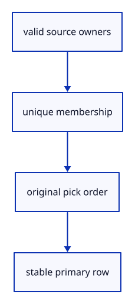

# 6.4.1 · Preserve unique selections in pick order

**Chapter 6 · Picking and selection · Section 6.4 · Multiple selection** · [Contents](contents.md)

**Typing: 23–45 minutes.** [Estimate](typing-load.md).

Keep object membership unique and preserve the order of valid picks. The primary object is the lowest row ID; it is independent of pick order.

## Type

Continue from [Select and inspect original faces, edges and controls](44l-input.md). [Save or recover your work](recovery.md).

### 1. `src/object_selection.rs`

Keep unique current owners in their original pick order.

Create the file and type:

```rust
--8<-- "journey/code/45-order-01.rs"
```

### 2. `src/lib.rs`

Register the component and copied checks.

<details>
<summary>Locate the existing block</summary>

```rust

#[cfg(test)]
mod selection_tests;
```

</details>

After that block, type:

```rust
--8<-- "journey/code/45-order-02.rs" skip=35
```

### 3. `src/scene.rs`

Collect selected bounds and move mixed original row placements.

<details>
<summary>Locate the existing block</summary>

```rust
            match &mut bounds { Some(bounds) => bounds.include(p), None => bounds = Some(crate::bounds::Bounds::point(p)) }
        }
        bounds
    }

    pub fn selected_bounds(&self, id: ObjectId) -> Option<crate::bounds::Bounds> {
```

</details>

Edit the existing block to match this code; keep unchanged lines:

```rust
--8<-- "journey/code/45-order-03.rs"
```

<details>
<summary>Supplied validation fixture</summary>

Copy this supplied authoring fixture once. Continue with the browser build below; the course does not require running native tests.

### 4. `src/object_selection_tests.rs`

Copy unique order and additive miss checks.

Copy this supplied file:

```text
--8<-- "journey/code/45-order-04.rs"
```

</details>

### 5. `src/lib.rs`

Register the component and copied checks.

<details>
<summary>Locate the existing block</summary>

```rust
mod selection_tests;

pub mod object_selection;
```

</details>

After that block, type:

```rust
--8<-- "journey/code/45-order-05.rs" skip=48
```

## Run and check

In your project:

```sh
cd workspace/journey
REGEN_PROTO=0 cargo build --lib --locked --target wasm32-unknown-unknown -j1
REGEN_PROTO=0 CARGO_BUILD_JOBS=1 trunk serve --port 8780
```

Open `http://127.0.0.1:8780/`. Keep an existing Trunk server running; saving rebuilds it.

Run the copied ordering checks. The original face-selection exercise is unchanged.

### Recorded visual result

**Previous native render — current verification pending.**

The earlier box has one original face highlighted. This preparation adds selection or batch-edit infrastructure without changing that exercise.


*This recorded image predates a source or checker change. Rebuild this checkpoint before using it as current evidence; browser controls require separate acceptance.*

This reference image is shared with [6.3.14 · Select and inspect original faces, edges and controls](44l-input.md). It does not demonstrate a new feature by itself.

<details>
<summary>Code explanation and diagram</summary>


valid source owners → unique membership → original pick order → stable primary row.



Should repeated Shift-clicks reorder an existing object?

No. Additive selection keeps its first position and does not duplicate it.

Study estimate, including typing and experiments: 0.5–1 hours.

</details>

<details>
<summary>Optional experiment</summary>

Add the higher row first, then the lower row, and compare primary selection with pick order.

</details>

<details>
<summary>Check and save your work</summary>

Restore experimental edits, then run from `session_viewer`:

```sh
npm --prefix ../session_tests run course -- check 6.4.1
npm --prefix ../session_tests run course -- save 6.4.1
```

Source comparison leaves your project untouched. [Save and recovery instructions](recovery.md).

</details>

<details>
<summary>Viewer coverage and verification</summary>

This preparation keeps the existing part-selection exercise. Multiple-object input is connected at45c; input order and atomic mixed-row edits are prepared here.

Original part selection remains available. Multiple-object input is connected at45c; browser acceptance is pending.

[Full validation scope](release.md).

To reproduce the scripted acceptance of the reference checkpoint, run from `session_viewer` with the [course bundle server](release.md#reproduce) running on port 8781:

```sh
npm --prefix ../session_tests run course -- capture 6.4.1
```

This uses the verified reference bundle; it does not check or change your typed project.

</details>
