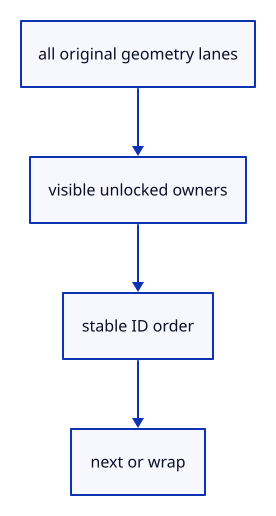

# 6.4.4 · Cycle every eligible original geometry owner

**Chapter 6 · Picking and selection · Section 6.4 · Multiple selection** · [Contents](contents.md)

**Typing: 8–15 minutes.** [Estimate](typing-load.md).

Selection cycling uses current eligible original owners. Include every geometry lane, skip locked or hidden rows, and wrap in stable owner order so a locked first row cannot trap the command.

## Type

Continue from [Connect multi-hit state and highlight every selected row](45b-membership.md). [Save or recover your work](recovery.md).

### 1. `src/scene.rs`

Cycle all original owners after applying visibility and locking.

<details>
<summary>Locate the existing block</summary>

```rust
    pub fn next(&self, current: Option<ObjectId>) -> Option<ObjectId> {
        let start = self.objects.iter().position(|object| Some(object.id) == current)
            .map_or(0, |index| index + 1);
        (0..self.objects.len()).map(|offset| &self.objects[(start + offset) % self.objects.len()])
            .find(|row| row.visible()).map(|row| row.id)
    }
```

</details>

Edit the existing block to match this code; keep unchanged lines:

```rust
--8<-- "journey/code/45bb-cycle-01.rs"
```

<details>
<summary>Supplied validation fixture</summary>

Copy this supplied authoring fixture once. Continue with the browser build below; the course does not require running native tests.

### 2. `src/selection_cycle_tests.rs`

Copy mixed-owner, visibility, lock and wraparound checks.

Copy this supplied file:

```text
--8<-- "journey/code/45bb-cycle-02.rs"
```

</details>

### 3. `src/lib.rs`

Register the copied original-owner cycling check.

<details>
<summary>Locate the existing block</summary>

```rust
#[cfg(test)]
mod multi_selection_tests;
```

</details>

After that block, type:

```rust
--8<-- "journey/code/45bb-cycle-03.rs" skip=40
```

## Run and check

In your project:

```sh
cd workspace/journey
REGEN_PROTO=0 cargo build --lib --locked --target wasm32-unknown-unknown -j1
REGEN_PROTO=0 CARGO_BUILD_JOBS=1 trunk serve --port 8780
```

Open `http://127.0.0.1:8780/`. Keep an existing Trunk server running; saving rebuilds it.

Close; Example Line; Select Next; Selection. The original line can now be selected from the command field. Run the copied cycling checks for mixed rows, locks, hidden sources and wraparound.

### Recorded visual result

**Previous native render — current verification pending.**

The earlier box has one original face highlighted. This preparation adds selection or batch-edit infrastructure without changing that exercise.


*This recorded image predates a source or checker change. Rebuild this checkpoint before using it as current evidence; browser controls require separate acceptance.*

This reference image is shared with [6.3.14 · Select and inspect original faces, edges and controls](44l-input.md). It does not demonstrate a new feature by itself.

<details>
<summary>Code explanation and diagram</summary>


all original geometry lanes → visible unlocked owners → stable ID order → next or wrap.



Why filter eligibility before choosing the next owner?

If the first visible row is locked, choosing it and then rejecting it repeatedly leaves selection stuck at nothing.

Study estimate, including typing and experiments: 0.5–1 hours.

</details>

<details>
<summary>Optional experiment</summary>

Add a point and a polyline, then cycle through all three owners. A locked or hidden owner must be skipped without losing the next valid row.

</details>

<details>
<summary>Check and save your work</summary>

Restore experimental edits, then run from `session_viewer`:

```sh
npm --prefix ../session_tests run course -- check 6.4.4
npm --prefix ../session_tests run course -- save 6.4.4
```

Source comparison leaves your project untouched. [Save and recovery instructions](recovery.md).

</details>

<details>
<summary>Viewer coverage and verification</summary>

The course selection scaffolding cycles all currently supported geometry lanes with the same eligibility policy as whole-object selection. Tree selection and read-only Element descendants are introduced in their subjects.

Native checks cover mixed geometry, a locked first mesh, a locked line, hidden points, stable ID order, an invalid current owner and empty scenes. Browser acceptance is pending.

Original part selection remains available. Multiple-object input is connected at45c; browser acceptance is pending.

[Full validation scope](release.md).

To reproduce the scripted acceptance of the reference checkpoint, run from `session_viewer` with the [course bundle server](release.md#reproduce) running on port 8781:

```sh
npm --prefix ../session_tests run course -- capture 6.4.4
```

This uses the verified reference bundle; it does not check or change your typed project.

</details>
