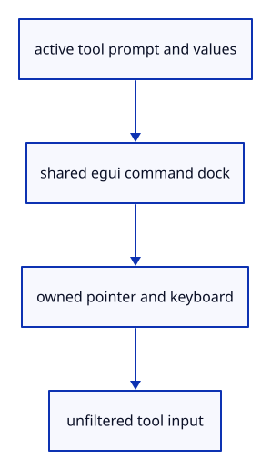

# 7.1.1 · Give active tools ownership of the command panel

**Chapter 7 · Drawing, snapping and transform tools · Section 7.1 · Active tools and the command panel** · [Contents](contents.md)

**Typing: 10–19 minutes.** [Estimate](typing-load.md).

The panel already shares the viewer device and draws its font atlas after the scene. Add the tool handoff: its prompt and options own value input, while field typing, button clicks and scrolling remain inside the dock.

## Type

Continue from [Collect multiple objects with Shift-click and commands](45c-input.md). [Save or recover your work](recovery.md).

### 1. `src/panel.rs`

Supply active prompts, own option input and forward values to their tool.

Edit these blocks from bottom to top. Keep the surrounding lines unchanged.

<details>
<summary>Locate this block</summary>

```rust
        let line = self.prepare();
        canvas.set_attribute("data-command-ui", &self.inspect())?;
        let Some(line) = line else { return Ok(None); };
        if line == "Escape" { return Ok(None); }
        if line.eq_ignore_ascii_case("Help") {
            self.answer(&line, &self.commands.0.join(" · "));
```

</details>

Replace it with:

```rust
        let line = self.prepare();
        canvas.set_attribute("data-command-ui", &self.inspect())?;
        let Some(line) = line else { return Ok(None); };
        if !self.model.options.is_empty() { return Ok(Some(line)); }
        if line == "Escape" { return Ok(None); }
        if line.eq_ignore_ascii_case("Help") {
            self.answer(&line, &self.commands.0.join(" · "));
```

<details>
<summary>Locate this block</summary>

```rust
        serde_json::json!({"controls": self.controls, "command": self.model.command, "history": self.model.history, "status": self.model.status,
            "pointer_owned": self.pointer_owned,
            "top": self.top, "focused": self.context.egui_wants_keyboard_input(),
            "completion_rect": self.model.completion_rect.map(|r| [r.min.x, r.min.y, r.max.x, r.max.y])}).to_string()
    }

    pub fn answer(&mut self, line: &str, message: &str) {
```

</details>

Replace it with:

```rust
        serde_json::json!({"controls": self.controls, "command": self.model.command, "history": self.model.history, "status": self.model.status,
            "pointer_owned": self.pointer_owned,
            "top": self.top, "focused": self.context.egui_wants_keyboard_input(),
            "completion_rect": self.model.completion_rect.map(|r| [r.min.x, r.min.y, r.max.x, r.max.y]),
            "options": self.model.options, "options_rect": self.model.options_rect.map(|r| [r.min.x, r.min.y, r.max.x, r.max.y])}).to_string()
    }

    pub fn answer(&mut self, line: &str, message: &str) {
```

<details>
<summary>Locate this block</summary>

```rust
            unit: match event.delta_mode() { 1 => egui::MouseWheelUnit::Line, 2 => egui::MouseWheelUnit::Page, _ => egui::MouseWheelUnit::Point },
            phase: egui::TouchPhase::Move, delta: egui::vec2(-event.delta_x() as f32, -event.delta_y() as f32), modifiers: Default::default(),
        });
        let over = pos.y >= self.top || self.model.completion_rect.is_some_and(|r| r.contains(pos));
        if over { event.prevent_default(); }
        over
    }
```

</details>

Replace it with:

```rust
            unit: match event.delta_mode() { 1 => egui::MouseWheelUnit::Line, 2 => egui::MouseWheelUnit::Page, _ => egui::MouseWheelUnit::Point },
            phase: egui::TouchPhase::Move, delta: egui::vec2(-event.delta_x() as f32, -event.delta_y() as f32), modifiers: Default::default(),
        });
        let over = pos.y >= self.top || (self.model.completion_rect.is_some_and(|r| r.contains(pos)) || self.model.options_rect.is_some_and(|r| r.contains(pos)));
        if over { event.prevent_default(); }
        over
    }
```

<details>
<summary>Locate this block</summary>

```rust
    pub fn pointer(&mut self, event: &web_sys::PointerEvent, canvas: &web_sys::HtmlCanvasElement) -> bool {
        let rect = canvas.get_bounding_client_rect();
        let pos = egui::pos2((event.client_x() as f64 - rect.left()) as f32, (event.client_y() as f64 - rect.top()) as f32);
        let over = pos.y >= self.top || self.model.completion_rect.is_some_and(|r| r.contains(pos));
        let owned = over || self.pointer_owned;
        if event.type_() == "pointerdown" {
            self.pointer_owned = over;
```

</details>

Replace it with:

```rust
    pub fn pointer(&mut self, event: &web_sys::PointerEvent, canvas: &web_sys::HtmlCanvasElement) -> bool {
        let rect = canvas.get_bounding_client_rect();
        let pos = egui::pos2((event.client_x() as f64 - rect.left()) as f32, (event.client_y() as f64 - rect.top()) as f32);
        let over = pos.y >= self.top || (self.model.completion_rect.is_some_and(|r| r.contains(pos)) || self.model.options_rect.is_some_and(|r| r.contains(pos)));
        let owned = over || self.pointer_owned;
        if event.type_() == "pointerdown" {
            self.pointer_owned = over;
```

<details>
<summary>Locate this block</summary>

```rust
        } }
    }

    pub fn command(&self) -> &str { &self.model.command }

    pub fn history(&self) -> &std::collections::VecDeque<String> { &self.model.history }
```

</details>

Replace it with:

```rust
        } }
    }

    pub fn tool(&mut self, prompt: String, options: Vec<(String, String)>) {
        self.model.drawing_prompt = prompt; self.model.options = options;
        if !self.model.options.is_empty() { self.model.completion_visible = false; self.model.inline_suffix = false; }
    }

    pub fn command(&self) -> &str { &self.model.command }

    pub fn history(&self) -> &std::collections::VecDeque<String> { &self.model.history }
```

<details>
<summary>Complete updated block reference</summary>

```rust
use crate::command_dock::{self, CommandLine, Commands as _, theme};
use crate::renderer::Renderer;

struct Commands(&'static [&'static str]);

impl command_dock::Commands for Commands {
    fn canonical(&self, line: &str) -> String {
        let line = line.split_whitespace().collect::<Vec<_>>().join(" ");
        self.0
            .iter()
            .find(|name| name.eq_ignore_ascii_case(&line))
            .map_or(line.clone(), |name| (*name).into())
    }
    fn choosing_option(&self, _: &str) -> bool {
        false
    }
    fn accept(&self, line: &str) -> (String, bool) {
        (self.canonical(line), true)
    }
    fn completions(&self, line: &str) -> Vec<&'static str> {
        crate::command_vocabulary::ranked(self.0.as_ref(), line)
    }
    fn browse(&self, line: &str) -> Vec<&'static str> {
        self.completions(line)
    }
}

pub struct Panel {
    commands: Commands,
    pub consumed: bool,
    pointer_owned: bool,
    top: f32,
    controls: Option<Vec<command_dock::Control>>,
    context: egui::Context,
    painter: egui_wgpu::Renderer,
    model: CommandLine,
    events: Vec<egui::Event>,
    output: Option<egui::FullOutput>,
    screen: egui_wgpu::ScreenDescriptor,
}

impl Panel {
    pub fn new(renderer: &Renderer, format: wgpu::TextureFormat, commands: &'static [&'static str]) -> Self {
        let context = egui::Context::default();
        context.set_fonts(theme::fonts([
            include_bytes!("../assets/text/NotoSans-Regular.subset.ttf"),
            include_bytes!("../assets/text/NotoSansSymbols2-Regular.subset.ttf"),
            include_bytes!("../assets/text/NotoSansSymbols-Regular.subset.ttf"),
        ]));
        context.set_theme(egui::Theme::Light);
        context.set_visuals(theme::visuals());
        // One layout pass prevents a future text event from being replayed.
        context.options_mut(|options| options.max_passes = 1.try_into().unwrap());
        let painter = egui_wgpu::Renderer::new(&renderer.device, format, Default::default());
        Self { commands: Commands(commands), consumed: false, pointer_owned: false, top: f32::INFINITY, controls: None, context, painter, events: Vec::new(), output: None,
            screen: egui_wgpu::ScreenDescriptor { size_in_pixels: [640, 480], pixels_per_point: 1.0 }, model: CommandLine {
            focus_command: true,
            ..Default::default()
        } }
    }

    pub fn tool(&mut self, prompt: String, options: Vec<(String, String)>) {
        self.model.drawing_prompt = prompt; self.model.options = options;
        if !self.model.options.is_empty() { self.model.completion_visible = false; self.model.inline_suffix = false; }
    }

    pub fn command(&self) -> &str { &self.model.command }

    pub fn history(&self) -> &std::collections::VecDeque<String> { &self.model.history }

    pub fn shortcut(&self, event: &web_sys::KeyboardEvent) -> Option<crate::shortcuts::Shortcut> {
        if event.type_() != "keydown" || event.repeat() { return None; }
        crate::shortcuts::key(&event.key(), event.ctrl_key() || event.meta_key(), event.shift_key(),
            event.alt_key(), event.is_composing(), self.context.egui_wants_keyboard_input(), self.model.command.is_empty())
    }

    pub fn key(&mut self, event: &web_sys::KeyboardEvent) -> bool {

        if event.is_composing() { return false; }
        let modifiers = egui::Modifiers {
            alt: event.alt_key(), ctrl: event.ctrl_key(), shift: event.shift_key(),
            mac_cmd: event.meta_key(), command: event.ctrl_key() || event.meta_key(),
        };
        let text = event.type_() == "keydown" && event.key().chars().count() == 1
            && !modifiers.command && !modifiers.alt;
        if text {
            if !self.context.egui_wants_keyboard_input() { self.model.focus_command = true; }
            self.context.memory_mut(|memory| memory.request_focus(egui::Id::new("command-input")));
            self.model.command_open = true;
        }
        if !self.context.egui_wants_keyboard_input() { return false; }
        if let Some(key) = egui::Key::from_name(&event.key()) {
            self.events.push(egui::Event::Key {
                key, physical_key: None, pressed: event.type_() == "keydown",
                repeat: event.repeat(), modifiers,
            });
        }
        if text { self.events.push(egui::Event::Text(event.key())); }
        event.prevent_default();
        true
    }

    pub fn pointer(&mut self, event: &web_sys::PointerEvent, canvas: &web_sys::HtmlCanvasElement) -> bool {
        let rect = canvas.get_bounding_client_rect();
        let pos = egui::pos2((event.client_x() as f64 - rect.left()) as f32, (event.client_y() as f64 - rect.top()) as f32);
        let over = pos.y >= self.top || (self.model.completion_rect.is_some_and(|r| r.contains(pos)) || self.model.options_rect.is_some_and(|r| r.contains(pos)));
        let owned = over || self.pointer_owned;
        if event.type_() == "pointerdown" {
            self.pointer_owned = over;
            if !over {
                self.model.command_open = false;
                self.model.focus_command = false;
                self.context.memory_mut(|memory| memory.surrender_focus(egui::Id::new("command-input")));
            }
        }
        self.events.push(egui::Event::PointerMoved(pos));
        if matches!(event.type_().as_str(), "pointercancel" | "lostpointercapture") {
            for button in [egui::PointerButton::Primary, egui::PointerButton::Middle, egui::PointerButton::Secondary] {
                self.events.push(egui::Event::PointerButton { pos, button, pressed: false, modifiers: Default::default() });
            }
            self.events.push(egui::Event::PointerGone);
        } else if matches!(event.type_().as_str(), "pointerdown" | "pointerup") {
            let button = match event.button() { 0 => egui::PointerButton::Primary, 1 => egui::PointerButton::Middle, _ => egui::PointerButton::Secondary };
            self.events.push(egui::Event::PointerButton { pos, button, pressed: event.type_() == "pointerdown", modifiers: Default::default() });
        }
        if matches!(event.type_().as_str(), "pointerup" | "pointercancel" | "lostpointercapture") { self.pointer_owned = false; }
        if owned { event.prevent_default(); }
        owned
    }

    pub fn wheel(&mut self, event: &web_sys::WheelEvent, canvas: &web_sys::HtmlCanvasElement) -> bool {
        let rect = canvas.get_bounding_client_rect();
        let pos = egui::pos2((event.client_x() as f64 - rect.left()) as f32, (event.client_y() as f64 - rect.top()) as f32);
        self.events.push(egui::Event::PointerMoved(pos));
        self.events.push(egui::Event::MouseWheel {
            unit: match event.delta_mode() { 1 => egui::MouseWheelUnit::Line, 2 => egui::MouseWheelUnit::Page, _ => egui::MouseWheelUnit::Point },
            phase: egui::TouchPhase::Move, delta: egui::vec2(-event.delta_x() as f32, -event.delta_y() as f32), modifiers: Default::default(),
        });
        let over = pos.y >= self.top || (self.model.completion_rect.is_some_and(|r| r.contains(pos)) || self.model.options_rect.is_some_and(|r| r.contains(pos)));
        if over { event.prevent_default(); }
        over
    }

    pub fn inspect(&self) -> String {
        serde_json::json!({"controls": self.controls, "command": self.model.command, "history": self.model.history, "status": self.model.status,
            "pointer_owned": self.pointer_owned,
            "top": self.top, "focused": self.context.egui_wants_keyboard_input(),
            "completion_rect": self.model.completion_rect.map(|r| [r.min.x, r.min.y, r.max.x, r.max.y]),
            "options": self.model.options, "options_rect": self.model.options_rect.map(|r| [r.min.x, r.min.y, r.max.x, r.max.y])}).to_string()
    }

    pub fn answer(&mut self, line: &str, message: &str) {
        self.model.remember(format!("> {line}\n{message}"));
        self.model.status = message.into();
    }

    pub fn result(&mut self, message: &str) {
        self.model.status = message.into();
        if let Some(last) = self.model.history.back_mut()
            && let Some(at) = last.find('\n')
        {
            last.truncate(at + 1);
            last.push_str(message);
        }
    }

    pub fn update(
        &mut self,
        event: Option<&web_sys::Event>,
        canvas: &web_sys::HtmlCanvasElement,
    ) -> Result<Option<String>, wasm_bindgen::JsValue> {
        use wasm_bindgen::JsCast;
        let rect = canvas.get_bounding_client_rect();
        self.screen.size_in_pixels = [canvas.width(), canvas.height()];
        self.screen.pixels_per_point = canvas.width() as f32 / rect.width() as f32;
        self.consumed = false;
        if let Some(event) = event {
            if let Some(key) = event.dyn_ref::<web_sys::KeyboardEvent>() { self.consumed = self.key(key); }
            if let Some(pointer) = event.dyn_ref::<web_sys::PointerEvent>() {
                self.consumed = self.pointer(pointer, canvas);
                if event.type_() == "pointerdown" {
                    let options = web_sys::FocusOptions::new(); options.set_prevent_scroll(true);
                    canvas.focus_with_options(&options)?;
                    event.prevent_default();
                }
            }
            if let Some(wheel) = event.dyn_ref::<web_sys::WheelEvent>() { self.consumed = self.wheel(wheel, canvas); }
        }
        let line = self.prepare();
        canvas.set_attribute("data-command-ui", &self.inspect())?;
        let Some(line) = line else { return Ok(None); };
        if !self.model.options.is_empty() { return Ok(Some(line)); }
        if line == "Escape" { return Ok(None); }
        if line.eq_ignore_ascii_case("Help") {
            self.answer(&line, &self.commands.0.join(" · "));
            return Ok(None);
        }
        if !self.commands.0.iter()
            .any(|name| name.eq_ignore_ascii_case(&line)
                || (*name == "Move" && line.to_ascii_lowercase().starts_with("move ")))
        {
            self.answer(&line, "Unknown command. Type Help.");
            return Ok(None);
        }
        self.answer(&line, "Command submitted.");
        Ok(Some(line.to_ascii_lowercase()))
    }

    fn prepare(&mut self) -> Option<String> {
        let size = self.screen.size_in_pixels;
        let mut input = egui::RawInput {
            focused: true,
            events: std::mem::take(&mut self.events),
            screen_rect: Some(egui::Rect::from_min_size(
                egui::Pos2::ZERO, egui::vec2(size[0] as f32, size[1] as f32) / self.screen.pixels_per_point,
            )),
            ..Default::default()
        };
        input.viewports.get_mut(&egui::ViewportId::ROOT).unwrap().native_pixels_per_point = Some(self.screen.pixels_per_point);
        self.controls = Some(Vec::new());
        let mut line = None;
        let output = self.context.run_ui(input, |root| {
            command_dock::draw(root, &mut self.model, &mut self.controls, &mut line, &self.commands, true);
        });
        if let Some(control) = self.controls.as_ref().and_then(|items| items.iter().find(|item| item.key == "command/resize")) {
            self.top = control.rect[1];
        }
        if let Some(previous) = self.output.as_mut() { previous.append(output); }
        else { self.output = Some(output); }
        line
    }

    pub fn draw(&mut self, renderer: &Renderer, target: &wgpu::TextureView) {
        let Some(output) = self.output.take() else { return; };
        // The font atlas is a texture: upload its changed pixels before drawing the letters.
        for (id, delta) in &output.textures_delta.set {
            self.painter.update_texture(&renderer.device, &renderer.queue, *id, delta);
        }
        let jobs = self.context.tessellate(output.shapes, output.pixels_per_point);
        let mut encoder = renderer.device.create_command_encoder(&Default::default());
        let mut buffers = self.painter.update_buffers(
            &renderer.device, &renderer.queue, &mut encoder, &jobs, &self.screen,
        );
        let pass = encoder.begin_render_pass(&wgpu::RenderPassDescriptor {
            label: Some("command panel"),
            color_attachments: &[Some(wgpu::RenderPassColorAttachment {
                view: target, resolve_target: None, depth_slice: None,
                ops: wgpu::Operations { load: wgpu::LoadOp::Load, store: wgpu::StoreOp::Store },
            })],
            ..Default::default()
        });
        self.painter.render(&mut pass.forget_lifetime(), &jobs, &self.screen);
        buffers.push(encoder.finish());
        renderer.queue.submit(buffers);
        for id in output.textures_delta.free { self.painter.free_texture(&id); }
    }
}
```

</details>

<details>
<summary>Optional patch references</summary>

Use these original edit fragments when comparing a saved checkpoint. Apply the complete blocks above.

```text
--8<-- "journey/code/46-tool-panel-01.rs"
```

```text
--8<-- "journey/code/46-tool-panel-02.rs"
```

```text
--8<-- "journey/code/46-tool-panel-03.rs"
```

```text
--8<-- "journey/code/46-tool-panel-04.rs"
```

```text
--8<-- "journey/code/46-tool-panel-05.rs"
```

</details>

## Run and check

In your project:

```sh
cd workspace/journey
REGEN_PROTO=0 cargo build --lib --locked --target wasm32-unknown-unknown -j1
REGEN_PROTO=0 CARGO_BUILD_JOBS=1 trunk serve --port 8780
```

Open `http://127.0.0.1:8780/`. Keep an existing Trunk server running; saving rebuilds it.

Inspect the copied tool_buttons_tests, then repeat the two-box selection and Undo exercise. This preparation adds the panel handoff; the point tool connects it at48.

### Recorded visual result

**Previous native render — current verification pending.**

The native frame retains the two original selected boxes. The shared egui panel gains input ownership without changing scene geometry.


*This recorded image predates a source or checker change. Rebuild this checkpoint before using it as current evidence; browser controls require separate acceptance.*

This reference image is shared with [6.4.5 · Collect multiple objects with Shift-click and commands](45c-input.md). It does not demonstrate a new feature by itself.

<details>
<summary>Code explanation and diagram</summary>


active tool prompt and values → shared egui command dock → owned pointer and keyboard → unfiltered tool input.



Why return a tool value before checking ordinary command names?

A value such as60 and an empty Enter belong to the running tool. The tool decides whether to keep a value, advance a point or commit.

Study estimate, including typing and experiments: 0.5–1 hours.

</details>

<details>
<summary>Optional experiment</summary>

Inspect the supplied widget fixture: click Thickness40, type60 and press Enter. Explain why the owner must receive60 without a Help completion or a second submission.

</details>

<details>
<summary>Check and save your work</summary>

Restore experimental edits, then run from `session_viewer`:

```sh
npm --prefix ../session_tests run course -- check 7.1.1
npm --prefix ../session_tests run course -- save 7.1.1
```

Source comparison leaves your project untouched. [Save and recovery instructions](recovery.md).

</details>

<details>
<summary>Viewer coverage and verification</summary>

The shared dock matches the latest production value-button layout. Panel.tool supplies prompts and options, owns their rectangles and forwards tool values, empty Enter and Escape. Geometry creation is connected in the tool subject.

Actual native egui tests cover value-button clicks, focus, suppressed suggestions and empty Enter. Existing GPU and selection checks remain. Headed browser acceptance has not run in the current sandbox.

Both original boxes remain selected. Active tools use the same command dock in the following tool lesson; this preparation has no fabricated demonstration buttons.

[Full validation scope](release.md).

To reproduce the scripted acceptance of the reference checkpoint, run from `session_viewer` with the [course bundle server](release.md#reproduce) running on port 8781:

```sh
npm --prefix ../session_tests run course -- capture 7.1.1
```

This uses the verified reference bundle; it does not check or change your typed project.

</details>
