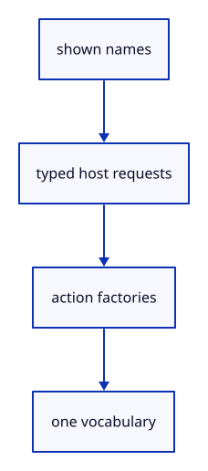

# 7.2.1 · Separate browser requests from editor actions

**Chapter 7 · Drawing, snapping and transform tools · Section 7.2 · Typed commands and browser requests** · [Contents](contents.md)

**Typing: 9–18 minutes.** [Estimate](typing-load.md).

A command can request an editor transaction or a browser operation. Store its shown name once so completion, help and parsing can share the same vocabulary.

## Type

Continue from [Give active tools ownership of the command panel](46-tool-panel.md). [Save or recover your work](recovery.md).

### 1. `src/commands.rs`

Declare host requests and the shared names they expose.

Create the file and type:

```rust
--8<-- "journey/code/47-registry-01.rs"
```

### 2. `src/lib.rs`

Register the typed command component and copied checks.

<details>
<summary>Locate the existing block</summary>

```rust

#[cfg(test)]
mod multi_selection_tests;
```

</details>

After that block, type:

```rust
--8<-- "journey/code/47-registry-02.rs" skip=41
```

## Run and check

In your project:

```sh
cd workspace/journey
REGEN_PROTO=0 cargo build --lib --locked --target wasm32-unknown-unknown -j1
REGEN_PROTO=0 CARGO_BUILD_JOBS=1 trunk serve --port 8780
```

Open `http://127.0.0.1:8780/`. Keep an existing Trunk server running; saving rebuilds it.

Run the earlier two-box selection exercise. This preparation declares typed requests; the command field keeps its existing route until47c.

### Recorded visual result

**Previous native render — current verification pending.**

The two original selected boxes retain their shared primary geometry.


*This recorded image predates a source or checker change. Rebuild this checkpoint before using it as current evidence; browser controls require separate acceptance.*

This reference image is shared with [6.4.5 · Collect multiple objects with Shift-click and commands](45c-input.md). It does not demonstrate a new feature by itself.

<details>
<summary>Code explanation and diagram</summary>


shown names → typed host requests → action factories → one vocabulary.



Why keep Open outside the synchronous editor action?

The browser owns its chooser and asynchronous read lifetime; only a checked completion becomes an editor transaction.

Study estimate, including typing and experiments: 0.5–1 hours.

</details>

<details>
<summary>Optional experiment</summary>

Compare Open and Open Replace: their host requests must remain different even though their names share a prefix.

</details>

<details>
<summary>Check and save your work</summary>

Restore experimental edits, then run from `session_viewer`:

```sh
npm --prefix ../session_tests run course -- check 7.2.1
npm --prefix ../session_tests run course -- save 7.2.1
```

Source comparison leaves your project untouched. [Save and recovery instructions](recovery.md).

</details>

<details>
<summary>Viewer coverage and verification</summary>

This preparation retains the existing selection exercise. The typed registry is connected to the command field at47c; all earlier commands remain available.

The existing selection exercise remains; typed registry input is connected at47c.

[Full validation scope](release.md).

To reproduce the scripted acceptance of the reference checkpoint, run from `session_viewer` with the [course bundle server](release.md#reproduce) running on port 8781:

```sh
npm --prefix ../session_tests run course -- capture 7.2.1
```

This uses the verified reference bundle; it does not check or change your typed project.

</details>
