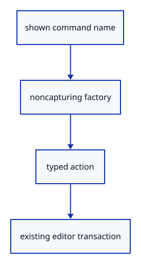

# 7.2.2 · Register the existing editor command factories

**Chapter 7 · Drawing, snapping and transform tools · Section 7.2 · Typed commands and browser requests** · [Contents](contents.md)

**Typing: 26–51 minutes.** [Estimate](typing-load.md).

Each registry entry constructs one existing typed action. A noncapturing closure becomes a function pointer and retains no editor borrow or mutable state.

## Type

Continue from [Separate browser requests from editor actions](47-registry.md). [Save or recover your work](recovery.md).

### 1. `src/commands.rs`

Register existing actions without duplicating command names in parsing branches.

<details>
<summary>Locate the existing block</summary>

```rust
pub enum Command { Editor(Action), Host(Host) }

pub type Factory = fn() -> Action;
pub const ACTIONS: &[(&str, Factory)] = &[];

pub const HOSTS: &[(&str, Host)] = &[
    ("Help", Host::Help),
```

</details>

Edit the existing block to match this code; keep unchanged lines:

```rust
--8<-- "journey/code/47a-actions-01.rs"
```

## Run and check

In your project:

```sh
cd workspace/journey
REGEN_PROTO=0 cargo build --lib --locked --target wasm32-unknown-unknown -j1
REGEN_PROTO=0 CARGO_BUILD_JOBS=1 trunk serve --port 8780
```

Open `http://127.0.0.1:8780/`. Keep an existing Trunk server running; saving rebuilds it.

Continue the existing selection exercise. The action registry is ready; command-field dispatch follows at47c.

### Recorded visual result

**Previous native render — current verification pending.**

The two original selected boxes retain their shared primary geometry.


*This recorded image predates a source or checker change. Rebuild this checkpoint before using it as current evidence; browser controls require separate acceptance.*

This reference image is shared with [6.4.5 · Collect multiple objects with Shift-click and commands](45c-input.md). It does not demonstrate a new feature by itself.

<details>
<summary>Code explanation and diagram</summary>


shown command name → noncapturing factory → typed action → existing editor transaction.



Does constructing an action create an Undo entry?

No. Construction has no scene effects; Editor.apply decides whether to commit a transaction.

Study estimate, including typing and experiments: 0.5–1 hours.

</details>

<details>
<summary>Optional experiment</summary>

Compare Fit, Fit Selected and View Perspective; each factory carries the existing action and its required parameters.

</details>

<details>
<summary>Check and save your work</summary>

Restore experimental edits, then run from `session_viewer`:

```sh
npm --prefix ../session_tests run course -- check 7.2.2
npm --prefix ../session_tests run course -- save 7.2.2
```

Source comparison leaves your project untouched. [Save and recovery instructions](recovery.md).

</details>

<details>
<summary>Viewer coverage and verification</summary>

This preparation retains the existing selection exercise. The typed registry is connected to the command field at47c; all earlier commands remain available.

The existing selection exercise remains; typed registry input is connected at47c.

[Full validation scope](release.md).

To reproduce the scripted acceptance of the reference checkpoint, run from `session_viewer` with the [course bundle server](release.md#reproduce) running on port 8781:

```sh
npm --prefix ../session_tests run course -- capture 7.2.2
```

This uses the verified reference bundle; it does not check or change your typed project.

</details>
