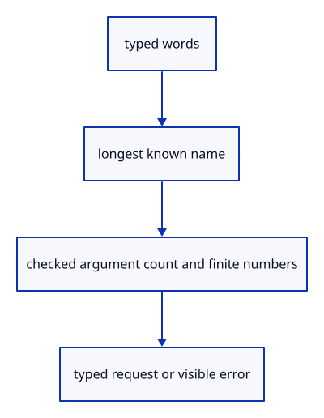

# 7.2.3 · Parse the longest command and validate its arguments

**Chapter 7 · Drawing, snapping and transform tools · Section 7.2 · Typed commands and browser requests** · [Contents](contents.md)

**Typing: 19–37 minutes.** [Estimate](typing-load.md).

Match names without case or internal-space differences. Keep arguments intact, choose the longest name, and reject invalid offsets before the editor sees an action.

## Type

Continue from [Register the existing editor command factories](47a-actions.md). [Save or recover your work](recovery.md).

### 1. `src/commands.rs`

Match current names and return checked typed requests.

<details>
<summary>Locate the existing block</summary>

```rust
    HOSTS.iter().map(|(name, _)| *name).chain(ACTIONS.iter().map(|(name, _)| *name)).chain(["Move"]).collect()
}
```

</details>

After that block, type:

```rust
--8<-- "journey/code/47b-parse-01.rs" skip=114
```

### 2. `src/offset.rs`

Accept finite three-coordinate offsets in comma or space form.

<details>
<summary>Locate the existing block</summary>

```rust
        return Err("Expected Move x,y,z");
    }
    let rest = words.collect::<Vec<_>>().join(" ");
    let parts: Vec<_> = rest.split(',').collect();
    if parts.len() != 3 { return Err("Move needs three coordinates: x,y,z"); }
    let mut values = [0.0; 3];
    for (value, text) in values.iter_mut().zip(parts) {
```

</details>

Edit the existing block to match this code; keep unchanged lines:

```rust
--8<-- "journey/code/47b-parse-02.rs"
```

<details>
<summary>Supplied validation fixture</summary>

Copy this supplied authoring fixture once. Continue with the browser build below; the course does not require running native tests.

### 3. `src/commands_tests.rs`

Copy longest-name, invalid-input, redo-preservation and one-Undo execution checks.

Copy this supplied file:

```text
--8<-- "journey/code/47b-parse-03.rs"
```

</details>

### 4. `src/lib.rs`

Register the typed command component and copied checks.

<details>
<summary>Locate the existing block</summary>

```rust
mod multi_selection_tests;

pub mod commands;
```

</details>

After that block, type:

```rust
--8<-- "journey/code/47b-parse-04.rs" skip=46
```

## Run and check

In your project:

```sh
cd workspace/journey
REGEN_PROTO=0 cargo build --lib --locked --target wasm32-unknown-unknown -j1
REGEN_PROTO=0 CARGO_BUILD_JOBS=1 trunk serve --port 8780
```

Open `http://127.0.0.1:8780/`. Keep an existing Trunk server running; saving rebuilds it.

Inspect commands_tests. Both Move 1,-2,0.03 and Move 1 -2 0.03 reach one transaction; malformed input keeps the source and redo branch. The browser uses this parser at47c.

### Recorded visual result

**Previous native render — current verification pending.**

The two original selected boxes retain their shared primary geometry.


*This recorded image predates a source or checker change. Rebuild this checkpoint before using it as current evidence; browser controls require separate acceptance.*

This reference image is shared with [6.4.5 · Collect multiple objects with Shift-click and commands](45c-input.md). It does not demonstrate a new feature by itself.

<details>
<summary>Code explanation and diagram</summary>


typed words → longest known name → checked argument count and finite numbers → typed request or visible error.



Why match Open Replace before Open?

Otherwise Replace becomes an unexpected argument to the shorter command. Longest-name matching preserves the intended operation.

Study estimate, including typing and experiments: 0.5–1 hours.

</details>

<details>
<summary>Optional experiment</summary>

Try empty input, Delete all, Move 1,,2 and Move NaN,0,0 in the copied parser check; each must fail before applying an action.

</details>

<details>
<summary>Check and save your work</summary>

Restore experimental edits, then run from `session_viewer`:

```sh
npm --prefix ../session_tests run course -- check 7.2.3
npm --prefix ../session_tests run course -- save 7.2.3
```

Source comparison leaves your project untouched. [Save and recovery instructions](recovery.md).

</details>

<details>
<summary>Viewer coverage and verification</summary>

This preparation retains the existing selection exercise. The typed registry is connected to the command field at47c; all earlier commands remain available.

Run the copied native checks where introduced. Actual browser acceptance remains pending; preparation images retain the existing two-box exercise.

The existing selection exercise remains; typed registry input is connected at47c.

[Full validation scope](release.md).

To reproduce the scripted acceptance of the reference checkpoint, run from `session_viewer` with the [course bundle server](release.md#reproduce) running on port 8781:

```sh
npm --prefix ../session_tests run course -- capture 7.2.3
```

This uses the verified reference bundle; it does not check or change your typed project.

</details>
