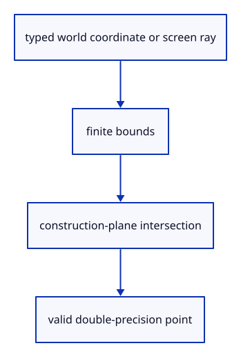

# 7.3.1 · Resolve drawing points on the construction plane

**Chapter 7 · Drawing, snapping and transform tools · Section 7.3 · Construction-plane drawing** · [Contents](contents.md)

**Typing: 12–24 minutes.** [Estimate](typing-load.md).

Validate finite world coordinates, then intersect the current camera ray with the XY construction plane. Parallel or clipped rays cannot provide a drawing point.

## Type

Continue from [Route the command field through the typed registry](47c-route.md). [Save or recover your work](recovery.md).

### 1. `src/tool_coords.rs`

Validate world coordinates and intersect the current ray with the XY plane.

Create the file and type:

```rust
--8<-- "journey/code/48-coordinates-01.rs"
```

<details>
<summary>Supplied validation fixture</summary>

Copy this supplied authoring fixture once. Continue with the browser build below; the course does not require running native tests.

### 2. `src/tool_coords_tests.rs`

Copy finite-coordinate, camera round-trip and invalid-ray checks.

Copy this supplied file:

```text
--8<-- "journey/code/48-coordinates-02.rs"
```

</details>

### 3. `src/lib.rs`

Register the tool component and copied checks.

<details>
<summary>Locate the existing block</summary>

```rust

#[cfg(test)]
mod commands_tests;
```

</details>

After that block, type:

```rust
--8<-- "journey/code/48-coordinates-03.rs" skip=34
```

## Run and check

In your project:

```sh
cd workspace/journey
REGEN_PROTO=0 cargo build --lib --locked --target wasm32-unknown-unknown -j1
REGEN_PROTO=0 CARGO_BUILD_JOBS=1 trunk serve --port 8780
```

Open `http://127.0.0.1:8780/`. Keep an existing Trunk server running; saving rebuilds it.

Inspect tool_coords_tests, then repeat the earlier command exercise. These helpers are connected to actual drawing input at48d.

### Recorded visual result

**Previous native render — current verification pending.**

The two earlier original boxes remain selected. New drawing infrastructure has no document effect until a tool runs.


*This recorded image predates a source or checker change. Rebuild this checkpoint before using it as current evidence; browser controls require separate acceptance.*

This reference image is shared with [6.4.5 · Collect multiple objects with Shift-click and commands](45c-input.md). It does not demonstrate a new feature by itself.

<details>
<summary>Code explanation and diagram</summary>


typed world coordinate or screen ray → finite bounds → construction-plane intersection → valid double-precision point.



Why use the current camera for a click?

The same screen position points elsewhere after orbiting or zooming. Reusing an old ray would place geometry away from the cursor.

Study estimate, including typing and experiments: 0.5–1 hours.

</details>

<details>
<summary>Optional experiment</summary>

Compare the same world point under perspective and orthographic projection. Reject NaN, coordinates beyond±1e12 and a ray parallel to the plane.

</details>

<details>
<summary>Check and save your work</summary>

Restore experimental edits, then run from `session_viewer`:

```sh
npm --prefix ../session_tests run course -- check 7.3.1
npm --prefix ../session_tests run course -- save 7.3.1
```

Source comparison leaves your project untouched. [Save and recovery instructions](recovery.md).

</details>

<details>
<summary>Viewer coverage and verification</summary>

This preparation adds point-tool infrastructure while retaining the earlier selection and command exercise. Actual drawing input is connected at48d. Object and grid snapping follow in49.

The earlier command and selection exercise remains; the point-tool route is connected at48d.

[Full validation scope](release.md).

To reproduce the scripted acceptance of the reference checkpoint, run from `session_viewer` with the [course bundle server](release.md#reproduce) running on port 8781:

```sh
npm --prefix ../session_tests run course -- capture 7.3.1
```

This uses the verified reference bundle; it does not check or change your typed project.

</details>
