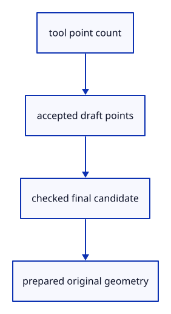

# 7.3.2 · Keep unfinished point tools outside the document

**Chapter 7 · Drawing, snapping and transform tools · Section 7.3 · Construction-plane drawing** · [Contents](contents.md)

**Typing: 24–48 minutes.** [Estimate](typing-load.md).

A draft owns a tool, its accepted points and a temporary cursor. The last point builds checked original geometry without replacing accepted points if validation fails.

## Type

Continue from [Resolve drawing points on the construction plane](48-coordinates.md). [Save or recover your work](recovery.md).

### 1. `src/tool.rs`

Define Point and Line tools with temporary accepted points and a cursor.

Create the file and type:

```rust
--8<-- "journey/code/48a-draft-01.rs"
```

### 2. `src/lib.rs`

Register the tool component and copied checks.

<details>
<summary>Locate the existing block</summary>

```rust
pub mod tool_coords;
#[cfg(test)]
mod tool_coords_tests;
```

</details>

After that block, type:

```rust
--8<-- "journey/code/48a-draft-02.rs" skip=57
```

## Run and check

In your project:

```sh
cd workspace/journey
REGEN_PROTO=0 cargo build --lib --locked --target wasm32-unknown-unknown -j1
REGEN_PROTO=0 CARGO_BUILD_JOBS=1 trunk serve --port 8780
```

Open `http://127.0.0.1:8780/`. Keep an existing Trunk server running; saving rebuilds it.

Continue the earlier command exercise. Point and Line tools are defined here; the editor adopts them at48c.

### Recorded visual result

**Previous native render — current verification pending.**

The two earlier original boxes remain selected. New drawing infrastructure has no document effect until a tool runs.


*This recorded image predates a source or checker change. Rebuild this checkpoint before using it as current evidence; browser controls require separate acceptance.*

This reference image is shared with [6.4.5 · Collect multiple objects with Shift-click and commands](45c-input.md). It does not demonstrate a new feature by itself.

<details>
<summary>Code explanation and diagram</summary>


tool point count → accepted draft points → checked final candidate → prepared original geometry.



Does accepting a first line point create a source row?

No. It changes only the draft. The checked final candidate becomes a source in the commit lesson.

Study estimate, including typing and experiments: 0.5–1 hours.

</details>

<details>
<summary>Optional experiment</summary>

Compare two identical line endpoints with distinct endpoints. A refused final point must leave the first accepted draft point available.

</details>

<details>
<summary>Check and save your work</summary>

Restore experimental edits, then run from `session_viewer`:

```sh
npm --prefix ../session_tests run course -- check 7.3.2
npm --prefix ../session_tests run course -- save 7.3.2
```

Source comparison leaves your project untouched. [Save and recovery instructions](recovery.md).

</details>

<details>
<summary>Viewer coverage and verification</summary>

This preparation adds point-tool infrastructure while retaining the earlier selection and command exercise. Actual drawing input is connected at48d. Object and grid snapping follow in49.

The earlier command and selection exercise remains; the point-tool route is connected at48d.

[Full validation scope](release.md).

To reproduce the scripted acceptance of the reference checkpoint, run from `session_viewer` with the [course bundle server](release.md#reproduce) running on port 8781:

```sh
npm --prefix ../session_tests run course -- capture 7.3.2
```

This uses the verified reference bundle; it does not check or change your typed project.

</details>
