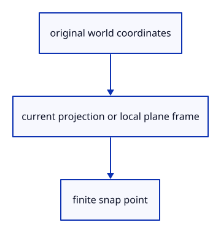

# 7.4.2 · Keep snap math in world and plane coordinates

**Chapter 7 · Drawing, snapping and transform tools · Section 7.4 · Object and grid snapping** · [Contents](contents.md)

**Typing: 27–53 minutes.** [Estimate](typing-load.md).

Project original world points into CSS pixels. Grid rounding uses the plane origin and two orthonormal axes, preserving height; Near and Perp resolve points on original segments.

## Type

Continue from [Separate object and grid snapping](49-settings.md). [Save or recover your work](recovery.md).

### 1. `src/snap_math.rs`

Resolve screen projection, local-plane rounding and nearest/perpendicular segment points.

Create the file and type:

```rust
--8<-- "journey/code/49a-math-01.rs"
```

### 2. `src/lib.rs`

Register the snap component and supplied checks.

<details>
<summary>Locate the existing block</summary>

```rust
mod selection_cycle_tests;

pub mod snap;
```

</details>

After that block, type:

```rust
--8<-- "journey/code/49a-math-02.rs" skip=42
```

## Run and check

In your project:

```sh
cd workspace/journey
REGEN_PROTO=0 cargo build --lib --locked --target wasm32-unknown-unknown -j1
REGEN_PROTO=0 CARGO_BUILD_JOBS=1 trunk serve --port 8780
```

Open `http://127.0.0.1:8780/`. Keep an existing Trunk server running; saving rebuilds it.

Continue the earlier Point/Line exercise. Compare the copied tilted-grid and segment examples when the snap checks arrive at 49f.

### Recorded visual result

**Previous native render — current verification pending.**

The earlier temporary line band and cursor remain, without a saved line.


*This recorded image predates a source or checker change. Rebuild this checkpoint before using it as current evidence; browser controls require separate acceptance.*

This reference image is shared with [7.3.5 · Draw points and lines through the shared command dock](48d-input.md). It does not demonstrate a new feature by itself.

<details>
<summary>Code explanation and diagram</summary>


original world coordinates → current projection or local plane frame → finite snap point.



Why round plane coordinates instead of selected world axes?

A tilted plane has its own axes. Rounding world x/y can move a point off that plane; rounding local u/v preserves its local height.

Study estimate, including typing and experiments: 0.5–1 hours.

</details>

<details>
<summary>Optional experiment</summary>

Use a tilted frame with a translated origin. The rounded point must retain its signed height; reject a degenerate frame, clipped projection or invalid spacing.

</details>

<details>
<summary>Check and save your work</summary>

Restore experimental edits, then run from `session_viewer`:

```sh
npm --prefix ../session_tests run course -- check 7.4.2
npm --prefix ../session_tests run course -- save 7.4.2
```

Source comparison leaves your project untouched. [Save and recovery instructions](recovery.md).

</details>

<details>
<summary>Viewer coverage and verification</summary>

This preparation retains Point/Line drawing while adding snap infrastructure. Actual snap commands and canvas queries connect at 49f. Full construction-plane controls follow in 77.

The earlier unfinished line remains. Snapping is connected to canvas input at 49f.

[Full validation scope](release.md).

To reproduce the scripted acceptance of the reference checkpoint, run from `session_viewer` with the [course bundle server](release.md#reproduce) running on port 8781:

```sh
npm --prefix ../session_tests run course -- capture 7.4.2
```

This uses the verified reference bundle; it does not check or change your typed project.

</details>
