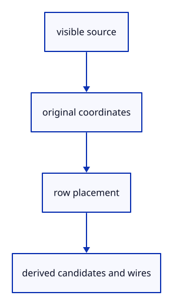

# 7.4.3 · Collect targets from original placed geometry

**Chapter 7 · Drawing, snapping and transform tools · Section 7.4 · Object and grid snapping** · [Contents](contents.md)

**Typing: 29–58 minutes.** [Estimate](typing-load.md).

Collect visible source endpoints, vertices, midpoints, loop centers and boundary wires after their row placement. Locked geometry may supply a snap while remaining uneditable.

## Type

Continue from [Keep snap math in world and plane coordinates](49a-math.md). [Save or recover your work](recovery.md).

### 1. `src/snap_sources.rs`

Collect precise placed source candidates and original boundaries without retaining source owners.

Create the file and type:

```rust
--8<-- "journey/code/49b-sources-01.rs"
```

### 2. `src/lib.rs`

Register the snap component and supplied checks.

<details>
<summary>Locate the existing block</summary>

```rust
pub mod snap;

pub mod snap_math;
```

</details>

After that block, type:

```rust
--8<-- "journey/code/49b-sources-02.rs" skip=34
```

## Run and check

In your project:

```sh
cd workspace/journey
REGEN_PROTO=0 cargo build --lib --locked --target wasm32-unknown-unknown -j1
REGEN_PROTO=0 CARGO_BUILD_JOBS=1 trunk serve --port 8780
```

Open `http://127.0.0.1:8780/`. Keep an existing Trunk server running; saving rebuilds it.

Continue the earlier drawing exercise. Inspect the target collection for each supported source lane before 49f connects actual snapping.

### Recorded visual result

**Previous native render — current verification pending.**

The earlier temporary line band and cursor remain, without a saved line.


*This recorded image predates a source or checker change. Rebuild this checkpoint before using it as current evidence; browser controls require separate acceptance.*

This reference image is shared with [7.3.5 · Draw points and lines through the shared command dock](48d-input.md). It does not demonstrate a new feature by itself.

<details>
<summary>Code explanation and diagram</summary>


visible source → original coordinates → row placement → derived candidates and wires.



Is a curve midpoint its middle control vertex?

No. It is the evaluated point halfway through the curve parameter domain. The control vertex shapes the curve and can lie away from it.

Study estimate, including typing and experiments: 0.5–1 hours.

</details>

<details>
<summary>Optional experiment</summary>

Compare a quadratic curve’s evaluated midpoint with its middle control vertex. Hide its source and confirm it contributes no targets in the copied checks.

</details>

<details>
<summary>Check and save your work</summary>

Restore experimental edits, then run from `session_viewer`:

```sh
npm --prefix ../session_tests run course -- check 7.4.3
npm --prefix ../session_tests run course -- save 7.4.3
```

Source comparison leaves your project untouched. [Save and recovery instructions](recovery.md).

</details>

<details>
<summary>Viewer coverage and verification</summary>

This preparation retains Point/Line drawing while adding snap infrastructure. Actual snap commands and canvas queries connect at 49f. Full construction-plane controls follow in 77.

The earlier unfinished line remains. Snapping is connected to canvas input at 49f.

[Full validation scope](release.md).

To reproduce the scripted acceptance of the reference checkpoint, run from `session_viewer` with the [course bundle server](release.md#reproduce) running on port 8781:

```sh
npm --prefix ../session_tests run course -- capture 7.4.3
```

This uses the verified reference bundle; it does not check or change your typed project.

</details>
