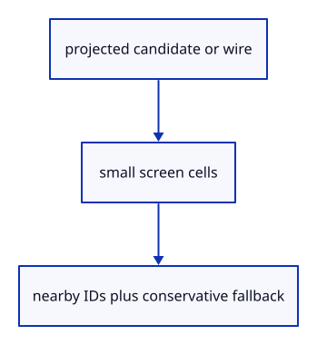

# 7.4.4 · Search nearby screen cells

**Chapter 7 · Drawing, snapping and transform tools · Section 7.4 · Object and grid snapping** · [Contents](contents.md)

**Typing: 14–28 minutes.** [Estimate](typing-load.md).

Index candidates in64 CSS-pixel cells. A query visits nearby cells; long or partially clipped wires remain in a conservative fallback list instead of filling an enormous rectangle.

## Type

Continue from [Collect targets from original placed geometry](49b-sources.md). [Save or recover your work](recovery.md).

### 1. `src/snap_bins.rs`

Bound screen-cell insertion and deduplicate nearby candidate IDs.

Create the file and type:

```rust
--8<-- "journey/code/49c-bins-01.rs"
```

### 2. `src/lib.rs`

Register the snap component and supplied checks.

<details>
<summary>Locate the existing block</summary>

```rust
pub mod snap_math;

pub mod snap_sources;
```

</details>

After that block, type:

```rust
--8<-- "journey/code/49c-bins-02.rs" skip=42
```

## Run and check

In your project:

```sh
cd workspace/journey
REGEN_PROTO=0 cargo build --lib --locked --target wasm32-unknown-unknown -j1
REGEN_PROTO=0 CARGO_BUILD_JOBS=1 trunk serve --port 8780
```

Open `http://127.0.0.1:8780/`. Keep an existing Trunk server running; saving rebuilds it.

Continue the earlier drawing exercise. The screen index is used by the candidate query in the next step.

### Recorded visual result

**Previous native render — current verification pending.**

The earlier temporary line band and cursor remain, without a saved line.


*This recorded image predates a source or checker change. Rebuild this checkpoint before using it as current evidence; browser controls require separate acceptance.*

This reference image is shared with [7.3.5 · Draw points and lines through the shared command dock](48d-input.md). It does not demonstrate a new feature by itself.

<details>
<summary>Code explanation and diagram</summary>


projected candidate or wire → small screen cells → nearby IDs plus conservative fallback.



Why retain a fallback for very long wires?

A wire can cross the cursor even when its endpoints are distant or clipped. Dropping it loses valid snaps; indexing every crossed cell wastes memory.

Study estimate, including typing and experiments: 0.5–1 hours.

</details>

<details>
<summary>Optional experiment</summary>

Insert a wire with enormous projected endpoints. It must remain queryable without allocating a huge range of cells.

</details>

<details>
<summary>Check and save your work</summary>

Restore experimental edits, then run from `session_viewer`:

```sh
npm --prefix ../session_tests run course -- check 7.4.4
npm --prefix ../session_tests run course -- save 7.4.4
```

Source comparison leaves your project untouched. [Save and recovery instructions](recovery.md).

</details>

<details>
<summary>Viewer coverage and verification</summary>

This preparation retains Point/Line drawing while adding snap infrastructure. Actual snap commands and canvas queries connect at 49f. Full construction-plane controls follow in 77.

The earlier unfinished line remains. Snapping is connected to canvas input at 49f.

[Full validation scope](release.md).

To reproduce the scripted acceptance of the reference checkpoint, run from `session_viewer` with the [course bundle server](release.md#reproduce) running on port 8781:

```sh
npm --prefix ../session_tests run course -- capture 7.4.4
```

This uses the verified reference bundle; it does not check or change your typed project.

</details>
