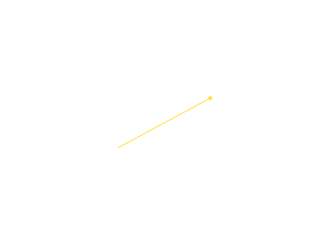
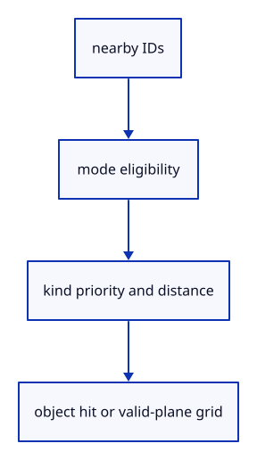

# 7.4.5 · Choose snap kinds before grid fallback

**Chapter 7 · Drawing, snapping and transform tools · Section 7.4 · Object and grid snapping** · [Contents](contents.md)

**Typing: 29–57 minutes.** [Estimate](typing-load.md).

Inside a12 CSS-pixel aperture, prefer End, Vertex, Mid, Center, Perp and Near in that order. Break same-kind ties by distance; use the grid only when no object target wins.

## Type

Continue from [Search nearby screen cells](49c-bins.md). [Save or recover your work](recovery.md).

### 1. `src/snap_index.rs`

Rank nearby valid candidates and apply independent construction-plane grid fallback.

Create the file and type:

```rust
--8<-- "journey/code/49d-index-01.rs"
```

### 2. `src/lib.rs`

Register the snap component and supplied checks.

<details>
<summary>Locate the existing block</summary>

```rust
pub mod snap_sources;

pub mod snap_bins;
```

</details>

After that block, type:

```rust
--8<-- "journey/code/49d-index-02.rs" skip=42
```

## Run and check

In your project:

```sh
cd workspace/journey
REGEN_PROTO=0 cargo build --lib --locked --target wasm32-unknown-unknown -j1
REGEN_PROTO=0 CARGO_BUILD_JOBS=1 trunk serve --port 8780
```

Open `http://127.0.0.1:8780/`. Keep an existing Trunk server running; saving rebuilds it.

Continue the earlier drawing exercise. The editor adopts this query next; actual canvas snapping follows at 49f.

### Recorded visual result

**Previous native render — current verification pending.**

The earlier temporary line band and cursor remain, without a saved line.



*This recorded image predates a source or checker change. Rebuild this checkpoint before using it as current evidence; browser controls require separate acceptance.*

This reference image is shared with [7.3.5 · Draw points and lines through the shared command dock](48d-input.md). It does not demonstrate a new feature by itself.

<details>
<summary>Code explanation and diagram</summary>


nearby IDs → mode eligibility → kind priority and distance → object hit or valid-plane grid.



Can a closer Near target displace an End inside the aperture?

No. Kind priority wins first. Distance chooses between targets of the same kind; grid rounding is only the fallback.

Study estimate, including typing and experiments: 0.5–1 hours.

</details>

<details>
<summary>Optional experiment</summary>

Query the same view repeatedly, then resize or orbit. Rebuild screen cells only when the matrix or CSS size changes; retain precise world candidates.

</details>

<details>
<summary>Check and save your work</summary>

Restore experimental edits, then run from `session_viewer`:

```sh
npm --prefix ../session_tests run course -- check 7.4.5
npm --prefix ../session_tests run course -- save 7.4.5
```

Source comparison leaves your project untouched. [Save and recovery instructions](recovery.md).

</details>

<details>
<summary>Viewer coverage and verification</summary>

This preparation retains Point/Line drawing while adding snap infrastructure. Actual snap commands and canvas queries connect at 49f. Full construction-plane controls follow in 77.

The earlier unfinished line remains. Snapping is connected to canvas input at 49f.

[Full validation scope](release.md).

To reproduce the scripted acceptance of the reference checkpoint, run from `session_viewer` with the [course bundle server](release.md#reproduce) running on port 8781:

```sh
npm --prefix ../session_tests run course -- capture 7.4.5
```

This uses the verified reference bundle; it does not check or change your typed project.

</details>
