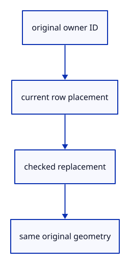

# 7.5.1 · Address placements across original geometry lanes

**Chapter 7 · Drawing, snapping and transform tools · Section 7.5 · Transform previews** · [Contents](contents.md)

**Typing: 9–17 minutes.** [Estimate](typing-load.md).

Read or replace an owner’s placement through one scene interface. Mesh, line, path and point rows retain their original geometry while checked matrices position their display.

## Type

Continue from [Snap actual drawing input through the command dock](49f-input.md). [Save or recover your work](recovery.md).

### 1. `src/scene.rs`

Read and replace checked placements across all supported original geometry lanes.

<details>
<summary>Locate the existing block</summary>

```rust
        for id in ids { if let Some(next) = self.selected_bounds(*id) {
            if let Some(b) = &mut bounds { b.include(next.min); b.include(next.max); } else { bounds = Some(next); }
        } } bounds
    }

    pub fn translate(&mut self, id: ObjectId, offset: [f64; 3]) -> Result<(), &'static str> {
```

</details>

Edit the existing block to match this code; keep unchanged lines:

```rust
--8<-- "journey/code/50-placements-01.rs"
```

## Run and check

In your project:

```sh
cd workspace/journey
REGEN_PROTO=0 cargo build --lib --locked --target wasm32-unknown-unknown -j1
REGEN_PROTO=0 CARGO_BUILD_JOBS=1 trunk serve --port 8780
```

Open `http://127.0.0.1:8780/`. Keep an existing Trunk server running; saving rebuilds it.

Continue the snapping exercise. These shared placement methods are used by the next preview model.

### Recorded visual result

**Previous native render — current verification pending.**

The saved line and temporary snapped band remain.


*This recorded image predates a source or checker change. Rebuild this checkpoint before using it as current evidence; browser controls require separate acceptance.*

This reference image is shared with [7.4.8 · Snap actual drawing input through the command dock](49f-input.md). It does not demonstrate a new feature by itself.

<details>
<summary>Code explanation and diagram</summary>


original owner ID → current row placement → checked replacement → same original geometry.



Does changing placement rewrite the source coordinates?

No. A row matrix positions the shared original geometry. Saving includes that placement; temporary edits can use a different row matrix without copying its vertices.

Study estimate, including typing and experiments: 0.5–1 hours.

</details>

<details>
<summary>Optional experiment</summary>

Compare mesh and line placement validation. Both must reject a nonfinite or projective matrix while preserving the row’s previous placement.

</details>

<details>
<summary>Check and save your work</summary>

Restore experimental edits, then run from `session_viewer`:

```sh
npm --prefix ../session_tests run course -- check 7.5.1
npm --prefix ../session_tests run course -- save 7.5.1
```

Source comparison leaves your project untouched. [Save and recovery instructions](recovery.md).

</details>

<details>
<summary>Viewer coverage and verification</summary>

This preparation retains snapping and Point/Line input. Placement preview input is connected at 50c; cancellation ownership and full direct-edit regression follow at 50d.

The earlier snapped line remains while placement preview infrastructure is introduced.

[Full validation scope](release.md).

To reproduce the scripted acceptance of the reference checkpoint, run from `session_viewer` with the [course bundle server](release.md#reproduce) running on port 8781:

```sh
npm --prefix ../session_tests run course -- capture 7.5.1
```

This uses the verified reference bundle; it does not check or change your typed project.

</details>
