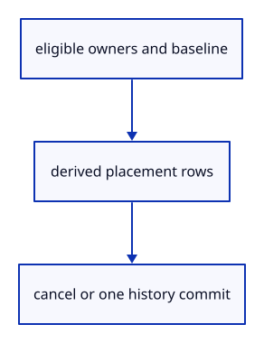

# 7.5.2 · Keep temporary placements outside the document

**Chapter 7 · Drawing, snapping and transform tools · Section 7.5 · Transform previews** · [Contents](contents.md)

**Typing: 21–42 minutes.** [Estimate](typing-load.md).

A preview captures eligible owners and their starting placements. Each update derives a fresh presentation from that baseline; commit groups every changed owner in one history transaction.

## Type

Continue from [Address placements across original geometry lanes](50-placements.md). [Save or recover your work](recovery.md).

### 1. `src/edit_preview.rs`

Capture eligible original owners, derive temporary placements and commit their group atomically.

Create the file and type:

```rust
--8<-- "journey/code/50a-preview-01.rs"
```

### 2. `src/lib.rs`

Register the placement preview and supplied checks.

<details>
<summary>Locate the existing block</summary>

```rust

#[cfg(test)]
mod snap_tests;
```

</details>

After that block, type:

```rust
--8<-- "journey/code/50a-preview-02.rs" skip=30
```

## Run and check

In your project:

```sh
cd workspace/journey
REGEN_PROTO=0 cargo build --lib --locked --target wasm32-unknown-unknown -j1
REGEN_PROTO=0 CARGO_BUILD_JOBS=1 trunk serve --port 8780
```

Open `http://127.0.0.1:8780/`. Keep an existing Trunk server running; saving rebuilds it.

Continue the snapping exercise. The preview model is adopted by the editor and browser next.

### Recorded visual result

**Previous native render — current verification pending.**

The saved line and temporary snapped band remain.


*This recorded image predates a source or checker change. Rebuild this checkpoint before using it as current evidence; browser controls require separate acceptance.*

This reference image is shared with [7.4.8 · Snap actual drawing input through the command dock](49f-input.md). It does not demonstrate a new feature by itself.

<details>
<summary>Code explanation and diagram</summary>


eligible owners and baseline → derived placement rows → cancel or one history commit.



Why derive each update from the baseline?

Applying each cursor delta to the previous preview accumulates movement. The same cursor position must produce the same placement regardless of intervening pointer events.

Study estimate, including typing and experiments: 0.5–1 hours.

</details>

<details>
<summary>Optional experiment</summary>

Update a preview several times and then commit or discard it. Original source owners stay shared; a zero transform must preserve redo.

</details>

<details>
<summary>Check and save your work</summary>

Restore experimental edits, then run from `session_viewer`:

```sh
npm --prefix ../session_tests run course -- check 7.5.2
npm --prefix ../session_tests run course -- save 7.5.2
```

Source comparison leaves your project untouched. [Save and recovery instructions](recovery.md).

</details>

<details>
<summary>Viewer coverage and verification</summary>

This preparation retains snapping and Point/Line input. Placement preview input is connected at 50c; cancellation ownership and full direct-edit regression follow at 50d.

The earlier snapped line remains while placement preview infrastructure is introduced.

[Full validation scope](release.md).

To reproduce the scripted acceptance of the reference checkpoint, run from `session_viewer` with the [course bundle server](release.md#reproduce) running on port 8781:

```sh
npm --prefix ../session_tests run course -- capture 7.5.2
```

This uses the verified reference bundle; it does not check or change your typed project.

</details>
