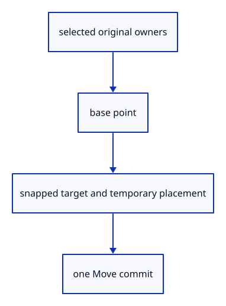

# 7.5.4 · Preview Move from a base point to a target

**Chapter 7 · Drawing, snapping and transform tools · Section 7.5 · Transform previews** · [Contents](contents.md)

**Typing: 28–55 minutes.** [Estimate](typing-load.md).

Bare Move asks for two points on the selected owners. Hovering previews their displacement; a valid target commits the mixed selection once. Snap targets exclude the moving owners after the base point.

## Type

Continue from [Present temporary edits through a separate scene view](50b-display.md). [Save or recover your work](recovery.md).

### 1. `src/tool.rs`

Preview a selected-owner Move, exclude its own snap targets and commit the chosen target once.

<details>
<summary>Locate the existing block</summary>

```rust
use crate::{marker::PreparedPoint, stroke::PreparedLine};
use std::rc::Rc;

pub enum Built { Point(PreparedPoint), Line(PreparedLine) }

pub trait Tool: std::fmt::Debug {
    fn name(&self) -> &'static str;
    fn count(&self) -> usize;
    fn build(&self, points: &[[f64; 3]]) -> Result<Built, &'static str>;
    fn buttons(&self) -> Vec<(String, String)> { vec![("Cancel".into(), "Escape".into())] }
}

#[derive(Clone, Copy, Debug)]
pub enum Shape { Point, Line }

impl Tool for Shape {
    fn name(&self) -> &'static str { match self { Self::Point => "Point", Self::Line => "Line" } }
    fn count(&self) -> usize { match self { Self::Point => 1, Self::Line => 2 } }
    fn build(&self, points: &[[f64; 3]]) -> Result<Built, &'static str> {
        match (self, points) {
            (Self::Point, [p]) => Ok(Built::Point(PreparedPoint::new(Rc::new(session_rust::Point::new(p[0], p[1], p[2])))?)),
            (Self::Line, [a, b]) => {
                if a.iter().zip(b).all(|(a, b)| (a-b).abs() < 1e-12) { return Err("Line endpoints must differ"); }
                Ok(Built::Line(PreparedLine::new(Rc::new(session_rust::Line::new(a[0], a[1], a[2], b[0], b[1], b[2])))?))
            }
            _ => Err("The tool needs more points"),
        }
    }
}

// A draft owns unfinished points and a cursor, so preview motion cannot become saved geometry or an Undo transaction.
pub struct Draft { pub tool: Box<dyn Tool>, pub points: Vec<[f64; 3]>, pub cursor: Option<[f64; 3]>, pub snapped: Option<crate::snap::Kind> }

impl Draft {
    pub fn new(shape: Shape) -> Self { Self { tool: Box::new(shape), points: Vec::new(), cursor: None, snapped: None } }
    pub fn prompt(&self) -> String {
        let mut prompt=format!("{} point {} of {} · Esc cancels", self.tool.name(), self.points.len()+1, self.tool.count());
        if let Some(kind)=self.snapped { prompt.push_str(&format!(" · Snap {kind:?}")); }
        prompt
    }
    pub fn submit(&mut self, point: [f64; 3]) -> Result<Option<Built>, &'static str> {
        let point = crate::tool_coords::checked(point)?;
        let mut points = self.points.clone(); points.push(point);
        if points.len() == self.tool.count() { return self.tool.build(&points).map(Some); }
        if points.len() > self.tool.count() { return Err("The tool has enough points"); }
        self.points = points; self.cursor = None; self.snapped = None; Ok(None)
    }
    pub fn hover(&mut self, point: Option<[f64; 3]>) -> Result<(), &'static str> {
        self.cursor = point.map(crate::tool_coords::checked).transpose()?; Ok(())
    }
}
```

</details>

Edit the existing block to match this code; keep unchanged lines:

```rust
use crate::{marker::PreparedPoint, stroke::PreparedLine};
use std::rc::Rc;

pub enum Built { Point(PreparedPoint), Line(PreparedLine), Move([f64; 3]) }

pub trait Tool: std::fmt::Debug {
    fn name(&self) -> &'static str;
    fn count(&self) -> usize;
    fn build(&self, points: &[[f64; 3]]) -> Result<Built, &'static str>;
    fn buttons(&self) -> Vec<(String, String)> { vec![("Cancel".into(), "Escape".into())] }
}

#[derive(Clone, Copy, Debug)]
pub enum Shape { Point, Line, Move }

impl Tool for Shape {
    fn name(&self) -> &'static str { match self { Self::Point => "Point", Self::Line => "Line", Self::Move => "Move" } }
    fn count(&self) -> usize { match self { Self::Point => 1, Self::Line | Self::Move => 2 } }
    fn build(&self, points: &[[f64; 3]]) -> Result<Built, &'static str> {
        match (self, points) {
            (Self::Point, [p]) => Ok(Built::Point(PreparedPoint::new(Rc::new(session_rust::Point::new(p[0], p[1], p[2])))?)),
            (Self::Line, [a, b]) => {
                if a.iter().zip(b).all(|(a, b)| (a-b).abs() < 1e-12) { return Err("Line endpoints must differ"); }
                Ok(Built::Line(PreparedLine::new(Rc::new(session_rust::Line::new(a[0], a[1], a[2], b[0], b[1], b[2])))?))
            }
            (Self::Move, [a,b]) => Ok(Built::Move(std::array::from_fn(|i| b[i]-a[i]))),
            _ => Err("The tool needs more points"),
        }
    }
}

// A draft owns unfinished points and a cursor, so preview motion cannot become saved geometry or an Undo transaction.
pub struct Draft { pub tool: Box<dyn Tool>, pub points: Vec<[f64; 3]>, pub cursor: Option<[f64; 3]>, pub snapped: Option<crate::snap::Kind> }

impl Draft {
    pub fn new(shape: Shape) -> Self { Self { tool: Box::new(shape), points: Vec::new(), cursor: None, snapped: None } }
    pub fn prompt(&self) -> String {
        let mut prompt=format!("{} point {} of {} · Esc cancels", self.tool.name(), self.points.len()+1, self.tool.count());
        if let Some(kind)=self.snapped { prompt.push_str(&format!(" · Snap {kind:?}")); }
        prompt
    }
    pub fn submit(&mut self, point: [f64; 3]) -> Result<Option<Built>, &'static str> {
        let point = crate::tool_coords::checked(point)?;
        let mut points = self.points.clone(); points.push(point);
        if points.len() == self.tool.count() { return self.tool.build(&points).map(Some); }
        if points.len() > self.tool.count() { return Err("The tool has enough points"); }
        self.points = points; self.cursor = None; self.snapped = None; Ok(None)
    }
    pub fn hover(&mut self, point: Option<[f64; 3]>) -> Result<(), &'static str> {
        self.cursor = point.map(crate::tool_coords::checked).transpose()?; Ok(())
    }
}
```

<details>
<summary>Optional patch references</summary>

Use these original edit fragments when comparing a saved checkpoint. Apply the complete blocks above.

```text
--8<-- "journey/code/50c-move-01.rs"
```

```text
--8<-- "journey/code/50c-move-02.rs"
```

```text
--8<-- "journey/code/50c-move-03.rs"
```

</details>

### 2. `src/editor.rs`

Preview a selected-owner Move, exclude its own snap targets and commit the chosen target once.

Edit these blocks from bottom to top. Keep the surrounding lines unchanged.

<details>
<summary>Locate this block</summary>

```rust
    pub fn snap_usage(&self) -> [u64; 2] { self.snap_index.as_ref().map_or([0,0], |index| [index.builds,index.visits as u64]) }

    pub fn apply(&mut self, action: Action) -> Result<Change, &'static str> {
        let change = self.apply_action(action)?;
        if change == Change::Scene { self.snap_index = None; }
        Ok(change)
    }

    fn apply_action(&mut self, action: Action) -> Result<Change, &'static str> {
        if matches!(&action, Action::Close | Action::Undo | Action::Redo | Action::Import(_) | Action::Replace(_) | Action::ImportAt(_, _) | Action::ReplaceAt(_, _)) { self.draft = None; }
        match action {
            Action::Snap(setting) => {
                self.tool_status = self.snapping.apply(setting)?;
                if let Some(draft) = self.draft.as_mut() { draft.cursor = None; draft.snapped = None; }
                return Ok(Change::View);
            }
            Action::ToolScreen { screen, size, commit } => {
                let hit = self.snap_point(screen,size);
                if let Some(draft) = self.draft.as_mut() { draft.snapped = hit.filter(|h| h.owner.is_some() || h.kind == crate::snap::Kind::Grid).map(|h| h.kind); }
                if commit { return hit.map_or(Ok(Change::View), |hit| self.place_tool_point(hit.point)); }
                if let Some(draft) = self.draft.as_mut() { draft.hover(hit.map(|h| h.point))?; }
                return Ok(Change::View);
            }
            Action::BeginTool(shape) => { self.snap_index = None; self.draft = Some(crate::tool::Draft::new(shape)); self.tool_status = self.draft.as_ref().unwrap().prompt(); return Ok(Change::View); }
            Action::ToolPoint(point) => return self.place_tool_point(point),
            Action::ToolHover(point) => { if let Some(draft) = self.draft.as_mut() { draft.snapped = None; draft.hover(point)?; } return Ok(Change::View); }
            Action::CancelTool => { self.draft = None; self.tool_status = "Tool cancelled.".into(); return Ok(Change::View); }
            Action::Picked(id) => self.select_objects(id, false),
            Action::PickedMany { target, additive } => {
                if self.pick_mode != crate::pick_sources::Mode::Object { return self.apply(Action::PickedTarget(target)); }
```

</details>

Replace it with:

```rust
    pub fn snap_usage(&self) -> [u64; 2] { self.snap_index.as_ref().map_or([0,0], |index| [index.builds,index.visits as u64]) }

    pub fn apply(&mut self, action: Action) -> Result<Change, &'static str> {
        let change=self.apply_action(action)?;
        if change==Change::Scene { self.snap_index=None; if self.edit_preview.take().is_some() { self.draft=None; } }
        Ok(change)
    }

    fn apply_action(&mut self, action: Action) -> Result<Change, &'static str> {

        if matches!(&action, Action::Close | Action::Undo | Action::Redo | Action::Import(_) | Action::Replace(_) | Action::ImportAt(_, _) | Action::ReplaceAt(_, _)) { self.draft = None; }
        match action {
            Action::Snap(setting) => {
                self.tool_status = self.snapping.apply(setting)?;
                if let Some(draft) = self.draft.as_mut() { draft.cursor = None; draft.snapped = None; }
                return self.update_edit_preview();
            }
            Action::ToolScreen { screen, size, commit } => {
                let hit = self.snap_point(screen,size);
                if let Some(draft) = self.draft.as_mut() { draft.snapped = hit.filter(|h| h.owner.is_some() || h.kind == crate::snap::Kind::Grid).map(|h| h.kind); }
                if commit { return hit.map_or(Ok(Change::View), |hit| self.place_tool_point(hit.point)); }
                if let Some(draft) = self.draft.as_mut() { draft.hover(hit.map(|h| h.point))?; }
                return self.update_edit_preview();
            }
            Action::BeginTool(shape) => {
                let preview=if matches!(shape,crate::tool::Shape::Move) {
                    if self.selected_part.is_some() { return Err("Use Select Object before Move"); }
                    Some(crate::edit_preview::Preview::new(&self.scene,self.selected_objects())?)
                } else { None };
                let changed=preview.is_some() || self.edit_preview.is_some(); self.edit_preview=preview;
                self.snap_index=None; self.draft=Some(crate::tool::Draft::new(shape)); self.tool_status=self.draft.as_ref().unwrap().prompt();
                return Ok(if changed { Change::Preview } else { Change::View });
            }
            Action::ToolPoint(point) => return self.place_tool_point(point),
            Action::ToolHover(point) => { if let Some(draft) = self.draft.as_mut() { draft.snapped=None; draft.hover(point)?; } return self.update_edit_preview(); }
            Action::CancelTool => { let changed=self.edit_preview.take().is_some(); self.draft=None; self.tool_status="Tool cancelled.".into(); return Ok(if changed { Change::Preview } else { Change::View }); }
            Action::Picked(id) => self.select_objects(id, false),
            Action::PickedMany { target, additive } => {
                if self.pick_mode != crate::pick_sources::Mode::Object { return self.apply(Action::PickedTarget(target)); }
```

<details>
<summary>Locate this block</summary>

```rust
    fn place_tool_point(&mut self, point: [f64; 3]) -> Result<Change, &'static str> {
        let draft = self.draft.as_mut().ok_or("No point tool is running")?;
        let name = draft.tool.name();
        let Some(built) = draft.submit(point)? else { self.tool_status = draft.prompt(); return Ok(Change::View); };
        self.history.try_edit(&mut self.scene, |scene| match built {
            crate::tool::Built::Point(point) => scene.insert_point(point).map(|_| ()),
            crate::tool::Built::Line(line) => scene.insert_line(line).map(|_| ()),
        })?;
        self.draft = None; self.tool_status = format!("{name} created."); Ok(Change::Scene)
    }
```

</details>

Replace it with:

```rust
    fn place_tool_point(&mut self, point: [f64; 3]) -> Result<Change, &'static str> {
        let draft = self.draft.as_mut().ok_or("No point tool is running")?;
        let name = draft.tool.name();
        let Some(built) = draft.submit(point)? else { self.tool_status = draft.prompt(); self.snap_index=None; return self.update_edit_preview(); };
        if let crate::tool::Built::Move(offset)=built {
            let preview=self.edit_preview.as_mut().ok_or("No placement preview is running")?;
            preview.set(session_rust::Xform::translation(offset[0],offset[1],offset[2]))?;
            let changed=preview.commit(&mut self.scene,&mut self.history)?;
            if self.edit_preview.take().is_some() { self.draft=None; } self.tool_status="Move completed.".into();
            return Ok(if changed { Change::Scene } else { Change::Preview });
        }
        self.history.try_edit(&mut self.scene, |scene| match built {
            crate::tool::Built::Point(point) => scene.insert_point(point).map(|_| ()),
            crate::tool::Built::Line(line) => scene.insert_line(line).map(|_| ()),
            crate::tool::Built::Move(_) => unreachable!("Move uses its placement preview"),
        })?;
        self.draft = None; self.tool_status = format!("{name} created."); Ok(Change::Scene)
    }
```

<details>
<summary>Complete updated block reference</summary>

```rust
use crate::{background::Background, camera::Camera, history::History, scene::{ObjectId, Scene}};

pub enum Action {
    Snap(crate::snap::Setting),
    ToolScreen { screen: [f32; 2], size: [f64; 2], commit: bool },
    BeginTool(crate::tool::Shape),
    ToolPoint([f64; 3]),
    ToolHover(Option<[f64; 3]>),
    CancelTool,
    Pick([f32; 2]),
    Picked(Option<ObjectId>),
    PickedTarget(Option<crate::pick_sources::Target>),
    PickedMany { target: Option<crate::pick_sources::Target>, additive: bool },
    SelectAll,
    PickMode(crate::pick_sources::Mode),
    Import(Vec<u8>),
    Replace(Vec<u8>),
    ImportAt(Vec<u8>, std::rc::Rc<crate::reload_url::ReloadUrl>),
    ReplaceAt(Vec<u8>, std::rc::Rc<crate::reload_url::ReloadUrl>),
    Close,
    UnloadSources,
    AddBox,
    AddLine,
    AddPoint,
    AddCurve,
    AddColours(crate::colour::Mode),
    NormalView(bool),
    Grid(Option<crate::grid::Settings>),
    AddNormals(crate::normal_example::Mode),
    Controls(bool),
    AddPolyline,
    AddArrow,
    Translate([f64; 3]),
    ToggleExtra,
    SelectNext,
    Delete,
    Undo,
    Redo,
    Background,
    Zoom(f32),
    Pan(f32, f32),
    Orbit(f64, f64),
    Isometric,
    ResetView,
    Fit,
    FitSelected,
    Projection(crate::camera::Projection),
}

#[derive(Debug, PartialEq, Eq)]
pub enum Change {
    View,
    Scene,
    Preview,
}

pub struct Editor {
    pub edit_preview: Option<crate::edit_preview::Preview>,
    pub snapping: crate::snap::Settings,
    snap_index: Option<crate::snap_index::Index>,
    pub draft: Option<crate::tool::Draft>,
    pub tool_status: String,
    pub scene: Scene,
    pub selected: Option<ObjectId>,
    pub selected_part: Option<crate::pick_sources::Part>,
    pub pick_mode: crate::pick_sources::Mode,
    objects: crate::object_selection::Objects,
    pub camera: Camera,
    pub background: Background,
    pub normal_view: bool,
    history: History,
    last_release: u64,
}

impl Default for Editor {
    fn default() -> Self {
        Self {
            edit_preview: None, snapping: Default::default(), snap_index: None,
            draft: None, tool_status: String::new(),
            scene: Scene::demo(),
            selected: None, selected_part: None, pick_mode: Default::default(), objects: Default::default(),
            camera: Camera::default(),
            background: Background::default(),
            normal_view: false,
            history: History::default(),
            last_release: 0,
        }
    }
}

impl Editor {
    pub fn display_scene(&self) -> &Scene { self.edit_preview.as_ref().map_or(&self.scene,|p| &p.scene) }

    fn update_edit_preview(&mut self) -> Result<Change, &'static str> {
        let Some(preview)=self.edit_preview.as_mut() else { return Ok(Change::View); };
        let offset=self.draft.as_ref().and_then(|d| d.points.first().zip(d.cursor)).map(|(a,b)| std::array::from_fn::<_,3,_>(|i| b[i]-a[i])).unwrap_or([0.;3]);
        preview.set(session_rust::Xform::translation(offset[0],offset[1],offset[2]))?; Ok(Change::Preview)
    }

    pub fn scenes(&self) -> impl Iterator<Item = &Scene> {
        std::iter::once(&self.scene).chain(self.history.scenes())
    }

    pub fn reload_keys(&self) -> Vec<crate::rehydrate::ReloadKey> {
        let mut seen = std::collections::HashSet::new();
        self.scene.objects().iter().filter_map(crate::rehydrate::ReloadKey::of)
            .filter(|key| seen.insert(key.origin.id)).collect()
    }

    fn scenes_mut(&mut self) -> impl Iterator<Item = &mut Scene> {
        std::iter::once(&mut self.scene).chain(self.history.scenes_mut())
    }

    pub fn hydrate(&mut self, values: Vec<(crate::rehydrate::ReloadKey, Vec<u8>)>) -> Result<bool, &'static str> {
        if values.is_empty() { return Ok(false); }
        let mut seen = std::collections::HashSet::new();
        for (key, _) in &values {
            if !seen.insert(key.origin.id) || !self.scene.objects().iter().any(|row| key.matches(row)) {
                return Ok(false);
            }
        }
        let prepared: Vec<_> = values.into_iter().map(|(key, bytes)|
            crate::rehydrate::PreparedReload::new(key, &bytes)).collect::<Result<_, _>>()?;
        for plan in &prepared {
            if self.scenes().flat_map(|scene| scene.objects()).filter(|row| plan.key.matches(row))
                .any(|row| !plan.validates(row)) { return Err("Reloaded source GUID or metadata does not match"); }
        }
        for scene in self.scenes_mut() {
            for plan in &prepared { scene.hydrate(plan); }
        }
        self.snap_index = None; Ok(true)
    }

    fn unload_sources(&mut self) -> Result<(), &'static str> {
        let mut origins: std::collections::HashSet<_> = self.scenes().flat_map(|scene| scene.objects())
            .filter(|row| row.can_unload()).filter_map(|row| row.origin().map(|origin| origin.id)).collect();
        for row in self.scenes().flat_map(|scene| scene.objects()) {
            if let Some(origin) = row.origin() {
                if !row.can_unload() { origins.remove(&origin.id); }
            }
        }
        if origins.is_empty() { return Err("No eligible imported sources to unload"); }
        let epoch = self.last_release.checked_add(1).ok_or("Release epochs exhausted")?;
        for scene in self.scenes_mut() { scene.unload(&origins, epoch); }
        self.last_release = epoch;
        Ok(())
    }

    pub fn move_object(&mut self, id: ObjectId, offset: [f64; 3]) -> Result<Change, &'static str> {
        if !offset.iter().all(|value| value.is_finite()) { return Err("Move needs finite coordinates"); }
        let object = self.scene.objects().iter().find(|row| row.id == id).ok_or("Object not found")?;
        if offset.iter().all(|&value| value == 0.0) { return Ok(Change::View); }
        let shift = session_rust::Xform::translation(offset[0], offset[1], offset[2]);
        let model = &shift * &object.model;
        self.history.try_edit(&mut self.scene, |scene| scene.place(id, model))?;
        self.snap_index = None; Ok(Change::Scene)
    }

    pub fn delete_object(&mut self, id: ObjectId) -> Result<Change, &'static str> {
        if !self.scene.contains(id) { return Err("Object not found"); }
        if self.scene.objects().iter().find(|row| row.id == id).is_some_and(|row| row.geometry().is_none()) {
            return Err("Reload editable sources before Delete");
        }
        self.history.edit(&mut self.scene, |scene| { scene.remove(id); });
        self.objects.retain(&self.scene);
        if self.selected == Some(id) { self.selected = self.objects.primary(); self.selected_part = None; }
        self.snap_index = None; Ok(Change::Scene)
    }

    pub fn selected_objects(&self) -> Vec<ObjectId> {
        if self.selected_part.is_some() { return Vec::new(); }
        if self.objects.primary() == self.selected { self.objects.rows().to_vec() }
        else { self.selected.into_iter().filter(|id| self.scene.pick_id(id.value()).is_some()).collect() }
    }

    pub fn select_objects(&mut self, rows: impl IntoIterator<Item = ObjectId>, additive: bool) {
        if additive { let old = self.selected_objects(); self.objects.set(&self.scene, old, false); }
        self.selected_part = None; self.objects.set(&self.scene, rows, additive); self.selected = self.objects.primary();
    }

    fn repair_selection(&mut self) {
        if self.objects.primary() == self.selected && self.selected_part.is_none() {
            self.objects.retain(&self.scene); self.selected = self.objects.primary();
        } else { self.objects.clear(); }
    }

    fn move_selection(&mut self, offset: [f64; 3]) -> Result<Change, &'static str> {
        if !offset.iter().all(|n| n.is_finite()) { return Err("Move needs finite coordinates"); }
        let ids = self.selected_objects(); if ids.is_empty() { return Err("Select an object before Move"); }
        if offset.iter().all(|&n| n == 0.) { return Ok(Change::View); }
        self.history.try_edit(&mut self.scene, |scene| {
            for id in ids { scene.translate(id, offset)?; } Ok(())
        })?; Ok(Change::Scene)
    }

    fn delete_selection(&mut self) -> Result<Change, &'static str> {
        if self.selected_part.is_some() { return Err("Use Select Object before Delete"); }
        let ids = self.selected_objects(); if ids.is_empty() { return Ok(Change::View); }
        if self.scene.objects().iter().any(|r| ids.contains(&r.id) && r.geometry().is_none()) {
            return Err("Reload editable sources before Delete");
        }
        self.history.edit(&mut self.scene, |scene| { for id in ids { scene.remove(id); } });
        self.objects.clear(); self.selected = None; Ok(Change::Scene)
    }

    pub fn selection(&self) -> Option<crate::pick_sources::Target> {
        self.selected.map(|owner| crate::pick_sources::Target { owner, part: self.selected_part.unwrap_or(crate::pick_sources::Part::Object) })
    }

    pub fn whole_selection(&self) -> Option<ObjectId> { self.selected.filter(|_| self.selected_part.is_none()) }

    pub fn tool_line(&self, text: &str) -> Option<Result<Action, &'static str>> {
        self.draft.as_ref()?;
        if text.trim().is_empty() || text.eq_ignore_ascii_case("Escape") { return Some(Ok(Action::CancelTool)); }
        text.contains(',').then(|| crate::tool_coords::parse(text).map(Action::ToolPoint))
    }

    fn place_tool_point(&mut self, point: [f64; 3]) -> Result<Change, &'static str> {
        let draft = self.draft.as_mut().ok_or("No point tool is running")?;
        let name = draft.tool.name();
        let Some(built) = draft.submit(point)? else { self.tool_status = draft.prompt(); self.snap_index=None; return self.update_edit_preview(); };
        if let crate::tool::Built::Move(offset)=built {
            let preview=self.edit_preview.as_mut().ok_or("No placement preview is running")?;
            preview.set(session_rust::Xform::translation(offset[0],offset[1],offset[2]))?;
            let changed=preview.commit(&mut self.scene,&mut self.history)?;
            if self.edit_preview.take().is_some() { self.draft=None; } self.tool_status="Move completed.".into();
            return Ok(if changed { Change::Scene } else { Change::Preview });
        }
        self.history.try_edit(&mut self.scene, |scene| match built {
            crate::tool::Built::Point(point) => scene.insert_point(point).map(|_| ()),
            crate::tool::Built::Line(line) => scene.insert_line(line).map(|_| ()),
            crate::tool::Built::Move(_) => unreachable!("Move uses its placement preview"),
        })?;
        self.draft = None; self.tool_status = format!("{name} created."); Ok(Change::Scene)
    }

    pub fn snap_point(&mut self, screen: [f32; 2], size: [f64; 2]) -> Option<crate::snap::Hit> {
        let ray = self.camera.ray(screen)?;
        let from = self.draft.as_ref()?.points.last().copied();
        let hit = if self.snapping.objects {
            let exclude=self.edit_preview.as_ref().filter(|_| from.is_some()).map_or_else(Vec::new,|p| p.ids().to_vec());
            let index = self.snap_index.get_or_insert_with(|| crate::snap_index::Index::new(&self.scene).excluding(&exclude));
            let viewport = crate::snap_math::Screen { matrix: self.camera.view_projection().m, size };
            index.query(viewport, &ray, [(screen[0] as f64+1.)*size[0]/2., (1.-screen[1] as f64)*size[1]/2.], self.snapping.modes, from)
        } else { None };
        hit.or_else(|| crate::snap_index::fallback(self.snapping, &self.camera, screen))
    }

    pub fn snap_usage(&self) -> [u64; 2] { self.snap_index.as_ref().map_or([0,0], |index| [index.builds,index.visits as u64]) }

    pub fn apply(&mut self, action: Action) -> Result<Change, &'static str> {
        let change=self.apply_action(action)?;
        if change==Change::Scene { self.snap_index=None; if self.edit_preview.take().is_some() { self.draft=None; } }
        Ok(change)
    }

    fn apply_action(&mut self, action: Action) -> Result<Change, &'static str> {

        if matches!(&action, Action::Close | Action::Undo | Action::Redo | Action::Import(_) | Action::Replace(_) | Action::ImportAt(_, _) | Action::ReplaceAt(_, _)) { self.draft = None; }
        match action {
            Action::Snap(setting) => {
                self.tool_status = self.snapping.apply(setting)?;
                if let Some(draft) = self.draft.as_mut() { draft.cursor = None; draft.snapped = None; }
                return self.update_edit_preview();
            }
            Action::ToolScreen { screen, size, commit } => {
                let hit = self.snap_point(screen,size);
                if let Some(draft) = self.draft.as_mut() { draft.snapped = hit.filter(|h| h.owner.is_some() || h.kind == crate::snap::Kind::Grid).map(|h| h.kind); }
                if commit { return hit.map_or(Ok(Change::View), |hit| self.place_tool_point(hit.point)); }
                if let Some(draft) = self.draft.as_mut() { draft.hover(hit.map(|h| h.point))?; }
                return self.update_edit_preview();
            }
            Action::BeginTool(shape) => {
                let preview=if matches!(shape,crate::tool::Shape::Move) {
                    if self.selected_part.is_some() { return Err("Use Select Object before Move"); }
                    Some(crate::edit_preview::Preview::new(&self.scene,self.selected_objects())?)
                } else { None };
                let changed=preview.is_some() || self.edit_preview.is_some(); self.edit_preview=preview;
                self.snap_index=None; self.draft=Some(crate::tool::Draft::new(shape)); self.tool_status=self.draft.as_ref().unwrap().prompt();
                return Ok(if changed { Change::Preview } else { Change::View });
            }
            Action::ToolPoint(point) => return self.place_tool_point(point),
            Action::ToolHover(point) => { if let Some(draft) = self.draft.as_mut() { draft.snapped=None; draft.hover(point)?; } return self.update_edit_preview(); }
            Action::CancelTool => { let changed=self.edit_preview.take().is_some(); self.draft=None; self.tool_status="Tool cancelled.".into(); return Ok(if changed { Change::Preview } else { Change::View }); }
            Action::Picked(id) => self.select_objects(id, false),
            Action::PickedMany { target, additive } => {
                if self.pick_mode != crate::pick_sources::Mode::Object { return self.apply(Action::PickedTarget(target)); }
                self.select_objects(target.filter(|t| t.part == crate::pick_sources::Part::Object && t.valid(&self.scene)).map(|t| t.owner), additive);
            }
            Action::SelectAll => {
                let ids: Vec<_> = self.scene.objects().iter().map(|r| r.id).chain(self.scene.lines().iter().map(|r| r.id))
                    .chain(self.scene.paths().iter().map(|r| r.id)).chain(self.scene.points().iter().map(|r| r.id)).collect();
                self.select_objects(ids, false);
            }
            Action::PickedTarget(target) => {
                let target = target.filter(|target| target.valid(&self.scene));
                self.objects.clear();
                self.selected = target.map(|target| target.owner);
                if let Some(target) = target.filter(|t| t.part == crate::pick_sources::Part::Object) { self.objects.set(&self.scene, [target.owner], false); }
                self.selected_part = target.map(|target| target.part).filter(|part| *part != crate::pick_sources::Part::Object);
            }
            Action::PickMode(mode) => { self.pick_mode = mode; self.selected = None; self.selected_part = None; self.objects.clear(); }
            Action::Pick(screen) => {
                let id = self.camera.ray(screen).and_then(|ray| crate::picking::pick(&self.scene, &ray));
                self.select_objects(id, false);
            }
            Action::UnloadSources => self.unload_sources()?,
            Action::Close => {
                self.scene.clear();
                self.history.clear();
                self.objects.clear(); self.selected = None;
            }
            Action::Replace(bytes) => {
                let loaded = crate::document::load(&bytes)?;
                self.history.try_edit(&mut self.scene, |scene| scene.replace(loaded))?;
            }
            Action::Import(bytes) => {
                let loaded = crate::document::load(&bytes)?;
                self.history.try_edit(&mut self.scene, |scene| scene.import(loaded))?;
            }
            Action::ImportAt(bytes, location) => {
                let loaded = crate::document::load_at(&bytes, Some(location))?;
                self.history.try_edit(&mut self.scene, |scene| scene.import(loaded))?;
            }
            Action::ReplaceAt(bytes, location) => {
                let loaded = crate::document::load_at(&bytes, Some(location))?;
                self.history.try_edit(&mut self.scene, |scene| scene.replace(loaded))?;
            }
            Action::AddPolyline | Action::AddArrow => {
                let prepared = if matches!(action, Action::AddPolyline) {
                    let mut line = session_rust::Polyline::new(vec![session_rust::Point::new(-0.6, -0.4, 0.0),
                        session_rust::Point::new(0.0, 0.0, 0.0), session_rust::Point::new(0.6, -0.4, 0.0)]);
                    line.width = 6.0; line.linecolor = session_rust::Color::new(0.0, 0.0, 0.0, 0.5);
                    crate::chain::PreparedChain::polyline(std::rc::Rc::new(line))?
                } else {
                    let mut line = session_rust::Line::new(-0.6, 0.3, 0.0, 0.6, 0.3, 0.0);
                    line.width = 5.0; line.linecolor = session_rust::Color::new(0.0, 0.0, 0.0, 1.0);
                    line.arrowhead = session_rust::Arrowhead::BOTH;
                    crate::chain::PreparedChain::line(std::rc::Rc::new(line))?
                };
                self.history.try_edit(&mut self.scene, |scene| scene.insert_path(prepared).map(|_| ()))?;
            }
            Action::Controls(visible) => self.scene.show_controls(visible),
            Action::AddNormals(mode) => {
                let prepared = crate::prepared::PreparedMesh::new(crate::normal_example::specimen(mode))?;
                self.history.try_edit(&mut self.scene, |scene| scene.insert(prepared).map(|_| ()))?;
            }
            Action::AddColours(mode) => {
                let prepared = crate::prepared::PreparedMesh::new(crate::colour::specimen(mode))?;
                self.history.try_edit(&mut self.scene, |scene| scene.insert(prepared).map(|_| ()))?;
            }
            Action::AddCurve => {
                let mut curve = session_rust::NurbsCurve::create(false, 2, &[session_rust::Point::new(-0.6, -0.4, 0.0),
                    session_rust::Point::new(0.0, 0.6, 0.0), session_rust::Point::new(0.6, -0.4, 0.0)]);
                curve.width = 5.0; curve.linecolors = vec![session_rust::Color::new(0.0, 0.0, 0.0, 0.5)];
                let prepared = crate::chain::PreparedChain::curve(std::rc::Rc::new(curve))?;
                self.history.try_edit(&mut self.scene, |scene| scene.insert_path(prepared).map(|_| ()))?;
            }
            Action::AddPoint => {
                let mut point = session_rust::Point::new(0.0, 0.0, 0.0);
                point.width = 12.0; point.pointcolor = session_rust::Color::new(0.0, 0.0, 0.0, 0.5);
                let prepared = crate::marker::PreparedPoint::new(std::rc::Rc::new(point))?;
                self.history.try_edit(&mut self.scene, |scene| scene.insert_point(prepared).map(|_| ()))?;
            }
            Action::AddLine => {
                let mut line = session_rust::Line::new(-0.6, 0.0, 0.0, 0.6, 0.0, 0.0);
                line.width = 5.0; line.linecolor = session_rust::Color::new(0.0, 0.0, 0.0, 1.0);
                let prepared = crate::stroke::PreparedLine::new(std::rc::Rc::new(line))?;
                self.history.try_edit(&mut self.scene, |scene| scene.insert_line(prepared).map(|_| ()))?;
            }
            Action::AddBox => {
                self.history.try_edit(&mut self.scene, |scene| scene.add_box().map(|_| ()))?;
            }
            Action::Translate(offset) => return self.move_selection(offset),
            Action::ToggleExtra => self.history.edit(&mut self.scene, Scene::toggle_extra),
            Action::SelectNext => { let id = self.scene.next(self.selected); self.select_objects(id, false); }
            Action::Delete => return self.delete_selection(),
            Action::Undo => { self.history.undo(&mut self.scene); }
            Action::Redo => { self.history.redo(&mut self.scene); }
            view => {
                match view {
                    Action::Background => self.background.toggle(),
                    Action::NormalView(visible) => self.normal_view = visible,
                    Action::Grid(settings) => {
                        if let Some(grid) = settings { grid.half()?; grid.reach(self.camera.target)?; }
                        self.camera.grid = settings;
                    }
                    Action::Zoom(factor) => self.camera.zoom(factor),
                    Action::Pan(dx, dy) => self.camera.pan(dx, dy),
                    Action::Orbit(yaw, pitch) => self.camera.orbit(yaw, pitch),
                    Action::Isometric => self.camera.isometric(),
                    Action::Projection(mode) => self.camera.projection = mode,
                    Action::Fit => {
                        if let Some(bounds) = self.scene.bounds() {
                            self.camera.fit(&bounds);
                        }
                    }
                    Action::FitSelected => {
                        if let Some(bounds) = self.scene.bounds_of(&self.selected_objects()).or_else(|| self.selected_part.and(self.selected).and_then(|id| self.scene.selected_bounds(id)))
                        {
                            self.camera.fit(&bounds);
                        }
                    }
                    Action::ResetView => {
                        let aspect = self.camera.aspect;
                        self.camera = Camera { aspect, grid: self.camera.grid, ..Camera::default() };
                    }
                    _ => unreachable!("Document actions were handled above"),
                }
                return Ok(Change::View);
            }
        }
        // Deletion and history travel can invalidate selection; repair it in one place.
        self.repair_selection();
        self.selected = self.selected.filter(|id| self.scene.contains(*id));
        if let (Some(owner), Some(part)) = (self.selected, self.selected_part) {
            if !(crate::pick_sources::Target { owner, part }).valid(&self.scene) { self.selected = None; }
        }
        if self.selected.is_none() { self.selected_part = None; }
        Ok(Change::Scene)
    }
}

#[cfg(test)]
mod tests {
    use super::*;

    #[test]
    fn a_modified_history_row_protects_only_its_own_import_origin() {
        use std::rc::Rc;
        let mut editor = Editor::default(); let bytes = crate::specimen::bytes();
        let first = Rc::new(crate::reload_url::ReloadUrl::new("test:first".into()));
        editor.apply(Action::ReplaceAt(bytes.clone(), first)).unwrap();
        let origin = editor.scene.objects()[0].origin().unwrap().id;
        let original = Rc::downgrade(editor.scene.objects()[0].geometry().unwrap());
        let second = Rc::new(crate::reload_url::ReloadUrl::new("test:second".into()));
        editor.apply(Action::ImportAt(bytes, second)).unwrap();
        let copy = Rc::downgrade(editor.scene.objects()[3].geometry().unwrap());
        editor.apply(Action::SelectNext).unwrap(); editor.apply(Action::Translate([0.25, 0.0, 0.0])).unwrap();
        editor.apply(Action::Undo).unwrap();
        let saved = editor.history.scenes_mut().last().unwrap();
        assert_eq!(saved.objects()[0].origin().unwrap().id, origin);
        Rc::make_mut(&mut saved.objects_mut()[0].metadata).is_locked = true;
        assert!(editor.scene.objects()[0].can_unload());
        editor.apply(Action::UnloadSources).unwrap();
        assert!(original.upgrade().is_some()); assert!(copy.upgrade().is_none());
        assert!(editor.scene.objects()[0].geometry().is_some());
        assert!(editor.scene.objects()[3].geometry().is_none());
        assert_eq!(editor.last_release, 1);
        assert!(editor.apply(Action::UnloadSources).is_err()); assert_eq!(editor.last_release, 1);
    }

    #[test]
    fn release_epochs_do_not_wrap_or_reset_on_close() {
        use std::rc::Rc;
        let mut editor = Editor::default(); let bytes = crate::specimen::bytes();
        let url = Rc::new(crate::reload_url::ReloadUrl::new("test:epoch".into()));
        editor.apply(Action::ReplaceAt(bytes.clone(), Rc::clone(&url))).unwrap();
        editor.last_release = u64::MAX;
        assert_eq!(editor.apply(Action::UnloadSources), Err("Release epochs exhausted"));
        assert!(editor.scene.objects()[0].geometry().is_some());
        editor.last_release = 0; editor.apply(Action::UnloadSources).unwrap();
        assert_eq!(editor.scene.objects()[0].release_epoch(), Some(1));
        editor.apply(Action::Close).unwrap();
        editor.apply(Action::ImportAt(bytes, url)).unwrap();
        editor.apply(Action::UnloadSources).unwrap();
        assert_eq!(editor.scene.objects()[0].release_epoch(), Some(2));
    }

    #[test]
    fn close_ends_history_and_keeps_issued_ids_and_view_settings() {
        let mut editor = Editor::default();
        editor.apply(Action::Import(crate::specimen::bytes())).unwrap();
        editor.apply(Action::AddBox).unwrap(); editor.apply(Action::Undo).unwrap();
        let old: Vec<_> = editor.scenes().flat_map(|scene| scene.objects().iter().map(|row| row.id)).collect();
        editor.apply(Action::SelectNext).unwrap();
        editor.apply(Action::Pan(0.2, 0.1)).unwrap(); editor.apply(Action::Background).unwrap();
        let view = editor.camera.uniform(); let background = editor.background.rgb();
        editor.apply(Action::Close).unwrap();
        assert!(editor.scene.objects().is_empty() && editor.selected.is_none());
        assert_eq!(editor.scenes().count(), 1);
        editor.apply(Action::Undo).unwrap(); editor.apply(Action::Redo).unwrap();
        assert!(editor.scene.objects().is_empty());
        assert_eq!(editor.camera.uniform(), view); assert_eq!(editor.background.rgb(), background);
        editor.apply(Action::AddBox).unwrap();
        assert!(!old.contains(&editor.scene.objects()[0].id));
    }

    #[test]
    fn repeated_close_is_empty_and_drops_sources_without_gpu_owners() {
        let mut editor = Editor::default();
        let display = std::rc::Rc::downgrade(&editor.scene.objects()[0].mesh);
        let source = std::rc::Rc::downgrade(editor.scene.objects()[0].geometry().unwrap());
        editor.apply(Action::Close).unwrap(); editor.apply(Action::Close).unwrap();
        assert!(display.upgrade().is_none() && source.upgrade().is_none());
        assert_eq!(crate::memory::cpu(editor.scenes(), std::iter::empty()), [0, 0, 0, 0, 0, 1]);
    }

    #[test]
    fn close_releases_imported_history_documents_and_reopening_uses_fresh_ids() {
        use std::rc::Rc;
        let mut editor = Editor::default();
        let bytes = crate::specimen::bytes();
        editor.apply(Action::Import(bytes.clone())).unwrap();
        editor.apply(Action::Replace(bytes.clone())).unwrap();
        let displays: Vec<_> = editor.scenes().flat_map(|scene| scene.objects().iter()
            .map(|row| Rc::downgrade(&row.mesh))).collect();
        let sources: Vec<_> = editor.scenes().flat_map(|scene| scene.objects().iter()
            .map(|row| Rc::downgrade(row.geometry().unwrap()))).collect();
        let documents: Vec<_> = editor.scenes().flat_map(|scene| scene.objects().iter()
            .filter_map(|row| row.source().map(|source| Rc::downgrade(&source.document)))).collect();
        let old: Vec<_> = editor.scenes().flat_map(|scene| scene.objects().iter().map(|row| row.id)).collect();
        assert!(!documents.is_empty());
        editor.apply(Action::Close).unwrap();
        assert!(displays.iter().all(|owner| owner.upgrade().is_none()));
        assert!(sources.iter().all(|owner| owner.upgrade().is_none()));
        assert!(documents.iter().all(|owner| owner.upgrade().is_none()));
        editor.apply(Action::Import(bytes)).unwrap();
        assert!(editor.scene.objects().iter().all(|row| !old.contains(&row.id)));
    }

    #[test]
    fn resetting_the_view_preserves_its_current_aspect() {
        let mut editor = Editor::default();
        editor.camera.aspect = 2.0;
        editor.apply(Action::Zoom(2.0)).unwrap();
        editor.apply(Action::ResetView).unwrap();
        assert_eq!(editor.camera.aspect, 2.0);
        assert_eq!(editor.camera.distance, 3.0);
    }

    #[test]
    fn undo_changes_the_document_without_rewinding_the_view() {
        let mut editor = Editor::default();
        editor.apply(Action::AddBox).unwrap();
        editor.apply(Action::Zoom(2.0)).unwrap();
        editor.apply(Action::Background).unwrap();
        editor.apply(Action::Undo).unwrap();
        assert_eq!(editor.scene.objects().len(), 2);
        assert_eq!(editor.camera.distance, 1.5);
        assert_eq!(editor.background.rgb(), [0.9, 0.9, 0.9]);
    }

    #[test]
    fn undo_repairs_selection_and_empty_delete_preserves_redo() {
        let mut editor = Editor::default();
        editor.apply(Action::AddBox).unwrap();
        for _ in 0..3 {
            editor.apply(Action::SelectNext).unwrap();
        }
        let box_id = editor.selected.unwrap();
        editor.apply(Action::Undo).unwrap();
        assert!(editor.selected.is_none());
        editor.apply(Action::Delete).unwrap();
        editor.apply(Action::Redo).unwrap();
        assert!(editor.scene.contains(box_id));
    }

    #[test]
    fn picking_a_moved_view_uses_the_editors_current_camera() {
        let mut editor = Editor::default();
        editor.apply(Action::Pan(0.2, 0.1)).unwrap();
        let point = session_rust::Point::new(0.2, 0.3, 0.75);
        let screen = editor.camera.view_projection().transform_point(&point);
        assert_eq!(editor.apply(Action::Pick([screen[0] as f32, screen[1] as f32])).unwrap(), Change::Scene);
        assert_eq!(editor.selected, Some(editor.scene.objects()[1].id));
        assert_eq!(editor.apply(Action::Zoom(2.0)).unwrap(), Change::View);
    }
}
```

</details>

<details>
<summary>Optional patch references</summary>

Use these original edit fragments when comparing a saved checkpoint. Apply the complete blocks above.

```text
--8<-- "journey/code/50c-move-04.rs"
```

```text
--8<-- "journey/code/50c-move-05.rs"
```

</details>

### 3. `src/commands.rs`

Preview a selected-owner Move, exclude its own snap targets and commit the chosen target once.

Edit these blocks from bottom to top. Keep the surrounding lines unchanged.

<details>
<summary>Locate this block</summary>

```rust
pub fn parse(line: &str) -> Result<Command, String> {
    let words: Vec<_> = line.split_whitespace().collect();
    let (name, count) = matched(&words).ok_or("Unknown command. Type Help.")?;
    if name == "Move" {
        return crate::offset::parse(&format!("Move {}", words[count..].join(" ")))
            .map(|offset| Command::Editor(Action::Translate(offset))).map_err(str::to_owned);
    }
```

</details>

Replace it with:

```rust
pub fn parse(line: &str) -> Result<Command, String> {
    let words: Vec<_> = line.split_whitespace().collect();
    let (name, count) = matched(&words).ok_or("Unknown command. Type Help.")?;
    if name == "Move" && words.len()>count {
        return crate::offset::parse(&format!("Move {}", words[count..].join(" ")))
            .map(|offset| Command::Editor(Action::Translate(offset))).map_err(str::to_owned);
    }
```

<details>
<summary>Locate this block</summary>

```rust
];

pub fn names() -> Vec<&'static str> {
    HOSTS.iter().map(|(name, _)| *name).chain(ACTIONS.iter().map(|(name, _)| *name)).chain(["Move"]).collect()
}

// Choose the longest known name so Open Replace cannot become Open with an unwanted argument.
```

</details>

Replace it with:

```rust
];

pub fn names() -> Vec<&'static str> {
    HOSTS.iter().map(|(name, _)| *name).chain(ACTIONS.iter().map(|(name, _)| *name)).collect()
}

// Choose the longest known name so Open Replace cannot become Open with an unwanted argument.
```

<details>
<summary>Locate this block</summary>

```rust
    ("Snap Mid", || Action::Snap(crate::snap::Setting::Mode(crate::snap::MID))),
    ("Snap Center", || Action::Snap(crate::snap::Setting::Mode(crate::snap::CENTER))),
    ("Snap Perp", || Action::Snap(crate::snap::Setting::Mode(crate::snap::PERP))),
    ("Point", || Action::BeginTool(crate::tool::Shape::Point)),
    ("Line", || Action::BeginTool(crate::tool::Shape::Line)),
    ("Example Box", || Action::AddBox),
```

</details>

Replace it with:

```rust
    ("Snap Mid", || Action::Snap(crate::snap::Setting::Mode(crate::snap::MID))),
    ("Snap Center", || Action::Snap(crate::snap::Setting::Mode(crate::snap::CENTER))),
    ("Snap Perp", || Action::Snap(crate::snap::Setting::Mode(crate::snap::PERP))),
    ("Move", || Action::BeginTool(crate::tool::Shape::Move)),
    ("Point", || Action::BeginTool(crate::tool::Shape::Point)),
    ("Line", || Action::BeginTool(crate::tool::Shape::Line)),
    ("Example Box", || Action::AddBox),
```

<details>
<summary>Complete updated block reference</summary>

```rust
use crate::editor::Action;

#[derive(Clone, Copy, Debug, PartialEq, Eq)]
pub enum Host { Help, Open, Replace, CancelOpen, Reload, CancelReload, Save, Report, PreviousReport, Selection }

pub enum Command { Editor(Action), Host(Host) }

pub type Factory = fn() -> Action;
pub const ACTIONS: &[(&str, Factory)] = &[
    ("Snap", || Action::Snap(crate::snap::Setting::Objects(None))),
    ("Snap On", || Action::Snap(crate::snap::Setting::Objects(Some(true)))),
    ("Snap Off", || Action::Snap(crate::snap::Setting::Objects(Some(false)))),
    ("Grid Snap", || Action::Snap(crate::snap::Setting::Grid(None))),
    ("Grid Snap On", || Action::Snap(crate::snap::Setting::Grid(Some(true)))),
    ("Grid Snap Off", || Action::Snap(crate::snap::Setting::Grid(Some(false)))),
    ("Snap End", || Action::Snap(crate::snap::Setting::Mode(crate::snap::END))),
    ("Snap Near", || Action::Snap(crate::snap::Setting::Mode(crate::snap::NEAR))),
    ("Snap Mid", || Action::Snap(crate::snap::Setting::Mode(crate::snap::MID))),
    ("Snap Center", || Action::Snap(crate::snap::Setting::Mode(crate::snap::CENTER))),
    ("Snap Perp", || Action::Snap(crate::snap::Setting::Mode(crate::snap::PERP))),
    ("Move", || Action::BeginTool(crate::tool::Shape::Move)),
    ("Point", || Action::BeginTool(crate::tool::Shape::Point)),
    ("Line", || Action::BeginTool(crate::tool::Shape::Line)),
    ("Example Box", || Action::AddBox),
    ("Example Line", || Action::AddLine),
    ("Example Point", || Action::AddPoint),
    ("Example Curve", || Action::AddCurve),
    ("Example Object Color", || Action::AddColours(crate::colour::Mode::Object)),
    ("Example Point Colors", || Action::AddColours(crate::colour::Mode::Points)),
    ("Example Face Colors", || Action::AddColours(crate::colour::Mode::Faces)),
    ("View Normals On", || Action::NormalView(true)),
    ("View Normals Off", || Action::NormalView(false)),
    ("View Grid On", || Action::Grid(Some(crate::grid::Settings::default()))),
    ("View Grid Off", || Action::Grid(None)),
    ("Example Sharp", || Action::AddNormals(crate::normal_example::Mode::Sharp)),
    ("Example Smooth", || Action::AddNormals(crate::normal_example::Mode::Smooth)),
    ("Example Winding", || Action::AddNormals(crate::normal_example::Mode::Winding)),
    ("Controls On", || Action::Controls(true)),
    ("Controls Off", || Action::Controls(false)),
    ("Example Polyline", || Action::AddPolyline),
    ("Example Arrow", || Action::AddArrow),
    ("Example Triangle", || Action::ToggleExtra),
    ("Select Next", || Action::SelectNext),
    ("Select All", || Action::SelectAll),
    ("Select None", || Action::Picked(None)),
    ("Select Object", || Action::PickMode(crate::pick_sources::Mode::Object)),
    ("Select Face", || Action::PickMode(crate::pick_sources::Mode::Face)),
    ("Select Edge", || Action::PickMode(crate::pick_sources::Mode::Edge)),
    ("Select Control", || Action::PickMode(crate::pick_sources::Mode::Control)),
    ("Delete", || Action::Delete),
    ("Undo", || Action::Undo),
    ("Redo", || Action::Redo),
    ("Background", || Action::Background),
    ("Zoom In", || Action::Zoom(2.0)),
    ("Zoom Out", || Action::Zoom(0.5)),
    ("Pan Left", || Action::Pan(-0.25, 0.0)),
    ("Pan Right", || Action::Pan(0.25, 0.0)),
    ("Orbit Right", || Action::Orbit(std::f64::consts::FRAC_PI_4, 0.0)),
    ("Orbit Up", || Action::Orbit(0.0, std::f64::consts::FRAC_PI_6)),
    ("View Isometric", || Action::Isometric),
    ("Fit", || Action::Fit),
    ("Fit Selected", || Action::FitSelected),
    ("View Reset", || Action::ResetView),
    ("View Perspective", || Action::Projection(crate::camera::Projection::Perspective)),
    ("View Orthographic", || Action::Projection(crate::camera::Projection::Orthographic)),
    ("Close", || Action::Close),
    ("Unload Sources", || Action::UnloadSources),
];

pub const HOSTS: &[(&str, Host)] = &[
    ("Help", Host::Help),
    ("Open", Host::Open),
    ("Open Replace", Host::Replace),
    ("Cancel Open", Host::CancelOpen),
    ("Reload Sources", Host::Reload),
    ("Cancel Reload", Host::CancelReload),
    ("Save", Host::Save),
    ("Report", Host::Report),
    ("Report Previous", Host::PreviousReport),
    ("Selection", Host::Selection),
];

pub fn names() -> Vec<&'static str> {
    HOSTS.iter().map(|(name, _)| *name).chain(ACTIONS.iter().map(|(name, _)| *name)).collect()
}

// Choose the longest known name so Open Replace cannot become Open with an unwanted argument.
fn matched(words: &[&str]) -> Option<(&'static str, usize)> {
    names().into_iter().filter_map(|name| {
        let compact = name.split_whitespace().collect::<String>().to_ascii_lowercase();
        let mut rest = compact.as_str();
        for (index, word) in words.iter().enumerate() {
            let word = word.to_ascii_lowercase();
            rest = rest.strip_prefix(&word)?;
            if rest.is_empty() { return Some((name, index + 1, compact.len())); }
        }
        None
    }).max_by_key(|(_, _, letters)| *letters).map(|(name, count, _)| (name, count))
}

pub fn canonical(line: &str) -> String {
    let words: Vec<_> = line.split_whitespace().collect();
    matched(&words).map_or_else(|| line.trim().to_owned(), |(name, count)| {
        std::iter::once(name).chain(words[count..].iter().copied()).collect::<Vec<_>>().join(" ")
    })
}

pub fn parse(line: &str) -> Result<Command, String> {
    let words: Vec<_> = line.split_whitespace().collect();
    let (name, count) = matched(&words).ok_or("Unknown command. Type Help.")?;
    if name == "Move" && words.len()>count {
        return crate::offset::parse(&format!("Move {}", words[count..].join(" ")))
            .map(|offset| Command::Editor(Action::Translate(offset))).map_err(str::to_owned);
    }
    if name == "Grid Snap" && words.len() > count {
        if words.len() != count+1 { return Err("Grid Snap (On Off) or a spacing".into()); }
        let step = words[count].parse::<f64>().map_err(|_| "Grid Snap (On Off) or a spacing")?;
        if !step.is_finite() || step<=0. { return Err("The grid spacing must be above zero · Example: Grid Snap 50".into()); }
        return Ok(Command::Editor(Action::Snap(crate::snap::Setting::Spacing(step))));
    }
    if words.len() != count { return Err(format!("{name} takes no arguments")); }
    if let Some((_, make)) = ACTIONS.iter().find(|(key, _)| *key == name) { return Ok(Command::Editor(make())); }
    let (_, host) = HOSTS.iter().find(|(key, _)| *key == name).ok_or("Command registry is incomplete")?;
    Ok(Command::Host(*host))
}
```

</details>

<details>
<summary>Optional patch references</summary>

Use these original edit fragments when comparing a saved checkpoint. Apply the complete blocks above.

```text
--8<-- "journey/code/50c-move-06.rs"
```

```text
--8<-- "journey/code/50c-move-07.rs"
```

```text
--8<-- "journey/code/50c-move-08.rs"
```

</details>

<details>
<summary>Supplied validation fixture</summary>

Copy this supplied authoring fixture once. Continue with the browser build below; the course does not require running native tests.

### 4. `src/commands_tests.rs`

Copy updated parser checks: bare Move starts a tool while invalid positional forms still fail.

<details>
<summary>Locate the existing block</summary>

```text
    let mut editor = Editor::default(); editor.apply(Action::SelectNext).unwrap();
    editor.apply(Action::Translate([1., 0., 0.])).unwrap(); editor.apply(Action::Undo).unwrap();
    let source = editor.scene.objects()[0].mesh.clone(); let placement = editor.scene.objects()[0].model.m;
    for text in ["", "Unknown", "Delete all", "Open Replace extra", "Fit Selected extra", "Move", "Move 1 2", "Move 1,,2", "Move NaN,0,0", "Move 1,2,inf", "Move 1,2,3,4", "Move 1 2,3,4"] {
        assert!(commands::parse(text).is_err(), "{text}");
        assert_eq!(editor.scene.objects()[0].model.m, placement);
        assert!(std::rc::Rc::ptr_eq(&source, &editor.scene.objects()[0].mesh));
```

</details>

Update the existing block with this supplied code; keep unchanged lines:

```text
--8<-- "journey/code/50c-move-09.rs"
```

</details>

## Run and check

In your project:

```sh
cd workspace/journey
REGEN_PROTO=0 cargo build --lib --locked --target wasm32-unknown-unknown -j1
REGEN_PROTO=0 CARGO_BUILD_JOBS=1 trunk serve --port 8780
```

Open `http://127.0.0.1:8780/`. Keep an existing Trunk server running; saving rebuilds it.

Close; Example Box; Select All; Snap Off; Grid Snap Off; Move; 0,0,0. Hover elsewhere: the box moves temporarily. Type 0.5,0.25,0 to commit, then Undo restores its whole placement.

### Recorded visual result

**Previous native render — current verification pending.**

The saved line and temporary snapped band remain.

This checkpoint was rendered independently and has the same native comparison frame as [Present temporary edits through a separate scene view](50b-display.md). Use its state checks and browser exercise to assess the changed behavior.


*This recorded image predates a source or checker change. Rebuild this checkpoint before using it as current evidence; browser controls require separate acceptance.*

This reference image is shared with [7.4.8 · Snap actual drawing input through the command dock](49f-input.md). It does not demonstrate a new feature by itself.

<details>
<summary>Code explanation and diagram</summary>


selected original owners → base point → snapped target and temporary placement → one Move commit.



Why exclude moving owners from target snapping?

Their captured positions are the movement’s inputs. Reusing those positions as destination targets can pull the cursor back onto the geometry being moved.

Study estimate, including typing and experiments: 0.5–1 hours.

</details>

<details>
<summary>Optional experiment</summary>

Select a box and line together, then Move from one base point to one target. One Undo must restore both owners. Move 1,2,3 retains its immediate positional form.

</details>

<details>
<summary>Check and save your work</summary>

Restore experimental edits, then run from `session_viewer`:

```sh
npm --prefix ../session_tests run course -- check 7.5.4
npm --prefix ../session_tests run course -- save 7.5.4
```

Source comparison leaves your project untouched. [Save and recovery instructions](recovery.md).

</details>

<details>
<summary>Viewer coverage and verification</summary>

Point-tool infrastructure now supports a selected-owner Move from base to target and its original positional form. Normal completion and Escape work; the next step completes document-command cancellation and captured-edit ownership. Browser acceptance remains pending.

The previous snap and point-tool checks remain. New direct-edit regression checks arrive at 50d. Actual browser acceptance is pending.

The earlier snapped line remains while placement preview infrastructure is introduced.

[Full validation scope](release.md).

To reproduce the scripted acceptance of the reference checkpoint, run from `session_viewer` with the [course bundle server](release.md#reproduce) running on port 8781:

```sh
npm --prefix ../session_tests run course -- capture 7.5.4
```

This uses the verified reference bundle; it does not check or change your typed project.

</details>
