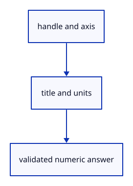

# 7.6.1 · Name move, rotation and scale handles

**Chapter 7 · Drawing, snapping and transform tools · Section 7.6 · Move, rotate and scale handles** · [Contents](contents.md)

**Typing: 25–50 minutes.** [Estimate](typing-load.md).

Each handle names an operation and world axis. Typed movement uses millimeters, rotation uses degrees and scaling uses a positive factor; neutral values create no edit.

## Type

Continue from [Cancel previews without consuming document history](50d-ownership.md). [Save or recover your work](recovery.md).

### 1. `src/gizmo.rs`

Define world-axis handles, labels and finite operation-specific numeric answers.

Create the file and type:

```rust
--8<-- "journey/code/51-handles-01.rs"
```

### 2. `src/lib.rs`

Register the handle component and supplied checks.

<details>
<summary>Locate the existing block</summary>

```rust

#[cfg(test)]
mod edit_preview_tests;
```

</details>

After that block, type:

```rust
--8<-- "journey/code/51-handles-02.rs" skip=38
```

## Run and check

In your project:

```sh
cd workspace/journey
REGEN_PROTO=0 cargo build --lib --locked --target wasm32-unknown-unknown -j1
REGEN_PROTO=0 CARGO_BUILD_JOBS=1 trunk serve --port 8780
```

Open `http://127.0.0.1:8780/`. Keep an existing Trunk server running; saving rebuilds it.

Continue the previous two-box Move exercise. Handle input connects after these drawing and editing preparations.

### Recorded visual result

**Previous native render — current verification pending.**

The earlier two gold boxes and temporary Move band remain.


*This recorded image predates a source or checker change. Rebuild this checkpoint before using it as current evidence; browser controls require separate acceptance.*

This reference image is shared with [7.5.5 · Cancel previews without consuming document history](50d-ownership.md). It does not demonstrate a new feature by itself.

<details>
<summary>Code explanation and diagram</summary>


handle and axis → title and units → validated numeric answer.



Can a scale factor of zero be accepted?

No. It collapses geometry. Empty input or factor1 makes no change; negative and nonfinite factors fail.

Study estimate, including typing and experiments: 0.5–1 hours.

</details>

<details>
<summary>Optional experiment</summary>

Compare Translate X and Scale X. Their visible positions, units and neutral values must remain distinct.

</details>

<details>
<summary>Check and save your work</summary>

Restore experimental edits, then run from `session_viewer`:

```sh
npm --prefix ../session_tests run course -- check 7.6.1
npm --prefix ../session_tests run course -- save 7.6.1
```

Source comparison leaves your project untouched. [Save and recovery instructions](recovery.md).

</details>

<details>
<summary>Viewer coverage and verification</summary>

This preparation retains the earlier Move input. Current handle math and drawing are introduced in dependency order; selection and pointer input are connected later in this subject.

The earlier temporary Move remains while handle infrastructure is introduced.

[Full validation scope](release.md).

To reproduce the scripted acceptance of the reference checkpoint, run from `session_viewer` with the [course bundle server](release.md#reproduce) running on port 8781:

```sh
npm --prefix ../session_tests run course -- capture 7.6.1
```

This uses the verified reference bundle; it does not check or change your typed project.

</details>
