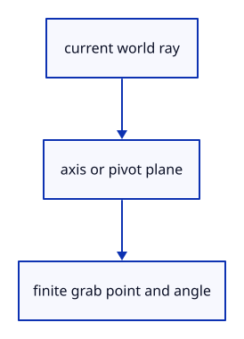

# 7.6.2 · Measure handle rays in original world coordinates

**Chapter 7 · Drawing, snapping and transform tools · Section 7.6 · Move, rotate and scale handles** · [Contents](contents.md)

**Typing: 24–48 minutes.** [Estimate](typing-load.md).

A handle drag intersects its world axis or a plane through its pivot. Reject parallel or behind-eye intersections; positive scaling is softened without mirroring.

## Type

Continue from [Name move, rotation and scale handles](51-handles.md). [Save or recover your work](recovery.md).

### 1. `src/gizmo.rs`

Resolve checked world-ray intersections, pivot transforms and positive drag scaling.

<details>
<summary>Locate the existing block</summary>

```rust
        }
        Handle::Scale(_) | Handle::ScaleUniform => Ok((value != 1.0).then_some(value)),
        Handle::Translate(_) | Handle::Rotate(_) => Ok((value != 0.0).then_some(value)),
    }
}
```

</details>

After that block, type:

```rust
--8<-- "journey/code/51a-rays-01.rs" skip=196
```

## Run and check

In your project:

```sh
cd workspace/journey
REGEN_PROTO=0 cargo build --lib --locked --target wasm32-unknown-unknown -j1
REGEN_PROTO=0 CARGO_BUILD_JOBS=1 trunk serve --port 8780
```

Open `http://127.0.0.1:8780/`. Keep an existing Trunk server running; saving rebuilds it.


### Recorded visual result

**Previous native render — current verification pending.**

The earlier two gold boxes and temporary Move band remain.


*This recorded image predates a source or checker change. Rebuild this checkpoint before using it as current evidence; browser controls require separate acceptance.*

This reference image is shared with [7.5.5 · Cancel previews without consuming document history](50d-ownership.md). It does not demonstrate a new feature by itself.

<details>
<summary>Code explanation and diagram</summary>


current world ray → axis or pivot plane → finite grab point and angle.



Why reject a parallel axis drag?

It has no unique closest grab position. Inventing an intersection would make a tiny camera change produce a large movement.

Study estimate, including typing and experiments: 0.5–1 hours.

</details>

<details>
<summary>Optional experiment</summary>

Compare plane and axis intersections. Only a valid point in front of the ray can start a drag.

</details>

<details>
<summary>Check and save your work</summary>

Restore experimental edits, then run from `session_viewer`:

```sh
npm --prefix ../session_tests run course -- check 7.6.2
npm --prefix ../session_tests run course -- save 7.6.2
```

Source comparison leaves your project untouched. [Save and recovery instructions](recovery.md).

</details>

<details>
<summary>Viewer coverage and verification</summary>

This preparation retains the earlier Move input. Current handle math and drawing are introduced in dependency order; selection and pointer input are connected later in this subject.

The earlier temporary Move remains while handle infrastructure is introduced.

[Full validation scope](release.md).

To reproduce the scripted acceptance of the reference checkpoint, run from `session_viewer` with the [course bundle server](release.md#reproduce) running on port 8781:

```sh
npm --prefix ../session_tests run course -- capture 7.6.2
```

This uses the verified reference bundle; it does not check or change your typed project.

</details>
