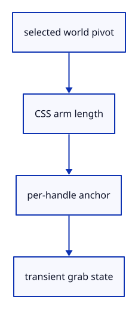

# 7.6.3 · Keep handle state at one original-world pivot

**Chapter 7 · Drawing, snapping and transform tools · Section 7.6 · Move, rotate and scale handles** · [Contents](contents.md)

**Typing: 12–24 minutes.** [Estimate](typing-load.md).

The pivot stores the selected geometry’s world position. Handle anchors use CSS size converted to world length; moving the pivot clears an older drag or number request.

## Type

Continue from [Measure handle rays in original world coordinates](51a-rays.md). [Save or recover your work](recovery.md).

### 1. `src/gizmo.rs`

Own transient handle state and compute each handle’s projected anchor.

<details>
<summary>Locate the existing block</summary>

```rust
    }
}

fn typed_factor(value: f64) -> f64 {
    if value <= 0.0 {
        return MIN_SCALE;
```

</details>

Edit the existing block to match this code; keep unchanged lines:

```rust
--8<-- "journey/code/51b-pivot-01.rs"
```

## Run and check

In your project:

```sh
cd workspace/journey
REGEN_PROTO=0 cargo build --lib --locked --target wasm32-unknown-unknown -j1
REGEN_PROTO=0 CARGO_BUILD_JOBS=1 trunk serve --port 8780
```

Open `http://127.0.0.1:8780/`. Keep an existing Trunk server running; saving rebuilds it.


### Recorded visual result

**Previous native render — current verification pending.**

The earlier two gold boxes and temporary Move band remain.


*This recorded image predates a source or checker change. Rebuild this checkpoint before using it as current evidence; browser controls require separate acceptance.*

This reference image is shared with [7.5.5 · Cancel previews without consuming document history](50d-ownership.md). It does not demonstrate a new feature by itself.

<details>
<summary>Code explanation and diagram</summary>


selected world pivot → CSS arm length → per-handle anchor → transient grab state.



Why does the number field use a different anchor for every handle?

It belongs beside the operation that opened it. Pinning all fields to the pivot hides which axis or scale ball the value changes.

Study estimate, including typing and experiments: 0.5–1 hours.

</details>

<details>
<summary>Optional experiment</summary>

Inspect the arrow, ball, arc and hub anchors. Rotation arcs occupy the quadrant opposite the positive arms.

</details>

<details>
<summary>Check and save your work</summary>

Restore experimental edits, then run from `session_viewer`:

```sh
npm --prefix ../session_tests run course -- check 7.6.3
npm --prefix ../session_tests run course -- save 7.6.3
```

Source comparison leaves your project untouched. [Save and recovery instructions](recovery.md).

</details>

<details>
<summary>Viewer coverage and verification</summary>

This preparation retains the earlier Move input. Current handle math and drawing are introduced in dependency order; selection and pointer input are connected later in this subject.

The earlier temporary Move remains while handle infrastructure is introduced.

[Full validation scope](release.md).

To reproduce the scripted acceptance of the reference checkpoint, run from `session_viewer` with the [course bundle server](release.md#reproduce) running on port 8781:

```sh
npm --prefix ../session_tests run course -- capture 7.6.3
```

This uses the verified reference bundle; it does not check or change your typed project.

</details>
