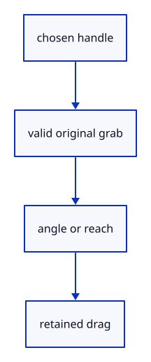

# 7.6.5 · Capture the handle’s original grab

**Chapter 7 · Drawing, snapping and transform tools · Section 7.6 · Move, rotate and scale handles** · [Contents](contents.md)

**Typing: 17–34 minutes.** [Estimate](typing-load.md).

Record the original grab point, rotation angle or scale reach. Every update will compare the current ray against that fixed start, without accumulating pointer deltas.

## Type

Continue from [Pick handles in a stable priority order](51c-hit.md). [Save or recover your work](recovery.md).

### 1. `src/gizmo.rs`

Capture original world grab measurements before producing a transform.

<details>
<summary>Locate the existing block</summary>

```rust
        None
    }

}

fn typed_factor(value: f64) -> f64 {
```

</details>

Edit the existing block to match this code; keep unchanged lines:

```rust
--8<-- "journey/code/51d-grab-01.rs"
```

## Run and check

In your project:

```sh
cd workspace/journey
REGEN_PROTO=0 cargo build --lib --locked --target wasm32-unknown-unknown -j1
REGEN_PROTO=0 CARGO_BUILD_JOBS=1 trunk serve --port 8780
```

Open `http://127.0.0.1:8780/`. Keep an existing Trunk server running; saving rebuilds it.


### Recorded visual result

**Previous native render — current verification pending.**

The earlier two gold boxes and temporary Move band remain.


*This recorded image predates a source or checker change. Rebuild this checkpoint before using it as current evidence; browser controls require separate acceptance.*

This reference image is shared with [7.5.5 · Cancel previews without consuming document history](50d-ownership.md). It does not demonstrate a new feature by itself.

<details>
<summary>Code explanation and diagram</summary>


chosen handle → valid original grab → angle or reach → retained drag.



Should a camera-facing axis invent a grab when its intersection is undefined?

No. A refused grab leaves the document and gesture state unchanged. Another visible handle can still be used.

Study estimate, including typing and experiments: 0.5–1 hours.

</details>

<details>
<summary>Optional experiment</summary>

Compare the initial scale reach with its later value. The scale begins at1 even when the grab is distant from the pivot.

</details>

<details>
<summary>Check and save your work</summary>

Restore experimental edits, then run from `session_viewer`:

```sh
npm --prefix ../session_tests run course -- check 7.6.5
npm --prefix ../session_tests run course -- save 7.6.5
```

Source comparison leaves your project untouched. [Save and recovery instructions](recovery.md).

</details>

<details>
<summary>Viewer coverage and verification</summary>

This preparation retains the earlier Move input. Current handle math and drawing are introduced in dependency order; selection and pointer input are connected later in this subject.

The earlier temporary Move remains while handle infrastructure is introduced.

[Full validation scope](release.md).

To reproduce the scripted acceptance of the reference checkpoint, run from `session_viewer` with the [course bundle server](release.md#reproduce) running on port 8781:

```sh
npm --prefix ../session_tests run course -- capture 7.6.5
```

This uses the verified reference bundle; it does not check or change your typed project.

</details>
