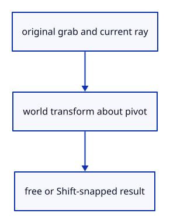

# 7.6.6 · Derive handle transforms and quarter-turn snapping

**Chapter 7 · Drawing, snapping and transform tools · Section 7.6 · Move, rotate and scale handles** · [Contents](contents.md)

**Typing: 26–52 minutes.** [Estimate](typing-load.md).

Movement follows one world axis. Rotation and scale act about the captured pivot; Shift rounds rotation to90-degree steps. Explicit typed scale remains precise below the drag minimum.

## Type

Continue from [Capture the handle’s original grab](51d-grab.md). [Save or recover your work](recovery.md).

### 1. `src/gizmo.rs`

Derive world transforms from original grabs and implement current90-degree Shift rotation snapping.

<details>
<summary>Locate the existing block</summary>

```rust
        Some(drag)
    }

}

fn typed_factor(value: f64) -> f64 {
```

</details>

Edit the existing block to match this code; keep unchanged lines:

```rust
--8<-- "journey/code/51e-transform-01.rs"
```

<details>
<summary>Supplied validation fixture</summary>

Copy this supplied authoring fixture once. Continue with the browser build below; the course does not require running native tests.

### 2. `src/gizmo_tests.rs`

Copy fourteen maintained handle-math regression checks.

Copy this supplied file:

```text
--8<-- "journey/code/51e-transform-02.rs"
```

</details>

### 3. `src/lib.rs`

Register the handle component and supplied checks.

<details>
<summary>Locate the existing block</summary>

```rust
mod edit_preview_tests;

pub mod gizmo;
```

</details>

After that block, type:

```rust
--8<-- "journey/code/51e-transform-03.rs" skip=40
```

## Run and check

In your project:

```sh
cd workspace/journey
REGEN_PROTO=0 cargo build --lib --locked --target wasm32-unknown-unknown -j1
REGEN_PROTO=0 CARGO_BUILD_JOBS=1 trunk serve --port 8780
```

Open `http://127.0.0.1:8780/`. Keep an existing Trunk server running; saving rebuilds it.


### Recorded visual result

**Previous native render — current verification pending.**

The earlier two gold boxes and temporary Move band remain.


*This recorded image predates a source or checker change. Rebuild this checkpoint before using it as current evidence; browser controls require separate acceptance.*

This reference image is shared with [7.5.5 · Cancel previews without consuming document history](50d-ownership.md). It does not demonstrate a new feature by itself.

<details>
<summary>Code explanation and diagram</summary>


original grab and current ray → world transform about pivot → free or Shift-snapped result.



Does Shift snap a rotation relative to the last pointer event?

No. It rounds the total angle swept from the original grab. Repeating the same cursor position produces the same transform.

Study estimate, including typing and experiments: 0.5–1 hours.

</details>

<details>
<summary>Optional experiment</summary>

Compare a60-degree free rotation with its90-degree Shift result. The pivot must remain fixed under rotation and scale.

</details>

<details>
<summary>Check and save your work</summary>

Restore experimental edits, then run from `session_viewer`:

```sh
npm --prefix ../session_tests run course -- check 7.6.6
npm --prefix ../session_tests run course -- save 7.6.6
```

Source comparison leaves your project untouched. [Save and recovery instructions](recovery.md).

</details>

<details>
<summary>Viewer coverage and verification</summary>

This preparation retains the earlier Move input. Current handle math and drawing are introduced in dependency order; selection and pointer input are connected later in this subject.

The earlier temporary Move remains while handle infrastructure is introduced.

[Full validation scope](release.md).

To reproduce the scripted acceptance of the reference checkpoint, run from `session_viewer` with the [course bundle server](release.md#reproduce) running on port 8781:

```sh
npm --prefix ../session_tests run course -- capture 7.6.6
```

This uses the verified reference bundle; it does not check or change your typed project.

</details>
