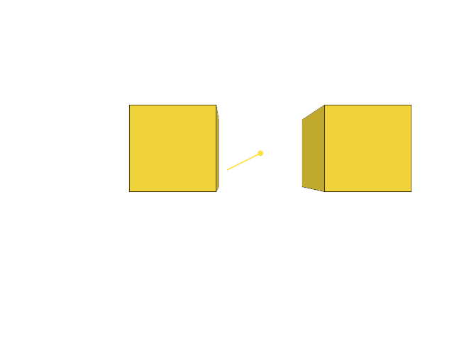

# 7.6.8 · Build local arrows balls and rotation arcs

**Chapter 7 · Drawing, snapping and transform tools · Section 7.6 · Move, rotate and scale handles** · [Contents](contents.md)

**Typing: 18–36 minutes.** [Estimate](typing-load.md).

Reuse the surface sampler for the original lathed shafts, cones, balls, rotation arcs and central hub. Assign the ten local handle numbers once and return the complete static mesh for its later GPU upload.

## Type

Continue from [Pack and sample local handle vertices](51ez-pack-and-sample-local-handle-vertices.md). [Save or recover your work](recovery.md).

### 1. `src/widget_mesh.rs`

Extend this original owner with today’s complete helper.

<details>
<summary>Locate the existing block</summary>

```rust
fn orient(p: [f32; 3], axis: usize) -> [f32; 3] {
    match axis {
        0 => p,
        1 => [p[2], p[0], p[1]],
        _ => [p[1], p[2], p[0]],
    }
```

</details>

Edit the existing block to match this code; keep unchanged lines:

```rust
--8<-- "journey/code/51f-mesh-1.rs"
```

## Run and check

In your project:

```sh
cd workspace/journey
REGEN_PROTO=0 cargo build --lib --locked --target wasm32-unknown-unknown -j1
REGEN_PROTO=0 CARGO_BUILD_JOBS=1 trunk serve --port 8780
```

Open `http://127.0.0.1:8780/`. Keep an existing Trunk server running; saving rebuilds it.

The complete static handle mesh compiles. GPU upload and drawing follow in the next lessons.

### Recorded visual result

**Previous native render — current verification pending.**

The earlier two gold boxes and temporary Move band remain.



*This recorded image predates a source or checker change. Rebuild this checkpoint before using it as current evidence; browser controls require separate acceptance.*

This reference image is shared with [7.6.7 · Pack and sample local handle vertices](51ez-pack-and-sample-local-handle-vertices.md). It does not demonstrate a new feature by itself.

<details>
<summary>Code explanation and diagram</summary>


parametric widget parts → twenty-byte vertices → static GPU mesh.


Why keep one surface sampler?

Every parametric widget part needs the same two-triangle rectangle construction. Reuse it while each part supplies its own coordinate map.

Study estimate, including typing and experiments: 0.5–1 hours.

</details>

<details>
<summary>Optional experiment</summary>

Trace the handle numbers for one axis. Compare its translation arrow, scale ball and rotation arc.

</details>

<details>
<summary>Check and save your work</summary>

Restore experimental edits, then run from `session_viewer`:

```sh
npm --prefix ../session_tests run course -- check 7.6.8
npm --prefix ../session_tests run course -- save 7.6.8
```

Source comparison leaves your project untouched. [Save and recovery instructions](recovery.md).

</details>

<details>
<summary>Viewer coverage and verification</summary>

Prepare the local handle mesh. Later lessons upload and draw it, then connect selection and pointer input.

The earlier temporary Move remains while handle infrastructure is introduced.

[Full validation scope](release.md).

To reproduce the scripted acceptance of the reference checkpoint, run from `session_viewer` with the [course bundle server](release.md#reproduce) running on port 8781:

```sh
npm --prefix ../session_tests run course -- capture 7.6.8
```

This uses the verified reference bundle; it does not check or change your typed project.

</details>
