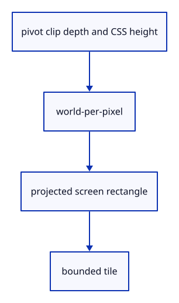

# 7.6.9 · Keep handles constant in CSS pixels

**Chapter 7 · Drawing, snapping and transform tools · Section 7.6 · Move, rotate and scale handles** · [Contents](contents.md)

**Typing: 28–56 minutes.** [Estimate](typing-load.md).

Measure world length per CSS pixel at the selected pivot. Project a conservative widget cube, clamp its screen rectangle and bound the independent tile to1024pixels per side.

## Type

Continue from [Build local arrows balls and rotation arcs](51f-mesh.md). [Save or recover your work](recovery.md).

### 1. `src/widget_layout.rs`

Convert CSS handle size through the pivot’s current depth and bound its projected tile.

Create the file and type:

```rust
--8<-- "journey/code/51g-layout-01.rs"
```

### 2. `src/lib.rs`

Register the handle component and supplied checks.

<details>
<summary>Locate the existing block</summary>

```rust
mod gizmo_tests;

pub mod widget_mesh;
```

</details>

After that block, type:

```rust
--8<-- "journey/code/51g-layout-02.rs" skip=39
```

## Run and check

In your project:

```sh
cd workspace/journey
REGEN_PROTO=0 cargo build --lib --locked --target wasm32-unknown-unknown -j1
REGEN_PROTO=0 CARGO_BUILD_JOBS=1 trunk serve --port 8780
```

Open `http://127.0.0.1:8780/`. Keep an existing Trunk server running; saving rebuilds it.


### Recorded visual result

**Previous native render — current verification pending.**

The earlier two gold boxes and temporary Move band remain.


*This recorded image predates a source or checker change. Rebuild this checkpoint before using it as current evidence; browser controls require separate acceptance.*

This reference image is shared with [7.5.5 · Cancel previews without consuming document history](50d-ownership.md). It does not demonstrate a new feature by itself.

<details>
<summary>Code explanation and diagram</summary>


pivot clip depth and CSS height → world-per-pixel → projected screen rectangle → bounded tile.



Why measure depth at the pivot rather than at the camera target?

A selected object can be away from the target. Using its own depth keeps the visible handle and grab aperture the same CSS size.

Study estimate, including typing and experiments: 0.5–1 hours.

</details>

<details>
<summary>Optional experiment</summary>

Compare zooms, both projections and DPR1/2. The arm remains96CSS pixels while the tile follows physical pixels.

</details>

<details>
<summary>Check and save your work</summary>

Restore experimental edits, then run from `session_viewer`:

```sh
npm --prefix ../session_tests run course -- check 7.6.9
npm --prefix ../session_tests run course -- save 7.6.9
```

Source comparison leaves your project untouched. [Save and recovery instructions](recovery.md).

</details>

<details>
<summary>Viewer coverage and verification</summary>

This preparation retains the earlier Move input. Current handle math and drawing are introduced in dependency order; selection and pointer input are connected later in this subject.

The earlier temporary Move remains while handle infrastructure is introduced.

[Full validation scope](release.md).

To reproduce the scripted acceptance of the reference checkpoint, run from `session_viewer` with the [course bundle server](release.md#reproduce) running on port 8781:

```sh
npm --prefix ../session_tests run course -- capture 7.6.9
```

This uses the verified reference bundle; it does not check or change your typed project.

</details>
