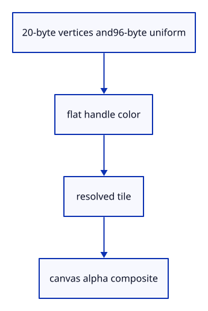

# 7.6.10 · Draw a local handle tile and its canvas rectangle

**Chapter 7 · Drawing, snapping and transform tools · Section 7.6 · Move, rotate and scale handles** · [Contents](contents.md)

**Typing: 21–42 minutes.** [Estimate](typing-load.md).

The96-byte widget uniform carries a tile matrix, canvas rectangle and active handle. One shader draws the mesh; another samples the resolved tile and blends its alpha over the canvas.

## Type

Continue from [Keep handles constant in CSS pixels](51g-layout.md). [Save or recover your work](recovery.md).

### 1. `src/widget.wgsl`

Draw packed handle colors, active orange and the resolved tile composite.

Create the file and type:

```wgsl
--8<-- "journey/code/51h-shader-01.rs"
```

## Run and check

In your project:

```sh
cd workspace/journey
REGEN_PROTO=0 cargo build --lib --locked --target wasm32-unknown-unknown -j1
REGEN_PROTO=0 CARGO_BUILD_JOBS=1 trunk serve --port 8780
```

Open `http://127.0.0.1:8780/`. Keep an existing Trunk server running; saving rebuilds it.


### Recorded visual result

**Previous native render — current verification pending.**

The earlier two gold boxes and temporary Move band remain.


*This recorded image predates a source or checker change. Rebuild this checkpoint before using it as current evidence; browser controls require separate acceptance.*

This reference image is shared with [7.5.5 · Cancel previews without consuming document history](50d-ownership.md). It does not demonstrate a new feature by itself.

<details>
<summary>Code explanation and diagram</summary>


20-byte vertices and96-byte uniform → flat handle color → resolved tile → canvas alpha composite.



Why divide sampled color by alpha before blending?

The multisampled clear leaves partially covered edge pixels. Recovering their unpremultiplied color avoids dark borders when ordinary alpha blending composites them.

Study estimate, including typing and experiments: 0.5–1 hours.

</details>

<details>
<summary>Optional experiment</summary>

Match the shader’s matrix, rectangle and active-handle fields to their exact Rust uniform offsets.

</details>

<details>
<summary>Check and save your work</summary>

Restore experimental edits, then run from `session_viewer`:

```sh
npm --prefix ../session_tests run course -- check 7.6.10
npm --prefix ../session_tests run course -- save 7.6.10
```

Source comparison leaves your project untouched. [Save and recovery instructions](recovery.md).

</details>

<details>
<summary>Viewer coverage and verification</summary>

This preparation retains the earlier Move input. Current handle math and drawing are introduced in dependency order; selection and pointer input are connected later in this subject.

The earlier temporary Move remains while handle infrastructure is introduced.

[Full validation scope](release.md).

To reproduce the scripted acceptance of the reference checkpoint, run from `session_viewer` with the [course bundle server](release.md#reproduce) running on port 8781:

```sh
npm --prefix ../session_tests run course -- capture 7.6.10
```

This uses the verified reference bundle; it does not check or change your typed project.

</details>
