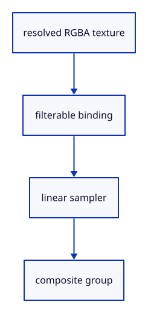

# 7.6.11 · Bind the widget’s own sampled image

**Chapter 7 · Drawing, snapping and transform tools · Section 7.6 · Move, rotate and scale handles** · [Contents](contents.md)

**Typing: 7–14 minutes.** [Estimate](typing-load.md).

The composite reads a resolved RGBA tile through a filterable2D texture and linear sampler. Explicit bindings keep this image independent of scene geometry and pick buffers.

## Type

Continue from [Draw a local handle tile and its canvas rectangle](51h-shader.md). [Save or recover your work](recovery.md).

### 1. `src/widget_pipelines.rs`

Declare the explicit sampled tile and filtering sampler bindings.

Create the file and type:

```rust
--8<-- "journey/code/51i-image-01.rs"
```

### 2. `src/lib.rs`

Register the handle component and supplied checks.

<details>
<summary>Locate the existing block</summary>

```rust
pub mod widget_mesh;

pub mod widget_layout;
```

</details>

After that block, type:

```rust
--8<-- "journey/code/51i-image-02.rs" skip=45
```

## Run and check

In your project:

```sh
cd workspace/journey
REGEN_PROTO=0 cargo build --lib --locked --target wasm32-unknown-unknown -j1
REGEN_PROTO=0 CARGO_BUILD_JOBS=1 trunk serve --port 8780
```

Open `http://127.0.0.1:8780/`. Keep an existing Trunk server running; saving rebuilds it.


### Recorded visual result

**Previous native render — current verification pending.**

The earlier two gold boxes and temporary Move band remain.


*This recorded image predates a source or checker change. Rebuild this checkpoint before using it as current evidence; browser controls require separate acceptance.*

This reference image is shared with [7.5.5 · Cancel previews without consuming document history](50d-ownership.md). It does not demonstrate a new feature by itself.

<details>
<summary>Code explanation and diagram</summary>


resolved RGBA texture → filterable binding → linear sampler → composite group.



Should the composite sample the4x multisampled texture directly?

No. Its ordinary2D texture binding reads the single-sample resolve result. The mesh pass resolves coverage before the composite samples it.

Study estimate, including typing and experiments: 0.5–1 hours.

</details>

<details>
<summary>Optional experiment</summary>

Compare a uniform binding with this texture/sampler layout. Each binding describes the resource type the shader actually reads.

</details>

<details>
<summary>Check and save your work</summary>

Restore experimental edits, then run from `session_viewer`:

```sh
npm --prefix ../session_tests run course -- check 7.6.11
npm --prefix ../session_tests run course -- save 7.6.11
```

Source comparison leaves your project untouched. [Save and recovery instructions](recovery.md).

</details>

<details>
<summary>Viewer coverage and verification</summary>

This preparation retains the earlier Move input. Current handle math and drawing are introduced in dependency order; selection and pointer input are connected later in this subject.

The earlier temporary Move remains while handle infrastructure is introduced.

[Full validation scope](release.md).

To reproduce the scripted acceptance of the reference checkpoint, run from `session_viewer` with the [course bundle server](release.md#reproduce) running on port 8781:

```sh
npm --prefix ../session_tests run course -- capture 7.6.11
```

This uses the verified reference bundle; it does not check or change your typed project.

</details>
