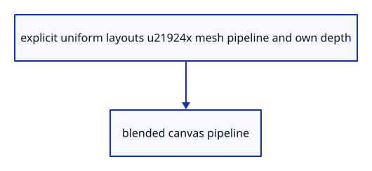

# 7.6.12 · Separate handle depth from scene depth

**Chapter 7 · Drawing, snapping and transform tools · Section 7.6 · Move, rotate and scale handles** · [Contents](contents.md)

**Typing: 27–53 minutes.** [Estimate](typing-load.md).

The widget mesh uses its own4xMSAA RGBA/depth tile. The canvas composite has alpha blending and no scene-depth attachment, keeping handles visible over nearer solids.

## Type

Continue from [Bind the widget’s own sampled image](51i-image.md). [Save or recover your work](recovery.md).

### 1. `src/widget_pipelines.rs`

Build separate4x depth-tested mesh and depth-free alpha-composite pipelines.

<details>
<summary>Locate the existing block</summary>

```rust
        ] })
}
```

</details>

After that block, type:

```rust
--8<-- "journey/code/51j-pipelines-01.rs" skip=16
```

## Run and check

In your project:

```sh
cd workspace/journey
REGEN_PROTO=0 cargo build --lib --locked --target wasm32-unknown-unknown -j1
REGEN_PROTO=0 CARGO_BUILD_JOBS=1 trunk serve --port 8780
```

Open `http://127.0.0.1:8780/`. Keep an existing Trunk server running; saving rebuilds it.


### Recorded visual result

**Previous native render — current verification pending.**

The earlier two gold boxes and temporary Move band remain.


*This recorded image predates a source or checker change. Rebuild this checkpoint before using it as current evidence; browser controls require separate acceptance.*

This reference image is shared with [7.5.5 · Cancel previews without consuming document history](50d-ownership.md). It does not demonstrate a new feature by itself.

<details>
<summary>Code explanation and diagram</summary>


explicit uniform layouts →4x mesh pipeline and own depth → blended canvas pipeline.



Why give handles an independent depth buffer?

Their arrows and balls must occlude each other correctly while staying visible over the source scene. Sharing scene depth would hide them inside selected solids.

Study estimate, including typing and experiments: 0.5–1 hours.

</details>

<details>
<summary>Optional experiment</summary>

Match the tile’s4x sample count to both color and depth attachments. The canvas composite stays single-sample.

</details>

<details>
<summary>Check and save your work</summary>

Restore experimental edits, then run from `session_viewer`:

```sh
npm --prefix ../session_tests run course -- check 7.6.12
npm --prefix ../session_tests run course -- save 7.6.12
```

Source comparison leaves your project untouched. [Save and recovery instructions](recovery.md).

</details>

<details>
<summary>Viewer coverage and verification</summary>

This preparation retains the earlier Move input. Current handle math and drawing are introduced in dependency order; selection and pointer input are connected later in this subject.

The earlier temporary Move remains while handle infrastructure is introduced.

[Full validation scope](release.md).

To reproduce the scripted acceptance of the reference checkpoint, run from `session_viewer` with the [course bundle server](release.md#reproduce) running on port 8781:

```sh
npm --prefix ../session_tests run course -- capture 7.6.12
```

This uses the verified reference bundle; it does not check or change your typed project.

</details>
