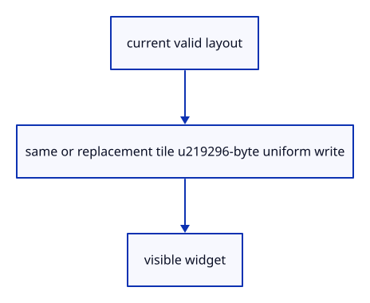

# 7.6.15 · Write only current handle placement

**Chapter 7 · Drawing, snapping and transform tools · Section 7.6 · Move, rotate and scale handles** · [Contents](contents.md)

**Typing: 7–14 minutes.** [Estimate](typing-load.md).

Preparing a frame hides an invalid or absent widget. Reuse a matching tile extent; otherwise replace the tile. Write the bounded matrix/rectangle/active-handle uniform for the current view.

## Type

Continue from [Upload handle geometry once](51l-upload.md). [Save or recover your work](recovery.md).

### 1. `src/widget.rs`

Reuse a matching tile, release absent widgets and update the small current-frame uniform.

<details>
<summary>Locate the existing block</summary>

```rust
    pub fn usage(&self) -> [u64;4] { [self.vertices.size()+self.uniform.size(),self.tile.as_ref().map_or(0,|t|u64::from(t.size[0])*u64::from(t.size[1])*36),self.allocations,self.writes] }
    pub fn extent(&self) -> Option<[u32;2]> { self.tile.as_ref().map(|t|t.size) }

}

impl Drop for Widget { fn drop(&mut self) {self.vertices.destroy();self.uniform.destroy();} }
```

</details>

Edit the existing block to match this code; keep unchanged lines:

```rust
--8<-- "journey/code/51m-prepare-01.rs"
```

## Run and check

In your project:

```sh
cd workspace/journey
REGEN_PROTO=0 cargo build --lib --locked --target wasm32-unknown-unknown -j1
REGEN_PROTO=0 CARGO_BUILD_JOBS=1 trunk serve --port 8780
```

Open `http://127.0.0.1:8780/`. Keep an existing Trunk server running; saving rebuilds it.


### Recorded visual result

**Previous native render — current verification pending.**

The earlier two gold boxes and temporary Move band remain.


*This recorded image predates a source or checker change. Rebuild this checkpoint before using it as current evidence; browser controls require separate acceptance.*

This reference image is shared with [7.5.5 · Cancel previews without consuming document history](50d-ownership.md). It does not demonstrate a new feature by itself.

<details>
<summary>Code explanation and diagram</summary>


current valid layout → same or replacement tile →96-byte uniform write → visible widget.



Does hovering require a new texture when the tile extent is unchanged?

No. Only the active-handle value changes. The existing tile and static vertex buffer remain reusable.

Study estimate, including typing and experiments: 0.5–1 hours.

</details>

<details>
<summary>Optional experiment</summary>

Prepare the same view repeatedly, then hover an arm. Texture allocations must stay unchanged while uniform writes advance.

</details>

<details>
<summary>Check and save your work</summary>

Restore experimental edits, then run from `session_viewer`:

```sh
npm --prefix ../session_tests run course -- check 7.6.15
npm --prefix ../session_tests run course -- save 7.6.15
```

Source comparison leaves your project untouched. [Save and recovery instructions](recovery.md).

</details>

<details>
<summary>Viewer coverage and verification</summary>

This preparation retains the earlier Move input. Current handle math and drawing are introduced in dependency order; selection and pointer input are connected later in this subject.

The earlier temporary Move remains while handle infrastructure is introduced.

[Full validation scope](release.md).

To reproduce the scripted acceptance of the reference checkpoint, run from `session_viewer` with the [course bundle server](release.md#reproduce) running on port 8781:

```sh
npm --prefix ../session_tests run course -- capture 7.6.15
```

This uses the verified reference bundle; it does not check or change your typed project.

</details>
