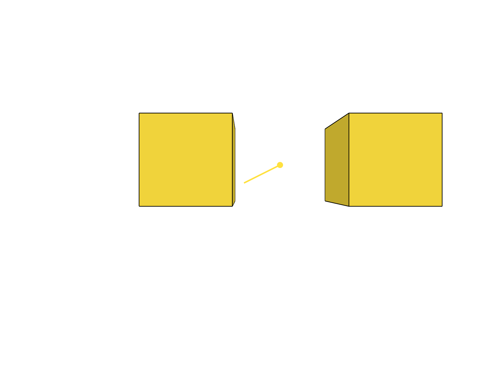
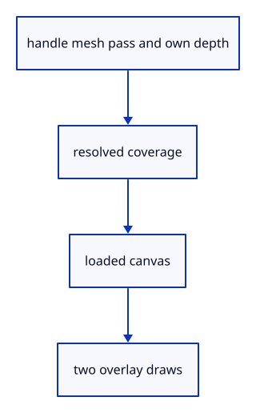

# 7.6.16 · Composite handles after source geometry

**Chapter 7 · Drawing, snapping and transform tools · Section 7.6 · Move, rotate and scale handles** · [Contents](contents.md)

**Typing: 15–29 minutes.** [Estimate](typing-load.md).

Render the handle mesh into its own cleared tile and resolve coverage. Then load the existing canvas and draw the image rectangle, without writing source depth or pick owners.

## Type

Continue from [Write only current handle placement](51m-prepare.md). [Save or recover your work](recovery.md).

### 1. `src/widget.rs`

Render the local4x tile, resolve it and blend its rectangle over the existing canvas.

<details>
<summary>Locate the existing block</summary>

```rust
        queue.write_buffer(&self.uniform,0,&bytes); self.writes+=1; self.visible=true;
    }

}

impl Drop for Widget { fn drop(&mut self) {self.vertices.destroy();self.uniform.destroy();} }
```

</details>

Edit the existing block to match this code; keep unchanged lines:

```rust
--8<-- "journey/code/51n-draw-01.rs"
```

## Run and check

In your project:

```sh
cd workspace/journey
REGEN_PROTO=0 cargo build --lib --locked --target wasm32-unknown-unknown -j1
REGEN_PROTO=0 CARGO_BUILD_JOBS=1 trunk serve --port 8780
```

Open `http://127.0.0.1:8780/`. Keep an existing Trunk server running; saving rebuilds it.


### Recorded visual result

**Source31 native image reviewed.**

The earlier two gold boxes and temporary Move band remain.



*Fresh Rust/NVIDIA raw-DPR4 presentation, personally reviewed at 2560 × 1920. The inherited two-box Move preview remains visible; this recorded fixture does not establish handle drawing. Fixed-resolution pixel checks and browser controls require separate acceptance.*

This scene continues [7.5.5 · Cancel previews without consuming document history](50d-ownership.md). This checkpoint was captured independently; its new source behavior requires separate state checks.

<details>
<summary>Code explanation and diagram</summary>


handle mesh pass and own depth → resolved coverage → loaded canvas → two overlay draws.



Should clearing the widget tile erase the drawing?

No. Only the independent tile is cleared. The composite loads the already rendered canvas and blends the tile over it.

Study estimate, including typing and experiments: 0.5–1 hours.

</details>

<details>
<summary>Optional experiment</summary>

Follow the two render passes. The first has widget depth; the second has the canvas color target and no depth attachment.

</details>

<details>
<summary>Check and save your work</summary>

Restore experimental edits, then run from `session_viewer`:

```sh
npm --prefix ../session_tests run course -- check 7.6.16
npm --prefix ../session_tests run course -- save 7.6.16
```

Source comparison leaves your project untouched. [Save and recovery instructions](recovery.md).

</details>

<details>
<summary>Viewer coverage and verification</summary>

This preparation retains the earlier Move input. Current handle math and drawing are introduced in dependency order; selection and pointer input are connected later in this subject.

The earlier temporary Move remains while handle infrastructure is introduced.

[Full validation scope](release.md).

To reproduce the scripted acceptance of the reference checkpoint, run from `session_viewer` with the [course bundle server](release.md#reproduce) running on port 8781:

```sh
npm --prefix ../session_tests run course -- capture 7.6.16
```

This uses the verified reference bundle; it does not check or change your typed project.

</details>
