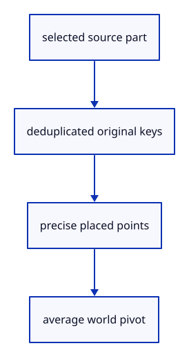

# 7.6.18 · Locate original mesh parts and curve controls

**Chapter 7 · Drawing, snapping and transform tools · Section 7.6 · Move, rotate and scale handles** · [Contents](contents.md)

**Typing: 20–40 minutes.** [Estimate](typing-load.md).

Resolve original source vertices for a mesh face or edge, including hole rims. A curve control is its original weighted point. Apply the owner’s placement before averaging a world pivot.

## Type

Continue from [Register the widget outside source picking](51o-renderer.md). [Save or recover your work](recovery.md).

### 1. `src/part_preview.rs`

Resolve original part keys and precise placed source points.

Create the file and type:

```rust
--8<-- "journey/code/51p-part-points-01.rs"
```

### 2. `src/lib.rs`

Register the edit component and supplied checks.

<details>
<summary>Locate the existing block</summary>

```rust

#[cfg(test)]
mod widget_tests;
```

</details>

After that block, type:

```rust
--8<-- "journey/code/51p-part-points-02.rs" skip=32
```

## Run and check

In your project:

```sh
cd workspace/journey
REGEN_PROTO=0 cargo build --lib --locked --target wasm32-unknown-unknown -j1
REGEN_PROTO=0 CARGO_BUILD_JOBS=1 trunk serve --port 8780
```

Open `http://127.0.0.1:8780/`. Keep an existing Trunk server running; saving rebuilds it.

Continue the previous two-box Move exercise. Selection-driven handle drawing connects at51zb, and actual captured input follows at51zc–51zd.

### Recorded visual result

**Previous native render — current verification pending.**

The earlier two selected boxes and temporary Move band remain.


*This recorded image predates a source or checker change. Rebuild this checkpoint before using it as current evidence; browser controls require separate acceptance.*

This reference image is shared with [7.5.5 · Cancel previews without consuming document history](50d-ownership.md). It does not demonstrate a new feature by itself.

<details>
<summary>Code explanation and diagram</summary>


selected source part → deduplicated original keys → precise placed points → average world pivot.



Is the pivot the center of a rendered triangle?

No. One original polygon can produce several display triangles. The pivot belongs to the selected source points, including its hole boundaries.

Study estimate, including typing and experiments: 0.5–1 hours.

</details>

<details>
<summary>Optional experiment</summary>

Compare sparse face keys, shared edge endpoints and a weighted curve control. A display-only diagonal must never become an editable source edge.

</details>

<details>
<summary>Check and save your work</summary>

Restore experimental edits, then run from `session_viewer`:

```sh
npm --prefix ../session_tests run course -- check 7.6.18
npm --prefix ../session_tests run course -- save 7.6.18
```

Source comparison leaves your project untouched. [Save and recovery instructions](recovery.md).

</details>

<details>
<summary>Viewer coverage and verification</summary>

This preparation retains earlier point tools and Move. Handle source ownership, pointer input and number fields are connected in dependency order; full browser acceptance remains pending.

The earlier temporary Move remains while handle editing infrastructure is introduced.

[Full validation scope](release.md).

To reproduce the scripted acceptance of the reference checkpoint, run from `session_viewer` with the [course bundle server](release.md#reproduce) running on port 8781:

```sh
npm --prefix ../session_tests run course -- capture 7.6.18
```

This uses the verified reference bundle; it does not check or change your typed project.

</details>
