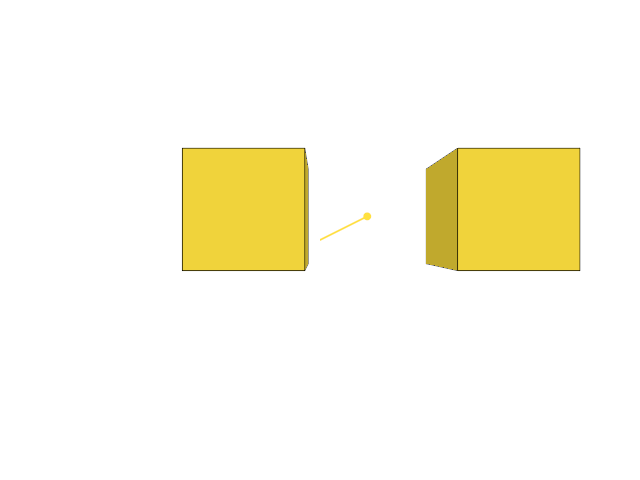
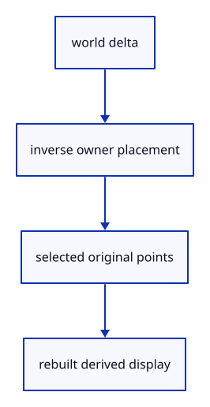

# 7.6.19 · Deform selected original points through their placement

**Chapter 7 · Drawing, snapping and transform tools · Section 7.6 · Move, rotate and scale handles** · [Contents](contents.md)

**Typing: 27–53 minutes.** [Estimate](typing-load.md).

Convert the world delta into the owner’s local frame. Clone only its selected original mesh vertices or curve control; rebuild derived display while preserving topology, attributes and rational weights.

## Type

Continue from [Locate original mesh parts and curve controls](51p-part-points.md). [Save or recover your work](recovery.md).

### 1. `src/scene.rs`

Transform original selected part points through local placement and preserve homogeneous curve weights.

<details>
<summary>Locate the existing block</summary>

```rust
#[cfg(all(test, not(target_arch = "wasm32")))]
#[path = "pick_gpu_tests.rs"]
mod pick_gpu_tests;
```

</details>

After that block, type:

```rust
--8<-- "journey/code/51q-deform-01.rs" skip=97
```

## Run and check

In your project:

```sh
cd workspace/journey
REGEN_PROTO=0 cargo build --lib --locked --target wasm32-unknown-unknown -j1
REGEN_PROTO=0 CARGO_BUILD_JOBS=1 trunk serve --port 8780
```

Open `http://127.0.0.1:8780/`. Keep an existing Trunk server running; saving rebuilds it.


### Recorded visual result

**Previous native render — current verification pending.**

The earlier two selected boxes and temporary Move band remain.



*This recorded image predates a source or checker change. Rebuild this checkpoint before using it as current evidence; browser controls require separate acceptance.*

This reference image is shared with [7.5.5 · Cancel previews without consuming document history](50d-ownership.md). It does not demonstrate a new feature by itself.

<details>
<summary>Code explanation and diagram</summary>


world delta → inverse owner placement → selected original points → rebuilt derived display.



Why preserve a rational control’s weight when moving its point?

The weight affects the whole curve shape. Resetting it to1 changes more than the intended point movement, even when its final coordinates are correct.

Study estimate, including typing and experiments: 0.5–1 hours.

</details>

<details>
<summary>Optional experiment</summary>

Move a face on a sheared, scaled owner. Its selected world vertices must follow the delta while other original vertices stay unchanged.

</details>

<details>
<summary>Check and save your work</summary>

Restore experimental edits, then run from `session_viewer`:

```sh
npm --prefix ../session_tests run course -- check 7.6.19
npm --prefix ../session_tests run course -- save 7.6.19
```

Source comparison leaves your project untouched. [Save and recovery instructions](recovery.md).

</details>

<details>
<summary>Viewer coverage and verification</summary>

This preparation retains earlier point tools and Move. Handle source ownership, pointer input and number fields are connected in dependency order; full browser acceptance remains pending.

The earlier temporary Move remains while handle editing infrastructure is introduced.

[Full validation scope](release.md).

To reproduce the scripted acceptance of the reference checkpoint, run from `session_viewer` with the [course bundle server](release.md#reproduce) running on port 8781:

```sh
npm --prefix ../session_tests run course -- capture 7.6.19
```

This uses the verified reference bundle; it does not check or change your typed project.

</details>
