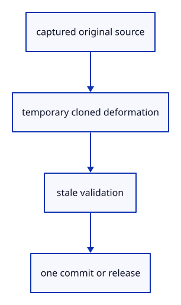

# 7.6.20 · Keep part deformation outside saved geometry

**Chapter 7 · Drawing, snapping and transform tools · Section 7.6 · Move, rotate and scale handles** · [Contents](contents.md)

**Typing: 21–41 minutes.** [Estimate](typing-load.md).

Capture the selected source and original placement. Derive a separate preview scene for every valid delta; commit only if the source and placement still match, using one history transaction.

## Type

Continue from [Deform selected original points through their placement](51q-deform.md). [Save or recover your work](recovery.md).

### 1. `src/part_preview.rs`

Own temporary source deformation and refuse stale part commits.

<details>
<summary>Locate the existing block</summary>

```rust
    Ok(keys)
}
```

</details>

After that block, type:

```rust
--8<-- "journey/code/51r-part-preview-01.rs" skip=16
```

### 2. `src/edit_preview.rs`

Expose both retained placement-preview scenes for later memory accounting.

<details>
<summary>Locate the existing block</summary>

```rust
        Ok(Self { base:scene.clone(),scene:scene.clone(),ids,transform:Xform::identity() })
    }
    pub fn ids(&self) -> &[ObjectId] { &self.ids }
    pub fn matrix(&self) -> &[f64; 16] { &self.transform.m }
    pub fn set(&mut self, transform: Xform) -> Result<(), &'static str> {
        if !crate::placement::valid(&transform.m) { return Err("Invalid preview transform"); }
```

</details>

Edit the existing block to match this code; keep unchanged lines:

```rust
--8<-- "journey/code/51r-part-preview-02.rs"
```

## Run and check

In your project:

```sh
cd workspace/journey
REGEN_PROTO=0 cargo build --lib --locked --target wasm32-unknown-unknown -j1
REGEN_PROTO=0 CARGO_BUILD_JOBS=1 trunk serve --port 8780
```

Open `http://127.0.0.1:8780/`. Keep an existing Trunk server running; saving rebuilds it.


### Recorded visual result

**Previous native render — current verification pending.**

The earlier two selected boxes and temporary Move band remain.


*This recorded image predates a source or checker change. Rebuild this checkpoint before using it as current evidence; browser controls require separate acceptance.*

This reference image is shared with [7.5.5 · Cancel previews without consuming document history](50d-ownership.md). It does not demonstrate a new feature by itself.

<details>
<summary>Code explanation and diagram</summary>


captured original source → temporary cloned deformation → stale validation → one commit or release.



What happens if the source changes while its handle is grabbed?

Refuse the stale commit. Its captured keys and placement belong to the earlier source; applying them to the replacement could edit the wrong geometry.

Study estimate, including typing and experiments: 0.5–1 hours.

</details>

<details>
<summary>Optional experiment</summary>

Compare cancellation with a commit. Cancellation releases derived geometry; Undo after commit restores the original shared source allocation.

</details>

<details>
<summary>Check and save your work</summary>

Restore experimental edits, then run from `session_viewer`:

```sh
npm --prefix ../session_tests run course -- check 7.6.20
npm --prefix ../session_tests run course -- save 7.6.20
```

Source comparison leaves your project untouched. [Save and recovery instructions](recovery.md).

</details>

<details>
<summary>Viewer coverage and verification</summary>

This preparation retains earlier point tools and Move. Handle source ownership, pointer input and number fields are connected in dependency order; full browser acceptance remains pending.

The earlier temporary Move remains while handle editing infrastructure is introduced.

[Full validation scope](release.md).

To reproduce the scripted acceptance of the reference checkpoint, run from `session_viewer` with the [course bundle server](release.md#reproduce) running on port 8781:

```sh
npm --prefix ../session_tests run course -- capture 7.6.20
```

This uses the verified reference bundle; it does not check or change your typed project.

</details>
