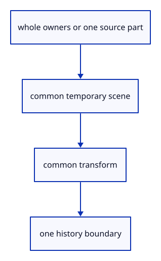

# 7.6.21 · Share one handle interface across whole and part edits

**Chapter 7 · Drawing, snapping and transform tools · Section 7.6 · Move, rotate and scale handles** · [Contents](contents.md)

**Typing: 12–24 minutes.** [Estimate](typing-load.md).

A whole selection changes shared-source placements; a selected part changes a cloned source. The handle owner exposes the same temporary scene, transform and commit boundary for both paths.

## Type

Continue from [Keep part deformation outside saved geometry](51r-part-preview.md). [Save or recover your work](recovery.md).

### 1. `src/gizmo_edit.rs`

Unify whole-placement and original-part previews without merging their source ownership.

Create the file and type:

```rust
--8<-- "journey/code/51s-edit-owner-01.rs"
```

### 2. `src/lib.rs`

Register the edit component and supplied checks.

<details>
<summary>Locate the existing block</summary>

```rust
mod widget_tests;

pub mod part_preview;
```

</details>

After that block, type:

```rust
--8<-- "journey/code/51s-edit-owner-02.rs" skip=41
```

## Run and check

In your project:

```sh
cd workspace/journey
REGEN_PROTO=0 cargo build --lib --locked --target wasm32-unknown-unknown -j1
REGEN_PROTO=0 CARGO_BUILD_JOBS=1 trunk serve --port 8780
```

Open `http://127.0.0.1:8780/`. Keep an existing Trunk server running; saving rebuilds it.


### Recorded visual result

**Previous native render — current verification pending.**

The earlier two selected boxes and temporary Move band remain.


*This recorded image predates a source or checker change. Rebuild this checkpoint before using it as current evidence; browser controls require separate acceptance.*

This reference image is shared with [7.5.5 · Cancel previews without consuming document history](50d-ownership.md). It does not demonstrate a new feature by itself.

<details>
<summary>Code explanation and diagram</summary>


whole owners or one source part → common temporary scene → common transform → one history boundary.



Does rotating a whole object clone its mesh vertices?

No. Its placement changes while the original geometry remains shared. Only an actual part deformation needs a changed source clone.

Study estimate, including typing and experiments: 0.5–1 hours.

</details>

<details>
<summary>Optional experiment</summary>

Trace both preview variants to their saved-document commit. Neither path may publish geometry while the cursor is moving.

</details>

<details>
<summary>Check and save your work</summary>

Restore experimental edits, then run from `session_viewer`:

```sh
npm --prefix ../session_tests run course -- check 7.6.21
npm --prefix ../session_tests run course -- save 7.6.21
```

Source comparison leaves your project untouched. [Save and recovery instructions](recovery.md).

</details>

<details>
<summary>Viewer coverage and verification</summary>

This preparation retains earlier point tools and Move. Handle source ownership, pointer input and number fields are connected in dependency order; full browser acceptance remains pending.

The earlier temporary Move remains while handle editing infrastructure is introduced.

[Full validation scope](release.md).

To reproduce the scripted acceptance of the reference checkpoint, run from `session_viewer` with the [course bundle server](release.md#reproduce) running on port 8781:

```sh
npm --prefix ../session_tests run course -- capture 7.6.21
```

This uses the verified reference bundle; it does not check or change your typed project.

</details>
