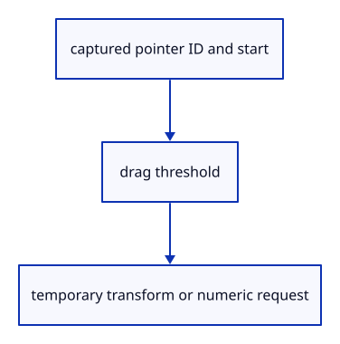

# 7.6.22 · Keep pointer ownership through click or drag

**Chapter 7 · Drawing, snapping and transform tools · Section 7.6 · Move, rotate and scale handles** · [Contents](contents.md)

**Typing: 19–38 minutes.** [Estimate](typing-load.md).

A captured pointer remembers its handle and starting screen position. Crossing4CSS pixels remains a drag even after returning; a click opens number input, and unrelated pointer IDs cannot update it.

## Type

Continue from [Share one handle interface across whole and part edits](51s-edit-owner.md). [Save or recover your work](recovery.md).

### 1. `src/gizmo_edit.rs`

Capture one pointer, distinguish clicks from drags and track the displayed active handle.

<details>
<summary>Locate the existing block</summary>

```rust
    pub fn commit(&self,scene:&mut Scene,history:&mut crate::history::History) -> Result<bool,&'static str> {match self {Self::Whole(p)=>p.commit(scene,history),Self::Part(p)=>p.commit(scene,history)}}
}
```

</details>

After that block, type:

```rust
--8<-- "journey/code/51t-capture-01.rs" skip=205
```

## Run and check

In your project:

```sh
cd workspace/journey
REGEN_PROTO=0 cargo build --lib --locked --target wasm32-unknown-unknown -j1
REGEN_PROTO=0 CARGO_BUILD_JOBS=1 trunk serve --port 8780
```

Open `http://127.0.0.1:8780/`. Keep an existing Trunk server running; saving rebuilds it.


### Recorded visual result

**Previous native render — current verification pending.**

The earlier two selected boxes and temporary Move band remain.


*This recorded image predates a source or checker change. Rebuild this checkpoint before using it as current evidence; browser controls require separate acceptance.*

This reference image is shared with [7.5.5 · Cancel previews without consuming document history](50d-ownership.md). It does not demonstrate a new feature by itself.

<details>
<summary>Code explanation and diagram</summary>


captured pointer ID and start → drag threshold → temporary transform or numeric request.



Can releasing another pointer commit the active handle?

No. Only the pointer that grabbed it owns its updates and release. Other touches must leave its preview and history untouched.

Study estimate, including typing and experiments: 0.5–1 hours.

</details>

<details>
<summary>Optional experiment</summary>

Move beyond the threshold and return to the start. The release remains a zero-distance drag rather than unexpectedly opening a number field.

</details>

<details>
<summary>Check and save your work</summary>

Restore experimental edits, then run from `session_viewer`:

```sh
npm --prefix ../session_tests run course -- check 7.6.22
npm --prefix ../session_tests run course -- save 7.6.22
```

Source comparison leaves your project untouched. [Save and recovery instructions](recovery.md).

</details>

<details>
<summary>Viewer coverage and verification</summary>

This preparation retains earlier point tools and Move. Handle source ownership, pointer input and number fields are connected in dependency order; full browser acceptance remains pending.

The earlier temporary Move remains while handle editing infrastructure is introduced.

[Full validation scope](release.md).

To reproduce the scripted acceptance of the reference checkpoint, run from `session_viewer` with the [course bundle server](release.md#reproduce) running on port 8781:

```sh
npm --prefix ../session_tests run course -- capture 7.6.22
```

This uses the verified reference bundle; it does not check or change your typed project.

</details>
