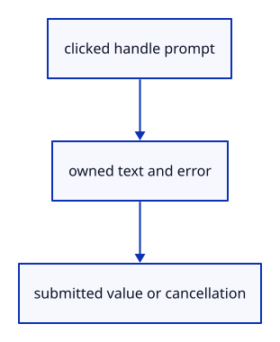

# 7.6.26 · Own one handle’s number-field state

**Chapter 7 · Drawing, snapping and transform tools · Section 7.6 · Move, rotate and scale handles** · [Contents](contents.md)

**Typing: 8–15 minutes.** [Estimate](typing-load.md).

The number model retains its handle, projected anchor, text, error and measured rectangle. It delivers a submitted value or cancellation once, separately from ordinary command input.

## Type

Continue from [Preview captured motion and commit one release](51w-release.md). [Save or recover your work](recovery.md).

### 1. `src/number_box.rs`

Own one projected handle-number prompt and its one-time submitted answer.

Create the file and type:

```rust
--8<-- "journey/code/51x-number-model-01.rs"
```

### 2. `src/lib.rs`

Register the edit component and supplied checks.

<details>
<summary>Locate the existing block</summary>

```rust
pub mod part_preview;

pub mod gizmo_edit;
```

</details>

After that block, type:

```rust
--8<-- "journey/code/51x-number-model-02.rs" skip=43
```

## Run and check

In your project:

```sh
cd workspace/journey
REGEN_PROTO=0 cargo build --lib --locked --target wasm32-unknown-unknown -j1
REGEN_PROTO=0 CARGO_BUILD_JOBS=1 trunk serve --port 8780
```

Open `http://127.0.0.1:8780/`. Keep an existing Trunk server running; saving rebuilds it.


### Recorded visual result

**Previous native render — current verification pending.**

The earlier two selected boxes and temporary Move band remain.


*This recorded image predates a source or checker change. Rebuild this checkpoint before using it as current evidence; browser controls require separate acceptance.*

This reference image is shared with [7.5.5 · Cancel previews without consuming document history](50d-ownership.md). It does not demonstrate a new feature by itself.

<details>
<summary>Code explanation and diagram</summary>


clicked handle prompt → owned text and error → submitted value or cancellation.



Should an invalid answer erase the learner’s typed number?

No. Keep the field and text available for correction while the original document and redo branch remain unchanged.

Study estimate, including typing and experiments: 0.5–1 hours.

</details>

<details>
<summary>Optional experiment</summary>

Compare reopening another handle with redrawing the same field. A different handle starts empty; the same field retains its answer and error.

</details>

<details>
<summary>Check and save your work</summary>

Restore experimental edits, then run from `session_viewer`:

```sh
npm --prefix ../session_tests run course -- check 7.6.26
npm --prefix ../session_tests run course -- save 7.6.26
```

Source comparison leaves your project untouched. [Save and recovery instructions](recovery.md).

</details>

<details>
<summary>Viewer coverage and verification</summary>

This preparation retains earlier point tools and Move. Handle source ownership, pointer input and number fields are connected in dependency order; full browser acceptance remains pending.

The earlier temporary Move remains while handle editing infrastructure is introduced.

[Full validation scope](release.md).

To reproduce the scripted acceptance of the reference checkpoint, run from `session_viewer` with the [course bundle server](release.md#reproduce) running on port 8781:

```sh
npm --prefix ../session_tests run course -- capture 7.6.26
```

This uses the verified reference bundle; it does not check or change your typed project.

</details>
