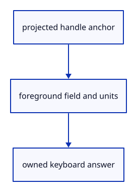

# 7.6.27 · Draw the number field beside its handle

**Chapter 7 · Drawing, snapping and transform tools · Section 7.6 · Move, rotate and scale handles** · [Contents](contents.md)

**Typing: 27–54 minutes.** [Estimate](typing-load.md).

The foreground field follows its projected handle anchor. Give it keyboard focus, show the operation’s units and neutral hint, and consume Enter or Escape before the ordinary command dock.

## Type

Continue from [Own one handle’s number-field state](51x-number-model.md). [Save or recover your work](recovery.md).

### 1. `src/number_box.rs`

Draw the foreground handle-number field with measured bounds and exclusive Enter/Escape ownership.

<details>
<summary>Locate the existing block</summary>

```rust
    pub fn set(&mut self,prompt:Option<NumberPrompt>) {self.number_prompt=prompt;if self.number_prompt.is_none() {self.number_handle=None;self.number_rect=None;}}
}
```

</details>

After that block, type:

```rust
--8<-- "journey/code/51y-number-field-01.rs" skip=166
```

## Run and check

In your project:

```sh
cd workspace/journey
REGEN_PROTO=0 cargo build --lib --locked --target wasm32-unknown-unknown -j1
REGEN_PROTO=0 CARGO_BUILD_JOBS=1 trunk serve --port 8780
```

Open `http://127.0.0.1:8780/`. Keep an existing Trunk server running; saving rebuilds it.


### Recorded visual result

**Previous native render — current verification pending.**

The earlier two selected boxes and temporary Move band remain.


*This recorded image predates a source or checker change. Rebuild this checkpoint before using it as current evidence; browser controls require separate acceptance.*

This reference image is shared with [7.5.5 · Cancel previews without consuming document history](50d-ownership.md). It does not demonstrate a new feature by itself.

<details>
<summary>Code explanation and diagram</summary>


projected handle anchor → foreground field and units → owned keyboard answer.



Why must Enter reach the number field before the command dock?

Both interfaces share the canvas event stream. Without input ownership, one Enter could apply a handle value and also submit an unrelated command.

Study estimate, including typing and experiments: 0.5–1 hours.

</details>

<details>
<summary>Optional experiment</summary>

Use the supplied UI checks after51zf. Typed decimals must stay in the number field; Enter submits once and Escape closes it.

</details>

<details>
<summary>Check and save your work</summary>

Restore experimental edits, then run from `session_viewer`:

```sh
npm --prefix ../session_tests run course -- check 7.6.27
npm --prefix ../session_tests run course -- save 7.6.27
```

Source comparison leaves your project untouched. [Save and recovery instructions](recovery.md).

</details>

<details>
<summary>Viewer coverage and verification</summary>

This preparation retains earlier point tools and Move. Handle source ownership, pointer input and number fields are connected in dependency order; full browser acceptance remains pending.

The earlier direct-edit and handle drawing checks remain. New editor and real number-field regressions are supplied at51zf. Actual browser acceptance is pending. The number-field drawing function is gated to tests/browser builds; its pure prompt model remains available to native rendering.

The earlier temporary Move remains while handle editing infrastructure is introduced.

[Full validation scope](release.md).

To reproduce the scripted acceptance of the reference checkpoint, run from `session_viewer` with the [course bundle server](release.md#reproduce) running on port 8781:

```sh
npm --prefix ../session_tests run course -- capture 7.6.27
```

This uses the verified reference bundle; it does not check or change your typed project.

</details>
