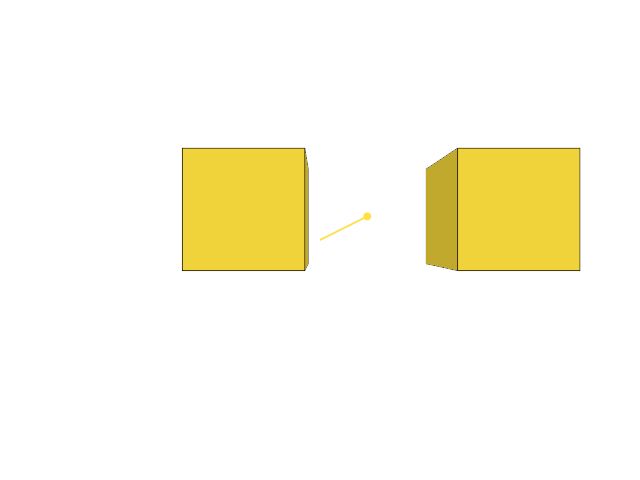
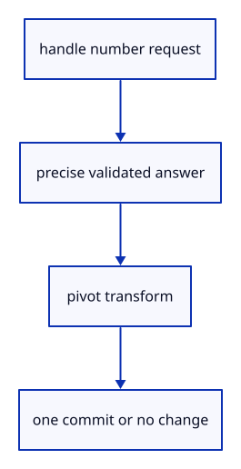

# 7.6.28 · Apply precise typed handle values once

**Chapter 7 · Drawing, snapping and transform tools · Section 7.6 · Move, rotate and scale handles** · [Contents](contents.md)

**Typing: 28–55 minutes.** [Estimate](typing-load.md).

Project the requested handle into CSS coordinates. Valid finite answers produce a checked preview transform and one commit; neutral answers close without history, and errors keep the request open.

## Type

Continue from [Draw the number field beside its handle](51y-number-field.md). [Save or recover your work](recovery.md).

### 1. `src/editor.rs`

Project the current number request and validate precise, neutral or invalid typed answers before committing. Route Escape to cancellation for an active handle drag as well as numeric entry.

Edit these blocks from bottom to top. Keep the surrounding lines unchanged.

<details>
<summary>Locate this block</summary>

```rust
            Action::GizmoMove {pointer,screen,size,shift}=>return self.gizmo_move(pointer,screen,size,shift),
            Action::GizmoRelease {pointer,screen,size,shift}=>return self.gizmo_release(pointer,screen,size,shift),
            Action::GizmoCancel=>{self.gizmo_edit=None;self.tool_status="Handle edit cancelled.".into();return Ok(Change::Preview);},
            Action::Snap(setting) => {
                self.tool_status = self.snapping.apply(setting)?;
                if let Some(draft) = self.draft.as_mut() { draft.cursor = None; draft.snapped = None; }
```

</details>

Replace it with:

```rust
            Action::GizmoMove {pointer,screen,size,shift}=>return self.gizmo_move(pointer,screen,size,shift),
            Action::GizmoRelease {pointer,screen,size,shift}=>return self.gizmo_release(pointer,screen,size,shift),
            Action::GizmoCancel=>{self.gizmo_edit=None;self.tool_status="Handle edit cancelled.".into();return Ok(Change::Preview);},
            Action::GizmoNumber(text)=>return self.gizmo_number(&text),
            Action::Snap(setting) => {
                self.tool_status = self.snapping.apply(setting)?;
                if let Some(draft) = self.draft.as_mut() { draft.cursor = None; draft.snapped = None; }
```

<details>
<summary>Locate this block</summary>

```rust
    pub fn snap_usage(&self) -> [u64; 2] { self.snap_index.as_ref().map_or([0,0], |index| [index.builds,index.visits as u64]) }

    pub fn apply(&mut self, action: Action) -> Result<Change, &'static str> {
        let keep_gizmo=matches!(&action,Action::GizmoPress {..}|Action::GizmoMove {..}|Action::GizmoRelease {..}|Action::GizmoCancel|Action::Zoom(_)|Action::Pan(_,_)|Action::Orbit(_,_)|Action::Fit|Action::FitSelected|Action::Projection(_)|Action::ResetView|Action::Background|Action::NormalView(_)|Action::Grid(_)|Action::Snap(_));
        let keep_edit=matches!(&action, Action::GizmoPress {..} | Action::GizmoMove {..} | Action::GizmoRelease {..} | Action::GizmoCancel | Action::BeginTool(_) | Action::ToolPoint(_) | Action::ToolScreen {..} | Action::ToolHover(_) | Action::CancelTool | Action::Snap(_) | Action::Zoom(_) | Action::Pan(_,_) | Action::Orbit(_,_) | Action::Fit | Action::FitSelected | Action::Projection(_) | Action::ResetView | Action::Background | Action::NormalView(_) | Action::Grid(_));
        let mut change=self.apply_action(action)?;
        if !keep_gizmo && self.gizmo_edit.take().is_some() && change==Change::View {change=Change::Preview;}
        if !keep_edit && self.edit_preview.take().is_some() { self.draft=None; if change==Change::View { change=Change::Preview; } }
```

</details>

Replace it with:

```rust
    pub fn snap_usage(&self) -> [u64; 2] { self.snap_index.as_ref().map_or([0,0], |index| [index.builds,index.visits as u64]) }

    pub fn apply(&mut self, action: Action) -> Result<Change, &'static str> {
        let keep_gizmo=matches!(&action,Action::GizmoPress {..}|Action::GizmoMove {..}|Action::GizmoRelease {..}|Action::GizmoCancel|Action::GizmoNumber(_)|Action::Zoom(_)|Action::Pan(_,_)|Action::Orbit(_,_)|Action::Fit|Action::FitSelected|Action::Projection(_)|Action::ResetView|Action::Background|Action::NormalView(_)|Action::Grid(_)|Action::Snap(_));
        let keep_edit=matches!(&action, Action::GizmoPress {..} | Action::GizmoMove {..} | Action::GizmoRelease {..} | Action::GizmoCancel | Action::GizmoNumber(_) | Action::BeginTool(_) | Action::ToolPoint(_) | Action::ToolScreen {..} | Action::ToolHover(_) | Action::CancelTool | Action::Snap(_) | Action::Zoom(_) | Action::Pan(_,_) | Action::Orbit(_,_) | Action::Fit | Action::FitSelected | Action::Projection(_) | Action::ResetView | Action::Background | Action::NormalView(_) | Action::Grid(_));
        let mut change=self.apply_action(action)?;
        if !keep_gizmo && self.gizmo_edit.take().is_some() && change==Change::View {change=Change::Preview;}
        if !keep_edit && self.edit_preview.take().is_some() { self.draft=None; if change==Change::View { change=Change::Preview; } }
```

<details>
<summary>Locate this block</summary>

```rust
    pub fn whole_selection(&self) -> Option<ObjectId> { self.selected.filter(|_| self.selected_part.is_none()) }

    pub fn tool_line(&self, text: &str) -> Option<Result<Action, &'static str>> {
        self.draft.as_ref()?;
        if text.trim().is_empty() || text.eq_ignore_ascii_case("Escape") { return Some(Ok(Action::CancelTool)); }
        text.contains(',').then(|| crate::tool_coords::parse(text).map(Action::ToolPoint))
```

</details>

Replace it with:

```rust
    pub fn whole_selection(&self) -> Option<ObjectId> { self.selected.filter(|_| self.selected_part.is_none()) }

    pub fn tool_line(&self, text: &str) -> Option<Result<Action, &'static str>> {
        if self.gizmo_edit.as_ref().is_some_and(|e|e.gizmo.typing.is_some() || text.trim().eq_ignore_ascii_case("Escape")) {
            return Some(Ok(if text.trim().eq_ignore_ascii_case("Escape") {Action::GizmoCancel} else {Action::GizmoNumber(text.to_owned())}));
        }
        self.draft.as_ref()?;
        if text.trim().is_empty() || text.eq_ignore_ascii_case("Escape") { return Some(Ok(Action::CancelTool)); }
        text.contains(',').then(|| crate::tool_coords::parse(text).map(Action::ToolPoint))
```

<details>
<summary>Locate this block</summary>

```rust
        self.tool_status="Handle edit completed.".into();Ok(if changed {Change::Scene} else {Change::Preview})
    }

    fn update_edit_preview(&mut self) -> Result<Change, &'static str> {
        let Some(preview)=self.edit_preview.as_mut() else { return Ok(Change::View); };
        let offset=self.draft.as_ref().and_then(|d| d.points.first().zip(d.cursor)).map(|(a,b)| std::array::from_fn::<_,3,_>(|i| b[i]-a[i])).unwrap_or([0.;3]);
```

</details>

Replace it with:

```rust
        self.tool_status="Handle edit completed.".into();Ok(if changed {Change::Scene} else {Change::Preview})
    }

    fn gizmo_number(&mut self,text:&str)->Result<Change,&'static str> {
        let edit=self.gizmo_edit.as_mut().ok_or("No handle number is being requested")?;
        let handle=edit.gizmo.typing.ok_or("No handle number is being requested")?;
        let value=crate::gizmo::typed_value(handle,text).map_err(|_|"Enter a finite number; scale needs a positive factor")?;
        let Some(value)=value else {self.gizmo_edit=None;return Ok(Change::Preview);};
        edit.preview.set(edit.gizmo.typed(handle,value))?;
        let changed=edit.preview.commit(&mut self.scene,&mut self.history)?;self.gizmo_edit=None;
        self.tool_status=format!("{} {value} {}",handle.title(),handle.labels().2);Ok(if changed {Change::Scene} else {Change::Preview})
    }

    fn update_edit_preview(&mut self) -> Result<Change, &'static str> {
        let Some(preview)=self.edit_preview.as_mut() else { return Ok(Change::View); };
        let offset=self.draft.as_ref().and_then(|d| d.points.first().zip(d.cursor)).map(|(a,b)| std::array::from_fn::<_,3,_>(|i| b[i]-a[i])).unwrap_or([0.;3]);
```

<details>
<summary>Locate this block</summary>

```rust
        crate::gizmo::Gizmo::new(session_rust::Point::new(origin[0],origin[1],origin[2])).hit(&ray.origin,&ray.direction,scale)
    }

    pub fn gizmo_active(&self)->f32 {crate::gizmo_edit::code(self.gizmo_edit.as_ref().and_then(|e|e.active()).or(self.gizmo_hover))}

    pub fn hover_gizmo(&mut self,screen:Option<([f32;2],[f64;2])>) {
```

</details>

Replace it with:

```rust
        crate::gizmo::Gizmo::new(session_rust::Point::new(origin[0],origin[1],origin[2])).hit(&ray.origin,&ray.direction,scale)
    }

    pub fn number_prompt(&self,size:[f64;2])->Option<crate::number_box::NumberPrompt> {
        let edit=self.gizmo_edit.as_ref()?;let handle=edit.gizmo.typing?;
        let origin=edit.origin();let matrix=self.camera.view_projection();let scale=crate::widget_layout::world_per_pixel(&matrix,origin,size[1])?;
        let point=edit.gizmo.handle_point(handle,scale);
        let at=crate::snap_math::Screen {matrix:matrix.m,size}.point([point[0],point[1],point[2]])?;
        let unit=handle.labels().2;
        Some(crate::number_box::NumberPrompt {handle,title:handle.title(),unit,hint:if unit=="factor" {"1"} else {"0"},at:at.map(|v|v as f32)})
    }

    pub fn gizmo_active(&self)->f32 {crate::gizmo_edit::code(self.gizmo_edit.as_ref().and_then(|e|e.active()).or(self.gizmo_hover))}

    pub fn hover_gizmo(&mut self,screen:Option<([f32;2],[f64;2])>) {
```

<details>
<summary>Locate this block</summary>

```rust
    GizmoMove {pointer:i32,screen:[f32;2],size:[f64;2],shift:bool},
    GizmoRelease {pointer:i32,screen:[f32;2],size:[f64;2],shift:bool},
    GizmoCancel,
    Snap(crate::snap::Setting),
    ToolScreen { screen: [f32; 2], size: [f64; 2], commit: bool },
    BeginTool(crate::tool::Shape),
```

</details>

Replace it with:

```rust
    GizmoMove {pointer:i32,screen:[f32;2],size:[f64;2],shift:bool},
    GizmoRelease {pointer:i32,screen:[f32;2],size:[f64;2],shift:bool},
    GizmoCancel,
    GizmoNumber(String),
    Snap(crate::snap::Setting),
    ToolScreen { screen: [f32; 2], size: [f64; 2], commit: bool },
    BeginTool(crate::tool::Shape),
```

<details>
<summary>Complete updated block reference</summary>

```rust
use crate::{background::Background, camera::Camera, history::History, scene::{ObjectId, Scene}};

pub enum Action {
    GizmoPress {pointer:i32,screen:[f32;2],size:[f64;2],modified:bool},
    GizmoMove {pointer:i32,screen:[f32;2],size:[f64;2],shift:bool},
    GizmoRelease {pointer:i32,screen:[f32;2],size:[f64;2],shift:bool},
    GizmoCancel,
    GizmoNumber(String),
    Snap(crate::snap::Setting),
    ToolScreen { screen: [f32; 2], size: [f64; 2], commit: bool },
    BeginTool(crate::tool::Shape),
    ToolPoint([f64; 3]),
    ToolHover(Option<[f64; 3]>),
    CancelTool,
    Pick([f32; 2]),
    Picked(Option<ObjectId>),
    PickedTarget(Option<crate::pick_sources::Target>),
    PickedMany { target: Option<crate::pick_sources::Target>, additive: bool },
    SelectAll,
    PickMode(crate::pick_sources::Mode),
    Import(Vec<u8>),
    Replace(Vec<u8>),
    ImportAt(Vec<u8>, std::rc::Rc<crate::reload_url::ReloadUrl>),
    ReplaceAt(Vec<u8>, std::rc::Rc<crate::reload_url::ReloadUrl>),
    Close,
    UnloadSources,
    AddBox,
    AddLine,
    AddPoint,
    AddCurve,
    AddColours(crate::colour::Mode),
    NormalView(bool),
    Grid(Option<crate::grid::Settings>),
    AddNormals(crate::normal_example::Mode),
    Controls(bool),
    AddPolyline,
    AddArrow,
    Translate([f64; 3]),
    ToggleExtra,
    SelectNext,
    Delete,
    Undo,
    Redo,
    Background,
    Zoom(f32),
    Pan(f32, f32),
    Orbit(f64, f64),
    Isometric,
    ResetView,
    Fit,
    FitSelected,
    Projection(crate::camera::Projection),
}

#[derive(Debug, PartialEq, Eq)]
pub enum Change {
    View,
    Scene,
    Preview,
}

pub struct Editor {
    pub gizmo_edit:Option<crate::gizmo_edit::Edit>,
    gizmo_hover:Option<crate::gizmo::Handle>,
    pub edit_preview: Option<crate::edit_preview::Preview>,
    pub snapping: crate::snap::Settings,
    snap_index: Option<crate::snap_index::Index>,
    pub draft: Option<crate::tool::Draft>,
    pub tool_status: String,
    pub scene: Scene,
    pub selected: Option<ObjectId>,
    pub selected_part: Option<crate::pick_sources::Part>,
    pub pick_mode: crate::pick_sources::Mode,
    objects: crate::object_selection::Objects,
    pub camera: Camera,
    pub background: Background,
    pub normal_view: bool,
    history: History,
    last_release: u64,
}

impl Default for Editor {
    fn default() -> Self {
        Self {
            gizmo_edit:None, gizmo_hover:None, edit_preview: None, snapping: Default::default(), snap_index: None,
            draft: None, tool_status: String::new(),
            scene: Scene::demo(),
            selected: None, selected_part: None, pick_mode: Default::default(), objects: Default::default(),
            camera: Camera::default(),
            background: Background::default(),
            normal_view: false,
            history: History::default(),
            last_release: 0,
        }
    }
}

impl Editor {
    pub fn display_scene(&self) -> &Scene {
        self.gizmo_edit.as_ref().map_or_else(||self.edit_preview.as_ref().map_or(&self.scene,|p| &p.scene),|g|g.preview.scene())
    }

    pub fn gizmo_origin(&self)->Option<[f64;3]> {
        if self.draft.is_some() {return None;}
        if let Some(edit)=self.gizmo_edit.as_ref() {return Some(edit.origin());}
        if let Some(target)=self.selection().filter(|_|self.selected_part.is_some()) {return crate::part_preview::origin(&self.scene,target);}
        self.scene.bounds_of(&self.selected_objects()).map(|b|b.centre())
    }

    pub fn gizmo_hit(&self,screen:[f32;2],size:[f64;2])->Option<crate::gizmo::Handle> {
        if size.iter().any(|v| !v.is_finite() || *v<=0.) {return None;}
        let origin=self.gizmo_origin()?;
        let scale=crate::widget_layout::world_per_pixel(&self.camera.view_projection(),origin,size[1])?;
        let ray=self.camera.ray(screen)?;
        crate::gizmo::Gizmo::new(session_rust::Point::new(origin[0],origin[1],origin[2])).hit(&ray.origin,&ray.direction,scale)
    }

    pub fn number_prompt(&self,size:[f64;2])->Option<crate::number_box::NumberPrompt> {
        let edit=self.gizmo_edit.as_ref()?;let handle=edit.gizmo.typing?;
        let origin=edit.origin();let matrix=self.camera.view_projection();let scale=crate::widget_layout::world_per_pixel(&matrix,origin,size[1])?;
        let point=edit.gizmo.handle_point(handle,scale);
        let at=crate::snap_math::Screen {matrix:matrix.m,size}.point([point[0],point[1],point[2]])?;
        let unit=handle.labels().2;
        Some(crate::number_box::NumberPrompt {handle,title:handle.title(),unit,hint:if unit=="factor" {"1"} else {"0"},at:at.map(|v|v as f32)})
    }

    pub fn gizmo_active(&self)->f32 {crate::gizmo_edit::code(self.gizmo_edit.as_ref().and_then(|e|e.active()).or(self.gizmo_hover))}

    pub fn hover_gizmo(&mut self,screen:Option<([f32;2],[f64;2])>) {
        self.gizmo_hover=if self.gizmo_edit.is_some() {None} else {screen.and_then(|(point,size)|self.gizmo_hit(point,size))};
    }

    fn gizmo_press(&mut self,pointer:i32,screen:[f32;2],size:[f64;2],modified:bool)->Result<Change,&'static str> {
        if modified || self.draft.is_some() || self.gizmo_edit.as_ref().is_some_and(|g|g.pointer.is_some()) {return Ok(Change::View);}
        let Some(handle)=self.gizmo_hit(screen,size) else {return Ok(Change::View);};
        let origin=self.gizmo_origin().ok_or("No editable selection")?;
        let preview=crate::gizmo_edit::Preview::new(&self.scene,self.selected_objects(),self.selection().filter(|_|self.selected_part.is_some()))?;
        let ray=self.camera.ray(screen).ok_or("Invalid handle ray")?;
        let gizmo=crate::gizmo::Gizmo::new(session_rust::Point::new(origin[0],origin[1],origin[2]));
        self.gizmo_edit=crate::gizmo_edit::Edit::begin(gizmo,handle,&ray,preview,pointer,screen);Ok(Change::View)
    }

    fn gizmo_move(&mut self,pointer:i32,screen:[f32;2],size:[f64;2],shift:bool)->Result<Change,&'static str> {
        if size.iter().any(|v| !v.is_finite() || *v<=0.) {return Err("Invalid handle viewport");}
        let Some(ray)=self.camera.ray(screen) else {return Err("Invalid handle ray");};
        let Some(edit)=self.gizmo_edit.as_mut() else {return Ok(Change::View);};
        Ok(if edit.update(pointer,screen,size,&ray,shift)? {Change::Preview} else {Change::View})
    }

    fn gizmo_release(&mut self,pointer:i32,screen:[f32;2],size:[f64;2],shift:bool)->Result<Change,&'static str> {
        if self.gizmo_edit.as_ref().is_none_or(|g|g.pointer!=Some(pointer)) {return Ok(Change::View);}
        self.gizmo_move(pointer,screen,size,shift)?;
        let edit=self.gizmo_edit.as_mut().unwrap();
        if edit.click() {self.tool_status=format!("{}: type a value in {}, Enter applies, Esc closes",edit.active().unwrap().title(),edit.active().unwrap().labels().2);return Ok(Change::Preview);}
        let changed=edit.preview.commit(&mut self.scene,&mut self.history)?; self.gizmo_edit=None;
        self.tool_status="Handle edit completed.".into();Ok(if changed {Change::Scene} else {Change::Preview})
    }

    fn gizmo_number(&mut self,text:&str)->Result<Change,&'static str> {
        let edit=self.gizmo_edit.as_mut().ok_or("No handle number is being requested")?;
        let handle=edit.gizmo.typing.ok_or("No handle number is being requested")?;
        let value=crate::gizmo::typed_value(handle,text).map_err(|_|"Enter a finite number; scale needs a positive factor")?;
        let Some(value)=value else {self.gizmo_edit=None;return Ok(Change::Preview);};
        edit.preview.set(edit.gizmo.typed(handle,value))?;
        let changed=edit.preview.commit(&mut self.scene,&mut self.history)?;self.gizmo_edit=None;
        self.tool_status=format!("{} {value} {}",handle.title(),handle.labels().2);Ok(if changed {Change::Scene} else {Change::Preview})
    }

    fn update_edit_preview(&mut self) -> Result<Change, &'static str> {
        let Some(preview)=self.edit_preview.as_mut() else { return Ok(Change::View); };
        let offset=self.draft.as_ref().and_then(|d| d.points.first().zip(d.cursor)).map(|(a,b)| std::array::from_fn::<_,3,_>(|i| b[i]-a[i])).unwrap_or([0.;3]);
        preview.set(session_rust::Xform::translation(offset[0],offset[1],offset[2]))?; Ok(Change::Preview)
    }

    pub fn scenes(&self) -> impl Iterator<Item = &Scene> {
        std::iter::once(&self.scene).chain(self.history.scenes())
    }

    pub fn reload_keys(&self) -> Vec<crate::rehydrate::ReloadKey> {
        let mut seen = std::collections::HashSet::new();
        self.scene.objects().iter().filter_map(crate::rehydrate::ReloadKey::of)
            .filter(|key| seen.insert(key.origin.id)).collect()
    }

    fn scenes_mut(&mut self) -> impl Iterator<Item = &mut Scene> {
        std::iter::once(&mut self.scene).chain(self.history.scenes_mut())
    }

    pub fn hydrate(&mut self, values: Vec<(crate::rehydrate::ReloadKey, Vec<u8>)>) -> Result<bool, &'static str> {
        if values.is_empty() { return Ok(false); }
        let mut seen = std::collections::HashSet::new();
        for (key, _) in &values {
            if !seen.insert(key.origin.id) || !self.scene.objects().iter().any(|row| key.matches(row)) {
                return Ok(false);
            }
        }
        let prepared: Vec<_> = values.into_iter().map(|(key, bytes)|
            crate::rehydrate::PreparedReload::new(key, &bytes)).collect::<Result<_, _>>()?;
        for plan in &prepared {
            if self.scenes().flat_map(|scene| scene.objects()).filter(|row| plan.key.matches(row))
                .any(|row| !plan.validates(row)) { return Err("Reloaded source GUID or metadata does not match"); }
        }
        for scene in self.scenes_mut() {
            for plan in &prepared { scene.hydrate(plan); }
        }
        if self.edit_preview.take().is_some() { self.draft=None; } self.snap_index = None; Ok(true)
    }

    fn unload_sources(&mut self) -> Result<(), &'static str> {
        let mut origins: std::collections::HashSet<_> = self.scenes().flat_map(|scene| scene.objects())
            .filter(|row| row.can_unload()).filter_map(|row| row.origin().map(|origin| origin.id)).collect();
        for row in self.scenes().flat_map(|scene| scene.objects()) {
            if let Some(origin) = row.origin() {
                if !row.can_unload() { origins.remove(&origin.id); }
            }
        }
        if origins.is_empty() { return Err("No eligible imported sources to unload"); }
        let epoch = self.last_release.checked_add(1).ok_or("Release epochs exhausted")?;
        for scene in self.scenes_mut() { scene.unload(&origins, epoch); }
        self.last_release = epoch;
        Ok(())
    }

    pub fn move_object(&mut self, id: ObjectId, offset: [f64; 3]) -> Result<Change, &'static str> {
        if !offset.iter().all(|value| value.is_finite()) { return Err("Move needs finite coordinates"); }
        let object = self.scene.objects().iter().find(|row| row.id == id).ok_or("Object not found")?;
        if offset.iter().all(|&value| value == 0.0) { return Ok(Change::View); }
        let shift = session_rust::Xform::translation(offset[0], offset[1], offset[2]);
        let model = &shift * &object.model;
        self.history.try_edit(&mut self.scene, |scene| scene.place(id, model))?;
        if self.edit_preview.take().is_some() { self.draft=None; }
        self.snap_index = None; Ok(Change::Scene)
    }

    pub fn delete_object(&mut self, id: ObjectId) -> Result<Change, &'static str> {
        if !self.scene.contains(id) { return Err("Object not found"); }
        if self.scene.objects().iter().find(|row| row.id == id).is_some_and(|row| row.geometry().is_none()) {
            return Err("Reload editable sources before Delete");
        }
        self.history.edit(&mut self.scene, |scene| { scene.remove(id); });
        if self.edit_preview.take().is_some() { self.draft=None; }
        self.objects.retain(&self.scene);
        if self.selected == Some(id) { self.selected = self.objects.primary(); self.selected_part = None; }
        self.snap_index = None; Ok(Change::Scene)
    }

    pub fn selected_objects(&self) -> Vec<ObjectId> {
        if self.selected_part.is_some() { return Vec::new(); }
        if self.objects.primary() == self.selected { self.objects.rows().to_vec() }
        else { self.selected.into_iter().filter(|id| self.scene.pick_id(id.value()).is_some()).collect() }
    }

    pub fn select_objects(&mut self, rows: impl IntoIterator<Item = ObjectId>, additive: bool) {
        if additive { let old = self.selected_objects(); self.objects.set(&self.scene, old, false); }
        self.selected_part = None; self.objects.set(&self.scene, rows, additive); self.selected = self.objects.primary();
    }

    fn repair_selection(&mut self) {
        if self.objects.primary() == self.selected && self.selected_part.is_none() {
            self.objects.retain(&self.scene); self.selected = self.objects.primary();
        } else { self.objects.clear(); }
    }

    fn move_selection(&mut self, offset: [f64; 3]) -> Result<Change, &'static str> {
        if !offset.iter().all(|n| n.is_finite()) { return Err("Move needs finite coordinates"); }
        let ids = self.selected_objects(); if ids.is_empty() { return Err("Select an object before Move"); }
        if offset.iter().all(|&n| n == 0.) { return Ok(Change::View); }
        self.history.try_edit(&mut self.scene, |scene| {
            for id in ids { scene.translate(id, offset)?; } Ok(())
        })?; Ok(Change::Scene)
    }

    fn delete_selection(&mut self) -> Result<Change, &'static str> {
        if self.selected_part.is_some() { return Err("Use Select Object before Delete"); }
        let ids = self.selected_objects(); if ids.is_empty() { return Ok(Change::View); }
        if self.scene.objects().iter().any(|r| ids.contains(&r.id) && r.geometry().is_none()) {
            return Err("Reload editable sources before Delete");
        }
        self.history.edit(&mut self.scene, |scene| { for id in ids { scene.remove(id); } });
        self.objects.clear(); self.selected = None; Ok(Change::Scene)
    }

    pub fn selection(&self) -> Option<crate::pick_sources::Target> {
        self.selected.map(|owner| crate::pick_sources::Target { owner, part: self.selected_part.unwrap_or(crate::pick_sources::Part::Object) })
    }

    pub fn whole_selection(&self) -> Option<ObjectId> { self.selected.filter(|_| self.selected_part.is_none()) }

    pub fn tool_line(&self, text: &str) -> Option<Result<Action, &'static str>> {
        if self.gizmo_edit.as_ref().is_some_and(|e|e.gizmo.typing.is_some() || text.trim().eq_ignore_ascii_case("Escape")) {
            return Some(Ok(if text.trim().eq_ignore_ascii_case("Escape") {Action::GizmoCancel} else {Action::GizmoNumber(text.to_owned())}));
        }
        self.draft.as_ref()?;
        if text.trim().is_empty() || text.eq_ignore_ascii_case("Escape") { return Some(Ok(Action::CancelTool)); }
        text.contains(',').then(|| crate::tool_coords::parse(text).map(Action::ToolPoint))
    }

    fn place_tool_point(&mut self, point: [f64; 3]) -> Result<Change, &'static str> {
        let draft = self.draft.as_mut().ok_or("No point tool is running")?;
        let name = draft.tool.name();
        let Some(built) = draft.submit(point)? else { self.tool_status = draft.prompt(); self.snap_index=None; return self.update_edit_preview(); };
        if let crate::tool::Built::Move(offset)=built {
            let preview=self.edit_preview.as_mut().ok_or("No placement preview is running")?;
            preview.set(session_rust::Xform::translation(offset[0],offset[1],offset[2]))?;
            let changed=preview.commit(&mut self.scene,&mut self.history)?;
            if self.edit_preview.take().is_some() { self.draft=None; } self.tool_status="Move completed.".into();
            return Ok(if changed { Change::Scene } else { Change::Preview });
        }
        self.history.try_edit(&mut self.scene, |scene| match built {
            crate::tool::Built::Point(point) => scene.insert_point(point).map(|_| ()),
            crate::tool::Built::Line(line) => scene.insert_line(line).map(|_| ()),
            crate::tool::Built::Move(_) => unreachable!("Move uses its placement preview"),
        })?;
        self.draft = None; self.tool_status = format!("{name} created."); Ok(Change::Scene)
    }

    pub fn snap_point(&mut self, screen: [f32; 2], size: [f64; 2]) -> Option<crate::snap::Hit> {
        let ray = self.camera.ray(screen)?;
        let from = self.draft.as_ref()?.points.last().copied();
        let hit = if self.snapping.objects {
            let exclude=self.edit_preview.as_ref().filter(|_| from.is_some()).map_or_else(Vec::new,|p| p.ids().to_vec());
            let index = self.snap_index.get_or_insert_with(|| crate::snap_index::Index::new(&self.scene).excluding(&exclude));
            let viewport = crate::snap_math::Screen { matrix: self.camera.view_projection().m, size };
            index.query(viewport, &ray, [(screen[0] as f64+1.)*size[0]/2., (1.-screen[1] as f64)*size[1]/2.], self.snapping.modes, from)
        } else { None };
        hit.or_else(|| crate::snap_index::fallback(self.snapping, &self.camera, screen))
    }

    pub fn snap_usage(&self) -> [u64; 2] { self.snap_index.as_ref().map_or([0,0], |index| [index.builds,index.visits as u64]) }

    pub fn apply(&mut self, action: Action) -> Result<Change, &'static str> {
        let keep_gizmo=matches!(&action,Action::GizmoPress {..}|Action::GizmoMove {..}|Action::GizmoRelease {..}|Action::GizmoCancel|Action::GizmoNumber(_)|Action::Zoom(_)|Action::Pan(_,_)|Action::Orbit(_,_)|Action::Fit|Action::FitSelected|Action::Projection(_)|Action::ResetView|Action::Background|Action::NormalView(_)|Action::Grid(_)|Action::Snap(_));
        let keep_edit=matches!(&action, Action::GizmoPress {..} | Action::GizmoMove {..} | Action::GizmoRelease {..} | Action::GizmoCancel | Action::GizmoNumber(_) | Action::BeginTool(_) | Action::ToolPoint(_) | Action::ToolScreen {..} | Action::ToolHover(_) | Action::CancelTool | Action::Snap(_) | Action::Zoom(_) | Action::Pan(_,_) | Action::Orbit(_,_) | Action::Fit | Action::FitSelected | Action::Projection(_) | Action::ResetView | Action::Background | Action::NormalView(_) | Action::Grid(_));
        let mut change=self.apply_action(action)?;
        if !keep_gizmo && self.gizmo_edit.take().is_some() && change==Change::View {change=Change::Preview;}
        if !keep_edit && self.edit_preview.take().is_some() { self.draft=None; if change==Change::View { change=Change::Preview; } }
        if change==Change::Scene { self.snap_index=None; }
        Ok(change)
    }

    fn apply_action(&mut self, action: Action) -> Result<Change, &'static str> {

        if matches!(&action, Action::Close | Action::Undo | Action::Redo | Action::Import(_) | Action::Replace(_) | Action::ImportAt(_, _) | Action::ReplaceAt(_, _)) { self.draft = None; }
        match action {
            Action::GizmoPress {pointer,screen,size,modified}=>return self.gizmo_press(pointer,screen,size,modified),
            Action::GizmoMove {pointer,screen,size,shift}=>return self.gizmo_move(pointer,screen,size,shift),
            Action::GizmoRelease {pointer,screen,size,shift}=>return self.gizmo_release(pointer,screen,size,shift),
            Action::GizmoCancel=>{self.gizmo_edit=None;self.tool_status="Handle edit cancelled.".into();return Ok(Change::Preview);},
            Action::GizmoNumber(text)=>return self.gizmo_number(&text),
            Action::Snap(setting) => {
                self.tool_status = self.snapping.apply(setting)?;
                if let Some(draft) = self.draft.as_mut() { draft.cursor = None; draft.snapped = None; }
                return self.update_edit_preview();
            }
            Action::ToolScreen { screen, size, commit } => {
                let hit = self.snap_point(screen,size);
                if let Some(draft) = self.draft.as_mut() { draft.snapped = hit.filter(|h| h.owner.is_some() || h.kind == crate::snap::Kind::Grid).map(|h| h.kind); }
                if commit { return hit.map_or(Ok(Change::View), |hit| self.place_tool_point(hit.point)); }
                if let Some(draft) = self.draft.as_mut() { draft.hover(hit.map(|h| h.point))?; }
                return self.update_edit_preview();
            }
            Action::BeginTool(shape) => {
                let preview=if matches!(shape,crate::tool::Shape::Move) {
                    if self.selected_part.is_some() { return Err("Use Select Object before Move"); }
                    Some(crate::edit_preview::Preview::new(&self.scene,self.selected_objects())?)
                } else { None };
                let changed=preview.is_some() || self.edit_preview.is_some(); self.edit_preview=preview;
                self.snap_index=None; self.draft=Some(crate::tool::Draft::new(shape)); self.tool_status=self.draft.as_ref().unwrap().prompt();
                return Ok(if changed { Change::Preview } else { Change::View });
            }
            Action::ToolPoint(point) => return self.place_tool_point(point),
            Action::ToolHover(point) => { if let Some(draft) = self.draft.as_mut() { draft.snapped=None; draft.hover(point)?; } return self.update_edit_preview(); }
            Action::CancelTool => { let changed=self.edit_preview.take().is_some(); self.draft=None; self.tool_status="Tool cancelled.".into(); return Ok(if changed { Change::Preview } else { Change::View }); }
            Action::Picked(id) => self.select_objects(id, false),
            Action::PickedMany { target, additive } => {
                if self.pick_mode != crate::pick_sources::Mode::Object { return self.apply(Action::PickedTarget(target)); }
                self.select_objects(target.filter(|t| t.part == crate::pick_sources::Part::Object && t.valid(&self.scene)).map(|t| t.owner), additive);
            }
            Action::SelectAll => {
                let ids: Vec<_> = self.scene.objects().iter().map(|r| r.id).chain(self.scene.lines().iter().map(|r| r.id))
                    .chain(self.scene.paths().iter().map(|r| r.id)).chain(self.scene.points().iter().map(|r| r.id)).collect();
                self.select_objects(ids, false);
            }
            Action::PickedTarget(target) => {
                let target = target.filter(|target| target.valid(&self.scene));
                self.objects.clear();
                self.selected = target.map(|target| target.owner);
                if let Some(target) = target.filter(|t| t.part == crate::pick_sources::Part::Object) { self.objects.set(&self.scene, [target.owner], false); }
                self.selected_part = target.map(|target| target.part).filter(|part| *part != crate::pick_sources::Part::Object);
            }
            Action::PickMode(mode) => { self.pick_mode = mode; self.selected = None; self.selected_part = None; self.objects.clear(); }
            Action::Pick(screen) => {
                let id = self.camera.ray(screen).and_then(|ray| crate::picking::pick(&self.scene, &ray));
                self.select_objects(id, false);
            }
            Action::UnloadSources => self.unload_sources()?,
            Action::Close => {
                self.scene.clear();
                self.history.clear();
                self.objects.clear(); self.selected = None;
            }
            Action::Replace(bytes) => {
                let loaded = crate::document::load(&bytes)?;
                self.history.try_edit(&mut self.scene, |scene| scene.replace(loaded))?;
            }
            Action::Import(bytes) => {
                let loaded = crate::document::load(&bytes)?;
                self.history.try_edit(&mut self.scene, |scene| scene.import(loaded))?;
            }
            Action::ImportAt(bytes, location) => {
                let loaded = crate::document::load_at(&bytes, Some(location))?;
                self.history.try_edit(&mut self.scene, |scene| scene.import(loaded))?;
            }
            Action::ReplaceAt(bytes, location) => {
                let loaded = crate::document::load_at(&bytes, Some(location))?;
                self.history.try_edit(&mut self.scene, |scene| scene.replace(loaded))?;
            }
            Action::AddPolyline | Action::AddArrow => {
                let prepared = if matches!(action, Action::AddPolyline) {
                    let mut line = session_rust::Polyline::new(vec![session_rust::Point::new(-0.6, -0.4, 0.0),
                        session_rust::Point::new(0.0, 0.0, 0.0), session_rust::Point::new(0.6, -0.4, 0.0)]);
                    line.width = 6.0; line.linecolor = session_rust::Color::new(0.0, 0.0, 0.0, 0.5);
                    crate::chain::PreparedChain::polyline(std::rc::Rc::new(line))?
                } else {
                    let mut line = session_rust::Line::new(-0.6, 0.3, 0.0, 0.6, 0.3, 0.0);
                    line.width = 5.0; line.linecolor = session_rust::Color::new(0.0, 0.0, 0.0, 1.0);
                    line.arrowhead = session_rust::Arrowhead::BOTH;
                    crate::chain::PreparedChain::line(std::rc::Rc::new(line))?
                };
                self.history.try_edit(&mut self.scene, |scene| scene.insert_path(prepared).map(|_| ()))?;
            }
            Action::Controls(visible) => self.scene.show_controls(visible),
            Action::AddNormals(mode) => {
                let prepared = crate::prepared::PreparedMesh::new(crate::normal_example::specimen(mode))?;
                self.history.try_edit(&mut self.scene, |scene| scene.insert(prepared).map(|_| ()))?;
            }
            Action::AddColours(mode) => {
                let prepared = crate::prepared::PreparedMesh::new(crate::colour::specimen(mode))?;
                self.history.try_edit(&mut self.scene, |scene| scene.insert(prepared).map(|_| ()))?;
            }
            Action::AddCurve => {
                let mut curve = session_rust::NurbsCurve::create(false, 2, &[session_rust::Point::new(-0.6, -0.4, 0.0),
                    session_rust::Point::new(0.0, 0.6, 0.0), session_rust::Point::new(0.6, -0.4, 0.0)]);
                curve.width = 5.0; curve.linecolors = vec![session_rust::Color::new(0.0, 0.0, 0.0, 0.5)];
                let prepared = crate::chain::PreparedChain::curve(std::rc::Rc::new(curve))?;
                self.history.try_edit(&mut self.scene, |scene| scene.insert_path(prepared).map(|_| ()))?;
            }
            Action::AddPoint => {
                let mut point = session_rust::Point::new(0.0, 0.0, 0.0);
                point.width = 12.0; point.pointcolor = session_rust::Color::new(0.0, 0.0, 0.0, 0.5);
                let prepared = crate::marker::PreparedPoint::new(std::rc::Rc::new(point))?;
                self.history.try_edit(&mut self.scene, |scene| scene.insert_point(prepared).map(|_| ()))?;
            }
            Action::AddLine => {
                let mut line = session_rust::Line::new(-0.6, 0.0, 0.0, 0.6, 0.0, 0.0);
                line.width = 5.0; line.linecolor = session_rust::Color::new(0.0, 0.0, 0.0, 1.0);
                let prepared = crate::stroke::PreparedLine::new(std::rc::Rc::new(line))?;
                self.history.try_edit(&mut self.scene, |scene| scene.insert_line(prepared).map(|_| ()))?;
            }
            Action::AddBox => {
                self.history.try_edit(&mut self.scene, |scene| scene.add_box().map(|_| ()))?;
            }
            Action::Translate(offset) => return self.move_selection(offset),
            Action::ToggleExtra => self.history.edit(&mut self.scene, Scene::toggle_extra),
            Action::SelectNext => { let id = self.scene.next(self.selected); self.select_objects(id, false); }
            Action::Delete => return self.delete_selection(),
            Action::Undo => { self.history.undo(&mut self.scene); }
            Action::Redo => { self.history.redo(&mut self.scene); }
            view => {
                match view {
                    Action::Background => self.background.toggle(),
                    Action::NormalView(visible) => self.normal_view = visible,
                    Action::Grid(settings) => {
                        if let Some(grid) = settings { grid.half()?; grid.reach(self.camera.target)?; }
                        self.camera.grid = settings;
                    }
                    Action::Zoom(factor) => self.camera.zoom(factor),
                    Action::Pan(dx, dy) => self.camera.pan(dx, dy),
                    Action::Orbit(yaw, pitch) => self.camera.orbit(yaw, pitch),
                    Action::Isometric => self.camera.isometric(),
                    Action::Projection(mode) => self.camera.projection = mode,
                    Action::Fit => {
                        if let Some(bounds) = self.display_scene().bounds() {
                            self.camera.fit(&bounds);
                        }
                    }
                    Action::FitSelected => {
                        if let Some(bounds) = self.display_scene().bounds_of(&self.selected_objects()).or_else(|| self.selected_part.and(self.selected).and_then(|id| self.scene.selected_bounds(id)))
                        {
                            self.camera.fit(&bounds);
                        }
                    }
                    Action::ResetView => {
                        let aspect = self.camera.aspect;
                        self.camera = Camera { aspect, grid: self.camera.grid, ..Camera::default() };
                    }
                    _ => unreachable!("Document actions were handled above"),
                }
                return Ok(Change::View);
            }
        }
        // Deletion and history travel can invalidate selection; repair it in one place.
        self.repair_selection();
        self.selected = self.selected.filter(|id| self.scene.contains(*id));
        if let (Some(owner), Some(part)) = (self.selected, self.selected_part) {
            if !(crate::pick_sources::Target { owner, part }).valid(&self.scene) { self.selected = None; }
        }
        if self.selected.is_none() { self.selected_part = None; }
        Ok(Change::Scene)
    }
}

#[cfg(test)]
mod tests {
    use super::*;

    #[test]
    fn a_modified_history_row_protects_only_its_own_import_origin() {
        use std::rc::Rc;
        let mut editor = Editor::default(); let bytes = crate::specimen::bytes();
        let first = Rc::new(crate::reload_url::ReloadUrl::new("test:first".into()));
        editor.apply(Action::ReplaceAt(bytes.clone(), first)).unwrap();
        let origin = editor.scene.objects()[0].origin().unwrap().id;
        let original = Rc::downgrade(editor.scene.objects()[0].geometry().unwrap());
        let second = Rc::new(crate::reload_url::ReloadUrl::new("test:second".into()));
        editor.apply(Action::ImportAt(bytes, second)).unwrap();
        let copy = Rc::downgrade(editor.scene.objects()[3].geometry().unwrap());
        editor.apply(Action::SelectNext).unwrap(); editor.apply(Action::Translate([0.25, 0.0, 0.0])).unwrap();
        editor.apply(Action::Undo).unwrap();
        let saved = editor.history.scenes_mut().last().unwrap();
        assert_eq!(saved.objects()[0].origin().unwrap().id, origin);
        Rc::make_mut(&mut saved.objects_mut()[0].metadata).is_locked = true;
        assert!(editor.scene.objects()[0].can_unload());
        editor.apply(Action::UnloadSources).unwrap();
        assert!(original.upgrade().is_some()); assert!(copy.upgrade().is_none());
        assert!(editor.scene.objects()[0].geometry().is_some());
        assert!(editor.scene.objects()[3].geometry().is_none());
        assert_eq!(editor.last_release, 1);
        assert!(editor.apply(Action::UnloadSources).is_err()); assert_eq!(editor.last_release, 1);
    }

    #[test]
    fn release_epochs_do_not_wrap_or_reset_on_close() {
        use std::rc::Rc;
        let mut editor = Editor::default(); let bytes = crate::specimen::bytes();
        let url = Rc::new(crate::reload_url::ReloadUrl::new("test:epoch".into()));
        editor.apply(Action::ReplaceAt(bytes.clone(), Rc::clone(&url))).unwrap();
        editor.last_release = u64::MAX;
        assert_eq!(editor.apply(Action::UnloadSources), Err("Release epochs exhausted"));
        assert!(editor.scene.objects()[0].geometry().is_some());
        editor.last_release = 0; editor.apply(Action::UnloadSources).unwrap();
        assert_eq!(editor.scene.objects()[0].release_epoch(), Some(1));
        editor.apply(Action::Close).unwrap();
        editor.apply(Action::ImportAt(bytes, url)).unwrap();
        editor.apply(Action::UnloadSources).unwrap();
        assert_eq!(editor.scene.objects()[0].release_epoch(), Some(2));
    }

    #[test]
    fn close_ends_history_and_keeps_issued_ids_and_view_settings() {
        let mut editor = Editor::default();
        editor.apply(Action::Import(crate::specimen::bytes())).unwrap();
        editor.apply(Action::AddBox).unwrap(); editor.apply(Action::Undo).unwrap();
        let old: Vec<_> = editor.scenes().flat_map(|scene| scene.objects().iter().map(|row| row.id)).collect();
        editor.apply(Action::SelectNext).unwrap();
        editor.apply(Action::Pan(0.2, 0.1)).unwrap(); editor.apply(Action::Background).unwrap();
        let view = editor.camera.uniform(); let background = editor.background.rgb();
        editor.apply(Action::Close).unwrap();
        assert!(editor.scene.objects().is_empty() && editor.selected.is_none());
        assert_eq!(editor.scenes().count(), 1);
        editor.apply(Action::Undo).unwrap(); editor.apply(Action::Redo).unwrap();
        assert!(editor.scene.objects().is_empty());
        assert_eq!(editor.camera.uniform(), view); assert_eq!(editor.background.rgb(), background);
        editor.apply(Action::AddBox).unwrap();
        assert!(!old.contains(&editor.scene.objects()[0].id));
    }

    #[test]
    fn repeated_close_is_empty_and_drops_sources_without_gpu_owners() {
        let mut editor = Editor::default();
        let display = std::rc::Rc::downgrade(&editor.scene.objects()[0].mesh);
        let source = std::rc::Rc::downgrade(editor.scene.objects()[0].geometry().unwrap());
        editor.apply(Action::Close).unwrap(); editor.apply(Action::Close).unwrap();
        assert!(display.upgrade().is_none() && source.upgrade().is_none());
        assert_eq!(crate::memory::cpu(editor.scenes(), std::iter::empty()), [0, 0, 0, 0, 0, 1]);
    }

    #[test]
    fn close_releases_imported_history_documents_and_reopening_uses_fresh_ids() {
        use std::rc::Rc;
        let mut editor = Editor::default();
        let bytes = crate::specimen::bytes();
        editor.apply(Action::Import(bytes.clone())).unwrap();
        editor.apply(Action::Replace(bytes.clone())).unwrap();
        let displays: Vec<_> = editor.scenes().flat_map(|scene| scene.objects().iter()
            .map(|row| Rc::downgrade(&row.mesh))).collect();
        let sources: Vec<_> = editor.scenes().flat_map(|scene| scene.objects().iter()
            .map(|row| Rc::downgrade(row.geometry().unwrap()))).collect();
        let documents: Vec<_> = editor.scenes().flat_map(|scene| scene.objects().iter()
            .filter_map(|row| row.source().map(|source| Rc::downgrade(&source.document)))).collect();
        let old: Vec<_> = editor.scenes().flat_map(|scene| scene.objects().iter().map(|row| row.id)).collect();
        assert!(!documents.is_empty());
        editor.apply(Action::Close).unwrap();
        assert!(displays.iter().all(|owner| owner.upgrade().is_none()));
        assert!(sources.iter().all(|owner| owner.upgrade().is_none()));
        assert!(documents.iter().all(|owner| owner.upgrade().is_none()));
        editor.apply(Action::Import(bytes)).unwrap();
        assert!(editor.scene.objects().iter().all(|row| !old.contains(&row.id)));
    }

    #[test]
    fn resetting_the_view_preserves_its_current_aspect() {
        let mut editor = Editor::default();
        editor.camera.aspect = 2.0;
        editor.apply(Action::Zoom(2.0)).unwrap();
        editor.apply(Action::ResetView).unwrap();
        assert_eq!(editor.camera.aspect, 2.0);
        assert_eq!(editor.camera.distance, 3.0);
    }

    #[test]
    fn undo_changes_the_document_without_rewinding_the_view() {
        let mut editor = Editor::default();
        editor.apply(Action::AddBox).unwrap();
        editor.apply(Action::Zoom(2.0)).unwrap();
        editor.apply(Action::Background).unwrap();
        editor.apply(Action::Undo).unwrap();
        assert_eq!(editor.scene.objects().len(), 2);
        assert_eq!(editor.camera.distance, 1.5);
        assert_eq!(editor.background.rgb(), [0.9, 0.9, 0.9]);
    }

    #[test]
    fn undo_repairs_selection_and_empty_delete_preserves_redo() {
        let mut editor = Editor::default();
        editor.apply(Action::AddBox).unwrap();
        for _ in 0..3 {
            editor.apply(Action::SelectNext).unwrap();
        }
        let box_id = editor.selected.unwrap();
        editor.apply(Action::Undo).unwrap();
        assert!(editor.selected.is_none());
        editor.apply(Action::Delete).unwrap();
        editor.apply(Action::Redo).unwrap();
        assert!(editor.scene.contains(box_id));
    }

    #[test]
    fn picking_a_moved_view_uses_the_editors_current_camera() {
        let mut editor = Editor::default();
        editor.apply(Action::Pan(0.2, 0.1)).unwrap();
        let point = session_rust::Point::new(0.2, 0.3, 0.75);
        let screen = editor.camera.view_projection().transform_point(&point);
        assert_eq!(editor.apply(Action::Pick([screen[0] as f32, screen[1] as f32])).unwrap(), Change::Scene);
        assert_eq!(editor.selected, Some(editor.scene.objects()[1].id));
        assert_eq!(editor.apply(Action::Zoom(2.0)).unwrap(), Change::View);
    }
}
```

</details>

<details>
<summary>Optional patch references</summary>

Use these original edit fragments when comparing a saved checkpoint. Apply the complete blocks above.

```text
--8<-- "journey/code/51z-number-submit-01.rs"
```

```text
--8<-- "journey/code/51z-number-submit-02.rs"
```

```text
--8<-- "journey/code/51z-number-submit-03.rs"
```

```text
--8<-- "journey/code/51z-number-submit-04.rs"
```

```text
--8<-- "journey/code/51z-number-submit-05.rs"
```

```text
--8<-- "journey/code/51z-number-submit-06.rs"
```

```text
--8<-- "journey/code/51z-number-submit-escape-drag.rs"
```

</details>

## Run and check

In your project:

```sh
cd workspace/journey
REGEN_PROTO=0 cargo build --lib --locked --target wasm32-unknown-unknown -j1
REGEN_PROTO=0 CARGO_BUILD_JOBS=1 trunk serve --port 8780
```

Open `http://127.0.0.1:8780/`. Keep an existing Trunk server running; saving rebuilds it.


### Recorded visual result

**Previous native render — current verification pending.**

The earlier two selected boxes and temporary Move band remain.



*This recorded image predates a source or checker change. Rebuild this checkpoint before using it as current evidence; browser controls require separate acceptance.*

<details>
<summary>Code explanation and diagram</summary>

Escape cancels every active gizmo operation, including a held pointer drag. Check cancellation before restricting numeric answers to the typing state; the subsequent pointer release must not commit a cancelled preview or replace the existing redo branch.

handle number request → precise validated answer → pivot transform → one commit or no change.



Does a typed scale below the drag minimum get clamped?

No. Positive explicit values are intentional. The drag minimum prevents accidental collapse while moving the pointer; typed positive factors retain their precision.

Study estimate, including typing and experiments: 0.5–1 hours.

</details>

<details>
<summary>Optional experiment</summary>

Type an invalid or zero scale, then a valid positive factor. The invalid answer keeps the field open and must preserve geometry and redo. Drag the Move X handle, press Escape while holding the pointer, then release: source placements must remain unchanged and Redo must still replay the earlier edit.

</details>

<details>
<summary>Check and save your work</summary>

Restore experimental edits, then run from `session_viewer`:

```sh
npm --prefix ../session_tests run course -- check 7.6.28
npm --prefix ../session_tests run course -- save 7.6.28
```

Source comparison leaves your project untouched. [Save and recovery instructions](recovery.md).

</details>

<details>
<summary>Viewer coverage and verification</summary>

This preparation retains earlier point tools and Move. Handle source ownership, pointer input and number fields are connected in dependency order; full browser acceptance remains pending.

The earlier temporary Move remains while handle editing infrastructure is introduced.

[Full validation scope](release.md).

To reproduce the scripted acceptance of the reference checkpoint, run from `session_viewer` with the [course bundle server](release.md#reproduce) running on port 8781:

```sh
npm --prefix ../session_tests run course -- capture 7.6.28
```

This uses the verified reference bundle; it does not check or change your typed project.

</details>
