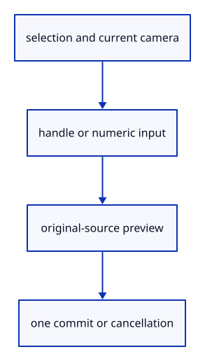

# 7.6.34 · Verify complete handle editing and input

**Chapter 7 · Drawing, snapping and transform tools · Section 7.6 · Move, rotate and scale handles** · [Contents](contents.md)

**Typing: 1–2 minutes.** [Estimate](typing-load.md).

Whole-object and source-part handles share current ray math, temporary presentation and one commit boundary. Exercise numeric fields, pointer cancellation, Shift release and original-source restoration together.

## Type

Continue from [Count temporary source owners without saving them](51ze-ledger.md). [Save or recover your work](recovery.md).

<details>
<summary>Supplied validation fixture</summary>

Copy this supplied authoring fixture once. Continue with the browser build below; the course does not require running native tests.

### 1. `src/gizmo_edit_tests.rs`

Copy original-source, pointer-ID, stale-edit, rational-weight, one-Undo and preview-ledger regression checks.

Copy this supplied file:

```text
--8<-- "journey/code/51zf-handles-01.rs"
```

</details>

<details>
<summary>Supplied validation fixture</summary>

Copy this supplied authoring fixture once. Continue with the browser build below; the course does not require running native tests.

### 2. `src/number_box_tests.rs`

Copy actual egui field-focus, text, Enter/Escape, rectangle and handle-switch regression checks.

Copy this supplied file:

```text
--8<-- "journey/code/51zf-handles-02.rs"
```

</details>

### 3. `src/lib.rs`

Register the edit component and supplied checks.

<details>
<summary>Locate the existing block</summary>

```rust
pub mod gizmo_edit;

pub mod number_box;
```

</details>

After that block, type:

```rust
--8<-- "journey/code/51zf-handles-03.rs" skip=41
```

<details>
<summary>Supplied validation fixture</summary>

Copy this supplied authoring fixture once. Continue with the browser build below; the course does not require running native tests.

### 4. `src/gizmo_edit_tests.rs`

Supply a regression for Escape during a held pointer drag, its later release and the preserved redo branch.

<details>
<summary>Locate the existing block</summary>

```text
;
    e.hover_gizmo(None);assert_eq!(e.gizmo_active(),-1.);
    e.hover_gizmo(Some((p,SIZE)));e.apply(Action::Zoom(1.)).unwrap();assert_eq!(e.gizmo_active(),-1.);assert_eq!(models(&e),before);
    e.apply(Action::BeginTool(crate::tool::Shape::Line)).unwrap();e.hover_gizmo(Some((p,SIZE)));assert_eq!(e.gizmo_active(),-1.);assert!(e.gizmo_edit.is_none());
    e.apply(Action::CancelTool).unwrap();e.apply(Action::Undo).unwrap();assert!(e.scene.points().is_empty(),"Hover created no history entry");
}
```

</details>

After that block, append this supplied code:

```text
--8<-- "journey/code/51zf-handles-escape-drag-tests.rs" skip=500
```

</details>

## Run and check

In your project:

```sh
cd workspace/journey
REGEN_PROTO=0 cargo build --lib --locked --target wasm32-unknown-unknown -j1
REGEN_PROTO=0 CARGO_BUILD_JOBS=1 trunk serve --port 8780
```

Open `http://127.0.0.1:8780/`. Keep an existing Trunk server running; saving rebuilds it.


### Recorded visual result

**Previous native render — current verification pending.**

Two selected gold boxes retain black source boundaries beneath the colored editing widget.


*This recorded image predates a source or checker change. Rebuild this checkpoint before using it as current evidence; browser controls require separate acceptance.*

<details>
<summary>Code explanation and diagram</summary>


selection and current camera → handle or numeric input → original-source preview → one commit or cancellation.



What proves a handle preview is still temporary?

Saved source coordinates and placements remain unchanged during motion. Cancellation restores presentation; only a valid completed edit changes one history entry.

Study estimate, including typing and experiments: 0.5–1 hours.

</details>

<details>
<summary>Optional experiment</summary>

Close; Example Box; Select All; Fit. Drag an arrow, then Undo. Click an arrow and type0.123456789012345. Try a rotation with Shift, a zero scale and Escape; errors or cancellation must preserve original geometry and redo.

</details>

<details>
<summary>Check and save your work</summary>

Restore experimental edits, then run from `session_viewer`:

```sh
npm --prefix ../session_tests run course -- check 7.6.34
npm --prefix ../session_tests run course -- save 7.6.34
```

Source comparison leaves your project untouched. [Save and recovery instructions](recovery.md).

</details>

<details>
<summary>Viewer coverage and verification</summary>

Current96CSS handles,8CSS grab aperture, world-axis Move/Rotate/Scale, Shift90-degree rotation, click-to-number input, original-source part previews and one-transaction commits are connected. Full control-point/object/window-crossing gesture precedence and release-before-source-pick behavior extend in54; descendant gathering extends with original tree ownership in52. Later geometry subjects add their original part types. Actual browser acceptance remains pending.

Native tests retain earlier input and add current handle math, actual GPU overlay pixels at both projections/DPR1/2, pointer IDs, exact numeric transforms, invalid/cancel/zero-edit redo preservation, original sparse face/edge keys, hole deduplication, inverse placed part movement, preserved rational weights/knots/GUIDs, stale-source refusal and actual egui number-field ownership. Browser acceptance retains prior tool contracts and adds real handle clicks/drags, Shift release, typed fields and cancel/blur behavior; it remains unrun.

The selected boxes show their world-axis arrows, scale balls and rotation arcs. Handles draw over source geometry with a constant CSS size.

[Full validation scope](release.md).

To reproduce the scripted acceptance of the reference checkpoint, run from `session_viewer` with the [course bundle server](release.md#reproduce) running on port 8781:

```sh
npm --prefix ../session_tests run course -- capture 7.6.34
```

This uses the verified reference bundle; it does not check or change your typed project.

</details>
