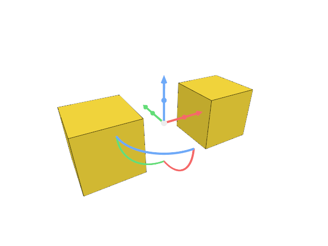
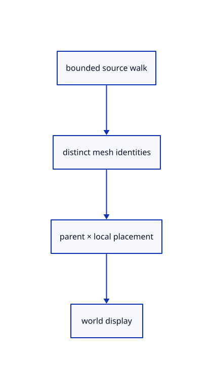

# 8.1.1 · Validate and place a nested source tree

**Chapter 8 · Hierarchy, layers and direct editing · Section 8.1 · Nested source trees** · [Contents](contents.md)

**Typing: 14–28 minutes.** [Estimate](typing-load.md).

Walk a source tree with explicit node and depth limits. Every mesh must occur once; compose object placements down its path without changing its original coordinates.

## Type

Continue from [Verify complete handle editing and input](51zf-handles.md). [Save or recover your work](recovery.md).

### 1. `src/hierarchy.rs`

Bound tree walks and compose precise placements along source paths.

Create the file and type:

```rust
--8<-- "journey/code/52-tree-01.rs"
```

### 2. `src/lib.rs`

Register the new source component.

<details>
<summary>Locate the existing block</summary>

```rust
mod gizmo_edit_tests;
#[cfg(test)]
mod number_box_tests;
```

</details>

After that block, type:

```rust
--8<-- "journey/code/52-tree-02.rs" skip=57
```

## Run and check

In your project:

```sh
cd workspace/journey
REGEN_PROTO=0 cargo build --lib --locked --target wasm32-unknown-unknown -j1
REGEN_PROTO=0 CARGO_BUILD_JOBS=1 trunk serve --port 8780
```

Open `http://127.0.0.1:8780/`. Keep an existing Trunk server running; saving rebuilds it.

Continue the earlier two-box handle exercise. Nested import connects at52c, descendant editing at52e, and the visible tree panel at52j.

### Recorded visual result

**Previous native render — current verification pending.**

Two selected boxes and their source-independent handles remain.



*This recorded image predates a source or checker change. Rebuild this checkpoint before using it as current evidence; browser controls require separate acceptance.*

<details>
<summary>Code explanation and diagram</summary>


bounded source walk → distinct mesh identities → parent × local placement → world display.



Does nesting bake a parent’s placement into the child’s original mesh?

No. Its original coordinates remain unchanged. The derived row carries the product of the parent and child placement matrices.

Study estimate, including typing and experiments: 0.5–1 hours.

</details>

<details>
<summary>Optional experiment</summary>

Compare a translated parent and locally shifted child. Reverse the multiplication order and predict which world coordinates change.

</details>

<details>
<summary>Check and save your work</summary>

Restore experimental edits, then run from `session_viewer`:

```sh
npm --prefix ../session_tests run course -- check 8.1.1
npm --prefix ../session_tests run course -- save 8.1.1
```

Source comparison leaves your project untouched. [Save and recovery instructions](recovery.md).

</details>

<details>
<summary>Viewer coverage and verification</summary>


The earlier selected-box and handle exercise remains available.

[Full validation scope](release.md).

To reproduce the scripted acceptance of the reference checkpoint, run from `session_viewer` with the [course bundle server](release.md#reproduce) running on port 8781:

```sh
npm --prefix ../session_tests run course -- capture 8.1.1
```

This uses the verified reference bundle; it does not check or change your typed project.

</details>
