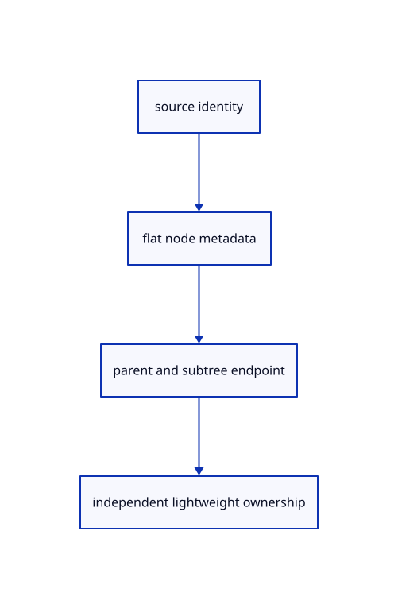

# 8.1.2 · Keep lightweight tree records outside kernel ownership

**Chapter 8 · Hierarchy, layers and direct editing · Section 8.1 · Nested source trees** · [Contents](contents.md)

**Typing: 4–8 minutes.** [Estimate](typing-load.md).

Each flattened node stores its source identity, parent, depth and subtree endpoint. Retain scalar metadata and original colours without keeping a mesh or kernel document alive.

## Type

Continue from [Validate and place a nested source tree](52-tree.md). [Save or recover your work](recovery.md).

### 1. `src/hierarchy.rs`

Store immutable document-scoped node records shared by previews and history.

<details>
<summary>Locate the existing block</summary>

```rust
    xforms.get(guid).cloned().unwrap_or_else(Xform::identity)
}
```

</details>

After that block, type:

```rust
--8<-- "journey/code/52a-records-01.rs" skip=65
```

### 2. `src/scene.rs`

Allow stable row identities to participate in deduplication sets.

<details>
<summary>Locate the existing block</summary>

```rust
use crate::{mesh::Mesh, prepared::PreparedMesh};
use std::rc::Rc;

#[derive(Clone, Copy, Debug, PartialEq, Eq)]
pub struct ObjectId(u32);

impl ObjectId { pub fn value(self) -> u32 { self.0 } }
```

</details>

Edit the existing block to match this code; keep unchanged lines:

```rust
--8<-- "journey/code/52a-records-02.rs"
```

## Run and check

In your project:

```sh
cd workspace/journey
REGEN_PROTO=0 cargo build --lib --locked --target wasm32-unknown-unknown -j1
REGEN_PROTO=0 CARGO_BUILD_JOBS=1 trunk serve --port 8780
```

Open `http://127.0.0.1:8780/`. Keep an existing Trunk server running; saving rebuilds it.


### Recorded visual result

**Previous native render — current verification pending.**

Two selected boxes and their source-independent handles remain.

This checkpoint was rendered independently and has the same native comparison frame as [Validate and place a nested source tree](52-tree.md). Use its state checks and browser exercise to assess the changed behavior.


*This recorded image predates a source or checker change. Rebuild this checkpoint before using it as current evidence; browser controls require separate acceptance.*

This reference image is shared with [8.1.1 · Validate and place a nested source tree](52-tree.md). It does not demonstrate a new feature by itself.

<details>
<summary>Code explanation and diagram</summary>


source identity → flat node metadata → parent and subtree endpoint → independent lightweight ownership.



Why store a subtree’s endpoint?

All descendants occupy one contiguous slice after their parent. This avoids a fresh recursive kernel walk for every expand, select or parent-edit operation.

Study estimate, including typing and experiments: 0.5–1 hours.

</details>

<details>
<summary>Optional experiment</summary>

Follow a five-level source path through its flat records. Verify that a leaf’s endpoint is exactly one position past itself.

</details>

<details>
<summary>Check and save your work</summary>

Restore experimental edits, then run from `session_viewer`:

```sh
npm --prefix ../session_tests run course -- check 8.1.2
npm --prefix ../session_tests run course -- save 8.1.2
```

Source comparison leaves your project untouched. [Save and recovery instructions](recovery.md).

</details>

<details>
<summary>Viewer coverage and verification</summary>


The earlier selected-box and handle exercise remains available.

[Full validation scope](release.md).

To reproduce the scripted acceptance of the reference checkpoint, run from `session_viewer` with the [course bundle server](release.md#reproduce) running on port 8781:

```sh
npm --prefix ../session_tests run course -- capture 8.1.2
```

This uses the verified reference bundle; it does not check or change your typed project.

</details>
