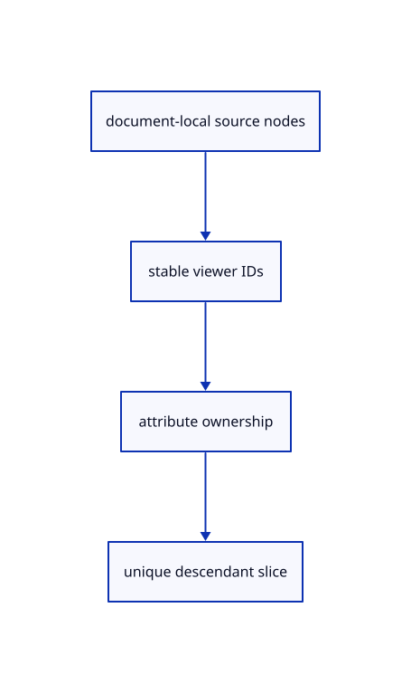

# 8.1.3 · Index descendants and read-only attribute groups

**Chapter 8 · Hierarchy, layers and direct editing · Section 8.1 · Nested source trees** · [Contents](contents.md)

**Typing: 22–43 minutes.** [Estimate](typing-load.md).

Flatten nested rows once per imported document. Attribute and feature groups below an object are read only; a parent edit gathers every descendant identity once.

## Type

Continue from [Keep lightweight tree records outside kernel ownership](52a-records.md). [Save or recover your work](recovery.md).

### 1. `src/hierarchy.rs`

Create stable document-scoped nodes and deduplicate parent-owned descendants.

<details>
<summary>Locate the existing block</summary>

```rust
#[derive(Clone,Default)]
pub struct Forest { pub documents:Vec<Rc<Document>> }

impl Forest {}
```

</details>

Edit the existing block to match this code; keep unchanged lines:

```rust
--8<-- "journey/code/52b-index-01.rs"
```

## Run and check

In your project:

```sh
cd workspace/journey
REGEN_PROTO=0 cargo build --lib --locked --target wasm32-unknown-unknown -j1
REGEN_PROTO=0 CARGO_BUILD_JOBS=1 trunk serve --port 8780
```

Open `http://127.0.0.1:8780/`. Keep an existing Trunk server running; saving rebuilds it.


### Recorded visual result

**Previous native render — current verification pending.**

Two selected boxes and their source-independent handles remain.

This checkpoint was rendered independently and has the same native comparison frame as [Keep lightweight tree records outside kernel ownership](52a-records.md). Use its state checks and browser exercise to assess the changed behavior.


*This recorded image predates a source or checker change. Rebuild this checkpoint before using it as current evidence; browser controls require separate acceptance.*

This reference image is shared with [8.1.1 · Validate and place a nested source tree](52-tree.md). It does not demonstrate a new feature by itself.

<details>
<summary>Code explanation and diagram</summary>


document-local source nodes → stable viewer IDs → attribute ownership → unique descendant slice.



Can a displayed attribute be a separate edit target?

No. It follows its owning object. Display and source metadata remain available, while source picking and independent editing refuse the attribute row.

Study estimate, including typing and experiments: 0.5–1 hours.

</details>

<details>
<summary>Optional experiment</summary>

Select a parent and its ordinary child together. Their descendant set must contain each object once, including attached attributes.

</details>

<details>
<summary>Check and save your work</summary>

Restore experimental edits, then run from `session_viewer`:

```sh
npm --prefix ../session_tests run course -- check 8.1.3
npm --prefix ../session_tests run course -- save 8.1.3
```

Source comparison leaves your project untouched. [Save and recovery instructions](recovery.md).

</details>

<details>
<summary>Viewer coverage and verification</summary>


The earlier selected-box and handle exercise remains available.

[Full validation scope](release.md).

To reproduce the scripted acceptance of the reference checkpoint, run from `session_viewer` with the [course bundle server](release.md#reproduce) running on port 8781:

```sh
npm --prefix ../session_tests run course -- capture 8.1.3
```

This uses the verified reference bundle; it does not check or change your typed project.

</details>
