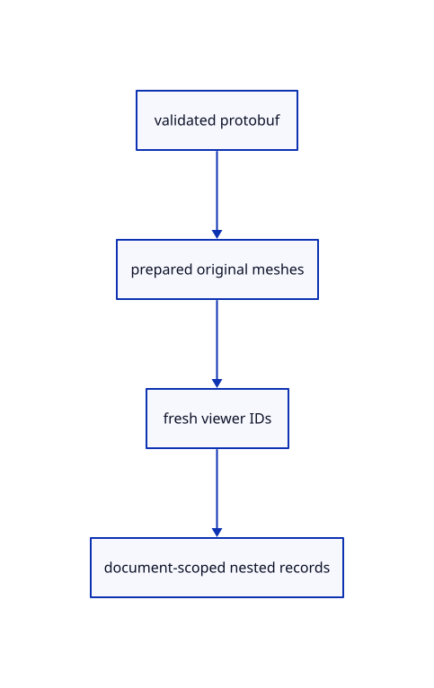

# 8.1.4 · Import nested source identities and precise placements

**Chapter 8 · Hierarchy, layers and direct editing · Section 8.1 · Nested source trees** · [Contents](contents.md)

**Typing: 9–18 minutes.** [Estimate](typing-load.md).

Capture only the source tree alongside prepared meshes. Bind its geometry GUIDs to newly allocated viewer IDs, so repeated imports preserve source identity without sharing panel keys.

## Type

Continue from [Index descendants and read-only attribute groups](52b-index.md). [Save or recover your work](recovery.md).

### 1. `src/document.rs`

Capture nested tree metadata and replace flat-only validation with the bounded source walk.

Edit these blocks from bottom to top. Keep the surrounding lines unchanged.

<details>
<summary>Locate this block</summary>

```rust
        }
    }
    if let Some(root) = message.tree.as_ref().and_then(|tree| tree.root.as_ref()) {
        let names: HashSet<_> = root.children.iter().map(|node| node.name.as_str()).collect();
        if names != guids || root.children.len() != guids.len()
            || root.children.iter().any(|node| !node.children.is_empty()) {
            return Err("This checkpoint needs one flat tree row per mesh");
        }
    }
    Ok(())
}
```

</details>

Replace it with:

```rust
        }
    }
    if let Some(root) = message.tree.as_ref().and_then(|tree| tree.root.as_ref()) {
        crate::hierarchy::validate(root,&guids)?;
    }
    Ok(())
}
```

<details>
<summary>Locate this block</summary>

```rust
        }
        Ok(meshes)
    })?;
    Ok(Loaded { document, meshes })
}

fn decode_raw(bytes: &[u8]) -> Result<proto::Session, &'static str> {
```

</details>

Replace it with:

```rust
        }
        Ok(meshes)
    })?;
    Ok(Loaded { document, meshes, tree })
}

fn decode_raw(bytes: &[u8]) -> Result<proto::Session, &'static str> {
```

<details>
<summary>Locate this block</summary>

```rust
        let mut meshes = Vec::new();
        for mesh in document.objects.meshes.iter() {
            let mut prepared = PreparedMesh::from_shared(Rc::clone(mesh))?;
            prepared.model = document.xforms.get(mesh.guid()).cloned().unwrap_or_else(session_rust::Xform::identity);
            prepared.source = Some(Source {
                document: Rc::clone(&document), guid: mesh.guid().to_owned(), origin: Rc::clone(&origin),
            });
```

</details>

Replace it with:

```rust
        let mut meshes = Vec::new();
        for mesh in document.objects.meshes.iter() {
            let mut prepared = PreparedMesh::from_shared(Rc::clone(mesh))?;
            prepared.model = crate::hierarchy::world(tree.as_ref(),&document.xforms,mesh.guid());
            prepared.source = Some(Source {
                document: Rc::clone(&document), guid: mesh.guid().to_owned(), origin: Rc::clone(&origin),
            });
```

<details>
<summary>Locate this block</summary>

```rust
    run("validation", size, clock, observe, || validate(&message))?;
    let mut origin = crate::origin::Origin::new(&message, bytes); origin.location = location;
    let origin = Rc::new(origin);
    let document = run("kernel", size, clock, observe, || {
        Session::from_proto(message).map(Rc::new).map_err(|_| "Cannot construct session")
    })?;
```

</details>

Replace it with:

```rust
    run("validation", size, clock, observe, || validate(&message))?;
    let mut origin = crate::origin::Origin::new(&message, bytes); origin.location = location;
    let origin = Rc::new(origin);
    let tree=message.tree.as_ref().and_then(|tree|tree.root.clone());
    let document = run("kernel", size, clock, observe, || {
        Session::from_proto(message).map(Rc::new).map_err(|_| "Cannot construct session")
    })?;
```

<details>
<summary>Locate this block</summary>

```rust
pub struct Loaded {
    pub document: Rc<Session>,
    pub meshes: Vec<PreparedMesh>,
}

pub fn load(bytes: &[u8]) -> Result<Loaded, &'static str> { load_at(bytes, None) }
```

</details>

Replace it with:

```rust
pub struct Loaded {
    pub document: Rc<Session>,
    pub meshes: Vec<PreparedMesh>,
    pub tree:Option<proto::TreeNode>,
}

pub fn load(bytes: &[u8]) -> Result<Loaded, &'static str> { load_at(bytes, None) }
```

<details>
<summary>Complete updated block reference</summary>

```rust
use crate::prepared::PreparedMesh;
use prost::Message;
use session_rust::{proto, Session};
use std::{collections::HashSet, rc::Rc};

pub const MAX_BYTES: usize = 4 * 1024 * 1024;

#[derive(Clone)]
pub struct Source {
    pub document: Rc<Session>,
    pub guid: String,
    pub origin: Rc<crate::origin::Origin>,
}

pub struct Loaded {
    pub document: Rc<Session>,
    pub meshes: Vec<PreparedMesh>,
    pub tree:Option<proto::TreeNode>,
}

pub fn load(bytes: &[u8]) -> Result<Loaded, &'static str> { load_at(bytes, None) }

pub fn load_at(bytes: &[u8], location: Option<Rc<crate::reload_url::ReloadUrl>>) -> Result<Loaded, &'static str> {
    load_observed(bytes, location, &mut crate::load_measure::now, &mut |phase| {
        #[cfg(target_arch = "wasm32")]
        crate::browser_phase::completed(phase, "document");
        #[cfg(not(target_arch = "wasm32"))]
        let _ = phase;
    })
}

pub fn load_observed(bytes: &[u8], location: Option<Rc<crate::reload_url::ReloadUrl>>,
    clock: &mut impl FnMut() -> f64, observe: &mut impl FnMut(crate::load_measure::Completed<'_>),
) -> Result<Loaded, &'static str> {
    use crate::load_measure::run;
    let size = bytes.len() as u64;
    let message = run("decode", size, clock, observe, || decode_raw(bytes))?;
    run("validation", size, clock, observe, || validate(&message))?;
    let mut origin = crate::origin::Origin::new(&message, bytes); origin.location = location;
    let origin = Rc::new(origin);
    let tree=message.tree.as_ref().and_then(|tree|tree.root.clone());
    let document = run("kernel", size, clock, observe, || {
        Session::from_proto(message).map(Rc::new).map_err(|_| "Cannot construct session")
    })?;
    let meshes = run("display walk", size, clock, observe, || {
        let mut meshes = Vec::new();
        for mesh in document.objects.meshes.iter() {
            let mut prepared = PreparedMesh::from_shared(Rc::clone(mesh))?;
            prepared.model = crate::hierarchy::world(tree.as_ref(),&document.xforms,mesh.guid());
            prepared.source = Some(Source {
                document: Rc::clone(&document), guid: mesh.guid().to_owned(), origin: Rc::clone(&origin),
            });
            meshes.push(prepared);
        }
        Ok(meshes)
    })?;
    Ok(Loaded { document, meshes, tree })
}

fn decode_raw(bytes: &[u8]) -> Result<proto::Session, &'static str> {
    if bytes.len() > MAX_BYTES { return Err("This checkpoint accepts files up to 4 MiB"); }
    proto::Session::decode(bytes).map_err(|_| "Invalid session protobuf")
}

fn decode(bytes: &[u8]) -> Result<proto::Session, &'static str> {
    let message = decode_raw(bytes)?;
    validate(&message)?;
    Ok(message)
}

pub(crate) fn restore(bytes: &[u8], origin: &crate::origin::Origin) -> Result<Rc<Session>, &'static str> {
    if bytes.len() > MAX_BYTES { return Err("This checkpoint accepts files up to 4 MiB"); }
    if crate::origin::FileVersion::of(bytes) != origin.version { return Err("Reloaded file version changed"); }
    Session::from_proto(decode(bytes)?).map(Rc::new).map_err(|_| "Cannot restore source session")
}

pub fn snapshot(scene: &crate::scene::Scene) -> Result<Vec<u8>, &'static str> {
    if !scene.points().is_empty() { return Err("This checkpoint cannot save point objects yet"); }
    if !scene.lines().is_empty() || !scene.paths().is_empty() { return Err("This checkpoint cannot save line objects yet"); }
    let mut objects = proto::Objects::default();
    let mut children = Vec::new();
    let mut xforms = Vec::new();
    for object in scene.objects() {
        let geometry = object.geometry().ok_or("Reload editable sources before saving")?;
        let mut mesh = geometry.to_proto();
        mesh.guid = object.guid.clone();
        objects.meshes.push(mesh);
        children.push(proto::TreeNode { name: object.guid.clone(), ..Default::default() });
        if object.model.m != session_rust::Xform::identity().m {
            xforms.push(proto::XformEntry {
                guid: object.guid.clone(), xform: Some(object.model.to_proto()),
            });
        }
    }
    let message = proto::Session {
        name: "Viewer document".into(), objects: Some(objects),
        tree: Some(proto::Tree { root: Some(proto::TreeNode {
            name: "Objects".into(), children, ..Default::default()
        }), ..Default::default() }), xforms, ..Default::default()
    };
    validate(&message)?;
    let bytes = message.encode_to_vec();
    if bytes.len() > MAX_BYTES { return Err("The saved document exceeds 4 MiB"); }
    Ok(bytes)
}

fn validate(message: &proto::Session) -> Result<(), &'static str> {
    let objects = message.objects.as_ref().ok_or("Session has no objects")?;
    if message.definitions.is_some() || !message.interactions.is_empty() {
        return Err("Definitions and interactions arrive in later checkpoints");
    }
    let other = objects.points.len() + objects.lines.len() + objects.planes.len()
        + objects.bboxes.len() + objects.polylines.len() + objects.pointclouds.len()
        + objects.nurbscurves.len() + objects.nurbssurfaces.len() + objects.breps.len()
        + objects.elements.len() + objects.components.len() + objects.sheets.len() + objects.instances.len();
    if other != 0 || objects.meshes.is_empty() || objects.meshes.len() > 64 {
        return Err("This checkpoint accepts 1–64 meshes and no other geometry types");
    }
    let mut guids = HashSet::new();
    for mesh in &objects.meshes {
        if mesh.guid.is_empty() || !guids.insert(mesh.guid.as_str()) {
            return Err("Every mesh needs a distinct source GUID");
        }
        validate_mesh(mesh)?;
    }
    let mut placed = HashSet::new();
    for entry in &message.xforms {
        let matrix = &entry.xform.as_ref().ok_or("Missing placement matrix")?.matrix;
        if !guids.contains(entry.guid.as_str()) || !placed.insert(entry.guid.as_str())
            || !crate::placement::valid(matrix)
        {
            return Err("Invalid mesh placement");
        }
    }
    if let Some(root) = message.tree.as_ref().and_then(|tree| tree.root.as_ref()) {
        crate::hierarchy::validate(root,&guids)?;
    }
    Ok(())
}

fn validate_mesh(mesh: &proto::Mesh) -> Result<(), &'static str> {
    if mesh.vertices.len() > 10_000 || mesh.faces.is_empty() || mesh.faces.len() > 10_000 {
        return Err("A mesh needs faces and at most 10,000 vertices and faces");
    }
    if !(0..=3).contains(&mesh.color_mode) { return Err("Unknown mesh colour mode"); }
    for colours in [&mesh.pointcolors_rgba, &mesh.facecolors_rgba, &mesh.linecolors_rgba] {
        if colours.len() % 4 != 0 || colours.len() > 160_000 || colours.iter().any(|v| !v.is_finite()) {
            return Err("Mesh colours need bounded complete finite RGBA records");
        }
    }
    if mesh.objectcolor.as_ref().is_some_and(|c| [c.r, c.g, c.b, c.a].iter().any(|v| !v.is_finite())) {
        return Err("Mesh object colour must be finite");
    }
    for (&key, vertex) in &mesh.vertices {
        if key > u32::MAX as u64 || [vertex.x, vertex.y, vertex.z].iter().any(|v| !v.is_finite()) {
            return Err("Invalid vertex key or coordinate");
        }
    }
    for (&key, face) in &mesh.faces {
        if key > u32::MAX as u64 || !(3..=4).contains(&face.vertices.len()) || !face.holes.is_empty()
            || face.vertices.iter().any(|key| !mesh.vertices.contains_key(key)) {
            return Err("This checkpoint needs triangles or quads with existing vertices and no holes");
        }
    }
    for (key, triangles) in &mesh.triangulation {
        if !mesh.faces.contains_key(key) || triangles.vertices.len() % 3 != 0
            || triangles.vertices.iter().any(|key| !mesh.vertices.contains_key(key)) {
            return Err("Invalid stored triangulation");
        }
    }
    Ok(())
}
```

</details>

<details>
<summary>Optional patch references</summary>

Use these original edit fragments when comparing a saved checkpoint. Apply the complete blocks above.

```text
--8<-- "journey/code/52c-load-01.rs"
```

```text
--8<-- "journey/code/52c-load-02.rs"
```

```text
--8<-- "journey/code/52c-load-03.rs"
```

```text
--8<-- "journey/code/52c-load-04.rs"
```

```text
--8<-- "journey/code/52c-load-05.rs"
```

</details>

### 2. `src/scene.rs`

Bind imported tree nodes to fresh row IDs and release their records when the document closes.

Edit these blocks from bottom to top. Keep the surrounding lines unchanged.

<details>
<summary>Locate this block</summary>

```rust
    }

    pub fn import(&mut self, loaded: crate::document::Loaded) -> Result<(), &'static str> {
        for prepared in loaded.meshes {
            self.insert(prepared)?;
        }
        Ok(())
    }

    pub fn place(&mut self, id: ObjectId, model: session_rust::Xform) -> Result<(), &'static str> {
```

</details>

Replace it with:

```rust
    }

    pub fn import(&mut self, loaded: crate::document::Loaded) -> Result<(), &'static str> {
        let mut objects=Vec::new();let key=self.next_id;
        for prepared in loaded.meshes {
            let guid=prepared.geometry.guid().to_owned();let name=prepared.geometry.name.clone();
            let id=self.insert(prepared)?;objects.push((guid,id,name));
        }
        self.forest.add(key,loaded.document.name.clone(),loaded.tree,&objects);Ok(())
    }

    pub fn place(&mut self, id: ObjectId, model: session_rust::Xform) -> Result<(), &'static str> {
```

<details>
<summary>Locate this block</summary>

```rust
    }

    pub fn clear(&mut self) {
        self.points = Vec::new();
        self.paths = Vec::new();
        self.lines = Vec::new();
```

</details>

Replace it with:

```rust
    }

    pub fn clear(&mut self) {
        self.forest=Default::default();
        self.points = Vec::new();
        self.paths = Vec::new();
        self.lines = Vec::new();
```

<details>
<summary>Locate this block</summary>

```rust
        let turquoise = PreparedMesh::triangle([
            [-0.4, -0.2, 0.75], [0.8, -0.2, 0.75], [0.2, 0.8, 0.75],
        ], [0.05, 0.7, 0.7]).expect("Valid turquoise triangle");
        let mut scene = Self { objects: Vec::new(), points: Vec::new(), paths: Vec::new(), lines: Vec::new(), next_id: 1, extra: None };
        scene.insert(pink).expect("ID available");
        scene.insert(turquoise).expect("ID available");
        scene
```

</details>

Replace it with:

```rust
        let turquoise = PreparedMesh::triangle([
            [-0.4, -0.2, 0.75], [0.8, -0.2, 0.75], [0.2, 0.8, 0.75],
        ], [0.05, 0.7, 0.7]).expect("Valid turquoise triangle");
        let mut scene = Self { forest:Default::default(), objects: Vec::new(), points: Vec::new(), paths: Vec::new(), lines: Vec::new(), next_id: 1, extra: None };
        scene.insert(pink).expect("ID available");
        scene.insert(turquoise).expect("ID available");
        scene
```

<details>
<summary>Locate this block</summary>

```rust

#[derive(Clone)]
pub struct Scene {
    points: Vec<PointObject>,
    paths: Vec<PathObject>,
    lines: Vec<LineObject>,
```

</details>

Replace it with:

```rust

#[derive(Clone)]
pub struct Scene {
    pub forest:crate::hierarchy::Forest,
    points: Vec<PointObject>,
    paths: Vec<PathObject>,
    lines: Vec<LineObject>,
```

<details>
<summary>Complete updated block reference</summary>

```rust
use crate::{mesh::Mesh, prepared::PreparedMesh};
use std::rc::Rc;

#[derive(Clone, Copy, Debug, PartialEq, Eq, Hash)]
pub struct ObjectId(u32);

impl ObjectId { pub fn value(self) -> u32 { self.0 } }

#[derive(Clone)]
pub struct Object {
    pub id: ObjectId,
    pub guid: String,
    pub metadata: Rc<crate::row_metadata::RowMetadata>,
    pub mesh: Rc<Mesh>,
    pub model: session_rust::Xform,
    editable: crate::edit_source::EditSource,
}

impl Object {
    pub fn visible(&self) -> bool { self.metadata.is_visible }

    pub fn geometry(&self) -> Option<&Rc<session_rust::Mesh>> {
        match &self.editable { crate::edit_source::EditSource::Loaded { geometry, .. } => Some(geometry), _ => None }
    }

    pub fn source(&self) -> Option<&crate::document::Source> {
        match &self.editable { crate::edit_source::EditSource::Loaded { source, .. } => source.as_ref(), _ => None }
    }

    pub fn origin(&self) -> Option<&Rc<crate::origin::Origin>> {
        match &self.editable {
            crate::edit_source::EditSource::Loaded { source, .. } => source.as_ref().map(|source| &source.origin),
            crate::edit_source::EditSource::Released { origin, .. } => Some(origin),
        }
    }

    pub fn release_epoch(&self) -> Option<u64> {
        match &self.editable { crate::edit_source::EditSource::Released { epoch, .. } => Some(*epoch), _ => None }
    }

    pub fn can_unload(&self) -> bool {
        let Some(source) = self.source() else { return false; };
        let Some(geometry) = self.geometry() else { return false; };
        source.origin.location.is_some() && self.metadata.source_guid == source.guid
            && geometry.guid() == source.guid && self.metadata.name == geometry.name
            && self.metadata.is_visible == geometry.is_visible && self.metadata.is_locked == geometry.is_locked
            && source.document.objects.meshes.iter().any(|mesh| Rc::ptr_eq(mesh, geometry))
    }

    pub fn world_point(&self, vertex: [f32; 6]) -> [f64; 3] {
        let local = session_rust::Point::new(vertex[0] as f64, vertex[1] as f64, vertex[2] as f64);
        let world = self.model.transform_point(&local);
        [world[0], world[1], world[2]]
    }
}

#[derive(Clone)]
pub struct LineObject {
    pub id: ObjectId,
    pub prepared: crate::stroke::PreparedLine,
    pub model: session_rust::Xform,
}

impl LineObject {
    pub fn visible(&self) -> bool { self.prepared.source.is_visible }

    pub fn endpoints(&self) -> [session_rust::Point; 2] {
        let line = &self.prepared.source;
        [self.model.transform_point(&line.start()), self.model.transform_point(&line.end())]
    }

    pub fn stroke(&self) -> crate::stroke::Stroke {
        let [start, end] = self.endpoints();
        crate::stroke::Stroke { start: std::array::from_fn(|i| start[i] as f32),
            end: std::array::from_fn(|i| end[i] as f32), ..self.prepared.display }
    }
}

#[derive(Clone)]
pub struct PathObject { pub controls_visible: bool, pub id: ObjectId, pub guid: String, pub prepared: crate::chain::PreparedChain, pub model: session_rust::Xform }

impl PathObject {
    pub fn visible(&self) -> bool { self.prepared.source.visible() }

    pub fn segments(&self) -> Vec<crate::chain::Segment> {
        let mut points = Vec::new();
        for p in self.points() {
            let p = std::array::from_fn(|i| p[i] as f32);
            if points.last() != Some(&p) { points.push(p); }
        }
        crate::chain::PreparedChain { points: Rc::new(points), ..self.prepared.clone() }.segments()
    }

    pub fn bounds_points(&self) -> Vec<session_rust::Point> {
        self.prepared.source.bounds_coordinates().into_iter().map(|p|
            self.model.transform_point(&session_rust::Point::new(p[0], p[1], p[2]))).collect()
    }

    pub fn points(&self) -> Vec<session_rust::Point> {
        self.prepared.source.coordinates().into_iter().map(|p| self.model.transform_point(&session_rust::Point::new(p[0], p[1], p[2]))).collect()
    }


}

pub struct ControlMarker { pub parent: ObjectId, pub control: crate::controls::Control, pub display: crate::marker::Marker }

#[derive(Clone)]
pub struct PointObject { pub id: ObjectId, pub guid: String, pub prepared: crate::marker::PreparedPoint, pub model: session_rust::Xform }

impl PointObject {
    pub fn visible(&self) -> bool { self.prepared.source.is_visible }

    pub fn point(&self) -> session_rust::Point { self.model.transform_point(&self.prepared.source) }
    pub fn marker(&self) -> crate::marker::Marker { crate::marker::Marker { center: self.point().to_f32(), ..self.prepared.display } }
}

#[derive(Clone)]
pub struct Scene {
    pub forest:crate::hierarchy::Forest,
    points: Vec<PointObject>,
    paths: Vec<PathObject>,
    lines: Vec<LineObject>,
    objects: Vec<Object>,
    next_id: u32,
    extra: Option<ObjectId>,
}

impl Scene {
    pub fn pick_id(&self, value: u32) -> Option<ObjectId> {
        self.objects.iter().filter(|r| r.visible() && !r.metadata.is_locked).map(|r| r.id)
            .chain(self.lines.iter().filter(|r| r.visible() && !r.prepared.source.is_locked).map(|r| r.id))
            .chain(self.paths.iter().filter(|r| r.visible() && !r.prepared.source.locked()).map(|r| r.id))
            .chain(self.points.iter().filter(|r| r.visible() && !r.prepared.source.is_locked).map(|r| r.id))
            .find(|id| id.value() == value)
    }

    pub fn demo() -> Self {
        let pink = PreparedMesh::triangle([
            [-0.7, -0.6, 0.25], [0.5, -0.6, 0.25], [-0.1, 0.6, 0.25],
        ], [0.9, 0.25, 0.45]).expect("Valid pink triangle");
        let turquoise = PreparedMesh::triangle([
            [-0.4, -0.2, 0.75], [0.8, -0.2, 0.75], [0.2, 0.8, 0.75],
        ], [0.05, 0.7, 0.7]).expect("Valid turquoise triangle");
        let mut scene = Self { forest:Default::default(), objects: Vec::new(), points: Vec::new(), paths: Vec::new(), lines: Vec::new(), next_id: 1, extra: None };
        scene.insert(pink).expect("ID available");
        scene.insert(turquoise).expect("ID available");
        scene
    }

    pub fn restore(&mut self, mut saved: Self) {
        saved.next_id = saved.next_id.max(self.next_id);
        *self = saved;
    }

    pub fn visible(&self, id: ObjectId) -> bool {
        if let Some(row) = self.objects.iter().find(|row| row.id == id) { return row.metadata.is_visible; }
        if let Some(row) = self.lines.iter().find(|row| row.id == id) { return row.prepared.source.is_visible; }
        if let Some(row) = self.paths.iter().find(|row| row.id == id) { return row.prepared.source.visible(); }
        self.points.iter().find(|row| row.id == id).is_some_and(|row| row.prepared.source.is_visible)
    }

    pub fn bounds(&self) -> Option<crate::bounds::Bounds> {
        let mut bounds: Option<crate::bounds::Bounds> = None;
        for object in self.objects.iter().filter(|row| row.visible()) {
            for vertex in object.mesh.vertices() {
                let point = object.world_point(*vertex);
                match &mut bounds {
                    Some(bounds) => bounds.include(point),
                    None => bounds = Some(crate::bounds::Bounds::point(point)),
                }
            }
        }
        for line in self.lines.iter().filter(|line| line.visible()) {
            for point in line.endpoints() {
                let point = [point[0], point[1], point[2]];
                match &mut bounds {
                    Some(bounds) => bounds.include(point),
                    None => bounds = Some(crate::bounds::Bounds::point(point)),
                }
            }
        }
        for row in self.paths.iter().filter(|row| row.visible()) {
            for point in row.bounds_points() {
                let point = [point[0], point[1], point[2]];
                match &mut bounds { Some(bounds) => bounds.include(point), None => bounds = Some(crate::bounds::Bounds::point(point)) }
            }
        }
        for row in self.points.iter().filter(|row| row.visible()) {
            let p = row.point(); let p = [p[0], p[1], p[2]];
            match &mut bounds { Some(bounds) => bounds.include(p), None => bounds = Some(crate::bounds::Bounds::point(p)) }
        }
        bounds
    }

    pub fn bounds_of(&self, ids: &[ObjectId]) -> Option<crate::bounds::Bounds> {
        let mut bounds: Option<crate::bounds::Bounds> = None;
        for id in ids { if let Some(next) = self.selected_bounds(*id) {
            if let Some(b) = &mut bounds { b.include(next.min); b.include(next.max); } else { bounds = Some(next); }
        } } bounds
    }

    pub fn placement(&self, id: ObjectId) -> Option<session_rust::Xform> {
        self.objects.iter().find(|r| r.id==id).map(|r| r.model.clone())
            .or_else(|| self.lines.iter().find(|r| r.id==id).map(|r| r.model.clone()))
            .or_else(|| self.paths.iter().find(|r| r.id==id).map(|r| r.model.clone()))
            .or_else(|| self.points.iter().find(|r| r.id==id).map(|r| r.model.clone()))
    }

    pub fn place_owner(&mut self, id: ObjectId, model: session_rust::Xform) -> Result<(), &'static str> {
        if self.objects.iter().any(|r| r.id==id) { self.place(id,model) }
        else if self.lines.iter().any(|r| r.id==id) { self.place_line(id,model) }
        else if self.paths.iter().any(|r| r.id==id) { self.place_path(id,model) }
        else { self.place_point(id,model) }
    }

    pub fn translate(&mut self, id: ObjectId, offset: [f64; 3]) -> Result<(), &'static str> {
        let shift = session_rust::Xform::translation(offset[0], offset[1], offset[2]);
        if let Some(row) = self.objects().iter().find(|r| r.id == id) {
            if row.geometry().is_none() { return Err("Reload editable sources before Move"); }
            let model = &shift * &row.model; return self.place(id, model);
        }
        if let Some(row) = self.lines().iter().find(|r| r.id == id) { let model = &shift * &row.model; return self.place_line(id, model); }
        if let Some(row) = self.paths().iter().find(|r| r.id == id) { let model = &shift * &row.model; return self.place_path(id, model); }
        if let Some(row) = self.points().iter().find(|r| r.id == id) { let model = &shift * &row.model; return self.place_point(id, model); }
        Err("Object not found")
    }

    pub fn selected_bounds(&self, id: ObjectId) -> Option<crate::bounds::Bounds> {
        if !self.visible(id) { return None; }
        let object = self.objects.iter().find(|object| object.id == id)?;
        let mut vertices = object.mesh.vertices().iter();
        let first = vertices.next()?;
        let mut bounds = crate::bounds::Bounds::point(object.world_point(*first));
        for vertex in vertices {
            bounds.include(object.world_point(*vertex));
        }
        Some(bounds)
    }

    pub fn line_capacity_bytes(&self) -> usize { self.lines.capacity() * std::mem::size_of::<LineObject>() }

    pub fn points(&self) -> &[PointObject] { &self.points }

    pub fn point_capacity_bytes(&self) -> usize { self.points.capacity() * std::mem::size_of::<PointObject>() }

    pub fn insert_point(&mut self, prepared: crate::marker::PreparedPoint) -> Result<ObjectId, &'static str> {
        let next = self.next_id.checked_add(1).ok_or("Object IDs exhausted")?;
        let mut guid = prepared.source.guid().to_owned();
        while self.points.iter().any(|row| row.guid == guid) || self.paths.iter().any(|row| row.guid == guid)
            || self.objects.iter().any(|row| row.guid == guid) || self.lines.iter().any(|row| row.prepared.source.guid() == guid) {
            guid = uuid::Uuid::new_v4().to_string();
        }
        let id = ObjectId(self.next_id); self.next_id = next;
        self.points.push(PointObject { id, guid, prepared, model: session_rust::Xform::identity() }); Ok(id)
    }

    pub fn place_point(&mut self, id: ObjectId, model: session_rust::Xform) -> Result<(), &'static str> {
        if !crate::placement::valid(&model.m) { return Err("Invalid point placement"); }
        let row = self.points.iter_mut().find(|row| row.id == id).ok_or("Point not found")?;
        let point = model.transform_point(&row.prepared.source);
        if (0..3).any(|i| !(point[i] as f32).is_finite()) { return Err("Point placement exceeds the display range"); }
        row.model = model; Ok(())
    }

    pub fn show_controls(&mut self, visible: bool) {
        for row in &mut self.paths { row.controls_visible = visible && matches!(row.prepared.source, crate::chain::Source::Curve(..)); }
    }

    pub fn control_markers(&self) -> Vec<ControlMarker> {
        let mut markers = Vec::new();
        for row in self.paths.iter().filter(|row| row.controls_visible && row.visible()) {
            for control in row.prepared.source.controls() {
                let p = control.position().expect("Validated original control");
                let p = row.model.transform_point(&session_rust::Point::new(p[0], p[1], p[2]));
                let display = crate::marker::Marker { center: p.to_f32(), ..control.marker().expect("Prepared control marker") };
                markers.push(ControlMarker { parent: row.id, control, display });
            }
        }
        markers
    }

    pub fn paths(&self) -> &[PathObject] { &self.paths }

    pub fn path_capacity_bytes(&self) -> usize { self.paths.capacity() * std::mem::size_of::<PathObject>() }

    pub fn insert_path(&mut self, prepared: crate::chain::PreparedChain) -> Result<ObjectId, &'static str> {
        let next = self.next_id.checked_add(1).ok_or("Object IDs exhausted")?;
        let mut guid = prepared.source.guid().to_owned();
        while self.paths.iter().any(|row| row.guid == guid) || self.objects.iter().any(|row| row.guid == guid)
            || self.lines.iter().any(|row| row.prepared.source.guid() == guid) { guid = uuid::Uuid::new_v4().to_string(); }
        let id = ObjectId(self.next_id); self.next_id = next;
        self.paths.push(PathObject { controls_visible: false, id, guid, prepared, model: session_rust::Xform::identity() }); Ok(id)
    }

    pub fn place_path(&mut self, id: ObjectId, model: session_rust::Xform) -> Result<(), &'static str> {
        if !crate::placement::valid(&model.m) { return Err("Invalid path placement"); }
        let row = self.paths.iter_mut().find(|row| row.id == id).ok_or("Path not found")?;
        for p in row.prepared.source.coordinates().into_iter().chain(row.prepared.source.bounds_coordinates()) {
            let p = model.transform_point(&session_rust::Point::new(p[0], p[1], p[2]));
            if (0..3).any(|i| !(p[i] as f32).is_finite()) { return Err("Path placement exceeds the display range"); }
        }
        row.model = model; Ok(())
    }

    pub fn lines(&self) -> &[LineObject] { &self.lines }

    pub fn insert_line(&mut self, prepared: crate::stroke::PreparedLine) -> Result<ObjectId, &'static str> {
        let next = self.next_id.checked_add(1).ok_or("Object IDs exhausted")?;
        let id = ObjectId(self.next_id); self.next_id = next;
        self.lines.push(LineObject { id, prepared, model: session_rust::Xform::identity() });
        Ok(id)
    }

    pub fn place_line(&mut self, id: ObjectId, model: session_rust::Xform) -> Result<(), &'static str> {
        if !crate::placement::valid(&model.m) { return Err("Invalid line placement"); }
        let row = self.lines.iter_mut().find(|row| row.id == id).ok_or("Line not found")?;
        for point in [row.prepared.source.start(), row.prepared.source.end()] {
            let placed = model.transform_point(&point);
            if (0..3).any(|i| !(placed[i] as f32).is_finite()) { return Err("Line placement exceeds the display range"); }
        }
        row.model = model; Ok(())
    }

    pub fn objects(&self) -> &[Object] {
        &self.objects
    }

    pub(crate) fn objects_mut(&mut self) -> &mut [Object] { &mut self.objects }

    pub(crate) fn unload(&mut self, origins: &std::collections::HashSet<uuid::Uuid>, epoch: u64) {
        for row in &mut self.objects {
            if let Some(origin) = row.origin().filter(|origin| origins.contains(&origin.id)).cloned() {
                row.editable = crate::edit_source::EditSource::Released { origin, epoch };
            }
        }
    }

    pub(crate) fn hydrate(&mut self, prepared: &crate::rehydrate::PreparedReload) {
        for row in &mut self.objects {
            if !prepared.key.matches(row) { continue; }
            let Some(geometry) = prepared.geometry(&row.metadata.source_guid).cloned() else { continue; };
            let source = crate::document::Source { document: Rc::clone(&prepared.document),
                guid: row.metadata.source_guid.clone(), origin: Rc::clone(&prepared.key.origin) };
            row.editable = crate::edit_source::EditSource::Loaded { geometry, source: Some(source) };
        }
    }

    pub fn insert(&mut self, prepared: PreparedMesh) -> Result<ObjectId, &'static str> {
        if !crate::placement::valid(&prepared.model.m) { return Err("Placement must be finite, affine and fit the display range"); }
        let next = self.next_id.checked_add(1).ok_or("Object IDs exhausted")?;
        let id = ObjectId(self.next_id);
        self.next_id = next;
        let mut guid = prepared.geometry.guid().to_owned();
        while self.objects.iter().any(|object| object.guid == guid) {
            guid = uuid::Uuid::new_v4().to_string();
        }
        let metadata = Rc::new(crate::row_metadata::RowMetadata::from_mesh(&prepared.geometry));
        let editable = crate::edit_source::EditSource::Loaded { geometry: prepared.geometry, source: prepared.source };
        self.objects.push(Object { id, guid, metadata, mesh: Rc::new(prepared.display), model: prepared.model, editable });
        Ok(id)
    }

    pub fn clear(&mut self) {
        self.forest=Default::default();
        self.points = Vec::new();
        self.paths = Vec::new();
        self.lines = Vec::new();
        self.objects = Vec::new();
        self.extra = None;
    }

    pub fn replace(&mut self, loaded: crate::document::Loaded) -> Result<(), &'static str> {
        self.clear();
        self.import(loaded)
    }

    pub fn import(&mut self, loaded: crate::document::Loaded) -> Result<(), &'static str> {
        let mut objects=Vec::new();let key=self.next_id;
        for prepared in loaded.meshes {
            let guid=prepared.geometry.guid().to_owned();let name=prepared.geometry.name.clone();
            let id=self.insert(prepared)?;objects.push((guid,id,name));
        }
        self.forest.add(key,loaded.document.name.clone(),loaded.tree,&objects);Ok(())
    }

    pub fn place(&mut self, id: ObjectId, model: session_rust::Xform) -> Result<(), &'static str> {
        if !crate::placement::valid(&model.m)
        {
            return Err("Placement must be finite, affine and fit the display range");
        }
        let object = self.objects.iter_mut().find(|o| o.id == id).ok_or("Object not found")?;
        if object.geometry().is_none() { return Err("Reload editable sources before Move"); }
        object.model = model;
        Ok(())
    }

    pub fn remove(&mut self, id: ObjectId) -> bool {
        let existed = self.contains(id);
        self.objects.retain(|row| row.id != id); self.lines.retain(|row| row.id != id);
        self.paths.retain(|row| row.id != id); self.points.retain(|row| row.id != id);
        if self.extra == Some(id) { self.extra = None; }
        existed
    }

    pub fn contains(&self, id: ObjectId) -> bool {
        self.objects.iter().map(|r| r.id).chain(self.lines.iter().map(|r| r.id))
            .chain(self.paths.iter().map(|r| r.id)).chain(self.points.iter().map(|r| r.id)).any(|row| row == id)
    }

    pub fn next(&self, current: Option<ObjectId>) -> Option<ObjectId> {
        let mut ids: Vec<_> = self.objects.iter().filter(|r| r.visible() && !r.metadata.is_locked).map(|r| r.id)
            .chain(self.lines.iter().filter(|r| r.visible() && !r.prepared.source.is_locked).map(|r| r.id))
            .chain(self.paths.iter().filter(|r| r.visible() && !r.prepared.source.locked()).map(|r| r.id))
            .chain(self.points.iter().filter(|r| r.visible() && !r.prepared.source.is_locked).map(|r| r.id)).collect();
        ids.sort_unstable_by_key(|id| id.value());
        if ids.is_empty() { return None; }
        let start = ids.iter().position(|id| Some(*id) == current).map_or(0, |i| i+1);
        Some(ids[start % ids.len()])
    }

    pub fn add_box(&mut self) -> Result<ObjectId, &'static str> {
        let mut source = session_rust::Mesh::create_box(0.8, 0.8, 0.8);
        source.set_objectcolor(session_rust::Color::new(0.65, 0.65, 0.65, 1.0));
        let id = self.insert(PreparedMesh::new(source)?)?;
        self.place(id, session_rust::Xform::translation(0.9, 0.0, 0.4))?;
        Ok(id)
    }

    pub fn toggle_extra(&mut self) {
        if let Some(id) = self.extra.take() {
            self.remove(id);
        } else {
            let extra = PreparedMesh::triangle([
                [-0.9, 0.3, 0.5], [-0.4, 0.3, 0.5], [-0.65, 0.9, 0.5],
            ], [0.2, 0.8, 0.3]).expect("Valid extra triangle");
            self.extra = Some(self.insert(extra).expect("ID available"));
        }
    }
}

#[cfg(test)]
mod tests {
    use super::*;

    #[test]
    fn unloading_policy_protects_generated_unlocated_and_modified_sources() {
        let mut scene = Scene::demo(); assert!(!scene.objects[0].can_unload());
        let bytes = crate::specimen::bytes();
        scene.replace(crate::document::load(&bytes).unwrap()).unwrap(); assert!(!scene.objects[0].can_unload());
        let url = Rc::new(crate::reload_url::ReloadUrl::new("test:policy".into()));
        scene.replace(crate::document::load_at(&bytes, Some(url)).unwrap()).unwrap();
        assert!(scene.objects.iter().all(Object::can_unload));
        let row = &mut scene.objects[0];
        Rc::make_mut(&mut row.metadata).is_locked = true; assert!(!row.can_unload());
        Rc::make_mut(&mut row.metadata).is_locked = row.geometry().unwrap().is_locked;
        assert!(row.can_unload());
        let source = row.source().cloned(); let geometry = Rc::new(session_rust::Mesh::create_box(1.0, 1.0, 1.0));
        row.editable = crate::edit_source::EditSource::Loaded { geometry, source }; assert!(!row.can_unload());
    }

    #[test]
    fn partial_replacement_failure_restores_owners_without_reusing_ids() {
        let mut scene = Scene::demo();
        let before = scene.objects.clone();
        scene.next_id = u32::MAX - 1;
        let loaded = crate::document::load(&crate::specimen::bytes()).unwrap();
        let mut history = crate::history::History::default();
        assert!(history.try_edit(&mut scene, |scene| scene.replace(loaded)).is_err());
        assert_eq!(scene.next_id, u32::MAX);
        assert_eq!(scene.objects.len(), before.len());
        for (object, old) in scene.objects.iter().zip(&before) {
            assert_eq!(object.id, old.id);
            assert!(Rc::ptr_eq(object.geometry().unwrap(), old.geometry().unwrap()));
            assert!(Rc::ptr_eq(&object.mesh, &old.mesh));
        }
        assert!(!history.undo(&mut scene));
    }

    #[test]
    fn removal_moves_a_row_without_changing_its_identity() {
        let mut scene = Scene::demo();
        let first = scene.objects()[0].id;
        let second = scene.objects()[1].id;
        assert!(scene.remove(first));
        assert_eq!(scene.objects()[0].id, second);
        assert_eq!(scene.next(None), Some(second));
        assert!(!scene.contains(first));
        scene.toggle_extra();
        assert_ne!(scene.objects()[1].id, first);
        assert_ne!(scene.objects()[1].id, second);
    }

    #[test]
    fn toggling_the_extra_object_uses_its_id_after_other_removals() {
        let mut scene = Scene::demo();
        scene.toggle_extra();
        let extra = scene.objects()[2].id;
        scene.remove(scene.objects()[0].id);
        scene.toggle_extra();
        assert!(!scene.contains(extra));
        assert_eq!(scene.objects().len(), 1);
    }
}

#[cfg(all(test, not(target_arch = "wasm32")))]
#[path = "pick_gpu_tests.rs"]
mod pick_gpu_tests;

impl Scene {
    pub fn deform_part(&mut self,target:crate::pick_sources::Target,delta:&session_rust::Xform) -> Result<(), &'static str> {
        use crate::pick_sources::Part;
        if !target.valid(self) || !crate::placement::valid(&delta.m) {return Err("Invalid part edit");}
        let model=self.placement(target.owner).ok_or("Part owner is missing")?;
        let local=&(&model.inverse().ok_or("Part placement cannot be inverted")?*delta)*&model;
        if let Some(row)=self.objects.iter_mut().find(|r|r.id==target.owner) {
            let mut source=(**row.geometry().ok_or("Reload editable sources before editing a part")?).clone();
            for key in crate::part_preview::keys(&source,target.part)? {
                let point=local.transform_point(&source.vertex_point(key).ok_or("Missing source vertex")?);
                source.vertex.get_mut(&key).ok_or("Missing source vertex")?.set_position(point);
            }
            source.clear_triangle_bvh();
            let prepared=crate::prepared::PreparedMesh::new(source)?;
            for vertex in prepared.display.vertices() {let point=model.transform_point(&session_rust::Point::new(vertex[0] as f64,vertex[1] as f64,vertex[2] as f64));
                if (0..3).any(|i| !(point[i] as f32).is_finite()) {return Err("Part edit exceeds the display range");}}
            row.mesh=Rc::new(prepared.display); row.editable=crate::edit_source::EditSource::Loaded {geometry:prepared.geometry,source:None}; return Ok(());
        }
        let row=self.paths.iter_mut().find(|r|r.id==target.owner).ok_or("Part owner is missing")?;
        let (crate::chain::Source::Curve(curve,_),Part::Control(index))=(&row.prepared.source,target.part) else {return Err("Select a curve control point");};
        let mut source=(**curve).clone(); let point=local.transform_point(&source.get_cv(index).ok_or("Missing curve control")?);
        let weight=source.get_cv_4d(index).ok_or("Missing curve control")?.3;
        let set=if source.m_is_rat {source.set_cv_4d(index,point[0]*weight,point[1]*weight,point[2]*weight,weight)} else {source.set_cv_point(index,&point)};
        if !set {return Err("Cannot set curve control");}
        let prepared=crate::chain::PreparedChain::curve(Rc::new(source))?;
        for p in prepared.source.coordinates().into_iter().chain(prepared.source.bounds_coordinates()) {
            let p=model.transform_point(&session_rust::Point::new(p[0],p[1],p[2]));
            if (0..3).any(|i| !(p[i] as f32).is_finite()) {return Err("Part edit exceeds the display range");}
        }
        row.prepared=prepared;Ok(())
    }
}
```

</details>

<details>
<summary>Optional patch references</summary>

Use these original edit fragments when comparing a saved checkpoint. Apply the complete blocks above.

```text
--8<-- "journey/code/52c-load-06.rs"
```

```text
--8<-- "journey/code/52c-load-07.rs"
```

```text
--8<-- "journey/code/52c-load-08.rs"
```

```text
--8<-- "journey/code/52c-load-09.rs"
```

</details>

## Run and check

In your project:

```sh
cd workspace/journey
REGEN_PROTO=0 cargo build --lib --locked --target wasm32-unknown-unknown -j1
REGEN_PROTO=0 CARGO_BUILD_JOBS=1 trunk serve --port 8780
```

Open `http://127.0.0.1:8780/`. Keep an existing Trunk server running; saving rebuilds it.


### Recorded visual result

**Previous native render — current verification pending.**

Two selected boxes and their source-independent handles remain.

This checkpoint was rendered independently and has the same native comparison frame as [Index descendants and read-only attribute groups](52b-index.md). Use its state checks and browser exercise to assess the changed behavior.


*This recorded image predates a source or checker change. Rebuild this checkpoint before using it as current evidence; browser controls require separate acceptance.*

This reference image is shared with [8.1.1 · Validate and place a nested source tree](52-tree.md). It does not demonstrate a new feature by itself.

<details>
<summary>Code explanation and diagram</summary>


validated protobuf → prepared original meshes → fresh viewer IDs → document-scoped nested records.



Do two imports of the same file share a tree key?

No. Their original mesh GUIDs may match, but each import owns separate viewer row IDs and a distinct document key.

Study estimate, including typing and experiments: 0.5–1 hours.

</details>

<details>
<summary>Optional experiment</summary>

Import the same nested file twice, then undo one import. The surviving document’s node keys and original source owners must remain unchanged.

</details>

<details>
<summary>Check and save your work</summary>

Restore experimental edits, then run from `session_viewer`:

```sh
npm --prefix ../session_tests run course -- check 8.1.4
npm --prefix ../session_tests run course -- save 8.1.4
```

Source comparison leaves your project untouched. [Save and recovery instructions](recovery.md).

</details>

<details>
<summary>Viewer coverage and verification</summary>


The earlier selected-box and handle exercise remains available.

[Full validation scope](release.md).

To reproduce the scripted acceptance of the reference checkpoint, run from `session_viewer` with the [course bundle server](release.md#reproduce) running on port 8781:

```sh
npm --prefix ../session_tests run course -- capture 8.1.4
```

This uses the verified reference bundle; it does not check or change your typed project.

</details>
