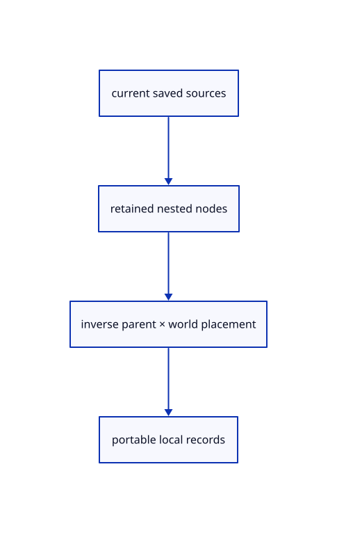

# 8.1.7 · Save nested rows and their local placements

**Chapter 8 · Hierarchy, layers and direct editing · Section 8.1 · Nested source trees** · [Contents](contents.md)

**Typing: 18–35 minutes.** [Estimate](typing-load.md).

Rebuild nested source nodes with saved geometry identities. Convert each edited world placement back through its nearest object parent, preserving precise sources, group labels, colours and hierarchy.

## Type

Continue from [Commit parent moves and deletions as one transaction](52e-edits.md). [Save or recover your work](recovery.md).

### 1. `src/hierarchy.rs`

Rebuild nested portable nodes and recover local placements from the edited world scene.

<details>
<summary>Locate the existing block</summary>

```rust
        out.sort_unstable_by_key(|id|id.value());out.dedup();out
    }

}
```

</details>

Edit the existing block to match this code; keep unchanged lines:

```rust
--8<-- "journey/code/52f-save-01.rs"
```

### 2. `src/document.rs`

Preserve nested imported trees while keeping generated objects beside them in the saved document.

<details>
<summary>Locate the existing block</summary>

```rust
    if !scene.points().is_empty() { return Err("This checkpoint cannot save point objects yet"); }
    if !scene.lines().is_empty() || !scene.paths().is_empty() { return Err("This checkpoint cannot save line objects yet"); }
    let mut objects = proto::Objects::default();
    let mut children = Vec::new();
    let mut xforms = Vec::new();
    for object in scene.objects() {
        let geometry = object.geometry().ok_or("Reload editable sources before saving")?;
        let mut mesh = geometry.to_proto();
        mesh.guid = object.guid.clone();
        objects.meshes.push(mesh);
        children.push(proto::TreeNode { name: object.guid.clone(), ..Default::default() });
        if object.model.m != session_rust::Xform::identity().m {
            xforms.push(proto::XformEntry {
                guid: object.guid.clone(), xform: Some(object.model.to_proto()),
            });
```

</details>

Edit the existing block to match this code; keep unchanged lines:

```rust
--8<-- "journey/code/52f-save-02.rs"
```

## Run and check

In your project:

```sh
cd workspace/journey
REGEN_PROTO=0 cargo build --lib --locked --target wasm32-unknown-unknown -j1
REGEN_PROTO=0 CARGO_BUILD_JOBS=1 trunk serve --port 8780
```

Open `http://127.0.0.1:8780/`. Keep an existing Trunk server running; saving rebuilds it.


### Recorded visual result

**Previous native render — current verification pending.**

Two selected boxes and their source-independent handles remain.

This checkpoint was rendered independently and has the same native comparison frame as [Commit parent moves and deletions as one transaction](52e-edits.md). Use its state checks and browser exercise to assess the changed behavior.


*This recorded image predates a source or checker change. Rebuild this checkpoint before using it as current evidence; browser controls require separate acceptance.*

This reference image is shared with [8.1.1 · Validate and place a nested source tree](52-tree.md). It does not demonstrate a new feature by itself.

<details>
<summary>Code explanation and diagram</summary>


current saved sources → retained nested nodes → inverse parent × world placement → portable local records.



Why not write every displayed world matrix as a nested local placement?

Loading multiplies through the parents again. Saving an unchanged world matrix under a transformed parent would apply that parent twice.

Study estimate, including typing and experiments: 0.5–1 hours.

</details>

<details>
<summary>Optional experiment</summary>

Move a nested parent, Save, and reopen. Compare every world placement and original mesh record before and after the round trip.

</details>

<details>
<summary>Check and save your work</summary>

Restore experimental edits, then run from `session_viewer`:

```sh
npm --prefix ../session_tests run course -- check 8.1.7
npm --prefix ../session_tests run course -- save 8.1.7
```

Source comparison leaves your project untouched. [Save and recovery instructions](recovery.md).

</details>

<details>
<summary>Viewer coverage and verification</summary>


The earlier selected-box and handle exercise remains available.

[Full validation scope](release.md).

To reproduce the scripted acceptance of the reference checkpoint, run from `session_viewer` with the [course bundle server](release.md#reproduce) running on port 8781:

```sh
npm --prefix ../session_tests run course -- capture 8.1.7
```

This uses the verified reference bundle; it does not check or change your typed project.

</details>
