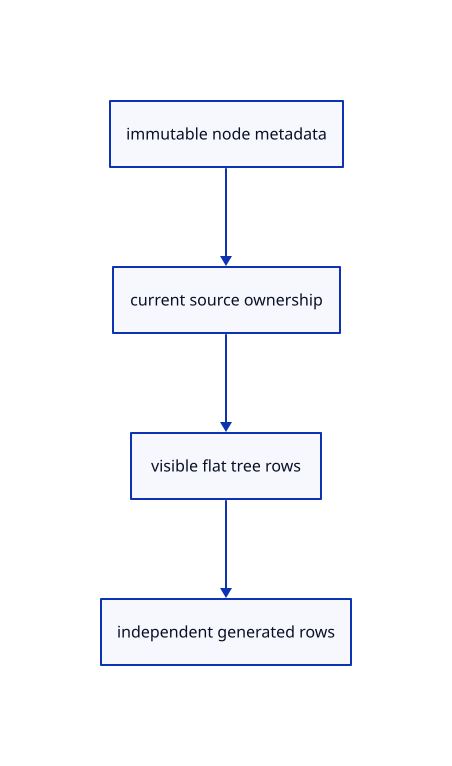

# 8.1.8 · Expose stable tree rows across geometry lanes

**Chapter 8 · Hierarchy, layers and direct editing · Section 8.1 · Nested source trees** · [Contents](contents.md)

**Typing: 19–38 minutes.** [Estimate](typing-load.md).

Resolve each lightweight node to current viewer rows. Removed object subtrees disappear; generated meshes, curves, lines and points remain independent rows with stable keys.

## Type

Continue from [Save nested rows and their local placements](52f-save.md). [Save or recover your work](recovery.md).

### 1. `src/hierarchy.rs`

Resolve current nested rows without reviving deleted object subtrees.

<details>
<summary>Locate the existing block</summary>

```rust
    Ok(Some(node))
}
```

</details>

After that block, type:

```rust
--8<-- "journey/code/52g-rows-01.rs" skip=22
```

### 2. `src/chain.rs`

Expose original line, polyline and curve names for their tree rows.

<details>
<summary>Locate the existing block</summary>

```rust
pub struct PreparedChain { pub source: Source, pub points: Rc<Vec<[f32; 3]>>, pub colour: [f32; 4], pub width: f32, pub heads: u32 }

impl Source {
    pub fn locked(&self) -> bool {
        match self { Self::Line(r) => r.is_locked, Self::Polyline(r) => r.is_locked, Self::Curve(r, _) => r.is_locked }
    }
```

</details>

Edit the existing block to match this code; keep unchanged lines:

```rust
--8<-- "journey/code/52g-rows-02.rs"
```

## Run and check

In your project:

```sh
cd workspace/journey
REGEN_PROTO=0 cargo build --lib --locked --target wasm32-unknown-unknown -j1
REGEN_PROTO=0 CARGO_BUILD_JOBS=1 trunk serve --port 8780
```

Open `http://127.0.0.1:8780/`. Keep an existing Trunk server running; saving rebuilds it.


### Recorded visual result

**Previous native render — current verification pending.**

Two selected boxes and their source-independent handles remain.

This checkpoint was rendered independently and has the same native comparison frame as [Save nested rows and their local placements](52f-save.md). Use its state checks and browser exercise to assess the changed behavior.


*This recorded image predates a source or checker change. Rebuild this checkpoint before using it as current evidence; browser controls require separate acceptance.*

This reference image is shared with [8.1.1 · Validate and place a nested source tree](52-tree.md). It does not demonstrate a new feature by itself.

<details>
<summary>Code explanation and diagram</summary>


immutable node metadata → current source ownership → visible flat tree rows → independent generated rows.



Can an old array position be a tree identity after Undo?

No. Rows may be removed or restored. The panel uses stable document/node keys and source-owned object IDs rather than current vector positions.

Study estimate, including typing and experiments: 0.5–1 hours.

</details>

<details>
<summary>Optional experiment</summary>

Compare the panel row keys before Delete and after Undo. Restored nodes should regain the same keys and source owners.

</details>

<details>
<summary>Check and save your work</summary>

Restore experimental edits, then run from `session_viewer`:

```sh
npm --prefix ../session_tests run course -- check 8.1.8
npm --prefix ../session_tests run course -- save 8.1.8
```

Source comparison leaves your project untouched. [Save and recovery instructions](recovery.md).

</details>

<details>
<summary>Viewer coverage and verification</summary>


The earlier selected-box and handle exercise remains available.

[Full validation scope](release.md).

To reproduce the scripted acceptance of the reference checkpoint, run from `session_viewer` with the [course bundle server](release.md#reproduce) running on port 8781:

```sh
npm --prefix ../session_tests run course -- capture 8.1.8
```

This uses the verified reference bundle; it does not check or change your typed project.

</details>
