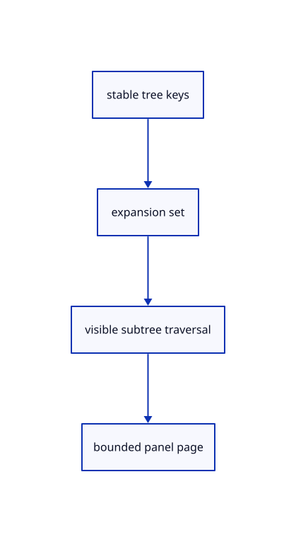

# 8.1.9 · Keep expansion and paging as presentation state

**Chapter 8 · Hierarchy, layers and direct editing · Section 8.1 · Nested source trees** · [Contents](contents.md)

**Typing: 10–20 minutes.** [Estimate](typing-load.md).

Expanded node keys survive source rebuilds and Undo. Present at most128 visible rows per page; collapsing a subtree changes only the panel, without editing document history.

## Type

Continue from [Expose stable tree rows across geometry lanes](52g-rows.md). [Save or recover your work](recovery.md).

### 1. `src/tree_panel.rs`

Keep stable expansion keys, bounded pages and pending row selection outside saved geometry.

Create the file and type:

```rust
--8<-- "journey/code/52h-expansion-01.rs"
```

### 2. `src/lib.rs`

Register the new source component.

<details>
<summary>Locate the existing block</summary>

```rust
mod number_box_tests;

pub mod hierarchy;
```

</details>

After that block, type:

```rust
--8<-- "journey/code/52h-expansion-02.rs" skip=42
```

## Run and check

In your project:

```sh
cd workspace/journey
REGEN_PROTO=0 cargo build --lib --locked --target wasm32-unknown-unknown -j1
REGEN_PROTO=0 CARGO_BUILD_JOBS=1 trunk serve --port 8780
```

Open `http://127.0.0.1:8780/`. Keep an existing Trunk server running; saving rebuilds it.


### Recorded visual result

**Previous native render — current verification pending.**

Two selected boxes and their source-independent handles remain.

This checkpoint was rendered independently and has the same native comparison frame as [Expose stable tree rows across geometry lanes](52g-rows.md). Use its state checks and browser exercise to assess the changed behavior.


*This recorded image predates a source or checker change. Rebuild this checkpoint before using it as current evidence; browser controls require separate acceptance.*

This reference image is shared with [8.1.1 · Validate and place a nested source tree](52-tree.md). It does not demonstrate a new feature by itself.

<details>
<summary>Code explanation and diagram</summary>


stable tree keys → expansion set → visible subtree traversal → bounded panel page.



Does expanding a tree node belong in Undo history?

No. Expansion changes presentation. Geometry, source records and saved placements remain untouched, so ordinary Undo stays focused on document edits.

Study estimate, including typing and experiments: 0.5–1 hours.

</details>

<details>
<summary>Optional experiment</summary>

Expand a group, delete it, undo, and compare its key. The expansion can return because the restored node retains its earlier stable identity.

</details>

<details>
<summary>Check and save your work</summary>

Restore experimental edits, then run from `session_viewer`:

```sh
npm --prefix ../session_tests run course -- check 8.1.9
npm --prefix ../session_tests run course -- save 8.1.9
```

Source comparison leaves your project untouched. [Save and recovery instructions](recovery.md).

</details>

<details>
<summary>Viewer coverage and verification</summary>


The earlier selected-box and handle exercise remains available.

[Full validation scope](release.md).

To reproduce the scripted acceptance of the reference checkpoint, run from `session_viewer` with the [course bundle server](release.md#reproduce) running on port 8781:

```sh
npm --prefix ../session_tests run course -- capture 8.1.9
```

This uses the verified reference bundle; it does not check or change your typed project.

</details>
