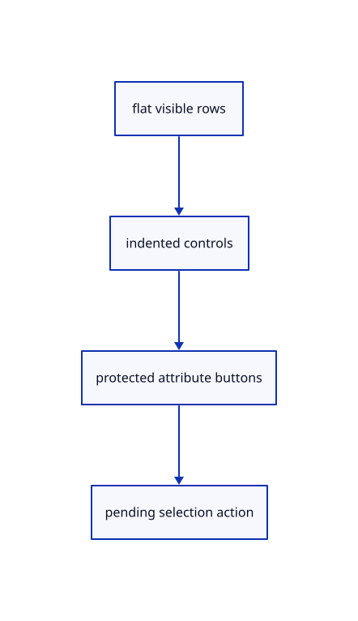

# 8.1.10 · Draw indented original-source tree controls

**Chapter 8 · Hierarchy, layers and direct editing · Section 8.1 · Nested source trees** · [Contents](contents.md)

**Typing: 26–51 minutes.** [Estimate](typing-load.md).

Draw a bounded, scrollable tree at the right using real egui controls. Attribute buttons stay disabled with a reason, while group selection and expansion own their measured pointer rectangles.

## Type

Continue from [Keep expansion and paging as presentation state](52h-expansion.md). [Save or recover your work](recovery.md).

### 1. `src/tree_panel.rs`

Draw bounded source rows with actual measured control rectangles and read-only explanations.

<details>
<summary>Locate the existing block</summary>

```rust
    }
}
```

</details>

After that block, type:

```rust
--8<-- "journey/code/52i-panel-01.rs" skip=9
```

## Run and check

In your project:

```sh
cd workspace/journey
REGEN_PROTO=0 cargo build --lib --locked --target wasm32-unknown-unknown -j1
REGEN_PROTO=0 CARGO_BUILD_JOBS=1 trunk serve --port 8780
```

Open `http://127.0.0.1:8780/`. Keep an existing Trunk server running; saving rebuilds it.


### Recorded visual result

**Previous native render — current verification pending.**

Two selected boxes and their source-independent handles remain.

This checkpoint was rendered independently and has the same native comparison frame as [Keep expansion and paging as presentation state](52h-expansion.md). Use its state checks and browser exercise to assess the changed behavior.


*This recorded image predates a source or checker change. Rebuild this checkpoint before using it as current evidence; browser controls require separate acceptance.*

This reference image is shared with [8.1.1 · Validate and place a nested source tree](52-tree.md). It does not demonstrate a new feature by itself.

<details>
<summary>Code explanation and diagram</summary>


flat visible rows → indented controls → protected attribute buttons → pending selection action.



Why disable an attribute’s button instead of hiding its row?

The learner still needs to understand which source geometry follows a parent. A visible read-only row explains that ownership without allowing an independent edit.

Study estimate, including typing and experiments: 0.5–1 hours.

</details>

<details>
<summary>Optional experiment</summary>

Open Layers All and locate a nested attribute. Its indentation and disabled button should explain its parent ownership; closing the panel releases its pointer rectangle.

</details>

<details>
<summary>Check and save your work</summary>

Restore experimental edits, then run from `session_viewer`:

```sh
npm --prefix ../session_tests run course -- check 8.1.10
npm --prefix ../session_tests run course -- save 8.1.10
```

Source comparison leaves your project untouched. [Save and recovery instructions](recovery.md).

</details>

<details>
<summary>Viewer coverage and verification</summary>


The earlier selected-box and handle exercise remains available.

[Full validation scope](release.md).

To reproduce the scripted acceptance of the reference checkpoint, run from `session_viewer` with the [course bundle server](release.md#reproduce) running on port 8781:

```sh
npm --prefix ../session_tests run course -- capture 8.1.10
```

This uses the verified reference bundle; it does not check or change your typed project.

</details>
