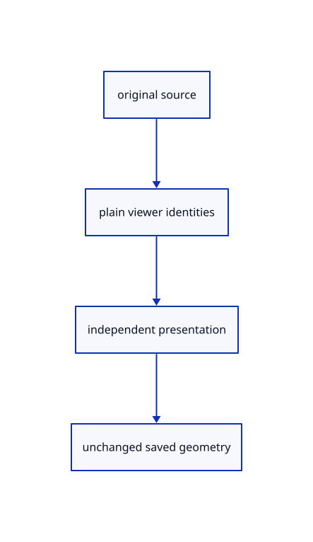

# 8.2.1 · Separate layer presentation from original sources

**Chapter 8 · Hierarchy, layers and direct editing · Section 8.2 · Layers and presentation** · [Contents](contents.md)

**Typing: 16–32 minutes.** [Estimate](typing-load.md).

Store hidden identities, locks and independent face/edge RGB overrides without owning a mesh. Document edits and presentation settings have different lifetimes.

## Type

Continue from [Exercise nested source ownership and exact undo](52k-tree.md). [Save or recover your work](recovery.md).

### 1. `src/view_flags.rs`

Store presentation identities and independent colour channels outside source geometry.

Create the file and type:

```rust
--8<-- "journey/code/53-flags-01.rs"
```

### 2. `src/lib.rs`

Register the new source component.

<details>
<summary>Locate the existing block</summary>

```rust
#[cfg(test)]
mod hierarchy_tests;
```

</details>

After that block, type:

```rust
--8<-- "journey/code/53-flags-02.rs" skip=34
```

## Run and check

In your project:

```sh
cd workspace/journey
REGEN_PROTO=0 cargo build --lib --locked --target wasm32-unknown-unknown -j1
REGEN_PROTO=0 CARGO_BUILD_JOBS=1 trunk serve --port 8780
```

Open `http://127.0.0.1:8780/`. Keep an existing Trunk server running; saving rebuilds it.

Continue the nested-frame exercise from52k. This preparation connects one layer component; full menus and canvas shortcuts are exercised at the end of53.

### Recorded visual result

**Previous native render — current verification pending.**

The nested frame and selected editable parent remain visible with original source edges.


*This recorded image predates a source or checker change. Rebuild this checkpoint before using it as current evidence; browser controls require separate acceptance.*

This reference image is shared with [8.1.12 · Exercise nested source ownership and exact undo](52k-tree.md). It does not demonstrate a new feature by itself.

<details>
<summary>Code explanation and diagram</summary>


original source → plain viewer identities → independent presentation → unchanged saved geometry.



Does hiding a row rewrite its original visible flag?

No. Presentation holds the viewer identity in a separate set. Original geometry and its source metadata remain unchanged.

Study estimate, including typing and experiments: 0.5–1 hours.

</details>

<details>
<summary>Optional experiment</summary>

Follow one identity through a shared snapshot. Changing presentation should copy only the small flag record, never the original mesh.

</details>

<details>
<summary>Check and save your work</summary>

Restore experimental edits, then run from `session_viewer`:

```sh
npm --prefix ../session_tests run course -- check 8.2.1
npm --prefix ../session_tests run course -- save 8.2.1
```

Source comparison leaves your project untouched. [Save and recovery instructions](recovery.md).

</details>

<details>
<summary>Viewer coverage and verification</summary>


The earlier nested-frame acceptance exercise remains; the complete layer control exercise connects at the end of this subject.

[Full validation scope](release.md).

To reproduce the scripted acceptance of the reference checkpoint, run from `session_viewer` with the [course bundle server](release.md#reproduce) running on port 8781:

```sh
npm --prefix ../session_tests run course -- capture 8.2.1
```

This uses the verified reference bundle; it does not check or change your typed project.

</details>
