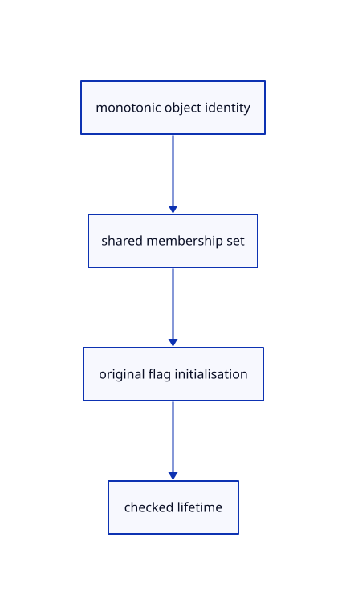

# 8.2.2 · Index live identities and initialise view flags

**Chapter 8 · Hierarchy, layers and direct editing · Section 8.2 · Layers and presentation** · [Contents](contents.md)

**Typing: 15–30 minutes.** [Estimate](typing-load.md).

Maintain constant-time live identity membership across every geometry lane. Initialise presentation from original source flags once, then preserve the original metadata.

## Type

Continue from [Separate layer presentation from original sources](53-flags.md). [Save or recover your work](recovery.md).

### 1. `src/scene.rs`

Maintain live identities and initialise independent flags in every source insertion and removal path.

Edit these blocks from bottom to top. Keep the surrounding lines unchanged.

<details>
<summary>Locate this block</summary>

```rust
    }

    pub fn remove(&mut self, id: ObjectId) -> bool {
        let existed = self.contains(id);
        self.objects.retain(|row| row.id != id); self.lines.retain(|row| row.id != id);
        self.paths.retain(|row| row.id != id); self.points.retain(|row| row.id != id);
        if self.extra == Some(id) { self.extra = None; }
        existed
    }

    pub fn contains(&self, id: ObjectId) -> bool {
        self.objects.iter().map(|r| r.id).chain(self.lines.iter().map(|r| r.id))
            .chain(self.paths.iter().map(|r| r.id)).chain(self.points.iter().map(|r| r.id)).any(|row| row == id)
    }

    pub fn next(&self, current: Option<ObjectId>) -> Option<ObjectId> {
        let mut ids: Vec<_> = self.objects.iter().filter(|r| r.visible() && !r.metadata.is_locked).map(|r| r.id)
```

</details>

Replace it with:

```rust
    }

    pub fn remove(&mut self, id: ObjectId) -> bool {
        let existed = Rc::make_mut(&mut self.ids).remove(&id);
        self.objects.retain(|row| row.id != id); self.lines.retain(|row| row.id != id);
        self.paths.retain(|row| row.id != id); self.points.retain(|row| row.id != id);
        if self.extra == Some(id) { self.extra = None; }
        existed
    }

    pub fn contains(&self,id:ObjectId)->bool {self.ids.contains(&id)}

    pub fn next(&self, current: Option<ObjectId>) -> Option<ObjectId> {
        let mut ids: Vec<_> = self.objects.iter().filter(|r| r.visible() && !r.metadata.is_locked).map(|r| r.id)
```

<details>
<summary>Locate this block</summary>

```rust
    }

    pub fn clear(&mut self) {
        self.forest=Default::default();
        self.points = Vec::new();
        self.paths = Vec::new();
```

</details>

Replace it with:

```rust
    }

    pub fn clear(&mut self) {
        self.ids=Default::default();
        self.view=Default::default();
        self.forest=Default::default();
        self.points = Vec::new();
        self.paths = Vec::new();
```

<details>
<summary>Locate this block</summary>

```rust
        while self.objects.iter().any(|object| object.guid == guid) {
            guid = uuid::Uuid::new_v4().to_string();
        }
        let metadata = Rc::new(crate::row_metadata::RowMetadata::from_mesh(&prepared.geometry));
        let editable = crate::edit_source::EditSource::Loaded { geometry: prepared.geometry, source: prepared.source };
        self.objects.push(Object { id, guid, metadata, mesh: Rc::new(prepared.display), model: prepared.model, editable });
```

</details>

Replace it with:

```rust
        while self.objects.iter().any(|object| object.guid == guid) {
            guid = uuid::Uuid::new_v4().to_string();
        }
        Rc::make_mut(&mut self.ids).insert(id);
        Rc::make_mut(&mut self.view).initial(id,prepared.geometry.is_visible,prepared.geometry.is_locked);
        let metadata = Rc::new(crate::row_metadata::RowMetadata::from_mesh(&prepared.geometry));
        let editable = crate::edit_source::EditSource::Loaded { geometry: prepared.geometry, source: prepared.source };
        self.objects.push(Object { id, guid, metadata, mesh: Rc::new(prepared.display), model: prepared.model, editable });
```

<details>
<summary>Locate this block</summary>

```rust
    pub fn insert_line(&mut self, prepared: crate::stroke::PreparedLine) -> Result<ObjectId, &'static str> {
        let next = self.next_id.checked_add(1).ok_or("Object IDs exhausted")?;
        let id = ObjectId(self.next_id); self.next_id = next;
        self.lines.push(LineObject { id, prepared, model: session_rust::Xform::identity() });
        Ok(id)
    }
```

</details>

Replace it with:

```rust
    pub fn insert_line(&mut self, prepared: crate::stroke::PreparedLine) -> Result<ObjectId, &'static str> {
        let next = self.next_id.checked_add(1).ok_or("Object IDs exhausted")?;
        let id = ObjectId(self.next_id); self.next_id = next;
        Rc::make_mut(&mut self.ids).insert(id);
        Rc::make_mut(&mut self.view).initial(id,prepared.source.is_visible,prepared.source.is_locked);
        self.lines.push(LineObject { id, prepared, model: session_rust::Xform::identity() });
        Ok(id)
    }
```

<details>
<summary>Locate this block</summary>

```rust
        while self.paths.iter().any(|row| row.guid == guid) || self.objects.iter().any(|row| row.guid == guid)
            || self.lines.iter().any(|row| row.prepared.source.guid() == guid) { guid = uuid::Uuid::new_v4().to_string(); }
        let id = ObjectId(self.next_id); self.next_id = next;
        self.paths.push(PathObject { controls_visible: false, id, guid, prepared, model: session_rust::Xform::identity() }); Ok(id)
    }
```

</details>

Replace it with:

```rust
        while self.paths.iter().any(|row| row.guid == guid) || self.objects.iter().any(|row| row.guid == guid)
            || self.lines.iter().any(|row| row.prepared.source.guid() == guid) { guid = uuid::Uuid::new_v4().to_string(); }
        let id = ObjectId(self.next_id); self.next_id = next;
        Rc::make_mut(&mut self.ids).insert(id);
        Rc::make_mut(&mut self.view).initial(id,prepared.source.visible(),prepared.source.locked());
        self.paths.push(PathObject { controls_visible: false, id, guid, prepared, model: session_rust::Xform::identity() }); Ok(id)
    }
```

<details>
<summary>Locate this block</summary>

```rust
            guid = uuid::Uuid::new_v4().to_string();
        }
        let id = ObjectId(self.next_id); self.next_id = next;
        self.points.push(PointObject { id, guid, prepared, model: session_rust::Xform::identity() }); Ok(id)
    }
```

</details>

Replace it with:

```rust
            guid = uuid::Uuid::new_v4().to_string();
        }
        let id = ObjectId(self.next_id); self.next_id = next;
        Rc::make_mut(&mut self.ids).insert(id);
        Rc::make_mut(&mut self.view).initial(id,prepared.source.is_visible,prepared.source.is_locked);
        self.points.push(PointObject { id, guid, prepared, model: session_rust::Xform::identity() }); Ok(id)
    }
```

<details>
<summary>Locate this block</summary>

```rust

    pub fn bounds(&self) -> Option<crate::bounds::Bounds> {
        let mut bounds: Option<crate::bounds::Bounds> = None;
        for object in self.objects.iter().filter(|row| row.visible()) {
            for vertex in object.mesh.vertices() {
                let point = object.world_point(*vertex);
                match &mut bounds {
```

</details>

Replace it with:

```rust

    pub fn bounds(&self) -> Option<crate::bounds::Bounds> {
        let mut bounds: Option<crate::bounds::Bounds> = None;
        for object in self.objects.iter().filter(|row| self.visible(row.id)) {
            for vertex in object.mesh.vertices() {
                let point = object.world_point(*vertex);
                match &mut bounds {
```

<details>
<summary>Locate this block</summary>

```rust
        let turquoise = PreparedMesh::triangle([
            [-0.4, -0.2, 0.75], [0.8, -0.2, 0.75], [0.2, 0.8, 0.75],
        ], [0.05, 0.7, 0.7]).expect("Valid turquoise triangle");
        let mut scene = Self { forest:Default::default(), objects: Vec::new(), points: Vec::new(), paths: Vec::new(), lines: Vec::new(), next_id: 1, extra: None };
        scene.insert(pink).expect("ID available");
        scene.insert(turquoise).expect("ID available");
        scene
```

</details>

Replace it with:

```rust
        let turquoise = PreparedMesh::triangle([
            [-0.4, -0.2, 0.75], [0.8, -0.2, 0.75], [0.2, 0.8, 0.75],
        ], [0.05, 0.7, 0.7]).expect("Valid turquoise triangle");
        let mut scene = Self { ids:Default::default(), view:Default::default(), forest:Default::default(), objects: Vec::new(), points: Vec::new(), paths: Vec::new(), lines: Vec::new(), next_id: 1, extra: None };
        scene.insert(pink).expect("ID available");
        scene.insert(turquoise).expect("ID available");
        scene
```

<details>
<summary>Locate this block</summary>

```rust

#[derive(Clone)]
pub struct Scene {
    pub forest:crate::hierarchy::Forest,
    points: Vec<PointObject>,
    paths: Vec<PathObject>,
```

</details>

Replace it with:

```rust

#[derive(Clone)]
pub struct Scene {
    ids:Rc<std::collections::HashSet<ObjectId>>,
    pub view:Rc<crate::view_flags::Flags>,
    pub forest:crate::hierarchy::Forest,
    points: Vec<PointObject>,
    paths: Vec<PathObject>,
```

<details>
<summary>Complete updated block reference</summary>

```rust
use crate::{mesh::Mesh, prepared::PreparedMesh};
use std::rc::Rc;

#[derive(Clone, Copy, Debug, PartialEq, Eq, Hash)]
pub struct ObjectId(u32);

impl ObjectId { pub fn value(self) -> u32 { self.0 } }

#[derive(Clone)]
pub struct Object {
    pub id: ObjectId,
    pub guid: String,
    pub metadata: Rc<crate::row_metadata::RowMetadata>,
    pub mesh: Rc<Mesh>,
    pub model: session_rust::Xform,
    editable: crate::edit_source::EditSource,
}

impl Object {
    pub fn visible(&self) -> bool { self.metadata.is_visible }

    pub fn geometry(&self) -> Option<&Rc<session_rust::Mesh>> {
        match &self.editable { crate::edit_source::EditSource::Loaded { geometry, .. } => Some(geometry), _ => None }
    }

    pub fn source(&self) -> Option<&crate::document::Source> {
        match &self.editable { crate::edit_source::EditSource::Loaded { source, .. } => source.as_ref(), _ => None }
    }

    pub fn origin(&self) -> Option<&Rc<crate::origin::Origin>> {
        match &self.editable {
            crate::edit_source::EditSource::Loaded { source, .. } => source.as_ref().map(|source| &source.origin),
            crate::edit_source::EditSource::Released { origin, .. } => Some(origin),
        }
    }

    pub fn release_epoch(&self) -> Option<u64> {
        match &self.editable { crate::edit_source::EditSource::Released { epoch, .. } => Some(*epoch), _ => None }
    }

    pub fn can_unload(&self) -> bool {
        let Some(source) = self.source() else { return false; };
        let Some(geometry) = self.geometry() else { return false; };
        source.origin.location.is_some() && self.metadata.source_guid == source.guid
            && geometry.guid() == source.guid && self.metadata.name == geometry.name
            && self.metadata.is_visible == geometry.is_visible && self.metadata.is_locked == geometry.is_locked
            && source.document.objects.meshes.iter().any(|mesh| Rc::ptr_eq(mesh, geometry))
    }

    pub fn world_point(&self, vertex: [f32; 6]) -> [f64; 3] {
        let local = session_rust::Point::new(vertex[0] as f64, vertex[1] as f64, vertex[2] as f64);
        let world = self.model.transform_point(&local);
        [world[0], world[1], world[2]]
    }
}

#[derive(Clone)]
pub struct LineObject {
    pub id: ObjectId,
    pub prepared: crate::stroke::PreparedLine,
    pub model: session_rust::Xform,
}

impl LineObject {
    pub fn visible(&self) -> bool { self.prepared.source.is_visible }

    pub fn endpoints(&self) -> [session_rust::Point; 2] {
        let line = &self.prepared.source;
        [self.model.transform_point(&line.start()), self.model.transform_point(&line.end())]
    }

    pub fn stroke(&self) -> crate::stroke::Stroke {
        let [start, end] = self.endpoints();
        crate::stroke::Stroke { start: std::array::from_fn(|i| start[i] as f32),
            end: std::array::from_fn(|i| end[i] as f32), ..self.prepared.display }
    }
}

#[derive(Clone)]
pub struct PathObject { pub controls_visible: bool, pub id: ObjectId, pub guid: String, pub prepared: crate::chain::PreparedChain, pub model: session_rust::Xform }

impl PathObject {
    pub fn visible(&self) -> bool { self.prepared.source.visible() }

    pub fn segments(&self) -> Vec<crate::chain::Segment> {
        let mut points = Vec::new();
        for p in self.points() {
            let p = std::array::from_fn(|i| p[i] as f32);
            if points.last() != Some(&p) { points.push(p); }
        }
        crate::chain::PreparedChain { points: Rc::new(points), ..self.prepared.clone() }.segments()
    }

    pub fn bounds_points(&self) -> Vec<session_rust::Point> {
        self.prepared.source.bounds_coordinates().into_iter().map(|p|
            self.model.transform_point(&session_rust::Point::new(p[0], p[1], p[2]))).collect()
    }

    pub fn points(&self) -> Vec<session_rust::Point> {
        self.prepared.source.coordinates().into_iter().map(|p| self.model.transform_point(&session_rust::Point::new(p[0], p[1], p[2]))).collect()
    }


}

pub struct ControlMarker { pub parent: ObjectId, pub control: crate::controls::Control, pub display: crate::marker::Marker }

#[derive(Clone)]
pub struct PointObject { pub id: ObjectId, pub guid: String, pub prepared: crate::marker::PreparedPoint, pub model: session_rust::Xform }

impl PointObject {
    pub fn visible(&self) -> bool { self.prepared.source.is_visible }

    pub fn point(&self) -> session_rust::Point { self.model.transform_point(&self.prepared.source) }
    pub fn marker(&self) -> crate::marker::Marker { crate::marker::Marker { center: self.point().to_f32(), ..self.prepared.display } }
}

#[derive(Clone)]
pub struct Scene {
    ids:Rc<std::collections::HashSet<ObjectId>>,
    pub view:Rc<crate::view_flags::Flags>,
    pub forest:crate::hierarchy::Forest,
    points: Vec<PointObject>,
    paths: Vec<PathObject>,
    lines: Vec<LineObject>,
    objects: Vec<Object>,
    next_id: u32,
    extra: Option<ObjectId>,
}

impl Scene {
    pub fn pick_id(&self, value: u32) -> Option<ObjectId> {
        self.objects.iter().filter(|r| r.visible() && !r.metadata.is_locked).map(|r| r.id)
            .chain(self.lines.iter().filter(|r| r.visible() && !r.prepared.source.is_locked).map(|r| r.id))
            .chain(self.paths.iter().filter(|r| r.visible() && !r.prepared.source.locked()).map(|r| r.id))
            .chain(self.points.iter().filter(|r| r.visible() && !r.prepared.source.is_locked).map(|r| r.id))
            .find(|id| id.value() == value && !self.forest.readonly(*id))
    }

    pub fn demo() -> Self {
        let pink = PreparedMesh::triangle([
            [-0.7, -0.6, 0.25], [0.5, -0.6, 0.25], [-0.1, 0.6, 0.25],
        ], [0.9, 0.25, 0.45]).expect("Valid pink triangle");
        let turquoise = PreparedMesh::triangle([
            [-0.4, -0.2, 0.75], [0.8, -0.2, 0.75], [0.2, 0.8, 0.75],
        ], [0.05, 0.7, 0.7]).expect("Valid turquoise triangle");
        let mut scene = Self { ids:Default::default(), view:Default::default(), forest:Default::default(), objects: Vec::new(), points: Vec::new(), paths: Vec::new(), lines: Vec::new(), next_id: 1, extra: None };
        scene.insert(pink).expect("ID available");
        scene.insert(turquoise).expect("ID available");
        scene
    }

    pub fn restore(&mut self, mut saved: Self) {
        saved.next_id = saved.next_id.max(self.next_id);
        *self = saved;
    }

    pub fn visible(&self, id: ObjectId) -> bool {
        if let Some(row) = self.objects.iter().find(|row| row.id == id) { return row.metadata.is_visible; }
        if let Some(row) = self.lines.iter().find(|row| row.id == id) { return row.prepared.source.is_visible; }
        if let Some(row) = self.paths.iter().find(|row| row.id == id) { return row.prepared.source.visible(); }
        self.points.iter().find(|row| row.id == id).is_some_and(|row| row.prepared.source.is_visible)
    }

    pub fn bounds(&self) -> Option<crate::bounds::Bounds> {
        let mut bounds: Option<crate::bounds::Bounds> = None;
        for object in self.objects.iter().filter(|row| self.visible(row.id)) {
            for vertex in object.mesh.vertices() {
                let point = object.world_point(*vertex);
                match &mut bounds {
                    Some(bounds) => bounds.include(point),
                    None => bounds = Some(crate::bounds::Bounds::point(point)),
                }
            }
        }
        for line in self.lines.iter().filter(|line| line.visible()) {
            for point in line.endpoints() {
                let point = [point[0], point[1], point[2]];
                match &mut bounds {
                    Some(bounds) => bounds.include(point),
                    None => bounds = Some(crate::bounds::Bounds::point(point)),
                }
            }
        }
        for row in self.paths.iter().filter(|row| row.visible()) {
            for point in row.bounds_points() {
                let point = [point[0], point[1], point[2]];
                match &mut bounds { Some(bounds) => bounds.include(point), None => bounds = Some(crate::bounds::Bounds::point(point)) }
            }
        }
        for row in self.points.iter().filter(|row| row.visible()) {
            let p = row.point(); let p = [p[0], p[1], p[2]];
            match &mut bounds { Some(bounds) => bounds.include(p), None => bounds = Some(crate::bounds::Bounds::point(p)) }
        }
        bounds
    }

    pub fn bounds_of(&self, ids: &[ObjectId]) -> Option<crate::bounds::Bounds> {
        let mut bounds: Option<crate::bounds::Bounds> = None;
        for id in ids { if let Some(next) = self.selected_bounds(*id) {
            if let Some(b) = &mut bounds { b.include(next.min); b.include(next.max); } else { bounds = Some(next); }
        } } bounds
    }

    pub fn placement(&self, id: ObjectId) -> Option<session_rust::Xform> {
        self.objects.iter().find(|r| r.id==id).map(|r| r.model.clone())
            .or_else(|| self.lines.iter().find(|r| r.id==id).map(|r| r.model.clone()))
            .or_else(|| self.paths.iter().find(|r| r.id==id).map(|r| r.model.clone()))
            .or_else(|| self.points.iter().find(|r| r.id==id).map(|r| r.model.clone()))
    }

    pub fn with_descendants(&self,ids:&[ObjectId])->Vec<ObjectId> {self.forest.descendants(ids).into_iter().filter(|id|self.contains(*id)).collect()}

    pub fn place_owner(&mut self, id: ObjectId, model: session_rust::Xform) -> Result<(), &'static str> {
        if self.forest.readonly(id) {return Err("Object attributes follow their parent and are read only");}
        self.place_following(id,model)
    }

    pub(crate) fn place_following(&mut self,id:ObjectId,model:session_rust::Xform)->Result<(), &'static str> {
        if self.objects.iter().any(|r| r.id==id) { self.place_mesh(id,model) }
        else if self.lines.iter().any(|r| r.id==id) { self.place_line(id,model) }
        else if self.paths.iter().any(|r| r.id==id) { self.place_path(id,model) }
        else { self.place_point(id,model) }
    }

    pub fn translate(&mut self, id: ObjectId, offset: [f64; 3]) -> Result<(), &'static str> {
        let shift = session_rust::Xform::translation(offset[0], offset[1], offset[2]);
        if let Some(row) = self.objects().iter().find(|r| r.id == id) {
            if row.geometry().is_none() { return Err("Reload editable sources before Move"); }
            let model = &shift * &row.model; return self.place(id, model);
        }
        if let Some(row) = self.lines().iter().find(|r| r.id == id) { let model = &shift * &row.model; return self.place_line(id, model); }
        if let Some(row) = self.paths().iter().find(|r| r.id == id) { let model = &shift * &row.model; return self.place_path(id, model); }
        if let Some(row) = self.points().iter().find(|r| r.id == id) { let model = &shift * &row.model; return self.place_point(id, model); }
        Err("Object not found")
    }

    pub fn selected_bounds(&self, id: ObjectId) -> Option<crate::bounds::Bounds> {
        if !self.visible(id) { return None; }
        let object = self.objects.iter().find(|object| object.id == id)?;
        let mut vertices = object.mesh.vertices().iter();
        let first = vertices.next()?;
        let mut bounds = crate::bounds::Bounds::point(object.world_point(*first));
        for vertex in vertices {
            bounds.include(object.world_point(*vertex));
        }
        Some(bounds)
    }

    pub fn line_capacity_bytes(&self) -> usize { self.lines.capacity() * std::mem::size_of::<LineObject>() }

    pub fn points(&self) -> &[PointObject] { &self.points }

    pub fn point_capacity_bytes(&self) -> usize { self.points.capacity() * std::mem::size_of::<PointObject>() }

    pub fn insert_point(&mut self, prepared: crate::marker::PreparedPoint) -> Result<ObjectId, &'static str> {
        let next = self.next_id.checked_add(1).ok_or("Object IDs exhausted")?;
        let mut guid = prepared.source.guid().to_owned();
        while self.points.iter().any(|row| row.guid == guid) || self.paths.iter().any(|row| row.guid == guid)
            || self.objects.iter().any(|row| row.guid == guid) || self.lines.iter().any(|row| row.prepared.source.guid() == guid) {
            guid = uuid::Uuid::new_v4().to_string();
        }
        let id = ObjectId(self.next_id); self.next_id = next;
        Rc::make_mut(&mut self.ids).insert(id);
        Rc::make_mut(&mut self.view).initial(id,prepared.source.is_visible,prepared.source.is_locked);
        self.points.push(PointObject { id, guid, prepared, model: session_rust::Xform::identity() }); Ok(id)
    }

    pub fn place_point(&mut self, id: ObjectId, model: session_rust::Xform) -> Result<(), &'static str> {
        if !crate::placement::valid(&model.m) { return Err("Invalid point placement"); }
        let row = self.points.iter_mut().find(|row| row.id == id).ok_or("Point not found")?;
        let point = model.transform_point(&row.prepared.source);
        if (0..3).any(|i| !(point[i] as f32).is_finite()) { return Err("Point placement exceeds the display range"); }
        row.model = model; Ok(())
    }

    pub fn show_controls(&mut self, visible: bool) {
        for row in &mut self.paths { row.controls_visible = visible && matches!(row.prepared.source, crate::chain::Source::Curve(..)); }
    }

    pub fn control_markers(&self) -> Vec<ControlMarker> {
        let mut markers = Vec::new();
        for row in self.paths.iter().filter(|row| row.controls_visible && row.visible()) {
            for control in row.prepared.source.controls() {
                let p = control.position().expect("Validated original control");
                let p = row.model.transform_point(&session_rust::Point::new(p[0], p[1], p[2]));
                let display = crate::marker::Marker { center: p.to_f32(), ..control.marker().expect("Prepared control marker") };
                markers.push(ControlMarker { parent: row.id, control, display });
            }
        }
        markers
    }

    pub fn paths(&self) -> &[PathObject] { &self.paths }

    pub fn path_capacity_bytes(&self) -> usize { self.paths.capacity() * std::mem::size_of::<PathObject>() }

    pub fn insert_path(&mut self, prepared: crate::chain::PreparedChain) -> Result<ObjectId, &'static str> {
        let next = self.next_id.checked_add(1).ok_or("Object IDs exhausted")?;
        let mut guid = prepared.source.guid().to_owned();
        while self.paths.iter().any(|row| row.guid == guid) || self.objects.iter().any(|row| row.guid == guid)
            || self.lines.iter().any(|row| row.prepared.source.guid() == guid) { guid = uuid::Uuid::new_v4().to_string(); }
        let id = ObjectId(self.next_id); self.next_id = next;
        Rc::make_mut(&mut self.ids).insert(id);
        Rc::make_mut(&mut self.view).initial(id,prepared.source.visible(),prepared.source.locked());
        self.paths.push(PathObject { controls_visible: false, id, guid, prepared, model: session_rust::Xform::identity() }); Ok(id)
    }

    pub fn place_path(&mut self, id: ObjectId, model: session_rust::Xform) -> Result<(), &'static str> {
        if !crate::placement::valid(&model.m) { return Err("Invalid path placement"); }
        let row = self.paths.iter_mut().find(|row| row.id == id).ok_or("Path not found")?;
        for p in row.prepared.source.coordinates().into_iter().chain(row.prepared.source.bounds_coordinates()) {
            let p = model.transform_point(&session_rust::Point::new(p[0], p[1], p[2]));
            if (0..3).any(|i| !(p[i] as f32).is_finite()) { return Err("Path placement exceeds the display range"); }
        }
        row.model = model; Ok(())
    }

    pub fn lines(&self) -> &[LineObject] { &self.lines }

    pub fn insert_line(&mut self, prepared: crate::stroke::PreparedLine) -> Result<ObjectId, &'static str> {
        let next = self.next_id.checked_add(1).ok_or("Object IDs exhausted")?;
        let id = ObjectId(self.next_id); self.next_id = next;
        Rc::make_mut(&mut self.ids).insert(id);
        Rc::make_mut(&mut self.view).initial(id,prepared.source.is_visible,prepared.source.is_locked);
        self.lines.push(LineObject { id, prepared, model: session_rust::Xform::identity() });
        Ok(id)
    }

    pub fn place_line(&mut self, id: ObjectId, model: session_rust::Xform) -> Result<(), &'static str> {
        if !crate::placement::valid(&model.m) { return Err("Invalid line placement"); }
        let row = self.lines.iter_mut().find(|row| row.id == id).ok_or("Line not found")?;
        for point in [row.prepared.source.start(), row.prepared.source.end()] {
            let placed = model.transform_point(&point);
            if (0..3).any(|i| !(placed[i] as f32).is_finite()) { return Err("Line placement exceeds the display range"); }
        }
        row.model = model; Ok(())
    }

    pub fn objects(&self) -> &[Object] {
        &self.objects
    }

    pub(crate) fn objects_mut(&mut self) -> &mut [Object] { &mut self.objects }

    pub(crate) fn unload(&mut self, origins: &std::collections::HashSet<uuid::Uuid>, epoch: u64) {
        for row in &mut self.objects {
            if let Some(origin) = row.origin().filter(|origin| origins.contains(&origin.id)).cloned() {
                row.editable = crate::edit_source::EditSource::Released { origin, epoch };
            }
        }
    }

    pub(crate) fn hydrate(&mut self, prepared: &crate::rehydrate::PreparedReload) {
        for row in &mut self.objects {
            if !prepared.key.matches(row) { continue; }
            let Some(geometry) = prepared.geometry(&row.metadata.source_guid).cloned() else { continue; };
            let source = crate::document::Source { document: Rc::clone(&prepared.document),
                guid: row.metadata.source_guid.clone(), origin: Rc::clone(&prepared.key.origin) };
            row.editable = crate::edit_source::EditSource::Loaded { geometry, source: Some(source) };
        }
    }

    pub fn insert(&mut self, prepared: PreparedMesh) -> Result<ObjectId, &'static str> {
        if !crate::placement::valid(&prepared.model.m) { return Err("Placement must be finite, affine and fit the display range"); }
        let next = self.next_id.checked_add(1).ok_or("Object IDs exhausted")?;
        let id = ObjectId(self.next_id);
        self.next_id = next;
        let mut guid = prepared.geometry.guid().to_owned();
        while self.objects.iter().any(|object| object.guid == guid) {
            guid = uuid::Uuid::new_v4().to_string();
        }
        Rc::make_mut(&mut self.ids).insert(id);
        Rc::make_mut(&mut self.view).initial(id,prepared.geometry.is_visible,prepared.geometry.is_locked);
        let metadata = Rc::new(crate::row_metadata::RowMetadata::from_mesh(&prepared.geometry));
        let editable = crate::edit_source::EditSource::Loaded { geometry: prepared.geometry, source: prepared.source };
        self.objects.push(Object { id, guid, metadata, mesh: Rc::new(prepared.display), model: prepared.model, editable });
        Ok(id)
    }

    pub fn clear(&mut self) {
        self.ids=Default::default();
        self.view=Default::default();
        self.forest=Default::default();
        self.points = Vec::new();
        self.paths = Vec::new();
        self.lines = Vec::new();
        self.objects = Vec::new();
        self.extra = None;
    }

    pub fn replace(&mut self, loaded: crate::document::Loaded) -> Result<(), &'static str> {
        self.clear();
        self.import(loaded)
    }

    pub fn import(&mut self, loaded: crate::document::Loaded) -> Result<(), &'static str> {
        let mut objects=Vec::new();let key=self.next_id;
        for prepared in loaded.meshes {
            let guid=prepared.geometry.guid().to_owned();let name=prepared.geometry.name.clone();
            let id=self.insert(prepared)?;objects.push((guid,id,name));
        }
        self.forest.add(key,loaded.document.name.clone(),loaded.tree,&objects);Ok(())
    }

    pub fn place(&mut self, id: ObjectId, model: session_rust::Xform) -> Result<(), &'static str> {
        if self.forest.readonly(id) {return Err("Object attributes follow their parent and are read only");}
        self.place_mesh(id,model)
    }

    fn place_mesh(&mut self,id:ObjectId,model:session_rust::Xform)->Result<(), &'static str> {
        if !crate::placement::valid(&model.m)
        {
            return Err("Placement must be finite, affine and fit the display range");
        }
        let object = self.objects.iter_mut().find(|o| o.id == id).ok_or("Object not found")?;
        if object.geometry().is_none() { return Err("Reload editable sources before Move"); }
        object.model = model;
        Ok(())
    }

    pub fn remove(&mut self, id: ObjectId) -> bool {
        let existed = Rc::make_mut(&mut self.ids).remove(&id);
        self.objects.retain(|row| row.id != id); self.lines.retain(|row| row.id != id);
        self.paths.retain(|row| row.id != id); self.points.retain(|row| row.id != id);
        if self.extra == Some(id) { self.extra = None; }
        existed
    }

    pub fn contains(&self,id:ObjectId)->bool {self.ids.contains(&id)}

    pub fn next(&self, current: Option<ObjectId>) -> Option<ObjectId> {
        let mut ids: Vec<_> = self.objects.iter().filter(|r| r.visible() && !r.metadata.is_locked).map(|r| r.id)
            .chain(self.lines.iter().filter(|r| r.visible() && !r.prepared.source.is_locked).map(|r| r.id))
            .chain(self.paths.iter().filter(|r| r.visible() && !r.prepared.source.locked()).map(|r| r.id))
            .chain(self.points.iter().filter(|r| r.visible() && !r.prepared.source.is_locked).map(|r| r.id)).collect();
        ids.retain(|id|!self.forest.readonly(*id));
        ids.sort_unstable_by_key(|id| id.value());
        if ids.is_empty() { return None; }
        let start = ids.iter().position(|id| Some(*id) == current).map_or(0, |i| i+1);
        Some(ids[start % ids.len()])
    }

    pub fn add_box(&mut self) -> Result<ObjectId, &'static str> {
        let mut source = session_rust::Mesh::create_box(0.8, 0.8, 0.8);
        source.set_objectcolor(session_rust::Color::new(0.65, 0.65, 0.65, 1.0));
        let id = self.insert(PreparedMesh::new(source)?)?;
        self.place(id, session_rust::Xform::translation(0.9, 0.0, 0.4))?;
        Ok(id)
    }

    pub fn toggle_extra(&mut self) {
        if let Some(id) = self.extra.take() {
            self.remove(id);
        } else {
            let extra = PreparedMesh::triangle([
                [-0.9, 0.3, 0.5], [-0.4, 0.3, 0.5], [-0.65, 0.9, 0.5],
            ], [0.2, 0.8, 0.3]).expect("Valid extra triangle");
            self.extra = Some(self.insert(extra).expect("ID available"));
        }
    }
}

#[cfg(test)]
mod tests {
    use super::*;

    #[test]
    fn unloading_policy_protects_generated_unlocated_and_modified_sources() {
        let mut scene = Scene::demo(); assert!(!scene.objects[0].can_unload());
        let bytes = crate::specimen::bytes();
        scene.replace(crate::document::load(&bytes).unwrap()).unwrap(); assert!(!scene.objects[0].can_unload());
        let url = Rc::new(crate::reload_url::ReloadUrl::new("test:policy".into()));
        scene.replace(crate::document::load_at(&bytes, Some(url)).unwrap()).unwrap();
        assert!(scene.objects.iter().all(Object::can_unload));
        let row = &mut scene.objects[0];
        Rc::make_mut(&mut row.metadata).is_locked = true; assert!(!row.can_unload());
        Rc::make_mut(&mut row.metadata).is_locked = row.geometry().unwrap().is_locked;
        assert!(row.can_unload());
        let source = row.source().cloned(); let geometry = Rc::new(session_rust::Mesh::create_box(1.0, 1.0, 1.0));
        row.editable = crate::edit_source::EditSource::Loaded { geometry, source }; assert!(!row.can_unload());
    }

    #[test]
    fn partial_replacement_failure_restores_owners_without_reusing_ids() {
        let mut scene = Scene::demo();
        let before = scene.objects.clone();
        scene.next_id = u32::MAX - 1;
        let loaded = crate::document::load(&crate::specimen::bytes()).unwrap();
        let mut history = crate::history::History::default();
        assert!(history.try_edit(&mut scene, |scene| scene.replace(loaded)).is_err());
        assert_eq!(scene.next_id, u32::MAX);
        assert_eq!(scene.objects.len(), before.len());
        for (object, old) in scene.objects.iter().zip(&before) {
            assert_eq!(object.id, old.id);
            assert!(Rc::ptr_eq(object.geometry().unwrap(), old.geometry().unwrap()));
            assert!(Rc::ptr_eq(&object.mesh, &old.mesh));
        }
        assert!(!history.undo(&mut scene));
    }

    #[test]
    fn removal_moves_a_row_without_changing_its_identity() {
        let mut scene = Scene::demo();
        let first = scene.objects()[0].id;
        let second = scene.objects()[1].id;
        assert!(scene.remove(first));
        assert_eq!(scene.objects()[0].id, second);
        assert_eq!(scene.next(None), Some(second));
        assert!(!scene.contains(first));
        scene.toggle_extra();
        assert_ne!(scene.objects()[1].id, first);
        assert_ne!(scene.objects()[1].id, second);
    }

    #[test]
    fn toggling_the_extra_object_uses_its_id_after_other_removals() {
        let mut scene = Scene::demo();
        scene.toggle_extra();
        let extra = scene.objects()[2].id;
        scene.remove(scene.objects()[0].id);
        scene.toggle_extra();
        assert!(!scene.contains(extra));
        assert_eq!(scene.objects().len(), 1);
    }
}

#[cfg(all(test, not(target_arch = "wasm32")))]
#[path = "pick_gpu_tests.rs"]
mod pick_gpu_tests;

impl Scene {
    pub fn deform_part(&mut self,target:crate::pick_sources::Target,delta:&session_rust::Xform) -> Result<(), &'static str> {
        use crate::pick_sources::Part;
        if !target.valid(self) || !crate::placement::valid(&delta.m) {return Err("Invalid part edit");}
        let model=self.placement(target.owner).ok_or("Part owner is missing")?;
        let local=&(&model.inverse().ok_or("Part placement cannot be inverted")?*delta)*&model;
        if let Some(row)=self.objects.iter_mut().find(|r|r.id==target.owner) {
            let mut source=(**row.geometry().ok_or("Reload editable sources before editing a part")?).clone();
            for key in crate::part_preview::keys(&source,target.part)? {
                let point=local.transform_point(&source.vertex_point(key).ok_or("Missing source vertex")?);
                source.vertex.get_mut(&key).ok_or("Missing source vertex")?.set_position(point);
            }
            source.clear_triangle_bvh();
            let prepared=crate::prepared::PreparedMesh::new(source)?;
            for vertex in prepared.display.vertices() {let point=model.transform_point(&session_rust::Point::new(vertex[0] as f64,vertex[1] as f64,vertex[2] as f64));
                if (0..3).any(|i| !(point[i] as f32).is_finite()) {return Err("Part edit exceeds the display range");}}
            row.mesh=Rc::new(prepared.display); row.editable=crate::edit_source::EditSource::Loaded {geometry:prepared.geometry,source:None}; return Ok(());
        }
        let row=self.paths.iter_mut().find(|r|r.id==target.owner).ok_or("Part owner is missing")?;
        let (crate::chain::Source::Curve(curve,_),Part::Control(index))=(&row.prepared.source,target.part) else {return Err("Select a curve control point");};
        let mut source=(**curve).clone(); let point=local.transform_point(&source.get_cv(index).ok_or("Missing curve control")?);
        let weight=source.get_cv_4d(index).ok_or("Missing curve control")?.3;
        let set=if source.m_is_rat {source.set_cv_4d(index,point[0]*weight,point[1]*weight,point[2]*weight,weight)} else {source.set_cv_point(index,&point)};
        if !set {return Err("Cannot set curve control");}
        let prepared=crate::chain::PreparedChain::curve(Rc::new(source))?;
        for p in prepared.source.coordinates().into_iter().chain(prepared.source.bounds_coordinates()) {
            let p=model.transform_point(&session_rust::Point::new(p[0],p[1],p[2]));
            if (0..3).any(|i| !(p[i] as f32).is_finite()) {return Err("Part edit exceeds the display range");}
        }
        row.prepared=prepared;Ok(())
    }
}
```

</details>

<details>
<summary>Optional patch references</summary>

Use these original edit fragments when comparing a saved checkpoint. Apply the complete blocks above.

```text
--8<-- "journey/code/53a-ids-01.rs"
```

```text
--8<-- "journey/code/53a-ids-02.rs"
```

```text
--8<-- "journey/code/53a-ids-03.rs"
```

```text
--8<-- "journey/code/53a-ids-04.rs"
```

```text
--8<-- "journey/code/53a-ids-05.rs"
```

```text
--8<-- "journey/code/53a-ids-06.rs"
```

```text
--8<-- "journey/code/53a-ids-07.rs"
```

```text
--8<-- "journey/code/53a-ids-08.rs"
```

```text
--8<-- "journey/code/53a-ids-09.rs"
```

```text
--8<-- "journey/code/53a-ids-10.rs"
```

</details>

### 2. `src/hierarchy.rs`

Index read-only identities once instead of walking the tree for each surface pick.

Edit these blocks from bottom to top. Keep the surrounding lines unchanged.

<details>
<summary>Locate this block</summary>

```rust
            stack.push((node,Some(index),depth,inside,readonly,true));
            stack.extend(node.children.iter().rev().map(|child|(child,Some(index),depth+1,inside||object.is_some(),readonly,false)));
        }
        self.documents.push(Rc::new(Document {key,label,nodes}));
    }

    pub fn readonly(&self,id:ObjectId)->bool {self.documents.iter().flat_map(|doc|&doc.nodes).any(|n|n.object==Some(id)&&n.readonly)}
    pub fn descendants(&self,ids:&[ObjectId])->Vec<ObjectId> {
        let mut out=ids.to_vec();
        for doc in &self.documents {for (index,node) in doc.nodes.iter().enumerate() {if node.object.is_some_and(|id|ids.contains(&id)) {out.extend(doc.nodes[index+1..node.end].iter().filter_map(|n|n.object));}}}
```

</details>

Replace it with:

```rust
            stack.push((node,Some(index),depth,inside,readonly,true));
            stack.extend(node.children.iter().rev().map(|child|(child,Some(index),depth+1,inside||object.is_some(),readonly,false)));
        }
        Rc::make_mut(&mut self.readonly_ids).extend(nodes.iter().filter(|node|node.readonly).filter_map(|node|node.object));
        self.documents.push(Rc::new(Document {key,label,nodes}));
    }

    pub fn readonly(&self,id:ObjectId)->bool {self.readonly_ids.contains(&id)}
    pub fn descendants(&self,ids:&[ObjectId])->Vec<ObjectId> {
        let mut out=ids.to_vec();
        for doc in &self.documents {for (index,node) in doc.nodes.iter().enumerate() {if node.object.is_some_and(|id|ids.contains(&id)) {out.extend(doc.nodes[index+1..node.end].iter().filter_map(|n|n.object));}}}
```

<details>
<summary>Locate this block</summary>

```rust
pub struct Node { pub source:proto::TreeNode,pub object:Option<ObjectId>,pub label:String,pub parent:Option<usize>,pub depth:usize,pub end:usize,pub readonly:bool }
pub struct Document {pub key:u32,pub label:String,pub nodes:Vec<Node>}
#[derive(Clone,Default)]
pub struct Forest { pub documents:Vec<Rc<Document>> }

impl Forest {
    pub fn add(&mut self,key:u32,label:String,root:Option<proto::TreeNode>,objects:&[(String,ObjectId,String)]) {
```

</details>

Replace it with:

```rust
pub struct Node { pub source:proto::TreeNode,pub object:Option<ObjectId>,pub label:String,pub parent:Option<usize>,pub depth:usize,pub end:usize,pub readonly:bool }
pub struct Document {pub key:u32,pub label:String,pub nodes:Vec<Node>}
#[derive(Clone,Default)]
pub struct Forest { pub documents:Vec<Rc<Document>>,readonly_ids:Rc<HashSet<ObjectId>> }

impl Forest {
    pub fn add(&mut self,key:u32,label:String,root:Option<proto::TreeNode>,objects:&[(String,ObjectId,String)]) {
```

<details>
<summary>Complete updated block reference</summary>

```rust
use crate::scene::{Scene,ObjectId};
use session_rust::{proto,Xform};
use std::{collections::{HashMap,HashSet},rc::Rc};

pub const MAX_NODES:usize=4096;
pub const MAX_DEPTH:usize=64;

pub fn validate(root:&proto::TreeNode,guids:&HashSet<&str>)->Result<(), &'static str> {
    let mut stack=vec![(root,0)];let mut seen=HashSet::new();let mut count=0;
    while let Some((node,depth))=stack.pop() {
        count+=1;if count>MAX_NODES || depth>MAX_DEPTH {return Err("Tree exceeds this checkpoint's node or depth limit");}
        if guids.contains(node.name.as_str()) && !seen.insert(node.name.as_str()) {return Err("A source object occurs twice in the tree");}
        stack.extend(node.children.iter().rev().map(|child|(child,depth+1)));
    }
    if seen!=*guids {return Err("The tree must contain every source mesh once");} Ok(())
}

pub fn world(root:Option<&proto::TreeNode>,xforms:&HashMap<String,Xform>,guid:&str)->Xform {
    let mut stack=root.into_iter().map(|node|(node,Xform::identity())).collect::<Vec<_>>();
    while let Some((node,parent))=stack.pop() {
        let local=xforms.get(&node.name).cloned().unwrap_or_else(Xform::identity);let matrix=&parent*&local;
        if node.name==guid {return matrix;}
        stack.extend(node.children.iter().rev().map(|child|(child,matrix.clone())));
    }
    xforms.get(guid).cloned().unwrap_or_else(Xform::identity)
}

pub struct Node { pub source:proto::TreeNode,pub object:Option<ObjectId>,pub label:String,pub parent:Option<usize>,pub depth:usize,pub end:usize,pub readonly:bool }
pub struct Document {pub key:u32,pub label:String,pub nodes:Vec<Node>}
#[derive(Clone,Default)]
pub struct Forest { pub documents:Vec<Rc<Document>>,readonly_ids:Rc<HashSet<ObjectId>> }

impl Forest {
    pub fn add(&mut self,key:u32,label:String,root:Option<proto::TreeNode>,objects:&[(String,ObjectId,String)]) {
        let fallback=proto::TreeNode {name:label.clone(),children:objects.iter().map(|(guid,_,_)|proto::TreeNode {name:guid.clone(),..Default::default()}).collect(),..Default::default()};
        let root=root.unwrap_or(fallback);let lookup=objects.iter().map(|(guid,id,name)|(guid.as_str(),(*id,name.as_str()))).collect::<HashMap<_,_>>();
        let mut nodes:Vec<Node>=Vec::new();let mut stack=vec![(&root,None::<usize>,0,false,false,false)];
        while let Some((node,parent,depth,inside,readonly,exit))=stack.pop() {
            if exit {nodes[parent.unwrap()].end=nodes.len();continue;}
            let object=lookup.get(node.name.as_str()).copied();let readonly=readonly || inside && matches!(node.name.as_str(),"attributes"|"interactions");
            let index=nodes.len();let source=proto::TreeNode {guid:if node.guid.is_empty() {uuid::Uuid::new_v4().to_string()} else {node.guid.clone()},name:node.name.clone(),parent_guid:node.parent_guid.clone(),color:node.color.clone(),children:Vec::new()};
            nodes.push(Node {source,object:object.map(|v|v.0),label:object.map_or_else(||node.name.clone(),|v|v.1.to_owned()),parent,depth,end:index+1,readonly});
            stack.push((node,Some(index),depth,inside,readonly,true));
            stack.extend(node.children.iter().rev().map(|child|(child,Some(index),depth+1,inside||object.is_some(),readonly,false)));
        }
        Rc::make_mut(&mut self.readonly_ids).extend(nodes.iter().filter(|node|node.readonly).filter_map(|node|node.object));
        self.documents.push(Rc::new(Document {key,label,nodes}));
    }

    pub fn readonly(&self,id:ObjectId)->bool {self.readonly_ids.contains(&id)}
    pub fn descendants(&self,ids:&[ObjectId])->Vec<ObjectId> {
        let mut out=ids.to_vec();
        for doc in &self.documents {for (index,node) in doc.nodes.iter().enumerate() {if node.object.is_some_and(|id|ids.contains(&id)) {out.extend(doc.nodes[index+1..node.end].iter().filter_map(|n|n.object));}}}
        out.sort_unstable_by_key(|id|id.value());out.dedup();out
    }

    pub fn snapshot(&self,scene:&Scene,xforms:&mut Vec<proto::XformEntry>)->Result<(Vec<proto::TreeNode>,HashSet<ObjectId>), &'static str> {
        let mut roots=Vec::new();let mut placed=HashSet::new();
        for doc in &self.documents {if let Some(root)=save_node(doc,0,scene,&Xform::identity(),"",xforms,&mut placed)? {roots.push(root);}}
        Ok((roots,placed))
    }
}

fn save_node(doc:&Document,index:usize,scene:&Scene,parent:&Xform,parent_guid:&str,xforms:&mut Vec<proto::XformEntry>,placed:&mut HashSet<ObjectId>)->Result<Option<proto::TreeNode>, &'static str> {
    let original=&doc.nodes[index];let mut node=original.source.clone();node.guid=uuid::Uuid::new_v4().to_string();node.parent_guid=parent_guid.to_owned();let mut matrix=parent.clone();
    if let Some(id)=original.object {
        let Some(row)=scene.objects().iter().find(|r|r.id==id) else {return Ok(None);};
        node.name=row.guid.clone();matrix=row.model.clone();let local=&parent.inverse().ok_or("Parent placement cannot be inverted for Save")?*&matrix;
        if local.m!=Xform::identity().m {xforms.push(proto::XformEntry {guid:row.guid.clone(),xform:Some(local.to_proto())});} placed.insert(id);
    }
    for child in index+1..original.end {if doc.nodes[child].parent==Some(index) {if let Some(child)=save_node(doc,child,scene,&matrix,&node.guid,xforms,placed)? {node.children.push(child);}}}
    Ok(Some(node))
}

#[derive(Clone)]
pub struct Row {pub key:String,pub label:String,pub depth:usize,pub end:usize,pub ids:Vec<ObjectId>,pub readonly:bool}
pub fn rows(scene:&Scene)->Vec<Row> {
    let mut rows=Vec::new();let mut placed=HashSet::new();
    for doc in &scene.forest.documents {
        let mut visible=Vec::new();let mut index=0;
        while index<doc.nodes.len() {
            let node=&doc.nodes[index];
            if node.object.is_some_and(|id|!scene.contains(id)) {index=node.end;continue;}
            visible.push(index);index+=1;
        }
        let start=rows.len();
        for &index in &visible {
            let node=&doc.nodes[index];let ids=doc.nodes[index..node.end].iter().filter_map(|n|n.object).filter(|id|scene.contains(*id)).collect::<Vec<_>>();
            placed.extend(node.object);let end=start+visible.partition_point(|i|*i<node.end);
            rows.push(Row {key:format!("{}/{}",doc.key,node.source.guid),label:if index==0 {doc.label.clone()} else {node.label.clone()},depth:node.depth,end,ids,readonly:node.readonly});
        }
    }
    for row in scene.objects().iter().filter(|r|!placed.contains(&r.id)) {let index=rows.len();rows.push(Row {key:format!("created/{}",row.id.value()),label:row.metadata.name.clone(),depth:0,end:index+1,ids:vec![row.id],readonly:false});}
    let other=scene.lines().iter().map(|r|(r.id,r.prepared.source.name.as_str())).chain(scene.paths().iter().map(|r|(r.id,r.prepared.source.name()))).chain(scene.points().iter().map(|r|(r.id,r.prepared.source.name.as_str())));
    for (id,label) in other {let index=rows.len();rows.push(Row {key:format!("created/{}",id.value()),label:label.to_owned(),depth:0,end:index+1,ids:vec![id],readonly:false});}
    rows
}
```

</details>

<details>
<summary>Optional patch references</summary>

Use these original edit fragments when comparing a saved checkpoint. Apply the complete blocks above.

```text
--8<-- "journey/code/53a-ids-11.rs"
```

```text
--8<-- "journey/code/53a-ids-12.rs"
```

</details>

## Run and check

In your project:

```sh
cd workspace/journey
REGEN_PROTO=0 cargo build --lib --locked --target wasm32-unknown-unknown -j1
REGEN_PROTO=0 CARGO_BUILD_JOBS=1 trunk serve --port 8780
```

Open `http://127.0.0.1:8780/`. Keep an existing Trunk server running; saving rebuilds it.


### Recorded visual result

**Previous native render — current verification pending.**

The nested frame and selected editable parent remain visible with original source edges.


*This recorded image predates a source or checker change. Rebuild this checkpoint before using it as current evidence; browser controls require separate acceptance.*

This reference image is shared with [8.1.12 · Exercise nested source ownership and exact undo](52k-tree.md). It does not demonstrate a new feature by itself.

<details>
<summary>Code explanation and diagram</summary>


monotonic object identity → shared membership set → original flag initialisation → checked lifetime.



Why maintain a live identity set?

A surface pick should check membership directly rather than scan every mesh. Removing a row updates this set without reusing its identity.

Study estimate, including typing and experiments: 0.5–1 hours.

</details>

<details>
<summary>Optional experiment</summary>

Insert a line, point, curve and mesh. Remove one and confirm that its integer identity stops resolving while other lanes remain eligible.

</details>

<details>
<summary>Check and save your work</summary>

Restore experimental edits, then run from `session_viewer`:

```sh
npm --prefix ../session_tests run course -- check 8.2.2
npm --prefix ../session_tests run course -- save 8.2.2
```

Source comparison leaves your project untouched. [Save and recovery instructions](recovery.md).

</details>

<details>
<summary>Viewer coverage and verification</summary>

This cumulative subject implements layer editing and independent presentation for the mesh tree and generated geometry lanes already taught. General group placements, display-only streamed documents and later geometry types connect in their own subjects.

The earlier nested-frame acceptance exercise remains; the complete layer control exercise connects at the end of this subject.

[Full validation scope](release.md).

To reproduce the scripted acceptance of the reference checkpoint, run from `session_viewer` with the [course bundle server](release.md#reproduce) running on port 8781:

```sh
npm --prefix ../session_tests run course -- capture 8.2.2
```

This uses the verified reference bundle; it does not check or change your typed project.

</details>
