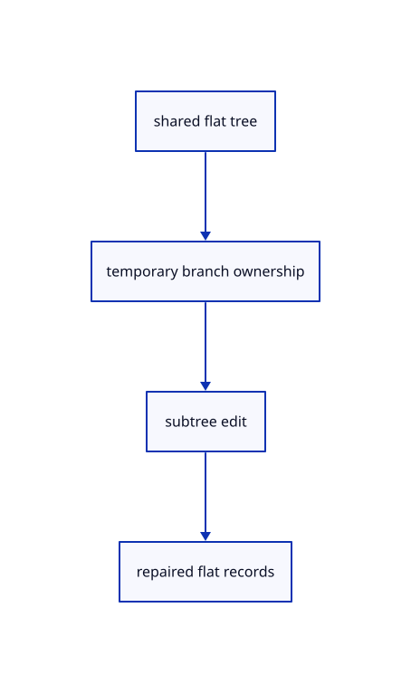

# 8.2.9 · Represent group edits with temporary branches

**Chapter 8 · Hierarchy, layers and direct editing · Section 8.2 · Layers and presentation** · [Contents](contents.md)

**Typing: 13–26 minutes.** [Estimate](typing-load.md).

Convert one immutable flat tree into temporary branches for an edit, then flatten it with repaired parents, depths and subtree endpoints.

## Type

Continue from [Keep tree identities stable across edits and saves](53f-portable.md). [Save or recover your work](recovery.md).

### 1. `src/layer_edit.rs`

Represent atomic subtree edits without owning kernel geometry.

Create the file and type:

```rust
--8<-- "journey/code/53g-branches-01.rs"
```

### 2. `src/lib.rs`

Register the new source component.

<details>
<summary>Locate the existing block</summary>

```rust

pub mod layer_properties;
```

</details>

After that block, type:

```rust
--8<-- "journey/code/53g-branches-02.rs" skip=27
```

## Run and check

In your project:

```sh
cd workspace/journey
REGEN_PROTO=0 cargo build --lib --locked --target wasm32-unknown-unknown -j1
REGEN_PROTO=0 CARGO_BUILD_JOBS=1 trunk serve --port 8780
```

Open `http://127.0.0.1:8780/`. Keep an existing Trunk server running; saving rebuilds it.


### Recorded visual result

**Previous native render — current verification pending.**

The nested frame and selected editable parent remain visible with original source edges.


*This recorded image predates a source or checker change. Rebuild this checkpoint before using it as current evidence; browser controls require separate acceptance.*

This reference image is shared with [8.1.12 · Exercise nested source ownership and exact undo](52k-tree.md). It does not demonstrate a new feature by itself.

<details>
<summary>Code explanation and diagram</summary>


shared flat tree → temporary branch ownership → subtree edit → repaired flat records.



Does making a temporary branch copy source geometry?

No. Branches contain lightweight node metadata and identities. Original source and display allocations remain shared by scene snapshots.

Study estimate, including typing and experiments: 0.5–1 hours.

</details>

<details>
<summary>Optional experiment</summary>

Move a nested branch in the temporary tree and inspect its new parent and depth. Its geometry identity should not change.

</details>

<details>
<summary>Check and save your work</summary>

Restore experimental edits, then run from `session_viewer`:

```sh
npm --prefix ../session_tests run course -- check 8.2.9
npm --prefix ../session_tests run course -- save 8.2.9
```

Source comparison leaves your project untouched. [Save and recovery instructions](recovery.md).

</details>

<details>
<summary>Viewer coverage and verification</summary>

This cumulative subject implements layer editing and independent presentation for the mesh tree and generated geometry lanes already taught. General group placements, display-only streamed documents and later geometry types connect in their own subjects.

The earlier nested-frame acceptance exercise remains; the complete layer control exercise connects at the end of this subject.

[Full validation scope](release.md).

To reproduce the scripted acceptance of the reference checkpoint, run from `session_viewer` with the [course bundle server](release.md#reproduce) running on port 8781:

```sh
npm --prefix ../session_tests run course -- capture 8.2.9
```

This uses the verified reference bundle; it does not check or change your typed project.

</details>
