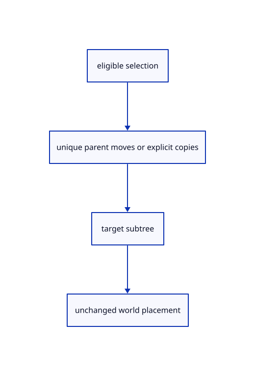

# 8.2.12 · Move and copy objects between layer trees

**Chapter 8 · Hierarchy, layers and direct editing · Section 8.2 · Layers and presentation** · [Contents](contents.md)

**Typing: 30–60 minutes.** [Estimate](typing-load.md).

Move a selected parent with its attached subtree once. Copy each explicitly selected object; preserve world placements and roll back failed document transactions.

## Type

Continue from [Copy row identities while sharing source allocations](53i-copy-records.md). [Save or recover your work](recovery.md).

### 1. `src/layer_edit.rs`

Transfer source-owned branches and copy explicit selections with checked node and depth limits.

<details>
<summary>Locate the existing block</summary>

```rust
    flatten(tree,None,0,&mut document.nodes);scene.forest.replace(owner,document);Rc::make_mut(&mut scene.view).refresh(&scene.forest);
}
```

</details>

After that block, type:

```rust
--8<-- "journey/code/53j-transfers-01.rs" skip=139
```

## Run and check

In your project:

```sh
cd workspace/journey
REGEN_PROTO=0 cargo build --lib --locked --target wasm32-unknown-unknown -j1
REGEN_PROTO=0 CARGO_BUILD_JOBS=1 trunk serve --port 8780
```

Open `http://127.0.0.1:8780/`. Keep an existing Trunk server running; saving rebuilds it.


### Recorded visual result

**Previous native render — current verification pending.**

The nested frame and selected editable parent remain visible with original source edges.


*This recorded image predates a source or checker change. Rebuild this checkpoint before using it as current evidence; browser controls require separate acceptance.*

This reference image is shared with [8.1.12 · Exercise nested source ownership and exact undo](52k-tree.md). It does not demonstrate a new feature by itself.

<details>
<summary>Code explanation and diagram</summary>


eligible selection → unique parent moves or explicit copies → target subtree → unchanged world placement.



Should selecting a parent and child move that child twice?

No. Parent moves carry a deduplicated subtree. Object-layer copying keeps each explicit selected object as a separate new row.

Study estimate, including typing and experiments: 0.5–1 hours.

</details>

<details>
<summary>Optional experiment</summary>

Move a parent between imported documents, save and reopen, then undo. Compare both the parent and attached attribute world matrices exactly.

</details>

<details>
<summary>Check and save your work</summary>

Restore experimental edits, then run from `session_viewer`:

```sh
npm --prefix ../session_tests run course -- check 8.2.12
npm --prefix ../session_tests run course -- save 8.2.12
```

Source comparison leaves your project untouched. [Save and recovery instructions](recovery.md).

</details>

<details>
<summary>Viewer coverage and verification</summary>

This cumulative subject implements layer editing and independent presentation for the mesh tree and generated geometry lanes already taught. General group placements, display-only streamed documents and later geometry types connect in their own subjects.

The earlier nested-frame acceptance exercise remains; the complete layer control exercise connects at the end of this subject.

[Full validation scope](release.md).

To reproduce the scripted acceptance of the reference checkpoint, run from `session_viewer` with the [course bundle server](release.md#reproduce) running on port 8781:

```sh
npm --prefix ../session_tests run course -- capture 8.2.12
```

This uses the verified reference bundle; it does not check or change your typed project.

</details>
